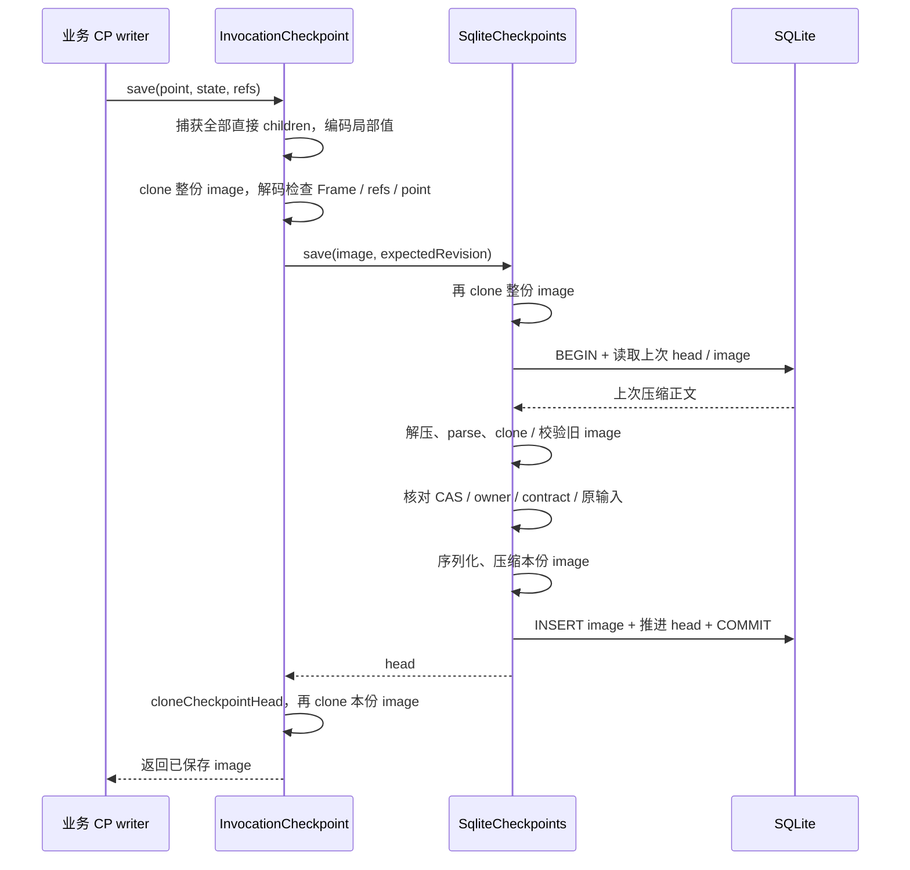

# CP 容量问题调查

> 历史设计／验证记录：下文版本、测量和“下一步”保留当轮语境，不是当前兼容承诺。现行接口见 [Checkpoint](checkpoints.md)、[增量引用选择](checkpoint-selection.md)；旧格式与数据库策略见[开发期兼容](development-compatibility.md)。文档脉络见[导航](README.md)。

2026-11-05。基于此前 200 会话测试，保持现有 CP 生产实现，使用离线模型、CPU 采样、同步边界计时和双端 TCP/HTTP 诊断。没有调整堆限制、连接超时、重试规则或持久提交顺序。

## 结论与范围

存在两层问题：CP 同步处理的计算与存储成本叠加，造成事件循环长时间不处理 I/O；在已复现的失败中，客户端随后复用了被上游超时关闭的连接，导致模型请求未到达上游就收到 `ECONNRESET`。

主要计算热点是重复复制、固定、校验和序列化完整镜像。SQLite 和压缩增加了成本，但将 CP 改放内存后仍然明显阻塞，不能只归因为磁盘。当前证据没有显示 CP 身份、CAS、父子接纳或持久数据遭到破坏；这是容量与响应性问题，需要保留这些正确性边界来优化。

初次调查仅新增 example 诊断工具与文档，没有修改 CP 机制、Frame v5、服务恢复范围或生产持久化实现。此前 AsyncLocalStorage 修复是工作区中已有的改动。随后实施的“完整镜像认证复用与写回执”及对照结果见第 7 节。

环境：Apple M3 Max，16 个逻辑核，64 GiB，Node 22.23.2，自带 undici 6.28.0。所有负载串行运行；每会话独立内容、结构、Runner 和数据库，共享一个实际 ModelProvider。模拟上游在独立进程，回答 1000 ms / 20 片段 / 约 2 KiB，记忆提案 100 ms / 空 changes。未调用真实模型。

## 1. 控制变量后的成本

三组均为 200 会话、每会话一次提交；内容、View、交互都保存在 SQLite，使用相同场景和模型配置。只改变 CP 是否启用、CP Store 实现。内存 CP 保留全部 points、接纳与固定效果流程，仅移除 CP 的 SQL 与压解缩，不提供跨进程恢复。

| CP 配置                | 完成 p95 | 负载期间进程 CPU 时间 | 最大事件循环延迟 | 回答／模型请求    |
| ---------------------- | -------- | --------------------- | ---------------- | ----------------- |
| 关闭 CP                | 1.825 s  | 1.803 s               | 195 ms           | 200／400 全部成功 |
| MemoryCheckpointStore  | 4.738 s  | 5.213 s               | 1394 ms          | 200／400 全部成功 |
| SQLite CheckpointStore | 7.482 s  | 8.567 s               | 2556 ms          | 200／400 全部成功 |

这是带探针的诊断对照，探针本身会增加耗时，不替代之前不带探针的容量成绩。关闭 CP 也改变实体固定凭据路径，不能将第一组与第二组的差额全部叫作 CP 序列化成本；第二组与第三组仍保持同样的 CP-enabled 业务流程。

SQLite CP 组的计时拆分如下。`self` 只扣除已经包裹计时的子步骤，仍包含未单独包裹的后代工作；不是 V8 函数自耗时。

| 测量范围                            | 次数  | 累计时间 | 说明                                      |
| ----------------------------------- | ----- | -------- | ----------------------------------------- |
| writer.save 完整同步路径            | 8400  | 4.781 s  | 含下方 Store.save，不能重复相加           |
| writer.save 扣除 Store 等已测子步骤 | 8400  | 2.089 s  | 捕获、编码、整体检查、返回 head 检查等    |
| Store.save 完整路径                 | 8400  | 2.692 s  | 含自身校验、SQL 和压缩                    |
| Store.save 扣除 SQL／压解缩         | 8400  | 1.346 s  | 仍包含入参和旧 head 检查、JSON 等         |
| Store.finish 完整路径               | 3400  | 0.746 s  | 不包含调用层 finalize 的全部成本          |
| Store.finish 扣除 SQL／压解缩       | 3400  | 0.402 s  | 主要为读取结果解释、校验等                |
| Brotli 压缩                         | 11800 | 0.468 s  | image 与 delivery，质量参数仍为 4         |
| Brotli 解压                         | 8400  | 0.119 s  | 推进／结束时读取上一份 image              |
| SQL COMMIT                          | 15600 | 0.945 s  | 包含内容、初始化和关闭后重载；并非全归 CP |

这一组单次 writer.save 最大约 8.66 ms；内存 CP 组最大约 2.12 ms。但成批完成的模型请求使许多 Promise 后续处理连续就绪，随后执行大量同步 CP。单点耗时虽不长，整批会阻止事件循环处理网络 I/O 达秒级。`await` 已完成 Promise 并不保证先处理一次 I/O。

另一次 200 会话、两轮的 CPU profile 中，`cloneCheckpointValue` 与其递归 `visit` 的采样自耗时合计约 5.84 s；同步 zlib `processChunkSync` 约 0.92 s。这是整个诊断进程的采样，包含装配与收尾，不能直接作为上述单轮表的分项相加。

## 2. 一次保存实际经过哪些边界



主要代码：

- [调用层保存与完成](../server/invocation/src/checkpoint/invocation.ts)：writer 捕获、认证、保存和返回检查；finalize 保存终态。
- [子关系捕获](../server/invocation/src/checkpoint/children.ts)：每次遍历全部直接关系，编码 input／returned／reception／progress。
- [CP 值与镜像校验](../server/checkpoint/src/value.ts)：属性描述符检查、递归构造与冻结，随后整份 JSON.stringify 核对字节上限。
- [服务 codec](../services/conversation/src/recovery/codecs.ts)：encode 已执行 schema.parse 与 cloneCheckpointValue；外层捕获仍会继续 clone。
- [SQLite CP Store](../services/conversation/src/persistence/checkpoints.ts)：每次 save／finish 都读取并完整解释旧 head。
- [存储编码](../services/conversation/src/persistence/checkpoint-storage.ts)：同步 JSON、Brotli、Base64；属于 SQLite 表达，不是 Frame 新契约。
- [同步事务](../services/conversation/src/persistence/store.ts)：持久成功后才返回，不存在后台完成承诺。

正常 image 至少经过：捕获整体 clone、Store 入参 clone、返回 head clone、下一次 save 或 finish 读回 clone。最后一份还会在 finish 返回 head 时再 clone。服务 codec 与各 child 字段的 clone 在这些整份遍历之外。字符串不一定每次产生独立副本，但对象遍历、构造及 JSON 编码仍然重复。

finish 没有新 image，也要完整解压、校验最后一份 image，返回后再复制它。这是值得单独收敛的消费路径。

## 3. 镜像为什么多、为什么大

正常默认链每次成功提交有 **42 次 save、17 次 finish，共 59 个独立 CP 事务**。这是不同声明、等待、接纳及落实边界的累计，不是同一个点被错误循环保存。200 次提交即 8400 份 image、3400 次终态写入。

只读抽样此前成功记录组的一个会话库，两次提交共 84 份 image、34 个 head：

| 内容       | 累计原始 JSON 字节 | 占完整 image 比例 |
| ---------- | -----------------: | ----------------: |
| 全部 image |          1,020,990 |              100% |
| Frame      |            919,586 |            约 90% |
| 业务 state |             77,340 |           约 7.6% |

同一份 image 内还存在按值相同的不同语义位置：

- 84/84 的 `input` 与 `currentInput` 相同，两处分别累计 182,356 字节。
- child 的 `progress.currentInput` 等于 child.input 的重复值累计 156,074 字节。
- accepted reception.output 等于 returned.output 的重复值累计 40,420 字节。

这些统计重叠于 Frame 内部，不可与 Frame 总量相加。它们在当前场景相同，不代表契约可以把它们永久视为同一个字段：输入可在不同处理轮变化，接纳也可以变换结果。

此前 1200 提交的持续 CP 组产生 50,400 份 image，原始 image JSON 累计约 930 MiB。历史材料不断增长，又作为完整输入进入多个调用与多个镜像，这是量级增大的来源之一。压缩降低落盘量，无法消除压缩之前的重复遍历、对象构造和编码。

## 4. 连接失败的确切因果链

双端网络诊断复现了 198 个失败，**198/198 都各自复用了已被上游超时关闭的 TCP 连接**。不是上游返回错误、请求 schema 被拒绝或调用 signal 取消。客户端记录发送后读到 `ECONNRESET`，服务器没有接到这些新请求。

同一连接的样例，相对探针首条记录：

| 时点     | 观察到的事实                                       |
| -------- | -------------------------------------------------- |
| 6.266 s  | 上游完成第一轮记忆响应                             |
| 8.355 s  | 客户端才处理该响应的 headers／complete             |
| 12.267 s | 上游闲置约 6 秒，触发 timeout 并关闭该连接         |
| 14.113 s | 客户端仍认为连接可用，在同一连接发送第二轮记忆请求 |
| 14.128 s | 客户端收到 read ECONNRESET                         |

全部失败发送时，上游连接已关闭约 1.846–1.852 秒。其间客户端有 11.188–14.105 秒、约 2.917 秒的事件循环停顿；同一次运行还观察到更长的批次停顿。

本机 Node 的服务端参数为 keepAliveTimeout 5000 ms 加 buffer 1000 ms。undici 有自己的闲置清理及复用前检查；不能称它完全不做检查。同步批次延迟了响应处理、检查和 I/O 消费，已有保护在这条实际时序中没能避免失效连接复用。内部 idle timer 具体何时登记、执行尚未逐个采样；不要进一步臆断所有定时器竞争细节。

保持两轮、200 会话以及相同上游超时，只将 CP Store 换成内存的对照中，400 次回答／800 次模型请求全部成功，未发生失效连接复用，最大事件循环停顿仍约 1.845 秒。它说明降低同步工作能改变这条失效时序，但也说明换内存没有解决全部响应性成本，更没有提供耐久性。

此前一次记录组更慢却没有连接失败同样可解释：连接复用、响应处理与闲置关闭的相对时间发生变化，失败数不与总耗时单调对应。不得用单次没有 reset 证明长停顿无害。

## 5. 应怎样推进

首先处理实现层的重复工作，不改变恢复语义：

1. **明确已认证不可变 CP 值的内部复用边界。** 入站不可信值继续完整检查；同一进程中已经通过该包认证、深度固定的值，考虑避免多次 clone 和预算重算。不能仅用 Object.isFrozen 或 TypeScript 类型当作认证，也不能全局跳过 Store 返回值检查。已认证子值不替代组合后镜像的整体字节上限、节点数、深度、结构和 refs 核验。
2. **梳理 Store 对当前 head 的消费。** save/finish 需要 CAS 和固定依据，并不天然要求每次都把已确认旧 image 完整解压一遍。是否复用 head 必须明确独占写入、缓存失效、外部读取与损坏检查，不以无界缓存或隐藏数据损坏换速度。
3. **复用固定 SQL 语句。** 属于局部实现优化；本次数据表明它不是第一大项。
4. **再验证 I/O 交接的响应性。** 同步总量减少后仍需重跑相同两轮突发；若仍有长批次，研究已有异步交接边界如何让出 I/O，保留取消、活动窗口和已提交顺序。不要仅在 Provider 中加重试，网络失败时不能普遍证明外部未执行。

Frame 去重／增量存储、减少业务 CP 点、异步 Store／后台提交属于另外的契约与存储设计议题。删掉等待或接纳点会缩减恢复保证；save 返回前尚未持久化则改变其承诺。不能把这些作为无语义变化的性能修补。本轮也不建议先关 CP、调高超时或提升压缩参数来宣称解决。

验收除相同负载时延与内存外，仍须验证：完整 refs/父子关系、外来值拒绝、CAS 冲突、终态不可推进、损坏持久数据拒绝、接纳和固定效果恢复、以及公开 Store 返回异常值的边界。

## 6. 诊断工具与材料

原始材料保存在本机、Git 忽略的 `.capix/cp-investigation-20261105/`：

- `comparison.json`：控制变量实验的摘要。
- `sqlite-content-{no-cp,memory-cp,sqlite-cp}/`：单轮对照的完整结果与 cost.json。
- `cpu-network-200/`：两轮 SQLite CP、CPU profile、双端网络事件及 network-analysis-reviewed.json。
- `memory-cp-network-200/`：相同两轮的内存 CP 对照及网络统计。

公开 example 诊断入口：

```sh
# CASE_DIRECTORY 必须先保存有效 config.json；所有输出必须是新文件。
CAPIX_CAPACITY_COST=CASE_DIRECTORY/cost.json \
node --expose-gc --import ./examples/capacity/diagnostics/cost.mjs \
  examples/capacity/worker.mjs CASE_DIRECTORY

# 仅诊断对照：另加 CAPIX_CP_STORE=memory，内容/交互仍用 SQLite。
# 这会移除 CP 持久性，不是生产配置建议。

node --expose-gc --cpu-prof --cpu-prof-dir=CASE_DIRECTORY \
  --import ./examples/capacity/diagnostics/network.mjs \
  examples/capacity/worker.mjs CASE_DIRECTORY
node examples/capacity/diagnostics/analyze-network.mjs CASE_DIRECTORY

node examples/capacity/diagnostics/analyze-frames.mjs CLOSED_EXPERIMENT_DB NEW_OUTPUT_FILE
```

cost 只统计同步区间，inclusive 不能累加，self 仍含未包裹的后代步骤；SQL 总量包含装配和重载，不把它全部归 CP。network 只允许离线 capacity worker/upstream，记录连接与请求位置，不记录正文、URL、凭据，响应头仅 Connection／Keep-Alive 白名单。分析按两端端口与时序匹配，拒绝已经溢出的事件记录。frames 只读关闭的实验数据库，拒绝非空 WAL，只输出大小与重复程度，不输出对话内容。

探针会改变时序，所有数字只用于本次诊断。结论由原始无探针复现、带探针连接证据、源码边界与 Store 对照共同支持，不宣称已完成生产容量认证。

## 7. 第一种流程的实现与效果

2026-11-05 实施“同一完整镜像认证复用 + 读取与写入确认分开”：

- checkpoint 包以私有 WeakMap 识别本包已经认证的准确 Image/Delivery 对象，后续边界不重复深拷贝；外来值、反序列化值和重新组合的镜像继续完整检查。未复用构件统计或业务 codec 结果。
- save/finish 返回独立回执，以 contextId、checkpointId、准确下一修订及固定 JSON 的 SHA-256 关联本次请求；finish 另核对终态。摘要在首次认证已有的 JSON 上计算，缓存只保存摘要。
- Invocation 正常保存只保留修订和镜像 ID；恢复仍取得完整 Head。保存入口固定基线并拒绝重入，captured 通知后再检查本地资格。Store 抛错或回执拒绝意味着提交结果未知，本调用不再自动提交失败终态。
- 同时补齐父字段编码后的即时固定，防止 codec 复用可变临时对象；这是保留捕获准确性的额外成本，不用延迟固定换性能。
- 两个 SQLite Store 的旧 head 完整读回、CAS/固定依据/终态检查、事务数量、压缩位置与同步持久承诺均保留。Frame v5、SQLite 格式及业务恢复资格不变。

在修改前、修改后各串行运行两次原 `checkpoint-burst-200`：每次 200 独立会话、每会话 2 次提交，真实本地 HTTP 模型，每次 400 回答 + 400 记忆请求。未加载成本或网络探针，未调用真实模型；四次均使用新目录/新数据库/新进程。比较表使用两次测量的均值，p95 列是两个 p95 的均值，不是合并样本的分位数。

| 指标              |    修改前 | 第一种流程 |  下降 |
| ----------------- | --------: | ---------: | ----: |
| 完成 p95          |   7.578 s |    6.243 s | 17.6% |
| 负载期间 CPU 时间 |  15.745 s |   12.888 s | 18.1% |
| 最大事件循环停顿  |   4.013 s |    3.151 s | 21.5% |
| 进程峰值 RSS      | 513.8 MiB |  445.2 MiB | 13.3% |

四次均成功返回 400 份回答、200/200 数据库关闭后重载核对通过、活动残留为零；但四次都仍有 **198 次记忆请求 NETWORK 失败**，因此容量用例仍判失败。业务策略接收记忆提案异常不等于模型请求健康。此次没有重新采集双端网络轨迹，不将这四次的每个失败逐一声称为重新证明了第 4 节的连接时序。

两次修改后 p95 分别为 6.292/6.195 s，最大停顿为 3.169/3.133 s。结果支持保留第一种优化，但它尚未解决突发负载下的事件循环饥饿；不能据此宣称已经支持健康的 200 用户服务。下一步仍需分别评估构件重复处理和旧 head 的消费成本，当前未进入第二种流程。

全仓 `pnpm check` 通过构建、类型检查、2763 项测试和格式检查；新增认证、回执、重入、取消、临时对象编码与未知提交不重写的定向测试。既有跨进程恢复、固定效果和终态回归保持。

对照材料：`.capix/cp-single-pass-20261105/comparison.json`，原始结果分别在 `before-1`、`before-2`、`after-1`、`after-2`。目录包含本地实验数据，未纳入 Git。

## 8. 宿主发送前让出执行权

2026-11-05 在新服务宿主增加 `createYieldingFetch`，通过 Provider 既有 fetch 配置接入：每次派发前 `await setImmediate()`，前后核对同一个有效 signal。底层 fetch 和 init 顶层字段固定；不增加重试、不改变总超时、不全局替换 fetch。它是 Node 宿主的交接策略，通用 Provider 默认行为保持原样，也不是“全部 FIN 已经消费”的保证。

使用 `node examples/capacity/transport.mjs --out .capix/transport-compare-20261105-native-tools` 串行运行 direct/yield 各两次。每组独立进程与数据库，200 会话 × 2 次提交，800 次本地 HTTP 模型请求；沿用第 7 节后的 CP 实现。机器为 Apple M3 Max、16 核、64 GiB，Node 22.23.2；测试期间没有并行编译或其他测试。未调用真实模型，未加载 CPU/网络诊断探针。

| 组别     | 模型请求失败 | 负载 CPU | 完成 p95 | 最大事件循环停顿 | 用例合格 |
| -------- | -----------: | -------: | -------: | ---------------: | -------- |
| direct-1 |    198 / 800 | 12.627 s |  6.134 s |          3.089 s | 否       |
| yield-1  |      0 / 800 | 12.998 s |  6.319 s |          3.062 s | 是       |
| direct-2 |    198 / 800 | 12.816 s |  6.291 s |          3.152 s | 否       |
| yield-2  |      0 / 800 | 12.983 s |  6.462 s |          3.106 s | 是       |

四组均完成 200/200 数据库重载核对，Runner、Interaction、模型调用、上游请求与占用残留均为零。direct 的业务策略接收了记忆提案失败，因此能够交付回答，但容量检查仍判失败；它少完成了部分维护工作，不能把略低的 CPU/p95 解释为性能更好。比较脚本因 direct 失败返回非零，yield 两组各自均通过。

结果支持发送前交接的修复，**没有证明同步 CP 成本或事件循环长停顿已经解决**。本次没有重新记录双端网络轨迹，不能声称逐一重证了全部失败的 TCP 时序，也不代表一台机器在任意真实模型、历史长度或负载下都支持 200 用户。后续 CP 计算优化仍需单独评估。

原始材料保存在 `.capix/transport-compare-20261105-native-tools/{environment,summary}.json` 与四个组目录，未纳入 Git。脚本与回归测试覆盖传输策略选择、原取消原因、让出期间超时、Request.signal 覆盖及 init 信号替换边界。
