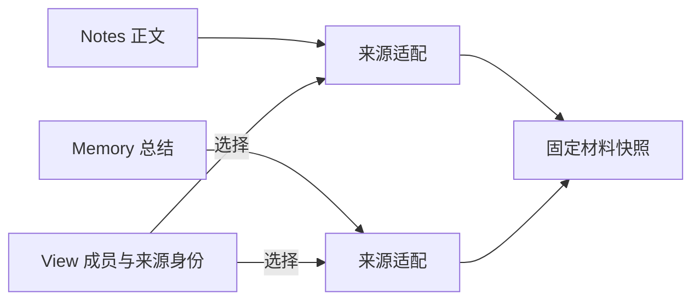

# 实体：让内容拥有自己的规则

实体持有有身份的内容，以及读取、更新和版本规则。便签、对话、总结或计划可以有完全不同的数据形状；作者先决定业务对象的规则，再选择它需要开放哪些能力。CAPiX 不要求业务对象继承统一基类。

## 便签就是普通业务对象

Notes 保存一组只能追加的便签。每张便签有自己的身份，集合在追加成功后推进版本；read 返回已固定的材料。整个对象不需要知道哪个模型或节点正在使用它。

<<< ../../examples/entities/domain.mjs#notes{js:line-numbers}

固定材料让读者持有的旧值不随后续追加改变。这里的固定并不意味着保存了可随时查询的历史，也不意味着数据落盘。示例只使用内存；真正持久化时，业务需要另行定义保存和确认规则。

实体的能力按需要组合：有些对象只读，有些按预期版本更新，有些能提供变化通知或固定写入凭据。拥有身份不自动获得所有能力。框架提供的 Transcript 管理正式消息，Memory 管理总结内容；普通便签可以继续使用自己的标题和正文，无需借用消息角色或总结格式。

## View 选择要使用的材料

当材料变多，可以用 View 管理本次想看哪些来源和条目。View 长期持有来源身份与成员关系，正文仍由来源实体持有。来源适配告诉 View 如何列举、检查和读取材料；每次目录与快照返回各自的版本读取依据，捕获时据此核验，避免把不同版本误当作同一份材料。

新建一张便签不会自动把它纳入已有 View；退出 View 也不会删除便签。总结可以作为另一种材料加入，是否替换旧成员由业务策略决定。这样，内容保存与上下文选择各自保持清楚的责任。

## 内容落实与调用结束

实体可以跨多次调用存在，由宿主管理寿命。资源开放它的操作，调用使用操作，View 组织读取范围。这些对象不替实体决定更新是否成立。若内容已经提交，后续通知或调用交付失败不能撤销这个事实；重做写入需要实体自己的凭据与规则。

便签助手直接读取指定便签，没有安装 View。需要筛选更多材料时，可沿[实体教程](../guide/notes-entities.md)理解当前对象，再看[自定义实体](../custom-entities.md)和 [View 参考](../view-package.md)中的组合示例。
