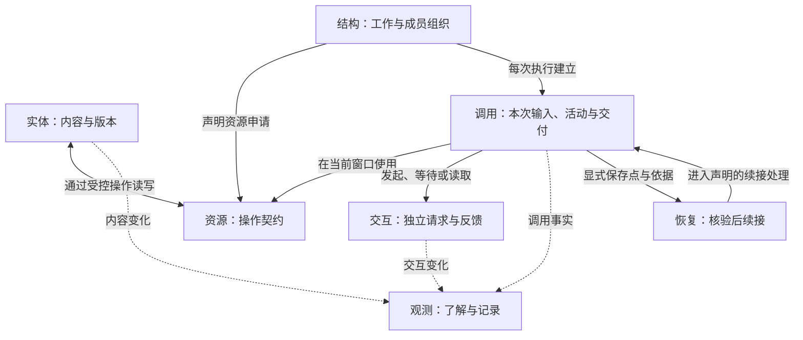

# 从七个维度理解 Agent

一个便签助手要读两张便签、整理待办、追加新便签，再告诉用户结果。CAPiX 把这件事拆成可以分别设计的职责：内容由谁保存，允许做哪些操作，工作怎样组合，每次怎样执行，外部请求怎样等待，以及如何看见和恢复执行。

这七个维度协作，但没有共同的生命周期。便签可以跨多次调用存在；结构可以反复运行；一次模型请求也可能在等待它的调用结束后才收到反馈。

图中的箭头表示使用或事实流向，不表示对象继承、统一所有权或同一次事务。资源访问通过调用窗口受控；实体和交互的寿命则由各自宿主管理。

## 围绕便签助手阅读

| 维度                    | 作者先回答的问题                   | 在便签助手中的落点                  |
| ----------------------- | ---------------------------------- | ----------------------------------- |
| [资源](resources.md)    | 这段工作需要哪些操作？             | 分开的读取与追加契约                |
| [实体](entities.md)     | 什么内容值得独立保存，如何更新？   | Notes 持有便签、身份与集合版本      |
| [结构](structure.md)    | 哪些步骤可以独立组织与组合？       | Scene 包含 Tool，Tool 登记两个 Node |
| [调用](invocation.md)   | 本次输入怎样成为可靠结果？         | 一次请求及其中的模型、工具调用      |
| [交互](interactions.md) | 请求发出以后，谁持有它？           | 独立模型请求及最终反馈              |
| [观测](observation.md)  | 要展示答案、查看过程还是保存记录？ | 宿主日志与最终回答；可另外安装观测  |
| [恢复](recovery.md)     | 中断后凭什么继续？                 | 教程未安装 CP；扩展时显式设计恢复点 |

这些问题可以单独回答。例如，只需要控制业务对象的访问时，可以先设计实体与资源；需要组合多个动作时再建立结构。记录和恢复也各有入口，不要求先搭建一套监控或持久化平台。

## 先运行，或先理解

希望边写边学，从[开始使用](../guide/getting-started.md)运行离线便签助手，再跟随[实体](../guide/notes-entities.md)、[资源](../guide/notes-resources.md)、[节点](../guide/notes-nodes.md)、[模型](../guide/notes-model.md)、[运行](../guide/notes-running.md)、[失败](../guide/notes-failures.md)与[扩展](../guide/notes-extend.md)教程。离线模式使用固定决策脚本；真实模型需要显式配置。

希望先理解设计，可以按上表独立阅读。各页先说明自身职责，再回到助手中的协作；需要精确端口、格式和限制时，沿页面末尾进入契约参考。教程中的便签只在内存中，日志也没有自动变成正式记录；理解这些落点后，才有依据决定自己的应用需要增加什么。
