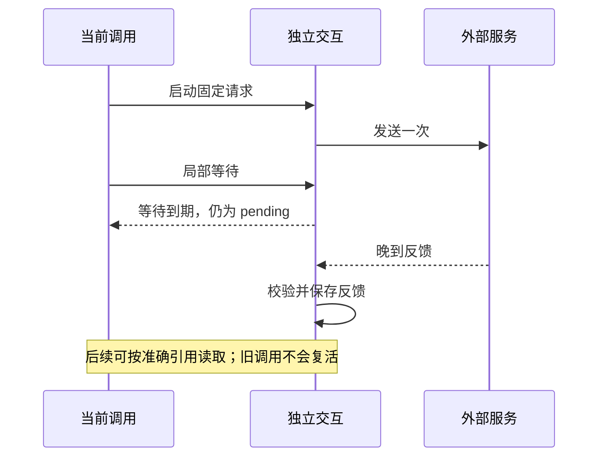

# 交互：请求发出后独立存在

Interaction 保存一笔固定请求和它的外部反馈。它适合模型请求等不能由本地调用窗口完全控制的工作：调用可以发起、等待或读取反馈，发送本身由独立交互持有。

这让作者能分别回答两个问题：“这次调用还要等多久？”和“外部请求是否已经完成？”等待结束并不自动回答第二个问题。

## 契约、发送与读取

宿主登记请求和反馈契约，再提供发送函数。bind 得到对应通道；启动时固定请求、保存必要登记，然后只调用一次发送者。反馈回来后要经过校验和必要保存，才可作为收到的反馈交付。读取是非破坏性的，多个读者可以读取同一反馈。

便签助手把模型协议接到 provider.complete，Tool 使用绑定通道组织模型交换。登记和 build 都不会提前发送模型请求。默认离线 Provider 返回固定决策，真实 Provider 则访问外部模型；两者使用相同的结构与操作边界。

## 等待者与发送者各有寿命

waitMs 限制本次等待，signal 也只终止当前等待者。取消调用不会取消独立发送。发送者自己的超时由宿主适配决定；不能把等待到期解释成从未发送并自动再发一次。

需要关闭应用时，宿主先停止接收新工作，再等待自己持有的交互 settled，最后 close。便签 CLI 的 finally 就执行这一收尾。单次调用退出不代替宿主完成这项责任。

## 反馈、过程与恢复

交互可以提供可选的有界过程反馈。片段用于预览，读完流只说明生产结束；最终反馈仍需校验与保存。读者离开不终止发送，读取游标也不是业务接纳凭据。

若宿主安装持久端口，新进程可按准确引用读取已保存反馈。只有发送登记而缺少反馈时，系统明确表达不确定状态；不会猜测远端失败、重发请求或恢复旧调用。进程内的一次发送约束也不承诺远端恰好执行一次。

助手当前没有持久保存交互。沿[模型教程](../guide/notes-model.md)理解接线，在[失败教程](../guide/notes-failures.md)判断等待与错误；具体状态、预算和持久边界见[交互参考](../interactions.md)。
