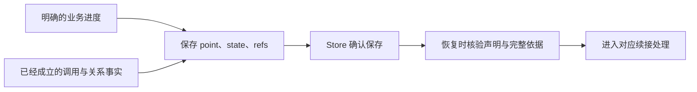

# 恢复：凭明确依据继续工作

Checkpoint（CP）让作者声明“到了这里，保存哪些依据，就可以从哪个处理入口继续”。它适用于需要跨中断续接的工作；作者必须知道续接的业务含义，并能证明继续所需的材料完整。

CP 保存正式调用事实和显式业务状态，不保存 JavaScript 栈、临时变量或闭包。恢复进入作者声明的处理，而非从中断的那一行代码自动往下走。

## 一个恢复点需要什么

作者为结构声明 checkpoint 契约、版本和 point，提供状态编码、核验与续接处理。运行中通过 work.checkpoint 保存所选 point、完整 state 和 refs。state 表达本次业务进度；refs 表达作者选择在该点使用的子调用角色，不能由值相等或已有接纳关系自动推导。

Store 的准确保存回执说明恢复依据已被接纳；内存 Store 的确认不等于跨进程落盘。真正跨进程恢复需要宿主提供持久介质，并重新核验声明、编码值、关系和所选引用。

## 为什么要显式选择

假设助手已读完两张便签，接下来要决定是否追加待办。恢复时需要知道哪些读取结果已成立、是否已发出模型请求、是否已完成写入与父层接纳。只保存“处理到第三步”不足以证明这些事实。

不同边界需要不同依据：模型反馈属于交互，便签写入属于实体，子返回与父接纳属于调用关系。CP 消费相同的正式调用依据，不通过重新运行旧代码推测过去。检查发现材料缺失或不兼容时应拒绝继续；失败终态也不会因为加载 CP 而复活。

## 恢复并不承诺重做安全

实体已经写入、父 CP 尚未保存时发生中断，不能只凭旧 CP 重做写入。安全续接需要实体明确的固定确认、版本规则或其他可核验凭据。CP 本身不提供任意资源幂等、跨实体事务、外部效果回滚，也不补造缺失的交互反馈。

state 每次按完整内容编码；refs 可使用增量选择减少重复提交，但选择仍保留真实角色、顺序和出现项。优化保存成本不会放宽恢复资格。

## 回到便签助手

当前教程的 Notes、交互与执行都在内存中，没有安装 CP 或正式 Recorder。不能把重新运行脚本称为恢复；新增便签也没有自动防重做承诺。需要这项能力时，先设计实体和交互的持久依据，再为可证明的业务边界定义恢复点。

从[扩展教程](../guide/notes-extend.md)判断需求，具体声明、Frame 与 Store 契约见 [Checkpoint 参考](../checkpoints.md)，较长工作中的引用管理见[增量选择](../checkpoint-selection.md)。
