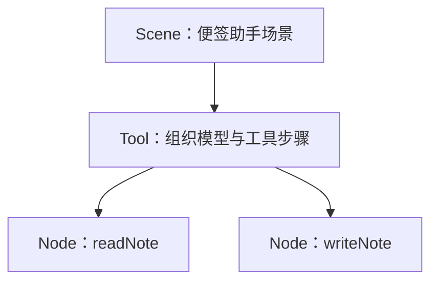

# 结构：组织可重复执行的工作

结构说明一项工作怎样处理输入、可以使用哪些成员和资源。它保存可复用的配置，不保存某次执行的输入、进度或端点。作者因此可以先建立稳定的工作组织，再让不同调用分别执行它。

## 从一个动作到整体场景

Node 表达直接处理：读一张便签、追加一张便签。Group 登记成员并组织自己的整体处理，可以顺序执行、选择分支或组织并行。Scene 面向宿主表达完整场景，也有自己的整体输入和输出。登记成员只是声明可调用范围，执行顺序由 run 中的业务逻辑决定。

助手的两个 Node 很小，因为内容规则已经放在实体中，访问方式已经放在资源中：

<<< ../../examples/notes/assistant.mjs#nodes{js:line-numbers}

Tool 是普通 Group 的预设。它把已登记工具及模型交换组织成工作过程：向模型提供目录，检查模型提出的选择，调用对应成员，再处理结果。工具目录描述可选项，实际执行仍要核验成员、输入和资源资格。

这是成员关系图，不是一次执行的时间线。同一个 readNote 可以在一次任务中被调用多次，每次都有独立调用；模型也不需要按图中的排列顺序选择工具。

## 构建之后，配置固定

宿主用 Runner 组合 Scene、资源与可选交互，然后 build。构建检查整棵树的成员、申请和契约，固定配置与接线；此时没有执行节点，也没有创建本次调用或捕获按次材料。

每个结构实例在树中占据唯一位置，不能把同一个 Node 挂在两个父结构下。复用时可共享处理函数、声明方式和独立资源，再创建相应结构实例。这样，每次调用的父子关系、访问范围和恢复声明都有明确位置。构建后需要另一种组织方式，应创建新结构；实体仍可由宿主继续复用。

## 把按次状态留在调用里

run 取得的 Work 提供当前输入、资源和成员操作。不要把 Work、当前结果或资源端点存到结构字段供下次使用；它们属于本次窗口。跨调用的业务内容应放到独立实体，一次执行中的临时变量则放在本次处理过程。

回到助手，Scene 委托 Tool，Tool 组合模型与两个便签动作，Notes 独立存在。沿[节点教程](../guide/notes-nodes.md)动手组合，再用[可调用结构参考](../callable-structures.md)查成员调用、声明与构建的具体写法。
