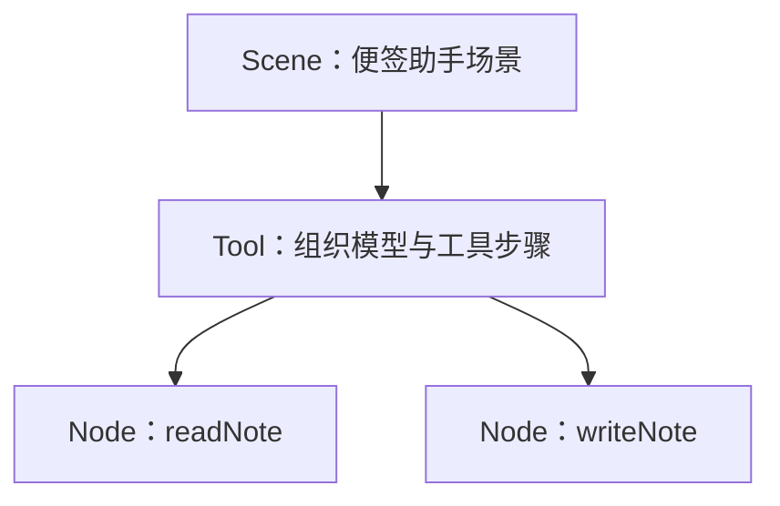

# 结构：组织可重复执行的工作

结构说明一项工作怎样处理输入、可以使用哪些成员和资源。它保存可复用的配置，不保存某次执行的输入、进度或端点。作者因此可以先建立稳定的工作组织，再让不同调用分别执行它。

## 从一个动作到整体场景

Node 表达直接处理：读一张便签、追加一张便签。Group 登记成员并组织自己的整体处理，可以顺序执行、选择分支或组织并行。Scene 面向宿主表达完整场景，也有自己的整体输入和输出。登记成员只是声明可调用范围，执行顺序由 run 中的业务逻辑决定。

助手的两个 Node 很小，因为内容规则已经放在实体中，访问方式已经放在资源中：

<<< ../../examples/notes/assistant.mjs#nodes{js:line-numbers}

Tool 是普通 Group 的预设。它把已登记工具及模型交换组织成工作过程：向模型提供目录，检查模型提出的选择，调用对应成员，再处理结果。工具目录描述可选项，实际执行仍要核验成员、输入和资源资格。

从 Tool 指向两个 Node 的边表示它登记的可选成员。同一个 readNote 可以在一次任务中被调用多次，每次都有独立调用。实际顺序取决于这次任务中的模型提议和工具反馈。

## 推进与交付的责任边界

选 Group 时可以把两个问题分开。**结构边界**说明有哪些可调用成员、各自申请哪些资源。实际可用的操作还取决于宿主的供给和本次调用窗口。**责任边界**决定谁根据已有结果选择下一步、何时可以结束，以及外层凭什么继续工作。Sequence、Dynamic 和 Tool 都沿用普通 Group 的成员调用与结果接纳机制，各自约定了不同的推进和交付方式。

| 写法       | 谁选择下一步                                                                                                        | 成功时交付给父层的值                                  |
| ---------- | ------------------------------------------------------------------------------------------------------------------- | ----------------------------------------------------- |
| 普通 Group | 作者在 `run` 中取得子结果，就地判断是否调用另一成员，也可以安排并行工作                                             | `run` 返回的业务结果                                  |
| Sequence   | 作者预先给出步骤顺序。默认把上一步已接纳的结果传给下一步                                                            | 末步已接纳的结果。空序列返回本次固定输入              |
| Dynamic    | 每轮由登记的决策成员 `decide` 选择一个候选，或决定结束。它每轮收到本次 Dynamic 的原始输入，需要的新事实通过资源读取 | 决策成员返回 `{ kind: 'finish', value }` 中的 `value` |
| Tool       | 模型从登记的工具中提出调用，Tool 校验并执行成员，把配对反馈交回模型继续判断                                         | 模型这一轮完成、没有工具调用时给出的非空最终文本      |

例如，便签助手的 `writeNote` 节点交回带 ID 的新便签，Tool 将它映射成模型能读取的反馈，用户最后看到的是模型写的答复。如果另一个节点必须消费这个 ID，可以把两个节点登记在同一个父 Group 下，由它接纳写入结果并交给下一步。模型仍然可以负责起草便签正文。[便签的写入与反馈](../guide/notes-nodes.md) · [设计随笔《工具循环应该在哪里结束？》](../essays/tool-loop-boundaries.md)

模型也可以参与 Dynamic 的选路。作者在决策成员中校验模型提议，结合业务状态决定是否返回 `call` 或 `finish`。当一段调查需要模型连续选工具并给出解释时，可以把 Tool 作为外层 Group 的成员。在并行审阅示例中，各模块的审阅调用自行查阅获准的材料，协调 Group 等待发现交回后再发起复核。[Sequence 与 Dynamic 的运行示例](../examples/structure.md) · [多 Agent 并行协作](../scenarios/multi-agent.md)

选用哪种 Group，与这一轮要读哪些材料，是两个独立的决定。作者可以用 View 选择供节点读取的便签。模型要承接上一轮工具调用时，ModelExchanges 则按固定起点、回复和配对反馈重建请求。[选材与模型续轮](../native-tool-integration.md#固定起点与交换实体)

## 构建之后，配置固定

宿主用 Runner 组合 Scene、资源与可选交互，然后 build。构建检查整棵树的成员、申请和契约，固定配置与接线；此时没有执行节点，也没有创建本次调用或捕获按次材料。

每个结构实例在树中占据唯一位置，不能把同一个 Node 挂在两个父结构下。复用时可共享处理函数、声明方式和独立资源，再创建相应结构实例。这样，每次调用的父子关系、访问范围和恢复声明都有明确位置。构建后需要另一种组织方式，应创建新结构；实体仍可由宿主继续复用。

## 把按次状态留在调用里

run 取得的 Work 提供当前输入、资源和成员操作。不要把 Work、当前结果或资源端点存到结构字段供下次使用；它们属于本次窗口。跨调用的业务内容应放到独立实体，一次执行中的临时变量则放在本次处理过程。

回到助手，Scene 委托 Tool，Tool 组合模型与两个便签动作，Notes 独立存在。沿[节点教程](../guide/notes-nodes.md)动手组合，再用[可调用结构参考](../callable-structures.md)查成员调用、声明与构建的具体写法。
