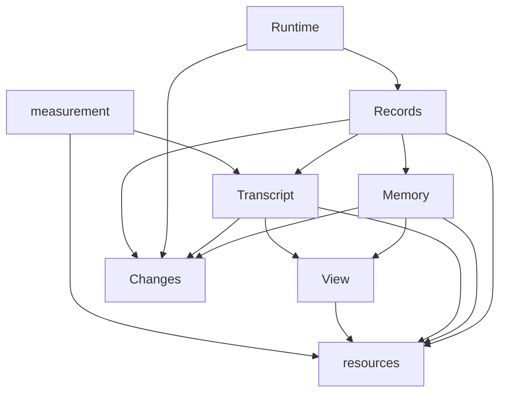

# 内容实体与独立包

实体承载持续累积的信息，资源开放受控操作，View 组织本次材料。共享包维护对象不变量，宿主负责业务组合、持久介质与策略。包边界不为每个值增加生命周期。

Memory 内容、资源、View 与默认记录投影见 [记忆](memory.md)。框架 protocol 只提供 Transcript wire；Memory 展示投影由宿主定义。消息、记录与调用进度类型分别归领域包。

[自定义实体](custom-entities.md)提供当前作者入口：普通业务对象用可选 `createViewSource` 接入相同 View／资源／调用链，CP 和记录分别装配。实体按固定读取、版本核验、条件更新等能力契约组合。现有 `stableValue` 与 `createViewSource` 已复用数据固定和读取约束；版本推进、条件更新及持久确认仍由各实体实现，进一步降低更新代码重复的复用能力尚需设计，当前没有 Entity 基类或通用版本容器。Memory 是压缩总结预设，提取与压缩策略由上层组合。

## 对象与包

| 对象或能力                           | 入口与归属                        | 负责什么                                                          | 不承担什么                                   |
| ------------------------------------ | --------------------------------- | ----------------------------------------------------------------- | -------------------------------------------- |
| `Message`                            | `@weiliang0121/capix-transcript`  | 正式消息的 `role/content` 领域值                                  | 不是独立可变实体，没有单独消息生命周期       |
| `Transcript`                         | `@weiliang0121/capix-transcript`  | 正式消息集合、稳定索引、分段、修订与固定追加凭据                  | 不执行模型或管理调用                         |
| `MemoryItem` / `Memories<Metadata>`  | `@weiliang0121/capix-memory`      | 固定单项身份与 content/metadata；集合统一接纳批次、顺序与固定写入 | 不决定应提取什么记忆                         |
| `View`                               | `@weiliang0121/capix-view`        | 来源契约、成员状态、目录与固定读取、依据核验                      | 不拥有正文，不决定业务保留策略               |
| `MessageUsage`                       | `@weiliang0121/capix-measurement` | 按准确消息对象累计本环境的材料使用次数                            | 不持久化，不进入模型输入，不决定选择策略     |
| `Recorder` / `RecordBook` / 记录载体 | `@weiliang0121/capix-records`     | 正式登记、记录树、正文快照、历史读取与普通资源访问                | 不持有调用，不决定内容或业务结果，不恢复执行 |
| 事实捕获与被动通知                   | `@weiliang0121/capix-changes`     | 捕获、缓冲、转交、发布、进度消费者故障隔离                        | 不拥有实体，不解释业务事实，不自动重做工作   |

`Memories<Metadata>` 是记忆的唯一写拥有者；`MemoryItem` 是 `{id,value}` 固定值，没有第二个可变单项实体。集合不持有 Transcript，不要求 topic 或来源，业务可用 metadata 表达自有字段。

共享实体包不反向依赖 Runtime、结构或服务实现。宿主通过公开出口组合机制。

`view` 提供通用来源与成员机制；TranscriptViewSource、MemoryViewSource 分别由实体包实现。自动纳入与维护规则由宿主策略定义。`measurement` 当前只提供 MessageUsage，不是通用测量平台。通用 View 的操作边界见 [View 包](view-package.md)。



图只展开内容和记录协作关系；共享实体、measurement 与 records 不依赖 protocol；共同契约与诊断由各自公开包提供。measurement 的 Message 来自 transcript 公开类型，WeakMap 计数仍按准确对象身份，不按文本或位置合并。Runtime 安装资源端点与可选记录预设，实体包不调用 Runtime。`observeMemory` 通过集合 `id` 与 `values(): readonly {id,value}[]` 的只读结构契约组合当前 content 与记录，按准确 memoriesId 过滤。records 的默认内容适配显式依赖 memory、transcript 的公开事实类型身份；Memory 本体不依赖 protocol 或 transcript。

默认记录只投影记忆 content 与可选操作 reason，不复制未知 metadata。框架 protocol 不提供 Memory wire，业务展示由宿主明确投影。baseline 与增量采用相同形状，更新替换 value；需要主题、消息跳转或其他字段时由业务显式提供自己的投影，不能把展示 DTO 当作完整实体快照或恢复材料。

## 包内组织与公开出口

目录先表达实体归属，文件再区分实体、访问和持久契约。不是先建一个通用的 `entities/`、`snapshots/` 或 `adapters/` 总目录，再让实体跨目录寻找自己的实现。

| 包                     | 主要文件与公开能力                                                                                                                                                                                                                                                                                                                                                             |
| ---------------------- | ------------------------------------------------------------------------------------------------------------------------------------------------------------------------------------------------------------------------------------------------------------------------------------------------------------------------------------------------------------------------------ |
| `packages/transcript`  | `types.ts/event.ts`：Message、定位／快照、TranscriptEvent 与 TranscriptFacts；`transcript.ts`：集合及接纳；`ref.ts`：`MessageRef/TranscriptRangeRef`；`append.ts`：固定追加依据和凭据；`persistence.ts`：状态与同步提交；`resource.ts`：`TranscriptResource/TranscriptRangeReader`；`progress.ts`：追加进展值；`view.ts`：TranscriptViewSource；`presets.ts`：可选相邻配对算法 |
| `packages/memory`      | `memory.ts/memories.ts`：固定材料与唯一写集合；`change.ts/apply.ts`：变更和固定批次；`persistence.ts`：当前状态与同步增量提交；`resource.ts`：`memoryResources<Metadata>()` 的 read/apply Offer；`event.ts`：MemoryEvent/MemoryFacts；`view.ts`：MemoryViewSource                                                                                                              |
| `packages/view`        | `view.ts`：通用成员状态与一致读取；`source.ts/types.ts`：来源与数据契约；`adapter.ts`：自定义同步来源的可选适配；`access.ts`：按资源窗口打开端点                                                                                                                                                                                                                               |
| `packages/measurement` | `usage.ts`：按对象计数；`resource.ts`：受窗口控制的记录端点                                                                                                                                                                                                                                                                                                                    |
| `packages/records`     | `data/`：纯记录 DTO、归档校验、输出解析及通用查询；`record.ts/book.ts/recorder.ts`：记录载体与登记；`tree/`：直接归属与树查询；`restoration/`：只读历史恢复；`resource.ts`：普通快照 read/write；`construction.ts`：宿主记录构造；`memory/observe.ts`：结构兼容的记忆投影辅助                                                                                                  |
| `packages/changes`     | `capture.ts/buffer.ts`：必要捕获与批次转交；`publish.ts/consumer.ts`：发布端口；`error.ts`：捕获错误及故障合并；`progress.ts`：被动进度通知                                                                                                                                                                                                                                    |

实体包通过显式根出口提供实体、访问和持久契约；消息包另以 `@weiliang0121/capix-transcript/presets` 提供可选算法。内部校验、消息事件构造、单项记忆写入不因文件独立就成为公开 API。内容状态和持久端口归对应实体包；它们不会仅因可序列化就全部搬入跨端协议。

`@weiliang0121/capix-records/data` 提供纯记录 DTO、归档校验和输出读取，不加载活记录实体或 Node API。`@weiliang0121/capix-records` 根出口提供记录实体与 Helper、snapshotValue、observeMemory、RecordResource。普通 `RecordResource.read` 的 get/snapshot 只返回纯数据快照；`RecordResource.write.create` 只接收 custom 内容，实体生成身份后返回快照。`@weiliang0121/capix-records/construction` 单独提供 RecordWriterResource 的 root/add/update/boundary，准确活对象只在宿主观察窗口中使用。Recorder 的 RecordClock 仅要求 now/tick；默认时间源属于记录包，宿主可注入兼容 Runtime Clock，包本身不依赖 Runtime。

Runtime `/recording` 提供自动观测预设，实体与历史恢复由 records 提供。安装内部通过资源包 Resources.bind 固定记录写口，每个事实打开无 owner 的独立窗口并关闭，使真实终态写入独立于业务 Work 的取消与退出。内部写口不回送自身资源观察链；Recorder 的变化出口、isolate/propagate 及来源失效仍按原规则工作。具体约束见 [记录机制](recording.md)。

`RuntimeError` 的唯一实现归 `@weiliang0121/capix-contracts`，Runtime 重导同一类。`ChangeCaptureError` 的唯一实现归 `@weiliang0121/capix-changes`。这两个对象的身份保持一致：宿主错误交付和资源失败分类继续识别它们，不能复制同名类。

## 实体、预设与策略节点

实体负责所有写入口必须遵守的不变量；预设表达一种可选择的处理方式。是否同包看职责与依赖，不按函数、类或节点形态机械划分。

- `transcript/presets` 的 `groupAdjacentPairs` 只对同一消息集合的有序索引值进行相邻 user → assistant 配对，保留孤立项和原消息身份。它不读写实体、不决定保留数量、不修改分段，也不把过滤后相邻的项当成原文相邻。候选数量与保留规则由使用者决定。
- 策略需要调用资源、模型或子节点时，由普通 Node/Group 承载。作者可在服务中组合资源申请与纯算法；内容实体包不因此反向依赖结构或 Runtime。`/presets` 子出口只分公开入口，不能隔离 package.json 的依赖。
- `Memories` 对外部变更值先复制校验固定，再检查集合目标、提交并落实；这属于所有策略都必须遵守的实体接纳，不是可选的记忆策略。选择提取内容、合并理解或退出视图仍由上层处理。

没有预设中心、通用策略基类或内容运行包。通用 View 与 MessageUsage 的实现边界保持不变；Memory 当前持久格式为 v2，旧格式明确拒绝，不随启动自动升级。纯算法或结构预设应有明确输入输出、前提和测试，不因为标注为预设就获得任意恢复或事务保证。

## 创建、使用与关闭

宿主创建或静默恢复实体，注册对应资源并构建 Runner；实体可以跨多次调用存活。同步变更先校验，持久成功后安装，再发布变化。宿主负责变化消费、存储连接和关闭顺序；资源窗口关闭只使端点失效，不销毁实体或删除已接纳内容。

最小接入仍使用已有模型：

```ts
import { Transcript, TranscriptResource } from '@weiliang0121/capix-transcript';
import { Resource } from '@weiliang0121/capix-resources';
import { Resources } from '@weiliang0121/capix-runtime';

const transcript = new Transcript();
const resources = new Resources();
resources.register(new Resource(transcript), TranscriptResource.append);
// 节点通过 deps 申请 TranscriptResource.append.request()。
// Runner 为本次调用打开端点；Transcript 继续由宿主持有。
```

## 保持的行为

- **View 成员。** 退出集合不删除实体，不强制提供替代内容。实体变化不自动决定成员；apply 核对完整依据，冲突不能以当前状态猜测成功。

## 维护与验证

公开入口由各包 package.json 与 index.ts 定义；跨包只能使用这些入口。实体不因可序列化就成为 wire，也不因有固定值就自动获得历史恢复能力。

[Transcript 测试](../packages/transcript/test)、[Memory 测试](../packages/memory/test)、[View 测试](../packages/view/test) 验证各自实体契约；[实体调用链](../packages/runtime/test/entity-chain.test.mjs) 验证真实 Runtime 协调。框架测试独立于任何外部应用。具体行为见 [Transcript](transcript.md)、[Memory](memory.md)、[View](view-package.md)、[记录](recording.md) 和 [变化捕获](observation-increments.md)。
