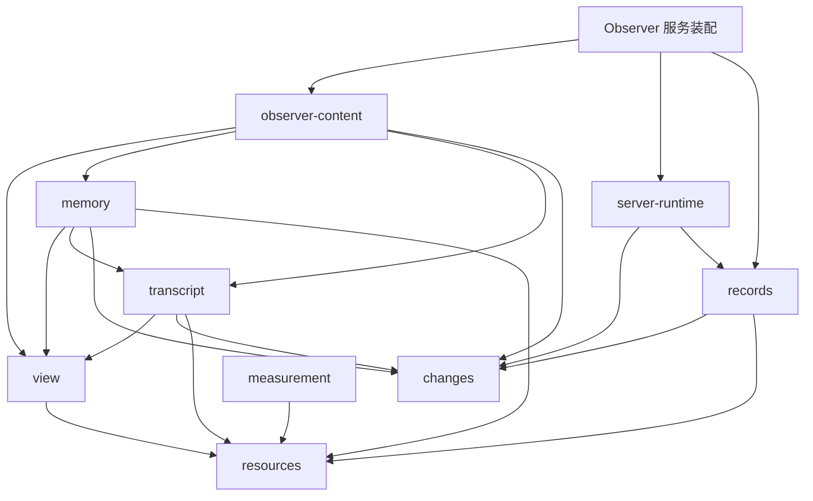
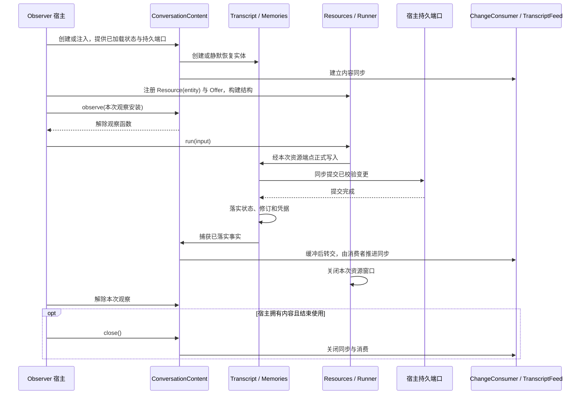

# 内容实体与独立包

本轮按已有职责拆包，保持消息、记忆、活跃材料、记录和通知的行为。包边界让各对象能够单独阅读、验证和继续整理；没有新增统一内容平台，也没有给每个值增加生命周期。

## 对象与包

| 对象或能力                           | 公开入口                               | 负责什么                                                   | 不承担什么                                      |
| ------------------------------------ | -------------------------------------- | ---------------------------------------------------------- | ----------------------------------------------- |
| `Message`                            | `@weiliang0121/capix-protocol/content` | 正式消息的 `role/content` 协议值                           | 不是独立可变实体，没有单独消息生命周期          |
| `Transcript`                         | `@weiliang0121/capix-transcript`       | 正式消息集合、稳定索引、分段、修订与固定追加凭据           | 不执行模型或管理调用                            |
| `Memory` / `Memories`                | `@weiliang0121/capix-memory`           | 单项记忆身份与内容；集合统一接纳批次、来源、顺序及固定写入 | 不决定应提取什么记忆                            |
| `View`                               | `@weiliang0121/capix-view`             | 来源契约、成员状态、目录与固定读取、依据核验               | 不拥有正文，不决定业务保留策略                  |
| `ActiveView`                         | `@capix/observer-content`              | Observer 消息/记忆活跃策略、旧快照形状及持久适配           | 不拥有第二份正文，不扩展 CP 恢复承诺            |
| `MessageUsage`                       | `@weiliang0121/capix-measurement`      | 按准确消息对象累计本环境的材料使用次数                     | 不持久化，不进入模型输入，不决定选择策略        |
| `Recorder` / `RecordBook` / 记录载体 | `@weiliang0121/capix-records`          | 正式登记、记录树、正文快照、历史读取与普通资源访问         | 不持有调用，不决定内容或业务结果，不恢复执行    |
| `ConversationContent`                | `@capix/observer-content`              | Observer 内容组合、内容同步、可借用的观察安装和关闭        | 不持有 Runner、Provider、模型交互或 SQLite 实现 |
| 事实捕获与被动通知                   | `@weiliang0121/capix-changes`          | 捕获、缓冲、转交、发布、进度消费者故障隔离                 | 不拥有实体，不解释业务事实，不自动重做工作      |

`@capix/observer-content` 是包名，对象仍叫 `ConversationContent`。`Memory` 与 `Memories` 放在同一包：集合是正式写入口，单项的更新与恢复方法保留为包内实现。`ActiveView` 是 Observer 的组合策略，使用通用 View，仍没有独立 UID，生命周期由 ConversationContent 确定。

上述包均不反向依赖 Runtime、结构或 Observer 服务实现。各包只通过公开出口协作。

`view` 提供通用来源与成员机制；TranscriptViewSource、MemoryViewSource 分别由实体包实现，ActiveView 的自动纳入和维护规则留在 observer-content。`measurement` 当前仍只提供 MessageUsage，不宣称通用测量平台。现有 `activeView/messageUsage` 代码属性、持久化的 `active`、`active_content`、复合依据字段和冲突错误码保持不变。通用 View 的操作边界见 [View 包](view-package.md)。



图只展开内容和记录协作关系；各包还按需依赖 `packages/protocol` 的纯数据、`packages/contracts` 的共同契约和诊断。Runtime 安装资源端点与可选记录预设，实体包不调用 Runtime。`observeMemory` 由 `@weiliang0121/capix-records` 提供，通过 `transcript.id` 与 `values()` 的只读结构契约组合协议值和记忆记录，不依赖 `@weiliang0121/capix-memory`。

## 包内组织与公开出口

目录先表达实体归属，文件再区分实体、访问和持久契约。不是先建一个通用的 `entities/`、`snapshots/` 或 `adapters/` 总目录，再让实体跨目录寻找自己的实现。

| 包                          | 主要文件与公开能力                                                                                                                                                                                                                                                                                                                                    |
| --------------------------- | ----------------------------------------------------------------------------------------------------------------------------------------------------------------------------------------------------------------------------------------------------------------------------------------------------------------------------------------------------- |
| `packages/transcript`       | `transcript.ts`：集合及接纳；`ref.ts`：`MessageRef/TranscriptRangeRef`；`append.ts`：固定追加依据和凭据；`persistence.ts`：状态与同步提交；`resource.ts`：`TranscriptResource/TranscriptRangeReader`；`progress.ts`：追加进展值；`view.ts`：TranscriptViewSource；`presets.ts`：可选相邻配对算法                                                      |
| `packages/memory`           | `memory.ts/memories.ts`：单项与集合；`change.ts/apply.ts`：变更和固定批次；`persistence.ts`：状态与提交；`resource.ts`：`MemoryResource/CapturedMemories`；来源核验留在包内 `source.ts`；`view.ts`：MemoryViewSource                                                                                                                                  |
| `packages/view`             | `view.ts`：通用成员状态与一致读取；`source.ts/types.ts`：来源与数据契约；`access.ts`：按资源窗口打开端点                                                                                                                                                                                                                                              |
| `packages/measurement`      | `usage.ts`：按对象计数；`resource.ts`：受窗口控制的记录端点                                                                                                                                                                                                                                                                                           |
| `packages/records`          | `record.ts/book.ts/recorder.ts`：记录载体与登记；`tree/`：直接归属与树查询；`restoration/`：只读历史恢复；`resource.ts`：普通快照 read/write；`construction.ts`：宿主记录构造；`memory/observe.ts`：结构兼容的记忆投影辅助                                                                                                                            |
| `packages/observer-content` | `content.ts`：持有和生命周期；`persistence.ts`：窄持久端口；`observation.ts`：观察安装；`synchronization/consumer.ts`：变化消费；`synchronization/transcript.ts`：原文基线与增量同步；`view/active.ts`：ActiveView 来源同步与正式操作；`view/state.ts`：状态契约与校验；`view/default-policy.ts`：默认纳入预设；`view/resource.ts`：read/manage Offer |
| `packages/changes`          | `capture.ts/buffer.ts`：必要捕获与批次转交；`publish.ts/consumer.ts`：发布端口；`error.ts`：捕获错误及故障合并；`progress.ts`：被动进度通知                                                                                                                                                                                                           |

实体包通过显式根出口提供实体、访问和持久契约；消息包另以 `@weiliang0121/capix-transcript/presets` 提供可选算法。内部校验、消息事件构造、单项记忆写入不因文件独立就成为公开 API。内容状态和持久端口归对应实体包；它们不会仅因可序列化就全部搬入跨端协议。

`@weiliang0121/capix-records` 根出口提供记录实体与 Helper、snapshotValue、observeMemory、RecordResource。普通 `RecordResource.read` 的 get/snapshot 只返回纯数据快照；`RecordResource.write.create` 只接收 custom 内容，实体生成身份后返回快照。`@weiliang0121/capix-records/construction` 单独提供 RecordWriterResource 的 root/add/update/boundary，准确活对象只在宿主观察窗口中使用。Recorder 的 RecordClock 仅要求 now/tick；默认时间源属于记录包，宿主可注入兼容 Runtime Clock，包本身不依赖 Runtime。

Runtime `/recording` 只保留自动观测预设，实体与历史恢复目录已迁出。安装内部通过资源包 Resources.bind 固定记录写口，每个事实打开无 owner 的独立窗口并关闭，使真实终态写入独立于业务 Work 的取消与退出。内部写口不回送自身资源观察链；Recorder 的变化出口、isolate/propagate 及来源失效仍按原规则工作。具体约束见 [记录机制](recording.md)。

`RuntimeError` 的唯一实现归 `@weiliang0121/capix-contracts`，Runtime 重导同一类。`ChangeCaptureError` 的唯一实现归 `@weiliang0121/capix-changes`。这两个对象的身份保持一致：宿主错误交付和资源失败分类继续识别它们，不能在迁移时复制同名类。

## 实体、预设与策略节点

实体负责所有写入口必须遵守的不变量；预设表达一种可选择的处理方式。是否同包看职责与依赖，不按函数、类或节点形态机械划分。

- `transcript/presets` 的 `groupAdjacentPairs` 只对同一消息集合的有序索引值进行相邻 user → assistant 配对，保留孤立项和原消息身份。它不读写实体、不决定保留数量、不修改分段，也不把过滤后相邻的项当成原文相邻。服务的 `segmentCandidates` 使用该算法，并单独保留最多两对的候选选择规则。
- Observer 的默认纳入规则位于 `view/default-policy.ts`；状态校验位于 `view/state.ts`。`ActiveView` 与 SQLite 内容提交共用纳入函数，内存安装不重复写入持久层。新消息、新记忆纳入，已退出的记忆更新后仍保持退出；这些是 Observer 的组合策略，不属于通用 View。
- 策略需要调用资源、模型或子节点时，由普通 Node/Group 承载。作者可在服务中组合资源申请与纯算法；内容实体包不因此反向依赖结构或 Runtime。`/presets` 子出口只分公开入口，不能隔离 package.json 的依赖。
- `Memories` 对外部变更值先复制校验固定，再检查集合目标、提交并落实；这属于所有策略都必须遵守的实体接纳，不是可选的记忆策略。选择提取内容、合并理解或退出视图仍由上层处理。

本轮没有新增预设中心、通用策略基类或内容运行包。通用 View 与 MessageUsage 的实现边界保持不变；历史分段及持久格式也继续保留。纯算法或结构预设应有明确输入输出、前提和测试，不因为标注为预设就获得任意恢复或事务保证。

## 创建、使用与关闭



选择、加载和初始化 SQLite 仍由 `services/observer` 完成。内容包只消费 `ConversationContentPersistence`：实体提交端口及内容故障报告；不查数据库、不持有连接。`loadConversationContent` 因此仍在服务装配侧。

`ConversationContent` 可以跨运行安装存活。借用它的环境关闭时只解除自身观察；拥有它的宿主才关闭内容同步。实体本身不跟随一次 Invocation 创建或销毁。资源窗口关闭后端点失效，实体和已经正式接纳的内容仍存在。

最小接入仍使用已有模型：

```ts
import { Transcript, TranscriptResource } from '@weiliang0121/capix-transcript';
import { Resource } from '@weiliang0121/capix-resources';
import { Resources } from '@weiliang0121/capix-runtime';

const transcript = new Transcript();
const resources = new Resources();
resources.register(new Resource(transcript), TranscriptResource.append);
// 节点通过 deps 申请 TranscriptResource.append.request()。
// Runner 为本次调用打开端点；Transcript 继续由宿主持有。
```

## 保持的行为

- **正式消息与固定范围。** 只接纳 user/assistant 的非空正文，整批预检查、复制冻结；旧位置不被外部修改。分段不删除消息，固定范围不因追加扩大。记录与跨端交付保存定位值，不持有活引用。
- **提交次序。** Transcript 和 Memories 先同步提交持久变更，再更新内存，再发布进展和变化。持久失败不产生半批内容；通知失败不撤销已落实内容，也不能靠重做业务补偿。
- **固定效果。** Transcript 的消息与追加凭据、Memories 的变更与批次凭据分别一起提交。相同依据返回原结果；不同内容或归属冲突明确拒绝。资源端点仍从真实调用或接纳范围取得依据，业务不能任意填写调用身份。
- **恢复与快照。** 实体恢复保持身份、顺序、来源和凭据，静默加载。活跃材料捕获消息和记忆的固定值，不能在后续读取时换成更新后的正文；分包不改变 CP 格式或承诺新的执行恢复范围。
- **活跃成员。** 退出活跃集合不删除实体，不强制提供替代内容。源追加和新建记忆默认纳入；更新已退出记忆不自动重新纳入。apply 核对复合依据，冲突不能以当前状态猜测成功。
- **计数。** MessageUsage 仍使用准确消息对象作 WeakMap 键，单次 add 去重；材料接纳后即计数，后续模型失败不回滚。服务每次建立环境重新创建它，不将计数冒充持久事实。
- **通知。** ChangeBuffer 只缓冲和转交；必要捕获失败保持明确故障。ProgressChannel 隔离并停用失败消费者；观察失败策略仍由宿主安装的端口确定。内容同步与可选记录消费相互区分。

## 入口迁移

| 旧入口                                                                                           | 当前入口                                              |
| ------------------------------------------------------------------------------------------------ | ----------------------------------------------------- |
| Runtime 根或 `@weiliang0121/capix-runtime/content` 的 Transcript 系列                            | `@weiliang0121/capix-transcript`                      |
| Runtime 根或 `/content` 的 Memory/Memories 系列                                                  | `@weiliang0121/capix-memory`                          |
| 原 `SelectionUsage` / `@capix/selection-usage`                                                   | `@weiliang0121/capix-measurement`                     |
| 原 `ActiveContent` / `@capix/active-content`，以及 `@weiliang0121/capix-view` 的 ActiveView 系列 | `@capix/observer-content`                             |
| Observer 装配内部的 ConversationContent、ChangeConsumer、TranscriptFeed                          | `@capix/observer-content`                             |
| Runtime 的 ChangeBuffer、发布/捕获契约、ProgressChannel、EventConsumer                           | `@weiliang0121/capix-changes`                         |
| Runtime 根或 `/recording` 的记录实体、Helper、snapshotValue、observeMemory                       | `@weiliang0121/capix-records`                         |
| 宿主需要准确活记录对象的构造写口                                                                 | `@weiliang0121/capix-records/construction`            |
| RuntimeError 实现                                                                                | `@weiliang0121/capix-contracts`；Runtime 仅重导同一类 |

Runtime 的 `/content` 出口已删除；根与 `/recording` 对记录实体的旧重导也已删除，`/recording` 仅保留运行观测预设。记录实体旧名、wire kind 和历史格式继续保留，不改变 CP 格式与恢复语义。`@capix/observer-content` 组合 Observer 内容生命周期并公开自己的 ActiveView 策略，不重导独立实体包或通用 View。客户端继续使用 `@weiliang0121/capix-protocol` 的数据契约，不因为服务端分包而依赖实体实现。

## 后续逐包整理

本轮完成的是职责归属和依赖方向。后续可以从 Transcript 开始，分别审阅实体公开方法、快照与引用的区别、Offer 中的同步操作及固定效果入口，再处理 Memory、ActiveView 和宿主内容组合，不把这些 API 一次性重写。

目前资源侧仍有 `transcript/memory` 专用观察端口，以及固定效果所需的 reception 来源。这是保留的现有接缝，尚未变成通用事件注册或插件机制。是否进一步收敛应由真实消费方式决定。

MessageUsage 当前生产路径通过服务的 `ConversationMaterialUsageResource` 核对正式消息后写入；独立 `MessageUsageResource.record` 保留，尚未被生产 deps 使用。目前服务不读取它的 get()；界面由 observeSelection 根据记录中的成功结果另算统计。两者的时机和历史范围不同，本轮保持原行为，下一轮先明确计量口径与消费者，再决定如何协作。

observer-content 的 ChangeConsumer 仍消费 ObserverChange 并维护在途调用事件，用于宿主观测交付；这超出纯内容持有，后续应单独整理归属，不借此次命名变化建立新的通用事件平台。

具体行为与回归依据仍见 [原文与分段](transcript.md)、[记忆](memory.md)、[活跃材料](active-content.md)、[持久化](../../capix-lab/docs/persistence.md)、[服务装配](../../capix-lab/docs/service-assembly.md) 和 [观测增量](observation-increments.md)。
