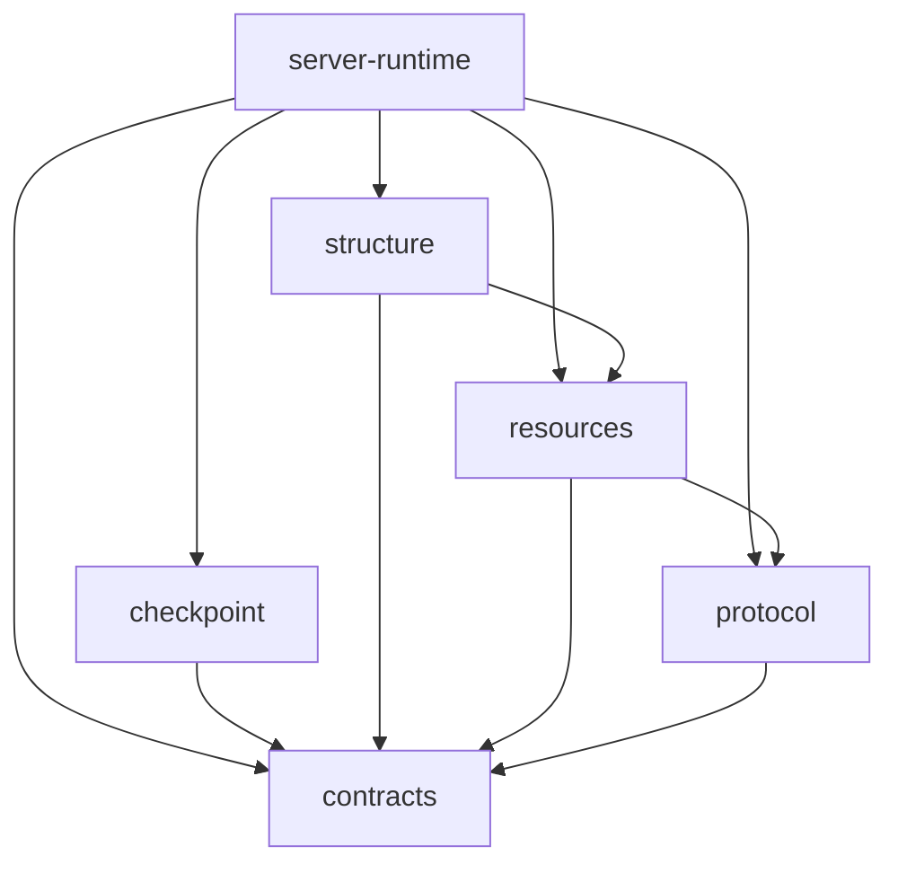

# 包内类型、共同契约与跨端协议

状态：2026-10-26。`@capix/contracts` 提供结构与 Runtime 共同使用的端口；InvocationIdentity 也由这里向 Runtime 和独立 checkpoint 包提供同一定义。调用、接纳、资源窗口和 Frame v5 的行为保持原样；Sequence / Dynamic 是普通 Group 预设。

## 三种归属

| 归属     | 判断依据                                         | 当前例子                                                                                      |
| -------- | ------------------------------------------------ | --------------------------------------------------------------------------------------------- |
| 包内类型 | 由所属包解释的专属概念；宿主仍可实现其公开端口   | 结构配置状态、资源捕获、Invocation 控制、CP Store                                             |
| 共同契约 | 多个包需要遵守同一形状，但不需要知道实现对象     | CallableContract、InvocationIdentity、ChildCalls、Work、操作接收、输出端口、CP 编码与认证事实 |
| 跨端协议 | 实际跨端传输的共享形状，需要解析、版本和兼容约定 | 会话提交、消息同步、观测增量、记录快照                                                        |

类型不会因为 `export` 或有两个 import 就自动晋级。单纯持久化也不自动属于 protocol，例如 CP Frame 属于 `@capix/checkpoint` 的保存格式，Runtime 依据它安装运行关系，尚不构成跨端协议。先确定它表达的责任及消费者，再决定归属；使用者可以从所属包的公开入口取得类型。共同契约的改变需要同时检查提供者与消费者，成为协议还需要检查编码、接纳和历史兼容。

## 当前依赖

箭头表示依赖；本图展开结构、资源、调用和 CP 保存的契约关系。内容实体与变化支持包的关系见 [内容实体与独立包](content-entities-packages.md)。



`contracts` 没有工作区依赖，不导入结构、Invocation、资源实体、Store、Node API 或传输实现。`structure` 只依赖 contracts 和 resources。Runtime 负责把共享端口兑现为本次活动；结构包无需反向认识 Invocation。

`checkpoint` 的工作区依赖只有 contracts；它持有 Frame/Image/Head/Delivery、格式核验及同步 Store。InvocationIdentity 的 contextId/kind/parentContextId 是保存方与运行方共同遵守的单次身份值，晋级共同契约避免复制身份形状或反向依赖 Runtime。CheckpointFact 中的运行观测、安装端口、Context 和实际续接留在 Runtime。

资源包仍显式依赖 protocol 的内容事件类型，这是已有的内容适配边界；本轮不借分包建立另一套内容协议或通用插件系统。

## 契约包的组织

| 目录／文件                     | 包含什么                                          | 实现或专属配置在哪里                                                     |
| ------------------------------ | ------------------------------------------------- | ------------------------------------------------------------------------ |
| `callable/`                    | kind、I/O/Delta 签名与类型见证                    | Scene/Group/Node、成员位置约束在 structure                               |
| `invocation.ts`                | 单次调用身份 contextId/kind/parentContextId       | 活调用在 Runtime，持久 owner/子身份在 checkpoint                         |
| `operation.ts`                 | Outcome、Reception、result/delta 及结果类型计算   | 资源接收在 resources，子调用接收在 Runtime                               |
| `children/`                    | 子调用动作、引用、交付事实及类型关联              | 成员注册在 structure，实际关系与窗口在 Runtime                           |
| `work.ts`                      | 输入、资源、signal、业务注释及可组合端口          | 结构组合 CallableWork/ResumeWork；Runtime 签发                           |
| `output.ts` / `observation.ts` | 输出声明、接收和写入端口，业务事件                | 发布、窗口、消费故障处理在 Runtime                                       |
| `checkpoint/`                  | Codec、点的所有者签名、保存端口、refs、已核实事实 | point/resume 在 structure，Frame/Store 在 checkpoint，调用续接在 Runtime |
| `diagnostic.ts`                | 可序列化错误与失败归属事实                        | 故障控制在 Runtime，传输解析在 protocol                                  |
| `errors.ts`                    | RuntimeError 的唯一诊断类实现                     | 各包共享同一错误身份，具体故障策略由对应机制解释                         |

契约可以描述方法，它们是进程内的协作端口，不等于可序列化 DTO。协议入口不会整包重导这些方法。只有真实共享的纯值词汇（如 CallableKind、RuntimeErrorValue、InvocationFailureFact）由 protocol 显式重导其单一来源；原协议字段和接纳器不变。

契约包当前的运行时出口是 `callableKinds` 和 `RuntimeError`。后者为资源、内容、变化捕获和调用提供同一诊断类身份，Runtime 只重导它；这不把异常处理、执行状态或错误传输放进契约包。`RuntimeError` 实例也不因此成为协议值。

ChildReference、I/O 签名、CP point owner 等见证只有一个定义。结构和 Runtime 的便捷出口重导同一契约，避免包之间产生两个品牌。见证仅保证静态关联，运行期仍检查准确结构、父关系、注册位置和活动窗口。

## 绑定接缝

```text
structure：声明 run(work)，登记成员和资源申请
    ↓ build
Runtime：解算声明、固定供给、安装调用构造能力
    ↓ run
Runtime：创建 Invocation，签发符合契约的 Work 与端点
    ↓
structure 中的处理函数：消费端点，返回业务结果
```

绑定者依赖两边以完成接线，但两边无需相互导入实现。`@capix/structure/construction` 仅提供结构构建状态及检查；`@capix/server-runtime/construction` 暴露具体构造能力。没有为了拆包新增的平行结构或统一服务定位器。

## 维护与验证

修改共同契约时，先确认端口的身份、寿命、失败传播和类型关联，再检查实现与消费。修改协议时再追加字段/版本/接纳兼容验证，不能把进程内对象直接塞进 wire。

当前验证覆盖包依赖的单向公开入口、品牌一致性、类型正常和拒绝用例、子调用接纳、输出、公共资源范围及既有 CP 回归。入口见 `test/contracts-package.test.mjs`、`test/structure-package.test.mjs` 和 `test/workspace.test.mjs`。旧记录及 CP 诊断中的历史词汇保留；这次整理不表示扩大恢复范围。
