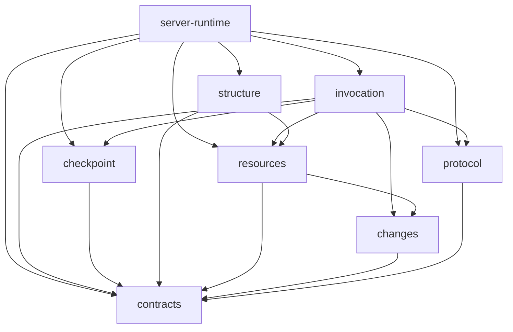

# 包内类型、共同契约与跨端协议

状态：2026-11-11。`@weiliang0121/capix-contracts` 提供结构、调用与 Runtime 装配共同使用的端口和稳定数据契约；InvocationIdentity 由这里向 invocation 和 checkpoint 包提供同一定义；InvocationOrigin 由这里向变化发布与观测提供同一调用来源纯值。`@weiliang0121/capix-invocation` 承载单次调用，Runtime 负责连接结构与调用；CP 使用 Frame v6 和显式增量引用选择。Sequence / Dynamic 是普通 Group 预设。

## 三种归属

| 归属     | 判断依据                                         | 当前例子                                                                                                        |
| -------- | ------------------------------------------------ | --------------------------------------------------------------------------------------------------------------- |
| 包内类型 | 由所属包解释的专属概念；宿主仍可实现其公开端口   | 结构配置状态、资源捕获、Invocation 控制、CP Store                                                               |
| 共同契约 | 多个包需要遵守同一形状，但不需要知道实现对象     | CallableContract、InvocationIdentity、InvocationOrigin、ChildCalls、Work、操作接收、输出端口、CP 编码与认证事实 |
| 跨端协议 | 实际跨端传输的共享形状，需要解析、版本和兼容约定 | 会话提交、消息同步、观测增量、记录快照                                                                          |

类型不会因为 `export` 或有两个 import 就自动晋级。单纯持久化也不自动属于 protocol，例如 CP Frame 属于 `@weiliang0121/capix-checkpoint` 的保存格式，invocation 依据它安装运行关系，尚不构成跨端协议。先确定它表达的责任及消费者，再决定归属；使用者可以从所属包的公开入口取得类型。共同契约的改变需要同时检查提供者与消费者，成为协议还需要检查编码、接纳和历史兼容。

## 当前依赖

箭头表示依赖；本图展开结构、资源、调用和 CP 保存的契约关系。内容实体与变化支持包的关系见 [内容实体与独立包](content-entities-packages.md)。



`packages/contracts` 没有工作区依赖，不导入结构、Invocation、资源实体、Store、Node API 或传输实现。`structure` 只依赖 packages/contracts 和 resources。`invocation` 消费固定工作入口、供给与机制端口，维护单次活动；不依赖 Runtime 或 structure。Runtime 连接两者，依据已固定声明签发 Work；结构包无需反向认识 Invocation。

`changes` 的共同调用来源直接取自 contracts，不依赖 protocol。InvocationOrigin 只含 contextId，描述事实来自哪次调用，不构成资源操作身份、接纳凭据或授权。protocol 为内容变化的实际跨端字段显式重导同一定义，不另建来源类型。

`checkpoint` 的工作区依赖只有 contracts；它持有 Frame/Image/Head/Delivery、格式核验及同步 Store。InvocationIdentity 的 contextId/kind/parentContextId 是保存方与运行方共同遵守的单次身份值，晋级共同契约避免复制身份形状或反向依赖 Runtime。CheckpointFact 中的运行观测、安装端口、Context 和实际续接归 invocation；point/resume 的声明解算与作者 Work 适配归 Runtime。

资源包的领域事实接缝使用 changes 的 FactType／Fact，与 protocol 解耦；InvocationObserver 和恢复活动只转交 ResourceFact。Invocation 仍有共同关系等协议依赖，领域数据与业务 wire 的进一步归位留在 P3／P4，不宣称整份 protocol 已收敛。

## 契约包的组织

| 目录／文件                     | 包含什么                                                                | 实现或专属配置在哪里                                                        |
| ------------------------------ | ----------------------------------------------------------------------- | --------------------------------------------------------------------------- |
| `callable/`                    | kind、I/O/Delta 签名与类型见证                                          | Scene/Group/Node、成员位置约束在 structure                                  |
| `invocation.ts`                | 单次调用身份 contextId/kind/parentContextId 和调用来源 InvocationOrigin | 活调用在 invocation，持久 owner/子身份在 checkpoint                         |
| `value.ts`                     | `Stable<T>`、`stableValue`、固定值域与限额                              | 调用边界由 invocation 使用，持久编码和逻辑额度由 checkpoint 核验            |
| `operation.ts`                 | Outcome、Reception、result/delta 及结果类型计算                         | 资源接收在 resources，子调用关系接收在 invocation                           |
| `children/`                    | 子调用动作、引用、交付事实及类型关联                                    | 成员注册在 structure，实际关系在 invocation，作者动作适配在 Runtime         |
| `work.ts`                      | 输入、资源、signal、业务注释及可组合端口                                | 结构组合 CallableWork/ResumeWork；Runtime 签发                              |
| `output.ts` / `observation.ts` | 输出声明、接收和写入端口，业务事件                                      | 发布、窗口、消费故障处理在 invocation，安装在 Runtime                       |
| `checkpoint/`                  | Codec、点的所有者签名、保存端口、refs、已核实事实                       | point/resume 在 structure，Frame/Store 在 checkpoint，调用续接在 invocation |
| `diagnostic.ts`                | 可序列化错误与失败归属事实                                              | 故障控制在 invocation，传输解析在 packages/protocol                         |
| `errors.ts`                    | RuntimeError 的唯一诊断类实现                                           | 各包共享同一错误身份，具体故障策略由对应机制解释                            |

契约可以描述方法，它们是进程内的协作端口，不等于可序列化 DTO。协议入口不会整包重导这些方法。只有真实共享的纯值词汇（如 CallableKind、InvocationOrigin、RuntimeErrorValue、InvocationFailureFact）由 packages/protocol 显式重导其单一来源；原协议字段和接纳器不变。

契约包的运行时出口包括 `callableKinds`、`RuntimeError` 与 `stableValue` / `StableValueError`。`RuntimeError` 为资源、内容、变化捕获和调用提供同一诊断类身份；这不把异常处理或执行状态放进契约包。`stableValue` 隔离并深固定普通数据，以私有证据复用已经固定的值，没有公开的任意信任注册入口；它不持有 Context 或持久化状态。`RuntimeError` 实例仍不是可交付的稳定数据或协议值。

ChildReference、I/O 签名、CP point owner 等见证只有一个定义。结构和 Runtime 的便捷出口重导同一契约，避免包之间产生两个品牌。见证仅保证静态关联，运行期仍检查准确结构、父关系、注册位置和活动窗口。

## 绑定接缝

```text
structure：声明 run(work)，登记成员和资源申请
    ↓ build
Runtime：解算声明、固定供给、安装调用构造能力
    ↓ run
Runtime：构造调用、接线作者 Work 与端点
    ↓
invocation：执行固定工作入口，维护活动窗口、关系、交付与恢复
    ↓
structure 中的处理函数：消费端点，返回业务结果
```

绑定者依赖两边以完成接线，但两边无需相互导入实现。`@weiliang0121/capix-structure/construction` 仅提供结构构建状态及检查；`@weiliang0121/capix-invocation` 提供单次机制；`@weiliang0121/capix-runtime/construction` 暴露连接两者的具体构造能力。Runtime 既有调用出口精确重导同一对象，不产生第二份异常类、Context 或调用实现。没有为了拆包新增的平行结构或统一服务定位器。

## 维护与验证

修改共同契约时，先确认端口的身份、寿命、失败传播和类型关联，再检查实现与消费。修改协议时再追加字段/版本/接纳兼容验证，不能把进程内对象直接塞进 wire。

当前验证覆盖包依赖的单向公开入口、品牌一致性、类型正常和拒绝用例、子调用接纳、输出、公共资源范围及既有 CP 回归。入口见 `test/contracts-package.test.mjs`、`test/structure-package.test.mjs` 和 `test/workspace.test.mjs`。旧记录及 CP 诊断中的历史词汇保留；这次整理不表示扩大恢复范围。
