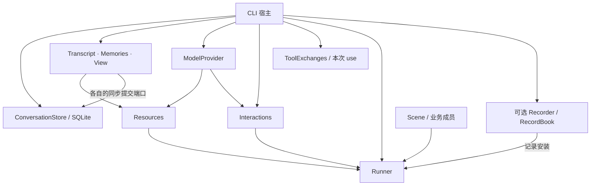

# 新对话服务的宿主与内容持久化

本服务将材料或工具回答、独立交互及记忆维护组合成一个可连续使用的入口。CLI/Web 共用 `createConversationHostAssembly`，宿主仍明确创建 Runner、安装观察端口并关闭持有的对象。本文说明 CLI 和持久边界；独立浏览器宿主见 [浏览器交付](conversation-web.md)。旧 Observer 维持原有接线，不迁移旧数据库。

## 对象与所有权



- 实体保存正式内容与自身不变量，View 仅保存成员和固定来源范围。
- 资源装配只登记实体、Offer 与交互能力；按次窗口仍由内核打开。
- 结构组合业务策略。默认材料模式选择消息纳入、按 View 读取、独立模型回答、回答后记忆维护；工具模式替换准备和回答，仍共用正式消息接纳及维护。
- Runner 管理单次入口、取消、输出与观测；宿主不复制 busy 状态。
- 可选 Recorder 保存本进程的真实调用事实，宿主安装、判定来源完整性并导出；业务结构不承担记录职责。
- Store 拥有数据库生命周期。模型、Interactions、Store 由宿主建立并关闭，不挂到 Scene 上。
- ToolExchanges 只管理当前入口加载的交换实体。每次 run/resume／资格检查使用独立句柄，finally 释放本次引用；busy 拒绝和观察回调重入不清空其他入口的实体。释放内存不删除归档，也不停止独立发送。

## 从启动到关闭

1. 解析运行方式、回答模式和模型配置。离线为默认；真实请求须 `--live`。`--answer-mode material|tools` 默认 material，与 demo/live 独立。
2. 若启用 `--records`，先排他建立记录目标，拒绝数据库及 sidecar 路径；再打开独立数据库，核对格式和单写者占用。空库一次性保存 Transcript、Memories 和 View 的初始关联。
3. 使用实体公开 `restore` 和 View 来源校验重建内容。不重演历史 append、记忆提案或成员维护。
4. 共用装配建立新 Scene、Resources、Interactions；可选安装记录，再构建 Runner。每次入口通过 Store 健康及联合归档门槛后才允许正式输入追加。工具集合按准确身份需要时载入，不在启动时加载所有旧交换正文。
5. 输入逐次运行，材料模式独立展示正文预览，工具模式展示真实模型／工具阶段和正式回答，不输出中间候选正文。`run` 返回才表示本次场景交付完成。维护失败时，已成立内容仍可存在。
6. 关闭先停止接收新输入；必要时请求 Runner 取消局部调用，等待本地调用退出。外部交互独立存活，宿主等待 `interactions.settled()`，再关闭交互，导出可选记录，关闭数据库和文件。导出失败仍清理其他资源并非零退出。

`runner.cancel()` 不等于取消模型发送。真实 Provider 自带总超时；宿主不能在本地等待取消后立即假定外部请求已经结束。

输出预算是服务策略的独立配置：默认回答4096、记忆提取8192 tokens，CLI/Web 都支持 `--answer-tokens`、`--memory-tokens`。两个值必须为正安全整数，解析失败发生在打开数据库之前；模型是否支持该值仍由宿主选定的模型决定。嵌入宿主可向 `createMaterialConversationScene(outputBudget)` 传入部分覆盖，Web 的 `outputBudget` 同样在装配时固定。预算不自动随输入长短变化，不做补生成或截断接纳。`MODEL_OUTPUT_LIMIT` 仅暴露固定上限与安全原因，不包含模型正文。

## 保存的边界

| 内容                          | 保存方式与恢复含义                                                         |
| ----------------------------- | -------------------------------------------------------------------------- |
| Transcript                    | 稳定 ID、revision、分段、按索引排列的正式消息、已有固定追加凭据            |
| Memories                      | 集合 ID、所属 Transcript、sequence、记忆 ID 与内容／来源、已有固定落实凭据 |
| View                          | 两个固定来源范围、revision、准确有序成员；退出保持退出                     |
| Invocation／Context／结构运行 | 不保存对象；按已声明 CP 重建有限调用现场                                   |
| 模型交互及预览                | 固定请求与完整反馈持久化；预览仅本进程，不自动重发或恢复生成               |
| 工具交换集合                  | 每次工具回答独立集合，保存模型回复与准确反馈槽位；按 ID 载入，不自动删除   |
| 记录                          | 可选本进程收集，退出导出只读快照；不加入 SQLite 或恢复执行                 |
| CP／提交队列                  | 默认结构安装 CP；提交队列不保存                                            |

消息追加和记忆更新使用各自的增量提交，View 变更保存完整成员状态。每次事务比较实体原版本；View 提交同时核对实际参与检查的来源版本。消息、记忆和 View **不是一个业务事务**：若消息已保存而后续纳入失败，保存的消息继续存在，正常重启不会补纳入；显式 CP 续接可按已固定默认策略继续。

数据库格式与 Observer 独立；未知格式、内容损坏、占用冲突都明确拒绝，不创建空内容替代原数据。持久端口失败后该 Store 拒绝后续接纳，不自动退化为内存运行。关闭重载重新核验真实保存结果，不根据先前异常推断提交必然未发生。

Conversation SQLite 当前为 **schema 8**，提供多个交换集合及分页元数据目录，并保存 Frame v6 的固定值块、关系和有序选择出现项。只创建空的新库或打开形状完整的当前库；旧库不升级、不清空、不覆盖，需显式使用 `--db` 指定新路径。旧文本交互不提供历史兼容读取。工具回答先保存准确的 prepared 空集合计划，再初始化该集合；waiting 只能取得原集合，不能把丢失的历史补建为空集合。

## 模式、恢复与归档门槛

工具准备固定本次已接纳问题与活跃记忆。`search_history` 和 `read_message` 只在问题之前的准确消息前缀内搜索或读取，后续追加不扩大这个范围。查询有分页、片段和字节上限，包含真实 Transcript 身份及消息索引。两种模式都在正式助手接纳后执行原有记忆维护。

CLI `/recoveries` 列出未终结的根；工具候选标记 `unchecked`，仅表示通过轻量检查，尚未加载原集合和核对全部交互依据。`/resume <contextId>` 才执行完整资格核验并申请实际入口。配置、内容、原交互反馈或 CP 不兼容时明确拒绝，不自动重发；终态调用不能借此复活。页面对应“检查可恢复处理”和“核验并继续”。

`store.archiveUsage()` 统计交换集合及元数据、当前持久 Interaction，以及 CP 当前头、固定值块及元数据、关系、选择、出现项和终态交付的已存编码字节；计数随各自事务变化，压缩正文使用未压缩编码大小。旧镜像 ID 行不计作正文，身份行及 SQL 索引仍占物理空间。这是归档存量口径，不是重复展开后的完整 Frame 额度，也不是 SQLite 文件大小。CLI/Web 的 material/tools 模式均在新运行及恢复入口检查：

```text
当前逻辑存量 + 在途交互数 × 待保存回复估算 + 入口余量 < 参考阈值
```

默认参考阈值 **2 GiB**、入口余量 **512 MiB**、每个在途回复估算 **2 MiB**。512 MiB 来自当前工具链路实测留出的经验余量，不是任意输入、工具数量或自定义策略的增长上界。`archivePolicy` 可由嵌入宿主显式配置；命令行不提供这三个数值的覆盖参数。

这是入口门槛，不预留空间、不在每次提交时执行硬配额。已接纳调用的保存及独立发送的晚到反馈继续进行，因此存量仍可能超过参考阈值。新运行被门槛阻止时，消息、已有提交和恢复候选等只读接口继续可用；真实存储故障仍按原规则停止接纳。当前没有自动退休、删除、裁剪或 VACUUM；View 排除成员和 use 释放都不删除交换、Interaction 或 CP 事实。

## 使用与验证

```sh
pnpm build
pnpm conversation --demo --db /tmp/capix-conversation.sqlite
pnpm conversation --demo --db /tmp/capix-conversation.sqlite --input '继续上一段对话'
# 工具模式：仍使用同一服务入口，阶段来自真实子调用。
pnpm conversation --demo --answer-mode tools --db /tmp/capix-conversation.sqlite --input '查找之前的对话'
# records 的父目录须已存在，目标须为新文件。
pnpm conversation --demo --db /tmp/capix-conversation.sqlite --records /tmp/capix-recording.json --input '你好'
```

离线替身只用于验证链路和教学，不代表模型质量。演示模式默认使用 `.capix/conversation-demo.sqlite`，真实模式默认 `.capix/conversation.sqlite`，防止演示记忆意外进入真实对话；显式 `--db` 按宿主选择。真实模式读取宿主的 `DEEPSEEK_API_KEY` 和可选 `DEEPSEEK_MODEL`（沿用已验证配置 `deepseek-flash`），使用独立 Provider 的 45 秒总超时；启动代码不加载环境文件，测试不访问网络。

自动验证分别覆盖持久端口、公开装配链及 CLI 子进程重启。内容状态可跨重启保留并参与新模型请求；材料／工具链路分别提供显式 CP 续接，见[有限恢复](conversation-recovery.md)。工具模式的阶段输出来自实际直属子调用，不依赖可选记录，也不回放旧 CP 阶段。材料筛选、复杂意图编排及跨调用业务进度仍是可替换业务策略，不在这一步加入隐含逻辑。

## 记录的保存范围

`@capix/conversation-service/recording` 的 `createConversationRecording(scene, recorder, options?)` 复用现有记录预设。调用、资源、消息与记忆事实按实际关系进入同一 RecordBook；Scene 输入已追加而子层未建立，也保留真实的 Scene 与内容关系。提案失败被接收后，子 returned failed 和父 reception handled 均保留。

描述只影响记录，不改变业务输入输出。服务摘要保留固定材料的来源 ID/版本和数量，正文记长度，数组记条数；不保存每个预览片段。单次摘要有界，整本记录随实际采集调用次数增长。CLI 只有显式 `--records` 才安装静态记录；Web 使用默认 idle 的 ConversationRecording，用户控制开始、停止和清空，不作为常驻日志。

CLI 排他建立 0600 文件并在退出时导出 `{format:'capix.conversation.recording', version:1, recorderId, rootId, integrity, book}`。`integrity` 为 `intact` 或 `incomplete`；可用 `RecordBook.restore(book)` 只读载入。记录安装默认隔离故障，但来源一旦漏记就永远标为 incomplete，不能把已有快照冒充完整轨迹。宿主自行安装时可显式采用 propagate，并提供自己的 invalidate 处理。

这是正常收尾时的一次完整导出，不是逐条落盘：崩溃或导出失败可能留下空/不完整文件，消息等正式内容依旧按各自事务保存。导出不保存 Provider 配置/凭据、不重放旧记录，也不承担独立交互状态的归档；晚到外部反馈没有实际读取调用时，不伪造新的资源消费记录。浏览器的每次主动采集复用同一记录预设，停止后保留结果供查看，显式清空释放；不载入 CLI 导出历史或迁移旧 Observer 投影，也不提供 Web 归档。详见 [主动记录](conversation-web.md#主动记录)。
