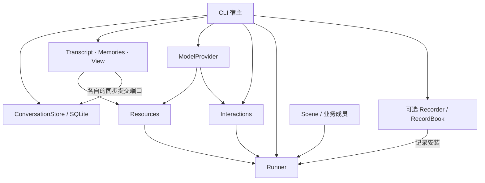

# 新对话服务的宿主与内容持久化

本服务将材料、回答、独立交互及记忆维护组合成一个可连续使用的入口。本文说明 CLI 和正式内容的持久边界；新增的独立浏览器宿主见 [浏览器交付](conversation-web.md)。旧 Observer 维持原有接线，不迁移旧数据库。

## 对象与所有权



- 实体保存正式内容与自身不变量，View 仅保存成员和固定来源范围。
- 资源装配只登记实体、Offer 与交互能力；按次窗口仍由内核打开。
- 结构组合业务策略。默认选择消息纳入、按 View 读取、独立模型回答、回答后记忆维护。
- Runner 管理单次入口、取消、输出与观测；宿主不复制 busy 状态。
- 可选 Recorder 保存本进程的真实调用事实，宿主安装、判定来源完整性并导出；业务结构不承担记录职责。
- Store 拥有数据库生命周期。模型、Interactions、Store 由宿主建立并关闭，不挂到 Scene 上。

## 从启动到关闭

1. 解析运行方式和模型配置。离线为默认；真实请求须 `--live`。
2. 若启用 `--records`，先排他建立记录目标，拒绝数据库及 sidecar 路径；再打开独立数据库，核对格式和单写者占用。空库一次性保存 Transcript、Memories 和 View 的初始关联。
3. 使用实体公开 `restore` 和 View 来源校验重建内容。不重演历史 append、记忆提案或成员维护。
4. 建立新 Scene、Resources、Interactions；可选安装记录，再构建 Runner。每次入口通过 Store 健康检查后才允许正式输入追加。
5. 输入逐次运行，预览独立展示，`run` 返回才表示本次场景交付完成。维护失败时，已成立内容仍可存在。
6. 关闭先停止接收新输入；必要时请求 Runner 取消局部调用，等待本地调用退出。外部交互独立存活，宿主等待 `interactions.settled()`，再关闭交互，导出可选记录，关闭数据库和文件。导出失败仍清理其他资源并非零退出。

`runner.cancel()` 不等于取消模型发送。真实 Provider 自带总超时；宿主不能在本地等待取消后立即假定外部请求已经结束。

## 保存的边界

| 内容                          | 保存方式与恢复含义                                                         |
| ----------------------------- | -------------------------------------------------------------------------- |
| Transcript                    | 稳定 ID、revision、分段、按索引排列的正式消息、已有固定追加凭据            |
| Memories                      | 集合 ID、所属 Transcript、sequence、记忆 ID 与内容／来源、已有固定落实凭据 |
| View                          | 两个固定来源范围、revision、准确有序成员；退出保持退出                     |
| Invocation／Context／结构运行 | 不保存对象；按已声明 CP 重建有限调用现场                                   |
| 模型交互及预览                | 固定请求与完整反馈持久化；预览仅本进程，不自动重发或恢复生成               |
| 记录                          | 可选本进程收集，退出导出只读快照；不加入 SQLite 或恢复执行                 |
| CP／提交队列                  | 默认结构安装 CP；提交队列不保存                                            |

消息追加和记忆更新使用各自的增量提交，View 变更保存完整成员状态。每次事务比较实体原版本；View 提交同时核对实际参与检查的来源版本。消息、记忆和 View **不是一个业务事务**：若消息已保存而后续纳入失败，保存的消息继续存在，正常重启不会补纳入；显式 CP 续接可按已固定默认策略继续。

数据库格式与 Observer 独立；未知格式、内容损坏、占用冲突都明确拒绝，不创建空内容替代原数据。持久端口失败后该 Store 拒绝后续接纳，不自动退化为内存运行。关闭重载重新核验真实保存结果，不根据先前异常推断提交必然未发生。

## 使用与验证

```sh
pnpm build
pnpm conversation --demo --db /tmp/capix-conversation.sqlite
pnpm conversation --demo --db /tmp/capix-conversation.sqlite --input '继续上一段对话'
# records 的父目录须已存在，目标须为新文件。
pnpm conversation --demo --db /tmp/capix-conversation.sqlite --records /tmp/capix-recording.json --input '你好'
```

离线替身只用于验证链路和教学，不代表模型质量。演示模式默认使用 `.capix/conversation-demo.sqlite`，真实模式默认 `.capix/conversation.sqlite`，防止演示记忆意外进入真实对话；显式 `--db` 按宿主选择。真实模式读取宿主的 `DEEPSEEK_API_KEY` 和可选 `DEEPSEEK_MODEL`（沿用已验证配置 `deepseek-flash`），使用独立 Provider 的 45 秒总超时；启动代码不加载环境文件，测试不访问网络。

自动验证分别覆盖持久端口、公开装配链及 CLI 子进程重启。内容状态可跨重启保留并参与新模型请求；另有默认链路的显式 CP 续接，见[有限恢复](conversation-recovery.md)。容量筛选、复杂意图编排及跨调用业务进度仍是可替换业务策略，不在这一步加入隐含逻辑。

## 记录的保存范围

`@capix/conversation-service/recording` 的 `createConversationRecording(scene, recorder, options?)` 复用现有记录预设。调用、资源、消息与记忆事实按实际关系进入同一 RecordBook；Scene 输入已追加而子层未建立，也保留真实的 Scene 与内容关系。提案失败被接收后，子 returned failed 和父 reception handled 均保留。

描述只影响记录，不改变业务输入输出。服务摘要保留固定材料的来源 ID/版本和数量，正文记长度，数组记条数；不保存每个预览片段。单次摘要有界，整本记录仍随本进程调用次数增长，默认不启用。

CLI 排他建立 0600 文件并在退出时导出 `{format:'capix.conversation.recording', version:1, recorderId, rootId, integrity, book}`。`integrity` 为 `intact` 或 `incomplete`；可用 `RecordBook.restore(book)` 只读载入。记录安装默认隔离故障，但来源一旦漏记就永远标为 incomplete，不能把已有快照冒充完整轨迹。宿主自行安装时可显式采用 propagate，并提供自己的 invalidate 处理。

这是正常收尾时的一次完整导出，不是逐条落盘：崩溃或导出失败可能留下空/不完整文件，消息等正式内容依旧按各自事务保存。导出不保存 Provider 配置/凭据、不重放旧记录，也不承担独立交互状态的归档；晚到外部反馈没有实际读取调用时，不伪造新的资源消费记录。浏览器宿主使用同一记录安装，通过自己的 HTTP 端点按需提供本进程记录；不载入 CLI 导出历史或迁移旧 Observer 投影。
