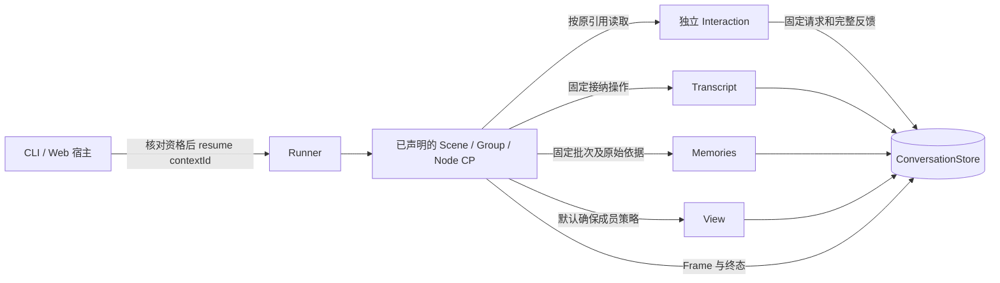

# 新对话服务的有限恢复

默认材料对话链现已装载已有 Checkpoint 和 Interaction 持久契约。恢复入口显式续接一个未结束的 Scene；正常启动仍只载入正式内容，不自动重发输入或恢复调用。本文只约定 `createMaterialConversationScene()` 的默认策略，普通 `createConversationScene()` 和自定义业务结构仍自行决定恢复点。

## 哪些事实由谁负责



| 范围     | 保存与恢复规则                                                                                    |
| -------- | ------------------------------------------------------------------------------------------------- |
| Scene    | 原始用户消息、当时内容依据、直接子关系、回答接纳及后处理进度                                      |
| 材料准备 | 已捕获的 query、View 来源版本和准确材料；恢复不重新选择历史                                       |
| 模型调用 | 固定模型请求、发送返回的 Interaction 引用、等待和接纳关系；已保存反馈只读                         |
| 助手消息 | 在 answer 的正式接纳内 `applyFixed`；同一父子接纳操作确认原凭据                                   |
| 记忆维护 | 原始完整前缀、原记忆集合、已接纳提案或 handled skipped；不重新提取已接纳提案                      |
| 记忆落实 | 独立 apply Node 保存 `{basis, changes, existingIds}`；先确认既有固定凭据，缺凭据才按原 basis 写入 |
| View     | 默认策略确保本次消息及实际新建记忆已纳入；不宣称 View 与实体／CP 构成事务                         |

父层保存等待关系，子层返回后由父层正式接纳。已有子结果可以重新交付，已处理的失败保持原 failed 与父 handled；接纳不改写成重新执行。每个点校验自己的输入、关键直接关系和已接纳事实，完整 Frame 仍由内核保存。

## 资格检查与未知窗口

`assertConversationRecovery(content, store, configuration, contextId, outputBudget?)` 是宿主的准入检查，紧邻 `runner.resume(contextId)` 执行；非默认预算必须与创建 Scene 时一致，`listConversationRecoveries` 同样接受预算：

- 必须是默认 Scene 的未结束 CP；成功、失败、取消的终态都不能再次执行。
- 固定配置身份、结构恢复契约及原始输入必须兼容。默认配置身份包含模型入口、模型名、thinking、策略版本和输出预算，不含密钥；自定义 Provider 的宿主要显式提供稳定的 `recoveryConfiguration`。
- 默认 Scene v3 的状态独立保存准确 `outputBudget`（默认 answer4096 / memory8192），资格检查及各点恢复 codec 都核验它；即便自定义配置身份未变，预算变化也不能继续旧调用。材料回答与记忆提案声明同为 v3，普通执行与恢复请求检查共用固定预算。旧 v1/v2 声明不自动迁移，已有正式内容仍可载入并开始新提交。宿主数据库编码版本与这些业务声明版本分别维护。
- 原用户输入和此前消息前缀、分段必须相同。后续最多存在本次固定接纳产生的一个助手消息；有新提交或其他内容变更则拒绝。
- 当前记忆必须由原集合与本次子树的准确固定批次构成；已完成的落实必须有真实凭据。
- View 必须处于默认按序纳入能产生的状态，已被 CP 证明完成的成员效果不能缺失。任意退出或自定义维护规则不属于这个恢复承诺。
- 尚待执行的子层必须已经有自己的 CP。没有首个 CP、关系或反馈不明时明确拒绝，不推断“应该还没做”。

输入追加早于首个 Scene CP、外部发送早于引用 CP、父层保存等待后子层尚未保存首个 CP，都存在未知窗口。这里不自动重发，也不以普通失败／取消伪装进程中断。

独立 Interaction 在重启后没有完整反馈时为 unavailable。外部系统是否执行过、能否继续生产，需要它自己的协议；本服务不能从本地请求记录推出答案。预览片段不持久化，恢复不从最终文本伪造历史 delta。

## 宿主装配与使用

```ts
const content = loadConversationContent(store);
const configuration = 'my-provider-and-default-policy-v1'; // 公开配置身份，不放凭据
const interactions = createConversationInteractions(model, store.interactions);
const runner = new Runner(createMaterialConversationScene(), createConversationResources(content, model, store.view, configuration), interactions, { checkpoints: { store: store.checkpoints }, validate: () => store.assertAvailable() }).build();

// 载入不会自动运行；宿主明确选择某个未结束的根。
const candidates = listConversationRecoveries(content, store, configuration);
assertConversationRecovery(content, store, configuration, contextId);
const answer = await runner.resume(contextId);
```

这两个资格函数由 `@capix/conversation-service/assembly` 导出。宿主负责让资格核验与调用之间没有并发内容修改；默认 CLI/Web 使用数据库单写者及 Runner 入口占用。

CLI 用 `/recoveries` 查看候选，用 `/resume <contextId>` 续接；也可独立启动：

```sh
pnpm conversation --demo --db /path/to/conversation.sqlite --resume <contextId>
```

Web 的 `GET /api/recoveries` 返回有限摘要；`POST /api/resume` 接收 `{conversationId, submissionId, contextId}`，产生新的传输提交并引用原正式输入，不再 append 用户消息。之后复用现有提交 follow/cancel 及消息同步。重复同一恢复提交 ID 只读取已保留的提交反馈；跨进程身份去重仍以真实 CP 终态和内容为依据。

候选查询只用于发现，不参与调用推进，也不预占恢复资格。浏览器将它与内容／记录刷新分开：会话初始化完成且宿主空闲时检查一次，其余由用户明确检查；新运行、连接或已观察到的内容变化使旧列表过期。已启用恢复的 Web 宿主忙时返回409、不可用时返回503，在查询前拒绝扫描；不会以空列表代替暂不可查询。提交后的正常准入确认与已有提交接回保持原样，真正 resume 仍重新核验。具体客户端状态见 [浏览器交付](conversation-web.md)。

## 持久与观测边界

Conversation SQLite schema 8 保存 CP 固定值块、当前关系、选择出现项、CAS head，以及固定模型交互请求与完整反馈。生产保存使用 Frame v6 增量 Commit；冷读取完整重建逻辑 Image 并核验正文、引用及交付。正文和 delivery 使用有界无损编码及 Brotli 存储；读取核验编码、长度和摘要。8 MiB 限制作用于完整逻辑值，不能因物理块共享或压缩而绕过。

仅空的新库可以创建表；已有数据库必须是完整的当前 schema 8。旧版本和不匹配表结构拒绝打开，不迁移、不清空，也不自动回退为内存运行。旧 CP 格式与旧文本模型交互没有只读兼容入口。需要新数据集时显式传入新的 `--db` 路径，保留原库。当前库不自动 VACUUM，文件可能留下可复用空闲页，不能用文件总长代替存储正文大小。CP／交互调用者冲突不毒化整个 Store，真实数据库失败或损坏会阻止继续接纳。

恢复根列表逐条解码当前 head 后按 Frame 的真实父关系筛选，不增设一份可能与 Frame 分歧的 parent 索引。该显式查询及冷恢复仍随历史调用数量增长。热保存只发布新增固定正文、变化关系和本次引用选择变化；完整数组 refs、完整作者检查和 state 仍按实际范围计算，见[增量引用选择](checkpoint-selection.md)。旧 head 身份保留拒重，无引用的值块正文退休；不自动删除整棵调用树或将 CP 当作分叉快照。

恢复仍使用原 contextId，但有新的入口与恢复 activityId。恢复中的实际新消息从 CP feedback 接入消息源，既有固定消息确认不重复发布 append。`GET /api/recovery-activity` 返回本进程最多 1024 条恢复元数据，淘汰后标注不完整，不带完整 Frame 或正文。

普通 Recorder 不伪造旧调用树；原 HTTP 提交、RecordBook、预览以及任意 JS 栈不恢复。恢复记录与本进程普通运行记录分开解释。客户端接回传输和内核 CP 续接仍是两个不同动作。

## 验证

测试使用离线 Provider 和临时数据库，真实子进程 `exit` / `SIGKILL`，不通过抛业务异常模拟崩溃：

1. 模型反馈已持久化，本地消费尚未交付。
2. 助手固定追加已提交，父接纳尚未写入下一 CP。
3. 记忆固定批次已提交，View 尚未纳入新 ID。

另覆盖已有对话／记忆后续接、原记忆 ID 更新、handled skipped、无变化批次、首个子 CP 缺失、没有反馈、配置／内容变化、终态拒绝、凭据与已完成成员缺失，以及 CLI/HTTP 消息同步和恢复观测。每个完成请求的发送次数、正式消息数、记忆序列及固定凭据都与中断前后对照。

CompletionInteraction 使用 `conversation.completion.v2`，模型完成节点及 Group 的 CP 声明为 v2，默认 Scene、材料回答及记忆提案为 v3；这些业务版本与 Frame v6、SQLite schema 8 分别核验。旧文本交互不读取或补造 native 续接材料。ToolLoop 可选恢复与默认 Web Scene 恢复资格分别装配；普通自定义工具回答不自动成为默认材料链的恢复对象。

## 工具宿主的独立恢复

CLI/Web 可选 `--answer-mode tools` 使用 `conversation.tools.scene@1`。根资格在 `/recovery/tools` 核验原问题、固定准备材料、工具目录与预算、原交换集合、父子关系、完整模型请求/持久反馈及正式消息/维护的固定凭据。工具完成 CP 为 `conversation.tools.completion@3`，completed 保留原 reference 与 reply；不迁移旧 v2 工具完成 CP。材料模式仍沿用原契约。

工具候选列表只做轻量检查并标记 unchecked，选定 resume 时才载入准确集合和交互，检查失败释放本次 use。prepared 可以核对并建立原空计划；waiting 集合或首个必要子 CP 缺失时拒绝，不能用重发补齐。已终结的取消/超时不复活；其独立晚反馈仍正常保存。

当前 SQLite schema 8 提供多集合元数据、准确集合读取及联合存量计数，不载入旧单集合数据库。归档门槛在两种模式的写入入口生效，不阻止读取恢复候选，也不在持久提交中拒绝已接纳工作。当前保存边界见[宿主与持久化](conversation-host.md)，设计与当轮验证见 [宿主设计](native-tool-host-integration.md) 和 [验证报告](native-tool-host-validation.md)。
