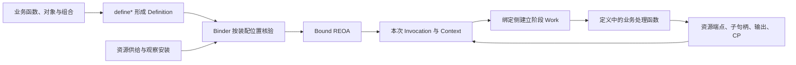

# 定义作者契约（收敛方案 v6）

> 状态：已实施，2026-10-17。由 Fable v5 与 Codex v1 合并，源码核对基线为 `1e72e2e`。门槛实验发现的 D06 失败交付调整已由用户确认；正式机制、Observer 声明与回归已迁移。
>
> 本文件是本轮唯一方案，包含完整契约、实施条件与验证结果，不再要求交叉阅读两份讨论稿。保留 D01–D10 与 C1–C7 编号供审阅定位。作者契约回归位于 `test/author-contract/`，均使用正式公开接口；类型门槛含独立编译失败用例。验证结果与兼容边界见 §12。

## 1. 目标、范围与收敛决定

**定义作者表达业务决定，内核核验自己掌握的身份、归属和活动边界。作者不必为了调用一个子能力，先理解并传递驱动自己的 Invocation。**

作者需要理解工作输入、资源、子工作、返回与接纳，以及按需使用的恢复点。普通作者面移走父 Invocation 证明、Bound 查找、Frame 解构、Context 生命周期修改和内部构造链。Work 不把这些对象原样装进一个参数。

| 编号 | 收敛决定                                                                                   |
| ---- | ------------------------------------------------------------------------------------------ |
| D01  | 最小 `define*` 与 Work 同期验证；Schema 推导和具名 children 不在本轮；保留现有声明固定机制 |
| D02  | Work 按层级、阶段和恢复能力形成真实类型限制；资源分别推导，不取并集                        |
| D03  | ref 保留本父身份；句柄行动按阶段/轮次撤销；open 重新取得当前阶段访问，事实查询不用 open    |
| D04  | run 返回真实 Output；accept 双重载；不加入幂等 run 或父结束时强制接纳的规则                |
| D05  | 保留返回和接纳的独立状态、父关系轮次与子自身进度；接纳值类型为 unknown                     |
| D06  | 来源分为 self / child-return / child-reception；准确传播必须经反例验证，不以最近匹配猜测   |
| D07  | Context 原子安装下一轮输入、轮次和已接纳继续决定；Frame 保存纯数据依据                     |
| D08  | 类型化 point/state/ref/facts；保存事实与最新交付分开；已接纳关系不能再次接纳               |
| D09  | 机制核验进入内核，业务一致性检查留在声明；逐函数迁移，不整文件删除                         |
| D10  | 七个场景与交叉反例验证；CP v2 一次升级，未通过关键验证前不承诺全部闭合                     |

保持：R 占用与释放；REOA 层级；`returned ≠ accepted`；maxRounds 为 1/2；声明异常与内核错误分开；入口先于 E Context；资源正式申请；观测与记录可选；实体固定落实；外部交互不重复发送；终态调用不可恢复执行。

不推进运行时注册新能力、通用调度、并行工作组、权限平台或任意中断点恢复。改进作者表达不等于扩大这些承诺。

## 2. 三谱系与职责落点

不增加第四套对象模型。

| 谱系 | 对象/契约                                           | 寿命与职责                                                         |
| ---- | --------------------------------------------------- | ------------------------------------------------------------------ |
| 定义 | Definition、恢复点、资源申请、异常和观测声明        | 可复用内容；描述允许做什么，不持有某次调用的进度                   |
| 结构 | Binder、Binding、Bound REOA                         | 在装配位置核验和连接资源；Bound 为调用提供稳定结构                 |
| 运行 | Context、Invocation、阶段 Work、子调用句柄、CP 活动 | Context 持有本次事实；Invocation 驱动；Work 和句柄提供受控使用方式 |

Work 没有独立任务寿命，不是另一个 Context。ChildCall 也不是另一套子 Invocation。二者是已有对象的能力端口，由绑定侧为当前调用的当前阶段建立。



箭头表示职责与调用关系，不表示这些步骤都由一个函数串行完成。普通定义作者主要接触 Definition、Work 和业务数据；扩展 Binder、恢复预设、记录实现的人仍可使用相应机制契约。低层出口不是普通业务场景缺能力时的默认逃生口。

## 3. D01：最小工厂与声明固定

### 3.1 最小工厂

工厂解除对抽象基类的强制继承要求。它不要求业务都写成无状态函数；业务可以用对象或类组织，再以闭包或绑定方法嵌入定义。

```ts
const readText = defineAttempt<ReadInput, TextDocument>()({
  name: 'readText',
  label: '读取文件',
  source: 'observer/files/read',
  callee: 'workspace',
  run: {
    requires: { reader: FileResources.readText.request() },
    execute(work) {
      return work.resources.reader.readText(work.input.path, work.signal);
    },
  },
});
```

这里的两次函数调用用于 TypeScript 部分泛型推导：外层明确 I/O，内层从声明推导资源和处理函数参数，不代表两个运行阶段，也不产生新的运行实体。类型回归同时覆盖资源/uses/point 的正确推导与错误用法拒绝。

R/E/O 同样采用 `defineRuntime/defineExecution/defineOperation`；E 保留入口输入与内部 Input 的差异。`run / exceptions / observation / checkpoint` 继续平级。保留现有描述字段，不在这次把它们重组为 `describe`。

本轮 children 继续使用声明对象数组，`uses` 也按对象身份约束。具名属性访问可以将来单独评估，本轮不增加声明别名与绑定位置的新规则。

### 3.2 工厂的责任上限

工厂负责声明形状、默认值和作者类型，不兑现资源，不建立 Invocation，不进行业务编排。默认值沿用现义：例如 run 未给 uses 时可用全部已声明子，exceptions 未给 uses 时没有新子调用能力。

每次工厂调用产生新的 Definition 身份。两次同名构造不是同一声明；复用必须保留同一个对象。不能用对象展开“替换”定义后，默认原 `uses/childResources/entry` 都跟着新身份迁移。

第一批继续复用现有声明固定与位置解算机制，不因返回一个冻结对象就删除 snapshot。后续若将嵌套结构复制、固定函数入口、receiver 保留等职责移入工厂，应消除重复工作，但要单独证明语义相同；不深冻业务实例、闭包实体或资源实例。

### 3.3 不捆绑的三项工作

| 工作             | 本轮处理                                                 |
| ---------------- | -------------------------------------------------------- |
| 作者类型推导     | 纳入：各阶段 resources、已声明子能力、I/O 的使用类型     |
| 通用 Schema 接入 | 不作为前置条件；暂不增加强制 input Schema 或自动转换     |
| CP 编解码        | 保留显式 Codec；可复用服务已有适配，不由类型推导自动产生 |

运行结果校验、增量 Delta 校验、CP 编解码各有职责。正式结果当前要求同步校验并保持原值身份；不能用返回新对象的解析悄悄替换。已有 `OutputDeclaration<Result, Delta>` 不被简单的 `output: schema` 覆盖。CP 需要可保存与可恢复的契约，不等于“必须使用某种 Schema”。

## 4. D02：Work 的阶段与能力

共享数据面如下；处理函数不会同时再取得 Context 或 Invocation。

```ts
interface Work<Input, Resources> {
  readonly input: Input;
  readonly initialInput: Input;
  readonly round: 1 | 2;
  readonly resources: Readonly<Resources>;
  readonly signal: AbortSignal;
  readonly continuation?: ContinuationFact;
}
```

`input` 是本轮输入，`initialInput` 是本次调用最初输入。只读表示作者不能修改内核属性，不承诺深冻所有业务值或每次复制输入。

Work 的公开形状按以下表生成，不能只在一个大接口上用注释限制：

| 阶段                 | 额外数据与操作                                                         | 返回值             |
| -------------------- | ---------------------------------------------------------------------- | ------------------ |
| run.execute          | REO 的 children；按声明提供 output；可选 checkpoint                    | Output             |
| run.accept           | delivered；REO 的 children；continue                                   | Output 或 Continue |
| exceptions.handle    | exception、origin；REO 的 children；continue/return/unhandled          | Resolution         |
| point.resume.execute | 该点的资源与 uses；children 增加 resume；本次执行段 output、checkpoint | Output             |

A 的各阶段没有 children；未声明 Delta 时作者面不提供 emit；普通 execute/accept/handle 不提供 resume。具体 TypeScript 可用组合类型实现，不要求为了这张表新增大量类。

run.accept 沿用 run 的资源与子能力范围，不新增一条独立 accept 配置。异常和各恢复点分别推导自己的资源，不取整个 Definition 的资源并集；run 省略 uses 表示全部已声明子，exceptions 和 resume 省略 uses 表示无新子调用能力。

资源端点继续遵守原 ResourceActivity 的活动范围和 round；本轮不把共享 run 资源强行拆成 execute/accept 两套供给。Work 的子行动、控制结果、输出和 CP 入口另有各自授权窗口，不能因资源仍有效就认定旧子句柄也有效。输出段在 execute 退出时封口，继续或异常处理废弃原段；恢复不能自动重放旧预览。

类型保证能力形状，阶段过期由运行期撤销保证。TypeScript 不能判断一个异步闭包何时过期，不能把 `open` 描述成纯类型层即可证明安全。

Continue/Resolution 采用不透明控制值，不能与普通 Output 的 `{ kind: ... }` 混淆。`work.continue(...)` 只是提出决定，不立即修改 Context；内核接纳后才推进。保留未声明 run.accept 时直接沿用 execute 结果的现义，不安装一个新的默认业务处理器。

Work 不是未来能力的任意容器。时钟、预算等若属于可申请资源，应走资源声明；只有确实属于调用工作控制的操作才成为 Work 固定成员。

### 4.1 两种 entry 不混同

E 的 `entry.accept/admit` 发生在 E Context 建立前，继续按现有入口资源契约工作。绑定源的 validate/capture/started 时机也不变。

`InvocationEntry` 则是某个已声明子能力的另一种输入接纳契约。旧接口曾让业务回调取得父 InvocationView；本轮已统一收敛为输入、只读父事实与 key。

本方案保留这种入口能力，迁移其作者参数：

```ts
const regenerationEntry = defineChildEntry(model, {
  accept({ input, facts, key }) {
    // facts 只提供本父层的受控事实查询；不提供创建子层或修改生命周期。
    return verifyAndPrepareRegeneration(input, facts, key);
  },
});

const child = work.children.entry(regenerationEntry, evidence, { key: 'model' });
```

这是当前 entry 回调形状，不增加新的运行实体。入口不能扩大目标声明的 uses、不能更换目标身份。绑定先核验目标允许、再接纳输入、复核活动状态，最后创建子调用。检查入口本身的失败仍按现有绑定边界归属，不自动变成可处理业务异常。

入口 facts 明确为 `{ round, continuation?, children: ChildFacts }`。父当前 round、已接纳继续依据和直接子事实足以支持现有再生成核对；普通替代入口不要求一定存在 continuation。它不提供资源、create/open/resume 或生命周期修改，活动、取消与归属仍由入口边界检查。

## 5. D03–D05：子句柄、准确身份与事实

### 5.1 三个时机继续分开

下面分开普通子访问与恢复子访问。类型中的 Allowed 来自本阶段 uses；事实可查询本父全部直接关系。此处省略推导工具类型的实现，不用一个包含 resume 的公共接口再加“仅恢复”注释。

```ts
interface ChildCalls<Allowed extends ChildDefinition> {
  create<D extends Allowed>(definition: D, input: EntryInputOf<D>, options?: ChildOptions<D>): ChildCall<D>;
  entry<D extends Allowed, In>(entry: ChildEntry<D, In>, input: In, options?: ChildOptions<D>): ChildCall<D>;
  open<D extends ChildDefinition>(reference: ChildReference<D>): ChildCall<D>;
  readonly facts: ChildFacts;
}

interface ResumeChildCalls<Allowed extends ChildDefinition> extends ChildCalls<Allowed> {
  resume<D extends Allowed>(reference: ChildReference<D>): ChildCall<D>;
}

interface ChildCall<D extends ChildDefinition> {
  readonly ref: ChildReference<D>;
  readonly key?: string;
  run(): Promise<OutputOf<D>>;
  accept(): Promise<OutputOf<D>>;
  accept<Value>(receive: (output: OutputOf<D>) => Value | Promise<Value>): Promise<Value>;
}

const child = work.children.create(answerDefinition, work.input, { key: 'answer' });
work.checkpoint?.save(answerWaiting, state, { answer: child.ref });
await child.run();
const answer = await child.accept((output) => acceptAnswer(output));
```

create 建立身份，run 启动或取得同次工作返回，accept 明确完成父接纳。run 返回值可供父层作判断，但不会改变接纳状态，不能从“拿到了值”推定“已经落实实体”。

run 保留 `Promise<Output>`，关系状态负责表达父层是否接纳。普通活调用的第二次 run 仍然拒绝；open 得到新句柄也不能重置真实调用的启动状态。读取已有返回使用 facts。CP 已保存成功交付的读取路径可以直接提供原交付，但不因此将所有活调用的 run 改成缓存读取。历史失败不通过重复 run 重新抛出并制造新的异常来源。

无回调的 `accept()` 仍是显式父接纳，只省略恒等函数；与本层 run.accept 的配置有无是两回事。必须用两个重载，不能允许 `accept<任意类型>()` 在没有转换回调时伪造类型。

不提供语义模糊的 call 快捷方法。Sequence 只使用同一作者契约，保持逐项构造输入、run、accept 和各自输出，不再兼容内部 ParentInvocation 另一条路径。`Sequence.run(input, work.children)` 在单一阶段内完成；跨阶段编排由作者显式取得新阶段 Work 和 open，不属于 Sequence 的隐含行为。

### 5.2 阶段句柄与稳定 ref

当前实现共享本调用的子关系映射，但通过当前阶段 children.accept 接纳。把 accept 挪到句柄上后，这层检查不能丢失，也不能让创建阶段永久决定后续能否接纳。

本方案选择：

1. ChildCall 属于取得它的阶段和 round；离开授权窗口后不能继续 run/accept。
2. ChildReference 是受控身份，不是执行端点；可以保留用于后续本层阶段的查询和 CP 保存。
3. `work.children.open(ref)` 在当前阶段重新取得指向既有关系的句柄，不创建 Invocation，不读持久化，不执行工作。
4. `work.children.resume(ref)` 仅出现在恢复阶段，解析已保存的续接依据；不与 open 混用。

```ts
// 前一阶段留下的是 ref，不保留可继续操作的旧 Work。
const child = work.children.open(savedReference);
const value = await child.accept(receive);
```

这不是要求普通顺序代码每次都 open；同阶段继续使用原句柄即可。它只补齐现有跨阶段接纳能力，避免让旧闭包自动取得新阶段权限。

授权按动作划分，不让 open 同时承担全部权限与状态判断：

| 操作           | 必要约束                                                                               |
| -------------- | -------------------------------------------------------------------------------------- |
| facts 查询     | 引用属于本父直接关系；不受阶段 uses 限制，不需要 open                                  |
| create / entry | 父行动窗口有效、层级允许、目标在当前 uses 中；入口前后复核                             |
| open           | 当前父行动窗口有效、引用属于本父；不要求子关系“尚未终结”                               |
| run            | 句柄阶段/round 有效；启动尚未启动的子需当前 uses；真实目标只能按自身启动或交付规则处理 |
| accept         | 句柄有效、子已成功返回、接纳窗口允许；不额外要求当前 uses                              |
| resume         | 恢复阶段、当前 uses、准确保存依据；不能由普通 open 代替                                |

open 可以取得已接纳或失败关系的句柄，但不会赋予该状态原本没有的动作。已接纳/失败的 reception 不能再次 accept，失败历史不能 run。当前 accept 本来就不要求声明出现在阶段 uses 中，这一能力继续保留。

父归属、阶段失效、未声明目标、非法接纳状态、恢复依据错误分别报告准确原因，并沿用现有错误归属；不为三组授权新建三套错误体系。新增稳定 code 仅在真实诊断/测试需要时明确，不因接口分组批量发明。

所有活动操作继续检查父归属、父及祖先活动、健康状态、阶段与轮次。open 不得“升级”另一父调用的引用；ref 的不透明类型也不能代替运行期核验。本父的其他历史直接关系同样可查询，continuation.origin.child 不是历史引用白名单。

ref 可跨本次调用的阶段/轮次，不意味着旧活动的行动端口可以跨恢复活动复用；恢复核验后重新签发引用。

open 也不能绕过恢复准备：已经安装的 waiting 占位只可查询，未解析续接依据前不能启动或接纳。必须先由恢复阶段的 resume 完成核验并得到合法目标。

### 5.3 查询与行动不是同一授权

普通阶段的子能力端口提供 create/entry/open 和事实查询；恢复阶段额外提供 resume。查询建议收在 `work.children.facts`，以免 `uses` 的“可新调用范围”被误解为“过去发生过什么的可见范围”。

```ts
interface ChildFacts {
  get<D extends ChildDefinition>(reference: ChildReference<D>): ChildFact<D>;
  require<D extends ChildDefinition>(definition: D, reference: ChildReference): ChildFact<D>;
  list<D extends ChildDefinition>(definition: D, query?: { parentRound?: 1 | 2 }): readonly ChildFact<D>[];
  requireUnique<D extends ChildDefinition>(definition: D, query: { parentRound: 1 | 2 }): ChildFact<D>;
}
```

get/require 对伪造、错父和未知引用明确拒绝，不将归属错误解释为空结果；list 可以正常返回空列表。所有查询均无创建或恢复副作用。已取得的只读事实可以保留，父结束后仍可读既有事实；这不延长父活动或行动端点的寿命，也不引入持久历史查询服务。

list 按父关系 order 返回多值，包含该声明的真实关系状态，不假装每个成员都已有交付。requireUnique 明确在 0 或多于 1 时失败，只适用于业务已经约定“一次”的位置。不给 latest 自动因果含义；未来若增加便利查询，要明确其排序依据。

同一 Definition、同 key、同 parentRound 都可以对应多次调用。key 是业务位置标记，不能替代 ref。类型系统可以拒绝不兼容的 I/O，但无法静态区分所有同形 Definition 实例；准确身份检查必须保留。

### 5.4 事实保留必要维度

建议的事实内容如下；这是语义形状，不要求与内部枚举一一同名：

```ts
interface ChildFact<D extends ChildDefinition> {
  readonly ref: ChildReference<D>;
  readonly key?: string;
  readonly parentRound: 1 | 2; // 父层创建该关系的轮次
  readonly order: number;
  readonly input: InputOf<D>; // 该子入口接纳后的初始输入
  readonly returned: ChildReturnFact<OutputOf<D>> | undefined;
  readonly reception: { status: 'pending' } | { status: 'receiving' } | { status: 'accepted'; value: unknown } | { status: 'failed'; diagnostic: FailureDiagnostic };
  readonly progress?: ChildProgressFact<D>; // 已知时保留子自身 round/currentInput/phase
}
```

ChildReturnFact 必须保留成功值、声明异常/错误诊断以及由内核确认的取消结果。当前内部取消归属不必为此整体改枚举，但公开映射不能仅凭 signal.aborted 猜测，也不能把取消当作可业务处理的声明异常。

父关系 round 与子自身 round 是两个事实。等待点不一定拥有子最新进度，不能伪造；有交付或保存依据时，保留其真实 round/currentInput。历史失败只有诊断，不恢复活 DeclaredException。

父接纳值可能经过任意转换，因此类型是 unknown，不自动等于子 Output。使用者通过业务 Codec/检查或保存的业务 state 取得类型。unknown 是类型知识的边界，不表示内核不保存该值；具体编码规则见 §7.4。事实接口只移除不必要的存储嵌套，不删除这些语义。

### 5.5 父完成但子返回未接纳

当前允许父直接使用子 run 的返回值完成，而未执行 accept。本轮不新增强制接纳、不自动补接纳：该关系如实保持 returned + pending，已有事实与可选记录可解释这种状态。

必须分开两种情况：

- 父已终态：只读事实保留，不能恢复父去补做接纳。
- 父尚未终态，合法 CP 中子为 returned + pending：可按恢复契约取得原交付并进入父接纳。

CP 是显式时点，不是父完成时自动刷新的全量最终快照。不能承诺最后一份 image 必然包含父结束前的全部关系变化，也不为此增加新的默认观测事件。

## 6. D06–D07：异常来源与继续依据

### 6.1 来源由边界关联，业务关系仍由业务验证

异常来源为三类：

```ts
type ExceptionOrigin = { kind: 'self'; phase: 'execute' | 'accept' } | { kind: 'child-return'; child: ChildReference } | { kind: 'child-reception'; child: ChildReference };
```

self 带发生阶段；子来源带准确 ref。来源不是当前父层“最近一次失败”的可覆盖变量，也不是一个 error 对象对应一个 origin 的全局表。

内核在实际交付和接纳边界保留关联，在本次异常分类时使用对应关联。并行子调用、同一个异常对象被复用、业务 catch 后抛出新异常，都不能使来源串到另一子层。结构错误、绑定错误、未声明错误、处理器错误仍不进入声明异常处理。

已完成反例验证并由用户确认失败交付调整：子 `run/accept` 对声明异常抛出独立 `ChildCallFailure`，携带原异常 `.exception`。原样 catch/rethrow 保留准确来源；解包再抛原异常属于本层 self，须满足本层 raises。直接 catch 的对象身份和 `instanceof DeclaredException` 改变，异常处理函数仍收到原始异常。来源凭据只对其父、阶段、轮次有效，不能以最近匹配兜底。

当前 `AcceptModelOutputDefinition` 是真实子 A，拒绝发生在其 run 中，父层在 `acceptance.run()` 收到异常，应是 child-return。只有 `child.accept(callback)` 中父层 callback 抛错，才是 child-reception。

```ts
handle(work) {
  if (work.round !== 1 || work.origin.kind !== 'child-return') return work.unhandled;
  const rejection = work.children.facts.require(acceptOutput, work.origin.child);
  const previous = work.children.facts.requireUnique(requestModel, { parentRound: 1 });
  if (!allowsRegeneration(previous, rejection, work.exception)) return work.unhandled;
  return work.continue(work.input, '完整返回未通过输出契约，按声明再生成一次');
}
```

此处 requireUnique 来自当前回答业务每轮最多一次模型请求的约定，不是内核通用假设。`allowsRegeneration` 仍检查拒绝内容与前一模型返回的对应、完整结束、异常类别和次数；origin 不能代替这些业务判断。

### 6.2 已接纳的继续决定

```ts
interface ContinuationFact {
  readonly fromRound: 1;
  readonly stage: 'accept' | 'handling';
  readonly reason: string;
  readonly origin?: ExceptionOrigin;
}
```

Context 持有已接纳决定，CP Frame 保存其纯数据表示。选择一个明确安装点：内核校验控制结果、健康状态、轮次上限与进入下一轮前的取消条件后，在同一次同步 Context 转移中安装 nextRound、currentInput 和 ContinuationFact；不是调用 work.continue 的瞬间。

安装前失败，决定仍是提案；安装后，下一阶段资源校验、业务或观测仍可能失败，但不能反向撤销已经成立的转移。ContinuationFact 表示内核接受了从前轮继续的决定，不保证下一轮业务已经执行或成功。实现时要核对原 continue 过程通知与新轮开始的顺序，不能仅凭已发出的过程通知推导该事实。

第二轮通过 continuation 定位前轮拒绝来源，再读取本父层事实。不得塞入任意 carry，不得向普通业务 Input 注入内部调用引用，也不以旧异常实例比较作为恢复后的条件。

其中的 ChildReference 不可直接序列化。保存为稳定子身份描述，恢复时核验本父直接关系、原轮次/顺序及声明契约，再签发新的引用。已有 origin 引用能识别前轮失败子，不意味着该子可以 resume。

恢复仍从明确 point 的 state 与已核实历史开始，不重新执行前轮异常处理器。已知旧模型交付不合法，也不能因为现在作者接口更方便就自动再发送；现有“不重复外部调用”的恢复边界继续生效。

这里有一项需要显式补齐的 v2 增量：当前 CP 只支持前轮子返回的已处理声明异常，无条件拒绝 failed reception。本轮将**直接成为已接纳继续决定来源的前轮接纳声明异常**保存为只读诊断，同时保留该子真实成功返回；continuation 必须明确以 child-reception 指向这一关系。它不能再次 accept，也不能恢复活异常。来源指向另一子返回、且同时伴生其他失败 reception 时，仍拒绝捕获。当前轮未处理失败、结构/绑定/观测错误、处理器错误同样拒绝保存。完整 Frame 必须支持这一有限历史形态，仅给 continuation 加 ref 不够。这是新增的有限恢复表达，应单独验证，不能称为机械接口迁移。

## 7. D08：Checkpoint 作者面与恢复语义

### 7.1 点、状态与引用契约

point 是 Definition 的固定内容，可在循环中多次保存；每份 image 的同一角色可以指向不同真实子调用，不为每次调用制造动态点名。

建议明确引用槽位的单个/多个形式。以下 `childReference/childReferences` 是声明辅助，不创建调用：

```ts
const waitingPoint = checkpointPoint<'operation', MergeInput, MergeOutput>()({
  name: 'summariesWaiting',
  state: mergeStateCodec,
  references: {
    summaries: childReferences(summaryDefinition),
  },
  check(state, facts) {
    // 只核对保存时的事实；不得在这里读取子最新交付或访问外部资源。
    for (const child of facts.references.summaries) {
      if (child.returned || child.reception.status !== 'pending') throw new Error('Expected a waiting summary');
    }
    verifyRequestedDocuments(state, facts.references.summaries);
  },
  resume: {
    requires: {},
    uses: [summaryDefinition],
    async execute(work, state, saved) {
      const calls = saved.summaries.map((ref) => work.children.resume(ref));
      return receiveSummaries(work, state, calls);
    },
  },
});

// 正常路径：同一能力、同一 key、多次调用不影响准确身份。
const calls = documents.map((document) => work.children.create(summaryDefinition, document, { key: 'summary' }));
work.checkpoint?.save(waitingPoint, state, {
  summaries: calls.map((call) => call.ref),
});
return receiveSummaries(work, state, calls);
```

`receiveSummaries` 是该业务自己的运行与接纳函数，不暗指内核提供了完整的并行工作组管理。其错误收尾必须在测试中明确。

点需显式注册在所属 Definition.checkpoint.points 中，保存时核验本定义注册的点对象，不能仅凭相同 name 接受另一点。state 类型与引用形状由点派生；语义输入/输出与所属 Definition 的关系在工厂类型验证和绑定检查中确认。

引用槽位只选择本点关注的关系，不替代 Frame 的全部直接子关系。多个槽位指向同一 ref 不应重复登记子调用；数组保留给定顺序，同时验证真实关系 order。是否允许重复角色等额外业务规则由点 check 指定。

### 7.2 检查的分工

| 内核核验                                       | 业务点 check 核验                              |
| ---------------------------------------------- | ---------------------------------------------- |
| image 格式、所有者、直接父子、声明版本、点注册 | 本点为何需要这些子工作                         |
| ref 对应的真实声明身份、父轮次、order          | 文件目标、请求正文、模型返回之间是否对应       |
| frame 轮次合法、状态组合合法、序号不冲突       | 当前业务点是否只允许第一轮、是否要求原输入未变 |
| Codec 解码与纯数据边界                         | 拒绝原因是否允许再生成、进度是否满足业务规则   |
| 保存引用是否属于本次工作                       | 该业务是否恰好只调用一次某能力                 |

check 得到保存时刻的事实，包含本层 initialInput/input/round/continuation、所选引用和必要的完整直接关系查询。它不取得真实 Context、活动资源或子执行能力。check 在保存与恢复时遵守同一保存事实语义，不能用“子现在已经返回”否定过去合法的 waiting 点。

示例中的 `facts.references` 是保存事实的具名视图；`requireWaiting/requireAccepted` 只检查并细化该事实的类型，不触发调用或接纳，不要求普通 ChildFact 也带有这些方法。

运行中事实与保存事实可以共用字段词汇，但不能假装同一时间：前者是当前可观察状态，后者固定于 image；子最新交付只在 resume 解析阶段进入。

### 7.3 恢复后的四类消费

| 保存/解析出的关系                               | 允许的动作                                          | 不允许的动作                           |
| ----------------------------------------------- | --------------------------------------------------- | -------------------------------------- |
| waiting 且有合法子 CP                           | 建立受控恢复活动，再 run/accept                     | 没有依据时创建替代子调用               |
| waiting 后有成功最终交付，或 returned + pending | 直接取得原交付，执行父接纳                          | 重新运行外部工作                       |
| returned + receiving                            | 受控重新进入接纳；实体按固定凭据确认                | 把重入接纳等同于任意副作用可以重复     |
| returned + accepted                             | 读取原父接纳值并检查，或使用已核实的业务 state 继续 | 再次执行 accept 回调，或默默忽略新回调 |

失败、取消、未知及不兼容依据不属于“可以再试”的恢复分支；前轮已处理失败只提供诊断。

因此，`resume → run → accept` 是等待/未完成接纳路径的共用代码，不是所有 CP 的统一恢复模板。已落实结果点直接验证和读取原结果。

实体落实与父 CP 不是同一事务。实体已写成功而父 accepted 尚未保存时，恢复依据仍可能是 waiting/pending/receiving。这时固定写入凭据、Transcript.applyFixed、Memories 和 WorkspaceFiles 的确认机制仍不可省略。只读 facts 不能替代实体确认。

### 7.4 保存端口、预设与格式

`work.checkpoint` 保持可选；save 同步成功后才说明保存成立。`?.` 和显式分支继续保留，防止引入 no-op 后改变参数求值、固定落实或资源调用路径。

不自动保存叶子结果，不取消 prepared/interactionStarted 等边界。不新增等待外部事件的平台；现有 Interaction 的 create/read 与持久反馈继续独立。

编码与容量沿用严格边界：

- 子 I/O 有 CP Codec 时按声明编码；已经成功交付的子不强制声明自己的 CP，无 Codec 时仍须满足现有纯数据规则。未返回子要等待恢复，必须有合法子 CP 契约和后续依据。
- 完整 Frame 中的父接纳值由内核严格复制检查；undefined 接纳值沿用省略 output 字段的现有表示。其他值必须是可保存的纯数据。unknown 不是“无法编码”，也不授权保存活对象。
- point.state 的业务 Codec 可另存所需表示，但不能豁免完整 Frame 内不可保存的接纳值。本轮不引入隐式丢弃、隐藏引用或新的接纳值 Codec。
- image 与最终 delivery 各自保留 8 MiB 上限；直接关系最多 4096 条，并保留深度和结构数量等检查。引用数组计入相应预算，不能截断后声称保存成功。
- 编码、结构或容量超限发生在 capture；Store 提交失败归 save。错误阶段按真实失败位置报告。

开放 point 是基础。`resultPoint(codec)` 只有在真实样板重复时才提供，仍需显式保存；awaiting/settled 不是恢复点的封闭分类。

续接事实、引用槽位和 continuation 共同需要新的 image 表达，建议合并为一次 formatVersion 2 升级。引用映射与 frame/state 分离，存储准确子 ID、目标声明的持久关联和引用列表，不存 Token/Definition/活错误；目标有 CP 契约时保存并核验其 key/version。经替代入口创建仍关联目标声明，不把入口作为另一子身份，也不重演入口接纳。

v2 的字段、预算和克隆检查必须在机制迁移前验证，不能只把类型里的数字改成 2。尤其不能把同形 TypeScript 类型、相同 name 或相同 CP key/version 当成原 Definition 的唯一身份证明；跨进程无法直接比较原 JS 对象。需明确父声明下的持久关联（例如固定解算位置与父契约版本），并覆盖同契约不同声明、无 CP 的已交付子和声明重排反例。上述核验已由 §12 的真实跨进程格式回归覆盖；父契约版本仍承担结构与实现兼容承诺。

持久关联确认的是当前父声明契约中的固定位置，不是恢复原 JS 对象身份。如果采用“固定位置 + 父契约版本”，改变子声明身份、顺序或对应恢复语义必须提升父契约版本；同版本内替换两个同形、同契约声明，现有保存字段无法保证识别。验收应证明版本变化被拒绝，或新增的持久描述足以识别对应变化，不承诺自动检测任意未声明的代码变更。

宿主对 v1 明确拒绝恢复、不自动重放或迁移；消息、记忆、历史记录读取不因此受影响。不把格式升级等同于所有声明 version 都必须改变，按对应恢复契约的实际变化确定。升级对尚未完成的旧恢复链有兼容性影响，必须在迁移说明中列明。

## 8. D09：真实链路上的职责划分

用现有回答链验证，而不是仅用纯函数叶子说明新接口：

```text
回答 O 第一轮
  组合上下文 A → 父接纳
  准备请求 A   → 父接纳
  请求模型 O   → 父接纳原始完整反馈
  校验输出 A   → 返回声明异常
      ↓
回答 O 的异常处理
  内核给出准确 child-return 来源
  业务核对拒绝内容、请求与原交付
  提出 continue，内核接受后进入第二轮
      ↓
回答 O 第二轮
  continuation + 直接子历史事实
  准备修正请求 A → 请求模型 O → 校验输出 A
  保存已接纳回答点，交付给 E
      ↓
E 接纳回答并落实 Transcript
  正常追加或固定落实，保存本层进度
```

内核负责准确来源、关系状态和恢复引用；服务仍负责 JSON/Schema、finishReason、容量、再生成业务规则和固定内容的一致性。迁移 `operations/checkpoint.ts`、`answer/checkpoint.ts` 时，应逐函数拆分机制部分与语义部分，不能整文件删除后把业务检查遗漏或搬进内核。

Sequence 是一种编排辅助；动态 E 继续根据结果在已声明能力间选择。新的作者面不能迫使 E 变成固定步骤列表，也不推出运行时注册新能力。

## 9. 实现落点与实施顺序

### 9.1 内部职责保持清楚

| 位置                           | 本轮责任                                                           |
| ------------------------------ | ------------------------------------------------------------------ |
| definition                     | `define*`、阶段处理契约、子入口契约；对外类型不包含真实 Invocation |
| binding/work 与 binding/access | 将声明连接到当前阶段；兑现资源，构造并撤销 Work/句柄               |
| binding/children               | 定义允许范围、create/entry/open 接线；当前阶段能力检查             |
| invocation                     | 启动、返回、接纳窗口、错误来源与继续决定的驱动                     |
| context                        | 单次语义进度与已接纳 continuation；不持有新的编排引擎              |
| checkpoint                     | 点核验、ref 编解码、facts 解码、子恢复依据与新活动                 |
| composition                    | 用公共作者契约组合，不调用内部 ParentInvocation                    |
| services/observer/conversation | 业务判断、恢复语义检查、具体声明与策略组合                         |

公开事实与可调用端点分开，普通业务不导入 `/construction`。也不因为迁移作者面就把原视图全量复制成观测契约；观测继续消费已有类型化事实。是否保留某个 View 导出按实际消费者检查，不作机械改名。

### 9.2 小闭环顺序

1. **目标代码与类型验证。** 建立七个场景及反例，验证最小工厂的推导、Work 阶段限制、引用形状和错误信息，包括普通辅助函数拆出后的类型书写成本。错误 I/O、资源、层级和 Delta 必须真实编译失败，不能因 any 退化误过。`ResourceRequest<Value>` 当前 `read(...): Value` 提供推导依据，需防止将来变成结构无差别的幻影泛型。类型 fixture 不执行业务、不用真实模型，本轮文档不宣称已完成。
2. **工厂、Work、子句柄和入口。** 统一迁移公开作者面，保留 Bound/Builder 的结构；Sequence 走单路径。跨阶段 open、无 uses 的事实查询、E entry 和替代输入入口一起验证，避免留一个普通业务必须使用内部对象的缺口。
3. **异常来源、继续依据和 CP 联合接线。** Context/Frame、保存引用、恢复 facts 一次落定格式；保持既有副作用和外部交互边界。ChildReference 的公开语义在第 2 步固定，持久化关联与 v2 编码在进入本步前验证，不因提供 live ref 就声称跨进程编码已成立。不要发布一个能保存 v2 却缺少续接检查的半版本。
4. **服务七场景迁移与回归。** 迁走机制核验，留下业务检查；覆盖记录关闭、CP 关闭和正常/恢复路径。执行跨进程中断用例，所有外部模型使用模拟反馈。
5. **文档与出口清理。** 更新角色表、运行边界、CP、服务装配及 AGENTS。删除被替代的同义作者接口；内部必要机制仍保留。

批次内部可以短暂适配旧接口保证可验证，但不将新旧同义作者面长期作为两套公共选择。命名如 `Bound* → *Structure`、Schema 自动推导、具名 children、通用恢复预设均不夹带进入本轮。

## 10. D10：验收矩阵与承诺边界

| 场景               | 必须成立                                                   | 重点反例                                                          |
| ------------------ | ---------------------------------------------------------- | ----------------------------------------------------------------- |
| 纯叶子 A           | 从 requires 推导资源，不取得内部 Context/Invocation        | children 不存在；错误资源访问编译失败                             |
| 普通 O             | create/run/accept 三时机，原返回引用保持                   | 未返回先接纳；accepted 后再接纳；无回调 accept 伪造泛型           |
| 异常修复与再生成 O | handler 可使用声明修复子；准确来源；第二轮读已接受依据     | 来源串到并行子；child-return 被判 child-reception；round 2 再继续 |
| 等待点 O           | 类型化 state/ref；保存事实与最新子交付分开                 | 错父引用、同形错声明、未注册点、缺失子首份 CP                     |
| 有限动态 E         | 同能力同 key 多次调用；各阶段选择已声明子集                | requireUnique 命中多个仍取首个；key 代替身份                      |
| 文件/记忆/模型 A   | prepared/interactionStarted 保留；固定落实与交互读取不重复 | 未确认文件被重写；未知交互被重新发送                              |
| 非对话流水线       | 无 Transcript/Memories；多个同声明子引用                   | 一子已接纳另一子未知；恢复时重复接纳已落实关系                    |

七个场景共同增加以下交叉检查：

- 阶段切换后旧子句柄和控制入口撤销；新阶段 open 可以按规则接纳已有关系；资源保留各自原作用域。exceptions.uses 为空不抹掉历史事实，TypeScript 不代替运行期撤销。
- 子执行取消与业务声明异常分开；结束接纳、观测失败与已经成立的事实不互相改写。
- emit 只在当前有效执行段可用；重试/继续换段；恢复不重放临时预览，最终结果与接纳保持原义。
- E entry 仍早于 E Context；入口前后失败不伪造 E；R 占用与释放不变。
- point 同槽位多次保存、引用数组、同 ref 多角色；TypeScript 绕过和持久数据被修改时仍严格核验。
- 无 Recorder、无 CP、不安装输出消费者时原路径仍成立；未声明 run.accept 不安装多余处理器。
- 已接纳关系的恢复只读旧接纳值；实体已落实但父事实未保存时仍由固定凭据处理重入。
- 父直接返回而子 reception 为 pending 时如实保留；父终态不可恢复。普通第二次 run 仍失败，已完成返回通过 facts 读取。
- 前轮 child-reception 声明异常被正式处理后，v2 可保存只读诊断；当前轮接纳失败、观测失败及未经处理的失败仍拒绝。continuation 与 Context 的轮次和输入必须同时安装。

现有机制已允许并行 run 和并行接纳，但没有承诺自动等待所有子退出、兄弟失败后统一取消、整组原子恢复。本轮非对话 fixture 要揭示这些边界，不能为了一个示例顺便引入工作组平台。并行示例需自行等待已启动工作收尾，不能把 Promise.all 首个拒绝当作全部工作都结束。

所有反例既检查类型，也检查运行期：类型不替代身份、归属和生命周期检查。最终验收还包括干净构建、公开出口、既有单元回归、必要跨进程 CP 回归、源码定位和格式。

### 10.1 C1–C7：CP 具体反例的收敛结论

| 编号 | 情形                          | 确定的处置                                                                                                               |
| ---- | ----------------------------- | ------------------------------------------------------------------------------------------------------------------------ |
| C1   | 第二轮点引用第一轮子          | 允许；核验直接父归属、准确声明关联和 parentRound ≤ frame.round。不会授予历史子新的行动能力                               |
| C2   | continuation 指向已失败校验 A | 可读取只读诊断；resume 拒绝，open 不赋予 run/accept；本父其他历史引用也可查                                              |
| C3   | 同 ref 出现在多个槽位         | 只保存一条关系，多处槽位关联同一身份；业务是否允许由 check 判断                                                          |
| C4   | 替代入口创建的子              | 保存目标声明关联与已接纳输入；有目标 CP 契约时核验 key/version，不保存另一“入口调用”，不重演接纳                         |
| C5   | 多子引用超过预算              | 数组可表达；完整 image、关系数和结构预算在运行时严格检查。超限在 capture 失败，不截断；Store 失败才归 save               |
| C6   | 子已 accepted，父尚未交付     | 合法非终态父 CP 可以继续；读取已接纳值或业务 state，不再次执行 accept。父已终态则拒绝续接                                |
| C7   | 第二轮使用前轮接纳值          | unknown 是类型边界，符合纯数据规则的值仍由内核保存；业务检查类型或用 state Codec 固定表示，后者不能绕过完整 Frame 的限制 |

C5 是运行期容量约束，C7 是类型检查与严格编码两种边界，均不是“目标代码无法表达”。它们不构成暗中截断或丢弃关系事实的理由。

## 11. 实施前必须通过的验证门槛

以下门槛已落实到正式接口及其回归，不再保留并行的原型 API。它们仍是后续修改的验收要求。

1. **类型关联。** 最小工厂、独立 point 与所属 I/O、引用数组、各阶段资源与 uses 的推导，以及辅助函数的可读写法。应同时有通过和编译失败用例，不用类型断言掩盖错误。
2. **异常传播关联。** 对同时失败、同异常对象复用、业务 catch/rethrow 的情形，证明所选传播机制不会串源，并明确是否影响业务捕获语义。若不能兼得，先讨论失败交付契约，不用扫描/最近一次来源兜底。
3. **持久引用与 Frame v2。** 完成跨进程声明关联、点注册、槽位编码、continuation 与前轮接纳失败诊断的格式及检查；证明完整 Frame 与业务 state/refs 同时成立。类型品牌与内存身份不足以完成此项。

本轮明确的语义增量是阶段行动句柄、已接纳继续事实、以及 v2 可保存的前轮已处理接纳异常诊断；它们都需要回归验证。其他既有语义按本文保持，不把接口重写当作自动证明。

若上述门槛暴露不可兼容处，应修订对应 D/C 决定后再继续机制迁移。验收评价是业务作者是否只承担业务决定、内核接缝是否明确、现有能力是否真实保留；不是只比较代码行数或对象数量。

## 12. 实施条件实证（2026-10-17）

本轮已把门槛原型替换为生产机制回归。新 Work、阶段句柄、continuation 与 Frame v2 已接入内核和 Observer 内置声明；具名业务类保持组织关系，新增工厂采用同一绑定路径。

### 12.1 D06 暴露的兼容性冲突

门槛反例建立两个子调用，让二者同时抛出同一个 DeclaredException。若原样交付该对象，父分别重抛第一份返回、第二份返回，或自行抛同一个对象时，分类边界取得的对象与全部直接关系事实相同。因此，保持原始 rejection 对象，同时自动准确区分这三个来源，不可兼得。扫描关系、保存“最近失败”、按 Error 对象建表都不能补回已经丢失的信息。[正式作者契约回归](../test/author-contract/propagation.test.mjs) 验证独立交付错误准确区分这些来源。

正式 ChildCallFailure 携带本次传播凭据，可以准确关联父、阶段、轮次与子关系。它保留成功 Output 和关系中的原异常；分发时可以把原异常交给异常处理函数。但业务直接 catch 收到的是交付错误，`caught === originalException` 与 `caught instanceof DeclaredException` 不再成立。调用分类和父子交付已同步迁移；这是一项明确的失败契约调整。

**D06 修订已由用户确认：**子 run/accept 的声明异常通过独立交付错误传播；原样 rethrow 保持来源，解包后抛原异常或另抛新异常按本层 self 与 raises 核验。吞掉声明异常继续保持现有可继续工作的语义；已归属的结构错误仍不能被吞掉或改标成业务异常。旧阶段、旧轮、其他父调用及伪造凭据均拒绝。

D04 的成功 `Promise<Output>` 和返回值身份保留，改变的是失败捕获契约。正式实现按这一决定移除来源扫描，不用临时来源猜测填补接口。

嵌套传播还证明另一条边界：`B.accept(async () => A.run())` 遇到 A 的声明异常时，传播来源是 A 的 child-return，同时 B 的 reception 失败。传播来源与受影响的接纳关系是不同事实，不能把外层经过的每个 accept 都改标为新的 child-reception。

### 12.2 D08 的持久关联与 v2 格式实验

[正式格式与跨进程回归](../test/checkpoint/format-v2.test.mjs) 使用独立 Node 进程重新创建工厂声明，经真实 Store、Binder、Invocation 保存并恢复。它验证完整 Frame/业务 state/refs、声明位置、点注册、非恒等 codec、无 CP 成功子、严格预算及拒绝路径；隔离持久原型已移除。

验证的持久关联为：**父 checkpoint key/version + 按声明对象首次出现去重的直接子位置**。同对象重复注册不新增位置，不同对象即使同名、同 CP 契约也占不同位置。有子 CP 时另验其 key/version；没有 CP 的成功子仍可关联，等待子仍要求有效恢复契约。

```ts
interface SavedChildReference {
  contextId: string;
  parentContextId: string;
  parentRound: 1 | 2;
  order: number;
  target: { position: number };
}

// 在现有完整 frame / state 之上增加，不替换完整直接子关系。
interface ImageV2Extensions {
  formatVersion: 2;
  references: Record<string, SavedChildReference | SavedChildReference[]>;
}
// 每条 frame.children 保存 target.position；frame 增加纯数据 continuation。
// continuation 的子来源使用 SavedChildReference，不保存活引用或异常对象。
```

保存验证已注册的点对象，跨进程验证父契约下唯一注册的点名。槽位按声明检查单值/数组、目标位置、父子身份、父轮次与 order；数组保留给定顺序，同 ref 多角色不重复登记关系。state Codec、所有直接关系及槽位同时检查；未选中的关系和接纳值不能被业务 state 豁免。

同版本任意实现替换无法被位置方案自动发现。改变子身份、顺序或恢复含义必须提升父版本；这是一项恢复契约要求，不是代码哈希或全程序等价证明。

### 12.3 D07 的有限接纳失败历史

新增的 reception 失败历史保留在子成功返回之下，包含纯数据诊断和父层核验的异常分类。正式实现允许的充分条件是：关系来自第一轮，父已进入第二轮，已接纳 continuation 的 stage 是 handling，origin 是准确指向同一关系的 child-reception。恢复只提供历史事实，不复活异常、不再次 accept。

这比“前轮发生过失败”更严格。并发的其他失败接纳，以及 §12.1 中由 A 的 child-return 引起的 B 接纳失败，不能只凭同一个异常对象或更早的轮次认定已处理。当前实现明确拒绝保存这些 reception；旧 v1 原本拒绝所有 failed reception，所以这没有删除既有恢复能力，但为 D07 的新增能力划定了有限范围。若需要恢复这些传播路径，应先补充处理结果与受影响接纳之间的准确依据，不悄悄把所有失败都记作已处理。

Context 原子安装 continuation、阶段行动撤销、恢复引用重新签发均已接入；[接纳失败历史](../test/checkpoint/history.test.mjs)、[真实服务恢复](../test/checkpoint/service.test.mjs) 和[跨阶段访问](../test/invocationAccess.test.mjs) 验证实际链路。

### 12.4 审查修复与整体验证

交叉审查补齐作者控制与固定声明的边界：低层 Continuation 不能冒充作者阶段签发的继续提案，普通业务标签对象仍保持原身份；entry 回调不能替换已核验目标；惰性子结构的 CP 布局采用绑定时固定的层级，不再读取原声明的可变字段。

恢复诊断明确区分已核验的保存数据与普通抛出对象，避免二次格式化改变错误码；真实回答恢复覆盖原拒绝原因与一次再生成额度。模型请求的流订阅也保持到 Follow 收尾，修复原先 try/finally 提前解除订阅的缺口。

整仓构建、类型检查和 1451 项测试通过；测试使用确定的 Provider 替身，没有调用真实模型。跨进程回归使用真实声明、绑定、Invocation、SQLite 和实体写入入口。仍保留 v1 CP 拒绝恢复、未版本化任意实现替换不可检测、未知外部效果不重发等原有边界。

## 附：当前实现核对依据

以下链接对应本轮实现与回归。

- [声明固定与 receiver](../server/runtime/src/binding/snapshot.ts)、[按装配位置解算](../server/runtime/src/binding/declarations.ts)。
- [阶段资源与共享子映射](../server/runtime/src/binding/access.ts)、[当前子创建、入口与接纳](../server/runtime/src/binding/children/binding.ts)。
- [调用视图与 run 返回值](../server/runtime/src/invocation/view.ts)、[父子关系状态与接纳窗口](../server/runtime/src/invocation/relation.ts)。
- [局部继续、异常处理与输出段](../server/runtime/src/invocation/cycle.ts)、[正式输出身份检查](../server/runtime/src/output/section.ts)。
- [E 入口](../server/runtime/src/definition/execution.ts)、[替代输入入口](../server/runtime/src/definition/entry.ts)。
- [CP 存储契约](../server/runtime/src/checkpoint/contract.ts)、[子依据解析与接纳状态安装](../server/runtime/src/checkpoint/children.ts)。
- [回答生成和异常来源](../services/observer/src/conversation/operations/answer/generate.ts)、[业务恢复检查](../services/observer/src/conversation/operations/answer/checkpoint.ts)、[模型再次生成入口](../services/observer/src/conversation/operations/model/request.ts)。
- [并行与输出身份现有测试](../test/checkpoint/audit.test.mjs)、[并行实体落实现有测试](../test/checkpoint/resources.test.mjs)。

公开工厂和阶段类型的通过/失败用例见 [类型门槛](../test/author-contract/types.test.mjs)，运行用例见 [工厂实例](../test/author-contract/factories.test.mjs)，控制与声明固定回归见 [作者边界](../test/author-contract/controlBoundaries.test.mjs)。
