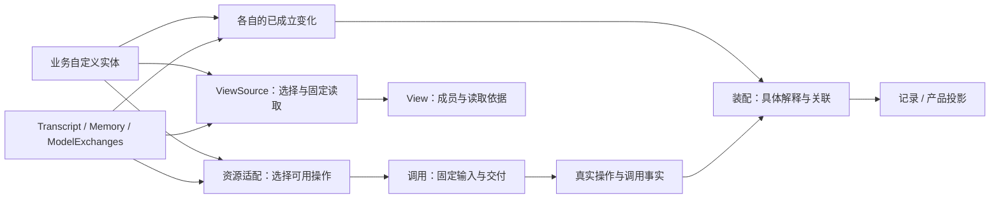

# 实体能力契约盘点与迁移候选

后续状态：P2／P3 已完成领域事实转交与 Memory 独立迁移；本文保留盘点时的源码形状，涉及旧 Memory、来源约束和专用观察端口的描述不再代表当前 API。当前实现见 [Memory](memory.md) 与 [迁移计划](kernel-boundary-migration-plan.md)。

状态：2026-11-11，源码基线 `ea6d5b3` 加当前未提交工作。本轮是源码盘点与设计整理，未修改生产 API、包身份、持久格式或运行行为。下文的「候选」「需补」不表示已经实现，也不要求所有实体实现全部能力。

后续进度：共同调用来源、类型化领域事实转交与普通业务固定材料已在 P2 落地；当前接口见[资源包](resources-package.md)、[记录](recording.md)，实施与限制见[迁移计划](kernel-boundary-migration-plan.md#8-p2-实施记录2026-11-11)。以下保留初始盘点，Memory 与其余协议归属仍待后续阶段迁移。

## 结论与心智模型

**按能力契约和表层形状协作；具体实体维护自己的操作语义和不变量。** 通用实体可以作为方便业务使用的一种实现，专用实体可以保持自己的内部组织。无需统一继承链，也不要求每个对象都提供 `snapshot/replace/restore/subscribe`。

现有机制已经覆盖稳定数据、资源访问窗口、View 来源、变化捕获和运行观测。主要待收敛点是：固定读取如何保留准确依据、具体内容事件如何退出低层机制、实体值与传输 DTO 的归属，以及可选写入回执的语义。



图中的能力可分别接入。实体不必认识调用实现，View 不拥有正文，观测解释不改写事实。固定值、纯值定位符、进程内活引用、受控访问端点分别识别：MessageRef／TranscriptRangeRef 持有活 Transcript 并提供读取行为，但不自动携带资源端点的访问窗口；不能把它们直接当作可保存的纯值依据。

## 一、已有、可迁移、需要补充

| 能力         | 已有                                                              | 可迁移或复用                                                  | 需要补充／保留的边界                                                     |
| ------------ | ----------------------------------------------------------------- | ------------------------------------------------------------- | ------------------------------------------------------------------------ |
| 数据固定     | contracts 的 `stableValue` / `Stable<T>`，调用边界已使用          | 在实体形成正式值时采用同一认证机制，之后复用固定子图          | 专门复制／freeze 不等于已有认证；准入、值域、预算和对象身份影响须验证    |
| 对象身份     | Transcript、Memory、Memories、ModelExchanges、Record 各有自身身份 | 使用已有身份与作用域表达读取依据                              | 不强制给 Message、View、MessageUsage 补 UUID；单项身份与集合身份分别处理 |
| 当前版本     | revision、sequence、SourceStamp 等已经存在                        | 适配器保留来源已有版本，不改变计数语义                        | 不用一个数字兼任条目版本、集合版本、消息位置、记录游标与格式版本         |
| 固定读取     | 各实体的固定条目／范围读；ViewSource 的按键读取                   | `ViewSource` 直接复用；普通资源出口可明确返回固定材料及其依据 | 普通实体读还没有共同材料外形；不因此重造 ViewSource 或要求全量快照       |
| 变更操作     | append、apply、intake、complete、include/exclude 等               | 每种操作继续通过普通 ResourceOffer 暴露                       | 不统一成 replace/CRUD；条件写是可选能力，当前检查位置也不同              |
| 固定写入确认 | Transcript、Memories、ModelExchanges 都有准确去重／确认           | 保留完整请求比较、原始回执及各自的增量持久路径                | 需关联因果时，要能区分新形成与确认旧效果；不强制统一 operation 身份      |
| 持久交接     | 内容实体有同步 commit/CAS；Interaction 有自身持久契约             | 复用先核验、提交后安装、故障不猜效果的原则                    | 不同对象的提交不确定处理不同，尚无可直接替换的统一持久器                 |
| 变化事实     | ChangeCapture、publishFact、各实体事件                            | 事实形状归生产者；捕获、转交、解释分别组合                    | 通用实体的 typed observation 接线尚未公共化，低层仍有两种内容特判        |
| 观察消费     | EventConsumer、ProgressChannel、Runner 订阅                       | 按所需错误策略使用现有端口                                    | 隔离订阅不能替代 required publication；订阅、缓冲不自动提供持久重放      |
| 历史材料     | append-only 消息可按位置重读；CP 可保存已取得材料                 | 对有保留能力的来源做显式历史读取适配                          | 版本存在不等于旧正文存在；不要求所有实体成为历史库                       |
| 生命周期     | 各对象维护自己的生存与活动边界                                    | 资源窗口与实体寿命继续分离                                    | 不预设所有实体具有 pending/completed/closed 等共同状态机                 |

主要证据：[固定值](../packages/contracts/src/value.ts)、[ViewSource](../packages/view/src/source.ts)、[View 数据形状](../packages/view/src/types.ts)、[资源操作](../packages/resources/src/activity.ts)、[变化捕获](../packages/changes/src/capture.ts)、[事实发布](../packages/changes/src/publish.ts)、[隔离消费者](../packages/changes/src/progress.ts)。

## 二、现有对象逐项归位

| 对象                | 身份与版本                                                                                   | 固定／活读取的现状                                                                                              | 需要保留的专用能力                                       |
| ------------------- | -------------------------------------------------------------------------------------------- | --------------------------------------------------------------------------------------------------------------- | -------------------------------------------------------- |
| Transcript          | 集合 UUID；Message 以集合＋绝对 index 定位；revision 也计入分段变更                          | 消息固定；snapshot 返回数组副本；range 固定成员上界，不要求复制全历史                                           | 正式追加、位置不变、分段、固定追加回执                   |
| Memory / Memories   | Memory 单项 UUID；集合 UUID，sequence 按实际条目变更推进，一批可推进多次；单项没有自己的版本 | Memory 是可继续更新的对象；snapshot 返回当前冻结内容；集合 get/values 返回活 Memory，集合 snapshot 是值数组副本 | 集合统一校验／接纳批次、保留创建顺序、固定应用确认       |
| ModelExchanges      | collection sequence、origin id/digest、entry id/revision 分别存在                            | 已有固定条目、按 origin 范围、准确引用及按 key 读取                                                             | 固定起点、模型回复与反馈槽、目录／续接核验、准确效果确认 |
| View                | 自身只有 revision，无 UUID；成员引用 source/key，读取另有 basis                              | 保存选择，不保存实体正文；capture 交付本次读取的材料                                                            | 成员顺序、来源范围、版本核验、局部 include/exclude       |
| MessageUsage        | 实例内 WeakMap，以 Message 对象身份计数；无持久 ID/版本                                      | get/add；无快照、枚举或历史恢复                                                                                 | 本次材料使用计量，不需要为了统一而变成持久实体           |
| Record / RecordBook | Record 有 ID/父关系；Book 没有独立 ID/revision                                               | Book.get 返回载体；资源 get 返回隔离 DTO；历史载入后只读                                                        | 记录关系合法性、按关系查询、历史只读载入                 |
| Recorder            | 自身 ID/revision 是该记录实例的事件序列                                                      | 登记／变更后捕获事实并通知；不是内容持久器                                                                      | 记录协调、实际事实顺序及可选消费                         |
| Interaction         | 自有身份、契约、持久 revision 与发送状态                                                     | 固定请求、反馈和查询；等待有局部寿命                                                                            | 独立发送、未知结果不重发；不能简化为普通内容 replace     |

源码入口：[Transcript](../packages/transcript/src/transcript.ts)、[Memory](../packages/memory/src/memory.ts)、[Memories](../packages/memory/src/memories.ts)、[ModelExchanges](../packages/model-exchanges/src/exchanges.ts)、[View](../packages/view/src/view.ts)、[MessageUsage](../packages/measurement/src/usage.ts)、[RecordBook](../packages/records/src/book.ts)、[Recorder](../packages/records/src/recorder.ts)、[Interaction 契约](../packages/interaction/src/contract.ts)。

这张表同时排除了一个误区：并非所有有状态对象都是同一种内容实体。计量器、记录协调者、外部发送机制可以提供部分共同能力，但没有因此获得统一的生命周期。

### 固定数据有三个不同层次

1. **隔离副本**：修改返回容器不影响实体，但调用者仍能修改该副本。例如 Transcript.snapshot 的数组。
2. **领域内冻结值**：按已知 schema 复制并冻结，如 Memory.snapshot；能维持现有领域不变量。
3. **认证稳定值**：由 stableValue 生产，具备通用值域检查、预算及可信子图复用证据。

当前 Transcript、Memory、ModelExchanges 并未普遍在实体准入处使用第三种。迁移要在值形成处真正认证，不能只把返回类型改成 `Stable<T>` 或开放任意信任注册。

也不能把所有 `freeze` 都机械替换为 `stableValue`：View 的被动值检查有自己的 Proxy 拒绝策略，Records 的诊断快照有特化表示，MessageUsage 依赖对象身份。应分别确认值域与语义；对大集合按新增条目或变化块认证，不能每次把完整历史重新固定。

## 三、最小读取形状：先表达依据，不强制内部模型

下面只是比较出口的设计记法，尚不是新增公开类型：

```ts
type FixedMaterial<Basis, Value> = {
  readonly basis: Stable<Basis>;
  readonly value: Stable<Value>;
};
```

`Basis` 由实际读取能力定义。例如：消息可以是集合＋位置／范围；当前 Memory 可以是集合 sequence＋单项 ID；交换可以是 collection＋entry＋revision。无需为了接入先给每个 Memory 增加独立 revision。

它只要求 **依据与所指内容在同一个读取边界成立**。以下能力分别表达：

- 读出正文不等于返回活实体或可执行端点。
- 当前一致性依据不自动成为历史地址，普通引用也不授权写入。
- ViewSource 已有 stamp/entries，不再包一层同义的通用来源接口。
- 如果业务只需要正文，可以保留正文出口；需要追踪身份的出口不能默默省掉依据。
- 一个批量读取可以保留多个条目依据，不把一次读取强制解释成一个 Entity 的全量状态。

当前差异的例子：MemoryResource.snapshot 内部捕获 memoriesId/sequence，但向业务只暴露 items；TranscriptRangeReader 则保留 locate/read；ModelExchanges 返回准确 reference。这些都是可选择的能力表面，不应仅靠相同的 `snapshot` 命名判定等价。证据：[Memory 资源](../packages/memory/src/resource.ts)、[Transcript 资源](../packages/transcript/src/resource.ts)、[交换资源](../packages/model-exchanges/src/resource.ts)。

## 四、哪些现有内容应留作预设

### Memory 的领域规则目前过于具体，不能用作通用实体要求

当前 Memory 必须持有具体 Transcript，topic/content 非空、sourceIndexes 非空且存在；sourceResults 还限定 file-created、assistant answerIndex 和 FileReceipt。Memories 额外检查变更说明、证据关系并组织批次。

来源与操作证据可以有价值，但它们属于这套记忆预设选择的规则。业务画像、推进状态或普通笔记不必为进入 View 满足这些规则。需要整理的是：哪些保留在记忆预设，哪些由业务策略／具体值 schema 实现；不能把必填字段改成 optional 就声称已经完成能力分解。

证据：[Memory.prepare](../packages/memory/src/memory.ts)、[MemoryChange](../packages/memory/src/change.ts)、`packages/memory/src/source.ts`（P3 已删除）、`packages/protocol/src/content/memory.ts`（P4 已删除；当前领域类型归 memory，记录投影归 records/data）。

Transcript 的 user/assistant、非空文本、分段与相邻配对同样是具体消息能力；ModelExchanges 的回复与反馈槽完整性是专用实体不变量。它们都可保留，但不进入通用内容约束。

### 回执语义与无变化处理必须分别保留

- Transcript 固定追加使用 parentContextId＋childContextId＋position；Memory 固定应用使用 contextId＋position。ModelExchanges 使用接纳父子身份及 position。字段近似不能直接统一身份含义。
- `applyFixed` / `complete` 可以返回既有效果，不代表本次又写入。若需要画出操作因果，当前回执不普遍提供 applied/confirmed 区分；可以明确操作结果或单独事实，但尚未决定公共形状。
- Transcript 普通空追加不推进，固定空追加拒绝；Memory 普通空／同值批次不推进，固定空／同值批次仍可提交确认凭据。
- ModelExchanges 的 `read(..., exact=false)` 返回当前条目，不是旧 revision 的正文。Memory 也没有历史内容库；Transcript 的旧消息可读不代表旧分段状态全都可重建。

证据：[Transcript 固定追加](../packages/transcript/src/append.ts)、[Memory 固定应用](../packages/memory/src/apply.ts)、[交换类型](../packages/model-exchanges/src/types.ts)及上述实体实现。

## 五、观测迁移涉及的真实接缝

当前有一条完整的内容专用链：

```text
protocol 的 TranscriptEvent / MemoryEvent
  → ResourceOwner / ResourceEndpointActivity 两个专用端口
  → InvocationObserver / 调用资源 / CP 活动观测
  → Runtime 内容记录映射与 Runner 投影
  → Records 与 Observer 的具体内容记录
```

证据：[ResourceOwner](../packages/resources/src/ports.ts)、[资源端点](../packages/resources/src/endpoint.ts)、[InvocationObserver](../packages/invocation/src/observation/observer.ts)、[调用资源](../packages/invocation/src/invocation/resources.ts)、[CP 活动契约](../packages/invocation/src/checkpoint/contract.ts)、[Runtime 录制](../packages/runtime/src/records/observation/invocation.ts)、[Runner 投影](../packages/runtime/src/runner/observation-projection.ts)。

这里的 CP 内容分支是恢复活动的观测转交，**不是 Frame v6 保存格式依赖 Memory/Transcript 正文**。整理观测不需要顺带重做 CP。

可迁移的是有限的事实转交与具体解释归属：实体产出领域事实；装配固定解释／消费；内核提供真实调用、操作与受保护故障依据。不能把两个字段简单换成 `unknown`，也不能用隔离所有错误的 ProgressChannel 替代当前 required publication。

需要保留四个边界：

1. 资源操作 UUID（现字段名 interactionId）、origin.contextId、接纳父子身份、实体固定写凭据各有用途。
2. 资源 returned 在 result 回调之前；变化发生、通知到达、读取返回、业务采用和效果确认分别表达。
3. 实体变更后方法仍可能抛错；成功返回路径不能独自覆盖所有来源关联。
4. 无来源或记录缺失保持未知，不能用全局当前调用、到达时间、相同资源或最新快照补线。

现有公开机制已能显式组合这些情况；尚缺的是经过类型与生命周期收敛的公共接线方式，不是新的 Entity 状态机。实验依据见 [Lab 因果验证](../../capix-lab/examples/generic-entity-study/observation-causality-validation.md)，其 80 项测试针对文中记录的候选包批次，不替代 CAPiX 自身回归。

## 六、类型归属与防止循环依赖

| 类型／能力                                       | 当前归属                                              | 建议方向                                                    |
| ------------------------------------------------ | ----------------------------------------------------- | ----------------------------------------------------------- |
| Stable、调用身份、操作接收                       | contracts                                             | 直接复用                                                    |
| ViewSource、SourceStamp                          | view                                                  | 保持在 view；scope/version 是来源读协议                     |
| InvocationOrigin                                 | protocol，仅含 contextId；changes 也因此依赖 protocol | 可优先归 contracts，protocol 显式提供同一纯值；不扩充其语义 |
| Message、MemoryContent、实体 change              | protocol，实体／持久端反向使用                        | 具体领域类型归所属实体或预设；与真实 wire DTO 的映射明确    |
| TranscriptFrame/Update、Observer 增量、HTTP 形状 | protocol                                              | 明确跨端版本和接纳规则；不能整包重导实体方法                |
| Record 数据、变更和传输                          | 目前混用 protocol recording 类型                      | 分别盘点实体事实与 wire 消费，避免全部塞入 contracts        |
| 本轮 FixedMaterial 记法与 typed 变化接线         | 尚未生产实现                                          | 先证明实际多包协作需求，再决定公开位置；不提前创建平台包    |

**仅移动类型定义不等于解除耦合。** transcript/memory 已依赖 resources；若让 resources 反向导入两个实体包，会产生循环。protocol 也不能为重导类型而依赖服务端实体实现。应先收敛低层事实转交通道，再处理实体值与显式 wire 投影。真正相同的共同纯值可有唯一中立定义；不要为维持同名而保留两份语义不清的类型。

## 七、持久与历史能力的差异

Transcript、Memories 已有增量 commit；ModelExchanges 每次提交一个 origin 或变化 entry。它们不需要通过通用实体改成每次保存完整集合。已取得的固定材料由 CP 保存时，仍只表示那份材料，不恢复活实体。

提交不确定处理也尚不一致：ModelExchanges 持久故障后锁住该实例的继续变更；View 抛 PersistenceError、保留本地旧状态，但没有同样的锁定或权威重载入口。Recorder 是变更后捕获，并无内容实体那种 commit-before-install 持久端口。此差异值得独立审查，不能在抽共同 helper 时静默统一。

本轮不建立共同事务、不提供自动重试，不要求历史查询、删除、清理、关闭或持久存储成为所有实体的必选能力。真实需求出现时，按具体能力补齐。

## 八、建议的小闭环与验收归属

| 阶段              | 可以做什么                                                                              | 验收与停止边界                                                                                 |
| ----------------- | --------------------------------------------------------------------------------------- | ---------------------------------------------------------------------------------------------- |
| 1：共同词汇       | 把真实共用的调用来源值归位；区分隔离副本、领域冻结值和认证稳定值                        | contracts／changes／protocol 自身类型与出口检查；无新身份、无行为变化                          |
| 2：固定读取       | 对一个自定义实体与一个专用实体确定准确固定材料出口，复用现有 ViewSource；只在形成处认证 | 所属实体＋view；涉及调用装配时由 runtime 承接组合回归；不要求全量 snapshot，不默认增加单项版本 |
| 3：事实转交       | 将消息／记忆特判从低层端口解耦，具体映射留在实体适配和录制装配                          | strict/isolate、关闭窗口、变更后失败、并发操作身份、未知来源都保持；不引入全局注册表           |
| 4：专用实体与协议 | 整理 Memory 的具体策略与值形状，迁移实体自有类型，显式定义 wire DTO；再处理客户端包边界 | 类型依赖无环、旧 API 真正替换、公开产物消费；不顺便增加历史存量升级                            |

阶段 2 的出口选择和阶段 3 的类型化接线仍需小范围设计；这份盘点不预先决定新的 Entity 类、包名或统一事件枚举。可以独立先完成阶段 1，不能用它代替主要边界的收敛。

已有框架回归可承接：

- 数据固定：[contracts stable-values](../packages/contracts/test/stable-values.test.mjs)。
- 实体提交／固定确认：[Transcript fixed](../packages/transcript/test/fixed.test.mjs)、[Memory apply-resource](../packages/memory/test/apply-resource.test.mjs)、[ModelExchanges](../packages/model-exchanges/test/model-exchanges.test.mjs)。
- 稀疏读取及来源再检查：[View generic](../packages/view/test/generic.test.mjs)、[View membership](../packages/view/test/membership.test.mjs)、[Transcript source reentry](../packages/transcript/test/view-source-reentry.test.mjs)、[Memory source reentry](../packages/memory/test/view-source-reentry.test.mjs)。
- 资源接收时序与保护：[resource-access](../packages/resources/test/resource-access.test.mjs)、[resource-operation-lifetime](../packages/resources/test/resource-operation-lifetime.test.mjs)、[resource-port-contracts](../packages/resources/test/resource-port-contracts.test.mjs)。
- 观测装配：[Runtime observation binding](../packages/runtime/test/observation/binding.test.mjs)、[Runtime resource ports](../packages/runtime/test/resource-port-contracts.test.mjs)。

以上为现有测试入口的源码盘点，本轮未重跑它们。后续框架迁移应在对应包增加／调整独立回归；Lab 的通用实体和观测实验保留研究作用，不成为框架构建与合入依赖。

## 九、后续窄验证（2026-11-11）

[Lab 实体能力契约验证](../../capix-lab/examples/entity-capabilities-study/README.md) 已完成共同固定读取形状、现有 Transcript／Memories 适配与候选泛型记忆的对照：新增 36 项测试及 10 个类型负例通过，前轮 80 项回归通过。使用报告中列明的既有候选包批次，没有改动本仓生产 API。

结果支持把固定正文与生产者自定依据共同交付，不要求共享 Entity 父类、统一版本或历史能力；ViewSource 继续独立表达来源范围与准确读取。候选记忆不依赖 Transcript 或强制来源，仍能接入相同资源／调用／View／CP 链路。它未实现现有 Memories 的批次、持久端口或固定凭据，不能据此宣称整个记忆包已经可替换。

下一步可先确定固定读取语义与 Memory 的具体边界，再按包迁移并补充框架自身测试。领域观测转交与 protocol 类型归位仍是独立接缝；不由本轮读契约代替。
