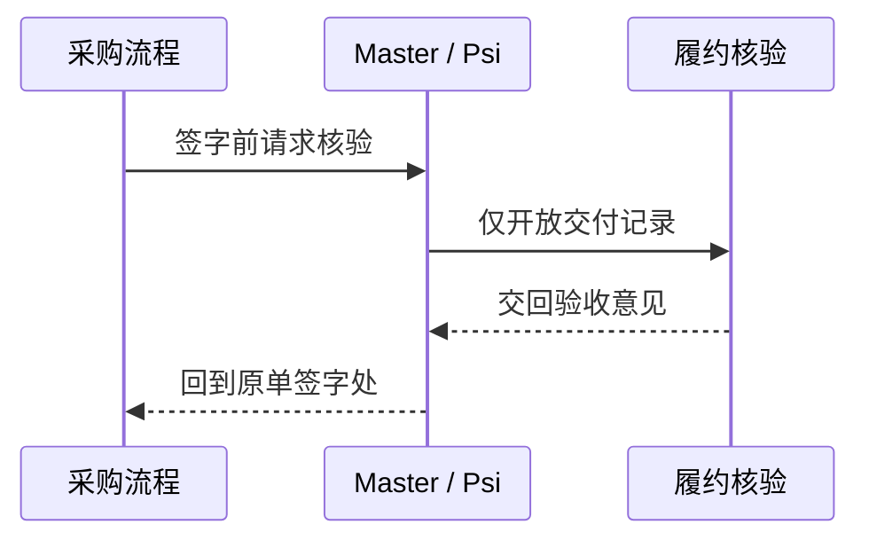
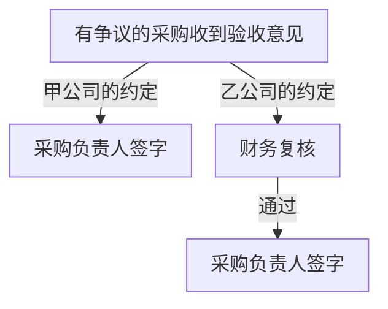

# 从 CAPiX 出发，如何思考智能组织

CAPiX 的并行审阅示例里，有三个模块要查，却只定义了一个审阅角色。协调者用普通代码遍历模块清单，对同一个 `Group` 发起三次调用。每次审阅只看自己模块的改动。等复核角色把 API 和文档的发现放到一起，才看出一边读的是毫秒，另一边教用户传秒。[多 Agent 并行协作](../scenarios/multi-agent.md)

在这个例子里，派出多少人可以等看到任务再定。审阅和复核这两种角色，却是写示例时就定好的。如果工作做到一半，我们才知道**还应该请谁来**，那个人也需要在系统启动时就占好一个位置吗？

## 一笔采购，什么时候需要临时组队

假设一笔采购按惯例做了比价，正在等负责人选报价。负责人问“去年买这个型号花了多少钱？”系统查到价格，答完继续等他选。这类工作里，答案每天都可能不同，下一步怎么走却很清楚。一次问答、一次选择、从原处接续，已经够用。

现在，负责人看完价格，想起另一件事：“这家供应商去年有过交付争议。找当时验收的人核一下，只给他看交付记录，结论回来我再签。”

对经办人，这是一句很自然的交代。对系统，这句话改变了分工。参与者要从旧记录里找，他可以看交付记录，报价仍然只对原有的经办和审批人员开放。他的答复还要回到这一笔尚未签字的采购上。价格已经核完，经办人等的是验收意见，谁也不想为了补这个环节再做一次比价。



有多少业务需要这样临时组队？我更愿意去看经办人在哪些地方接过了工作。有人只是补一个日期，有人却花了半天找到合适的人、说明他能看什么，再追着把意见拿回来。这两张工单都可能写着“人工处理一次”，值得交给系统的工作却很不一样。

## 黄金路径可以先启动，其他角色可以晚一点

在基于 CAPiX 的宿主 Psi 里，我想保留一条“黄金路径”。它是团队已经反复走通的办事方法。主 Agent（Master）先理解需求，属于常规采购的就交给默认的 Worker。这个 Worker 可以随系统启动，也可以等第一笔采购到来再装配。流程是否成熟，与今天有没有必要让它提前就绪，是两个独立的决定。

遇到交付争议，默认 Worker 把已经完成的比价、待回答的问题和签字前的等待位置交给 Master。Master 可以选择现成的履约核验预设，也可以用查找验收人、限定可读材料、请求反馈几个已有能力，为这一次核验装配一个新 Worker。需要动态生成代码时，代码写的是这几步怎样衔接。能读到哪些记录，仍由宿主实际授予的资源决定。反馈回来后，宿主按任务记录把结论交还原审批环节。

这里有一个我很看重的时间差。对 Master 来说，核验团队是在遇到争议之后才组建的。对新 Worker 来说，它开始执行时，自己的 `Scene` 已经装配好，`Runner.build()` 已固定成员和接线。组织可以按需变化，每一次执行仍然有清楚的边界。前者是我对 Psi 的设计设想，后者是今天 CAPiX 已有的能力。[CAPiX 的结构与构建契约](../concepts/structure.md)

把这次委托写成伪代码，可以看到两处不同的决定。第一处发生在组队时。Master 选用了“找原验收人”和“向他请求反馈”两个预设。下面的工厂为本次核验创建成员，用 CAPiX 的 `Group` 把它们接起来。

```js
const deliveryRead = new ResourceOffer({
  methods: { read: (records) => records },
});

function createDeliveryReview() {
  const findInspector = presets.createInspectorLookup();
  const askInspector = presets.createFeedbackRequest();
  return new Group({
    deps: { delivery: deliveryRead.request() },
    async run(work) {
      const records = await work.resources.delivery.read();
      const inspector = await work.children.invoke(findInspector, records);
      return work.children.invoke(askInspector, {
        inspector,
        records,
        question: work.input,
      });
    },
  }).add({ findInspector, askInspector });
}
```

第二处决定是**哪些材料真的可读，以及意见交还给谁**。这里的 `presets` 和 `host` 是 Psi 的业务伪代码。Master 发出核验委托后，宿主挑出这笔采购获准披露的交付记录，接好验收人的反馈通道，再用同一个 `deliveryRead` 登记只读材料。核验人收到的材料里没有报价。

```js
const { deliveryRecords, resources } = await host.prepareReview(task);
resources.register(deliveryRead, deliveryRecords);

const scene = new Scene(createDeliveryReview());
const worker = new Runner(scene, resources).build();
const opinion = await worker.run(task.question);
await host.deliver(task.replyTo, opinion);
```

核验 Worker 的职责到返回意见为止。宿主用委托时保存的 `replyTo` 找回对应的采购单，把意见交到签字前的等待处。

## 组织方式也可以成为预设

预设很容易让人想到工具清单。拿两家拥有同样采购、验收和财务能力的公司做个比较，就会发现清单里少了什么。甲公司允许采购负责人看过验收意见后签字，乙公司要求有过争议的供应商还得由财务复核。两家公司用得上同一套工具，真正让它们按不同方式做事的，是**谁能委托谁、谁能看哪些材料、谁的意见足以让事情继续**。这些约定也可以写成预设。一个 `Group` 甚至可以把整段核验工作做好，留给上层一句明确的委托。



当预设多起来，我会先把能力按域整理，让 Master 知道遇到什么问题该往哪里找。多一层目录，不必多一个转述需求的 Agent。“只给他看交付记录”这样的原话，值得一直保留到实际分配读取权限的那一步。只有域内确实需要独立判断时，再请那个角色参与。

回到那笔采购。一次临时委托，还不足以成为所有采购都要走的手续。假设此后又发生了几次同样的争议，团队确认找原验收人核验确实有用，就可以把这段分工收进采购预设，并写清什么时候才需要触发它。至于昨天那一笔究竟委托给了谁、对方回了什么，则由那笔任务自己的记录保存。

如果有一天，另一位经办人第一次碰到有争议的供应商，系统已经能替他找到当年的验收人，把恰当的材料交过去，再把意见带回签字的人面前，我会觉得这个组织确实学会了一件事。
