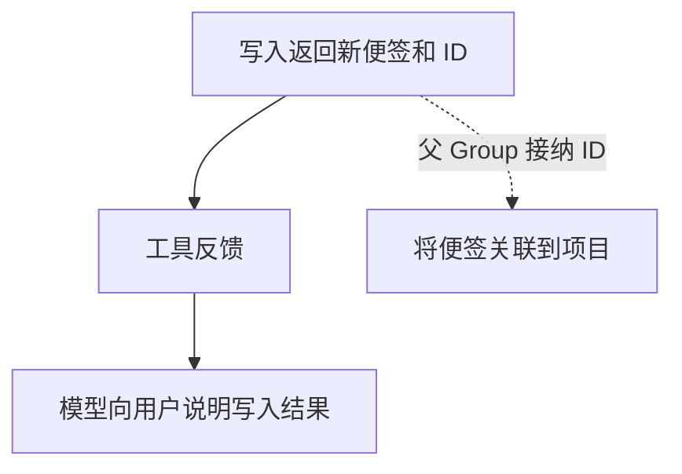

# 工具循环应该在哪里结束？

便签助手有个我很喜欢的失败用例。它读完两张便签，把「整理用户反馈」等三项待办写进一张新便签。第四次请求已经带上了新便签的 ID 和正文，该由模型告诉用户“已经写好了”。我们故意让这次请求失败。用户没收到答复，但按写入时拿到的 ID，仍然能读出那张「待办」。整次运行只写了一张。[便签助手的离线验证](../../examples/notes/verify.mjs)

起初我担心的是另一个问题。CAPiX 提供了顺序执行的 Sequence，也有每轮选择下一步的 Dynamic，为什么写助手时，我们还是习惯先用 Tool？这条用例让我换了个问法。下一项需求来了，我们最容易把它加在哪里？

## 两个都像是“再加一个工具”的需求

假设有人想按关键词找便签。用户只记得标题里的几个字，模型可以先搜，看看结果，再决定要打开哪一张。教程已经把搜索本身做成了一个独立节点。助手调用结束后，用这个节点在同一份 Notes 里搜「待办」，能找到刚才写入的内容。要让模型也能用它，只需把节点登记为工具并供给查询资源。现成的循环会把搜索结果送进下一轮，连“还要不要再查一次”都有地方处理。这个方便是实实在在的。[给便签助手增加查询](../guide/notes-extend.md)

再换一个需求。有人希望“以后新建的待办都要关联到当前项目”。我第一反应也可能是加一个工具。模型刚拿到新便签的 ID，再让它调用一次关联操作，看起来只差一步。可要是模型拿到 ID 就答复了用户，项目里会少一条关联。按工具循环的结束条件，这一轮却已经顺利完成了。

同样是新增一个能调用的动作，搜索让模型多了一条调查途径。把项目关联也放进它可以自由选择的目录，就连“这一步要不要发生”都一起委派了出去。**让我担心的惯性，是这种选择往往在写登记项时就做完了，作者甚至还没问过谁应该负责。**

Dynamic 也能把选择交给模型。比如，作者可以让决策节点通过 View 读几张便签，请模型判断接下来该查哪张，再把判断映射成一次成员调用。用 Tool 写这段调查之所以顺手，是因为模型协议本来就能表达“我要调用哪个工具”，ModelExchanges 又能把这次调用和对应的反馈带进下一轮。省下来的是一轮轮接线的工夫。至于哪一步可以交给模型选，还是得回到需求上判断。[选材与模型续轮](../native-tool-integration.md#固定起点与交换实体)

## 顺着新便签的 ID 往下看

在现有教程里，写入节点交回带 ID 的便签，Tool 把它映射为反馈，下一轮模型读到这份反馈，再向用户作答。假如项目关联是必经步骤，我会把写入节点和关联节点登记在同一个普通 Group 下。这个 Group 可以直接接纳写入结果，拿到 ID 就调用关联节点，最后再请模型组织给人看的说明。下图的虚线是这个假设需求下的另一种装配。[写入节点和工具反馈](../guide/notes-nodes.md)

这样想，我倒愿意让有些工具循环走得很长。查一个陌生故障，模型可能要读十几次材料才有把握交回一份解释，这正是我请它做的事。反过来看，哪怕只让模型读一次写入确认，如果关联节点非得等它开口才会启动，模型也已经决定了项目里有没有这张便签。数循环跑了几轮，看不出这个区别。顺着 ID 找到下一个等它的人，就容易看见了。[推进与交付的责任边界](../concepts/structure.md#推进与交付的责任边界)

我现在会用第四轮失败的那张便签检验自己的设计。要是下一位等着的是用户，确实还欠他一句答复。要是等着的是项目关联节点，它需要的 ID 在上一轮就已经有了。它为什么还要等模型再说一遍呢？
