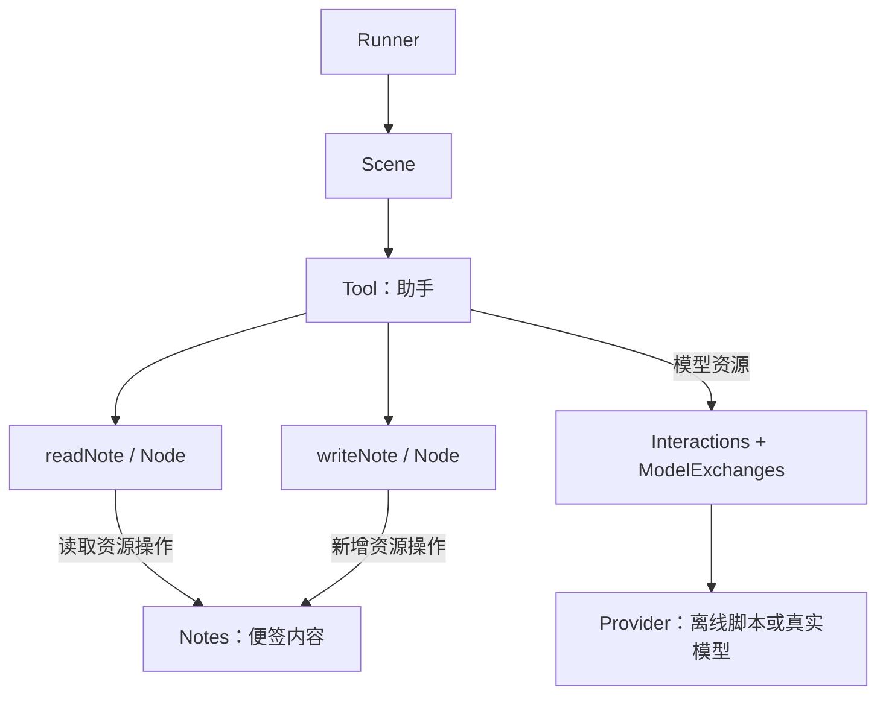
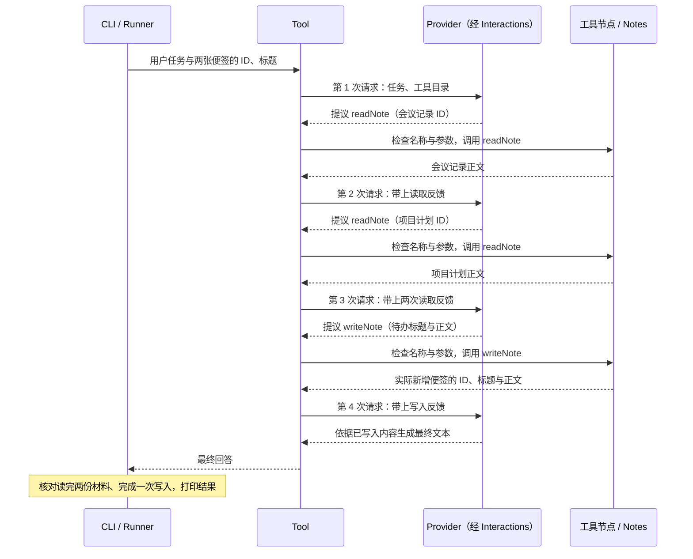

# 快速开始：便签助手

**任务**：读取「会议记录」和「项目计划」，整理三项待办，新增一张「待办」便签并回答用户。

**结果**：两次真实读取、一次内存新增，以及依据写入反馈生成的最终回答。本页先跑通任务，再用结构图、时序图和完整源码解释它。

## 运行并核对结果

在仓库根目录，使用 Node.js 22.23.2 与 pnpm 10.7.1：

```sh
pnpm install --frozen-lockfile
pnpm build
node examples/notes-assistant.mjs
```

默认模式无需 Key、不访问外部服务。它是**固定决策脚本**：核对工具反馈后再推进，验证完整调用链路；它不代表模型理解材料或能规划任意任务。

终端依次打印两次 `readNote` 成功、一次 `writeNote` 成功，随后输出：

```text
最终回答：
已创建便签「待办」：
- 整理用户反馈
- 发送演示链接
- 检查安装步骤
```

末尾的「本次新增便签」会打印实体实际返回的 ID 与内容，可以与回答对照。便签每次运行重新创建，**只在内存中，没有文件、数据库或 Checkpoint**。

## 看清结构与一次运行



Tool 从登记的节点生成目录，检查模型提出的工具名称与参数，再调用对应成员。节点通过各自申请的资源操作访问 Notes；模型的最终文本不会直接改变便签。

默认离线模式依次调用模型接口四次。下面省略资源接线，保留每轮请求、实际工具操作与反馈：



“先读两份材料再写入”来自本例的提示和离线脚本。CLI 的末尾核对发生在执行之后，**不是写入前的业务门禁**；必须强制的规则要写在结构或资源操作中。写入已成功时，后续回答失败不会撤销它。

## 完整源码：提供工具、接模型、运行

以下标签直接导入仓库里的完整文件，没有省略装配代码。先看 `assistant.mjs` 的两种资源操作、两个 Node、Tool 和模型接线，再看入口怎样选择 Provider、调用 Runner 并等待独立发送退出。

::: code-group

<<< ../../examples/notes/assistant.mjs{js:line-numbers} [assistant.mjs]

<<< ../../examples/notes-assistant.mjs{js:line-numbers} [notes-assistant.mjs]

<<< ../../examples/notes/materials.mjs{js:line-numbers} [materials.mjs]

:::

Interactions 负责独立发送和反馈；ModelExchanges 保存请求起点、回复与工具结果。停止局部等待不自动取消发送，因此 CLI 在 `finally` 中等待 `interactions.settled()`，再关闭通道。

::: details 完整支持代码：离线 Provider 与业务实体

`offline-provider.mjs` 检查每次真实反馈，按分号拆分读取的正文，形成待办并验证写入。`domain.mjs` 中本课只使用 Notes；同文件的 Plan 用于其他实体示例。两者都是宿主业务对象，没有隐含持久化。

::: code-group

<<< ../../examples/notes/offline-provider.mjs{js:line-numbers} [offline-provider.mjs]

<<< ../../examples/entities/domain.mjs{js:line-numbers} [domain.mjs]

:::

:::

## 改一处，再运行

在 `examples/notes/materials.mjs` 的 `initialValues` 中修改一条事项，再运行：

```sh
node examples/notes-assistant.mjs
```

保留两张便签和总计三条事项，观察读取日志、新便签和最终回答一起改变。离线脚本固定了顺序与分号拆分规则；任意改写任务不会让它自动产生新计划。

## 显式接入真实模型

同一棵结构可以换用 Chat Completions Provider。在当前终端配置后，自行运行：

```sh
export MODEL_ENDPOINT='https://your-provider.example/v1/chat/completions'
export MODEL_NAME='your-model'
export MODEL_API_KEY='your-key'
node examples/notes-assistant.mjs --live
```

`--live` 会调用真实服务，只读取当前进程环境，不读取 `.env`；缺少配置会拒绝运行。真实模型决定工具调用与措辞，可能不同于上面的离线时序。密钥留在终端环境中，不写入源码。

## 下一步

- [为什么用 CAPiX](../why.md)：结构、能力、事实与生命周期的边界。
- [结构与资源](../examples/structure.md)：Sequence 与 Dynamic，以及更小的字典示例。
- [实体与视图](../examples/content.md)：内容所有者、材料快照和使用范围。
- [工具、输出与记录](../examples/runtime.md)：输出订阅与观测事实。
- [模型与工具](../native-tool-integration.md)：协议、交换、预算与恢复。
- [契约导航](../README.md)：按需查阅当前 API。

页面只展示源码，执行发生在本机 Node.js 中；浏览器不会运行模型或框架。教程从仓库构建运行，发布包范围见 [npm 发布](../npm-publishing.md)。

本地查看网站运行 `pnpm docs:dev`；构建、预览分别用 `pnpm docs:build`、`pnpm docs:preview`，地址以终端输出为准。产物在 `docs/.vitepress/dist`。子路径预览时，为构建与预览设置相同的 `CAPIX_DOCS_BASE`（如 `/capix/`）。
