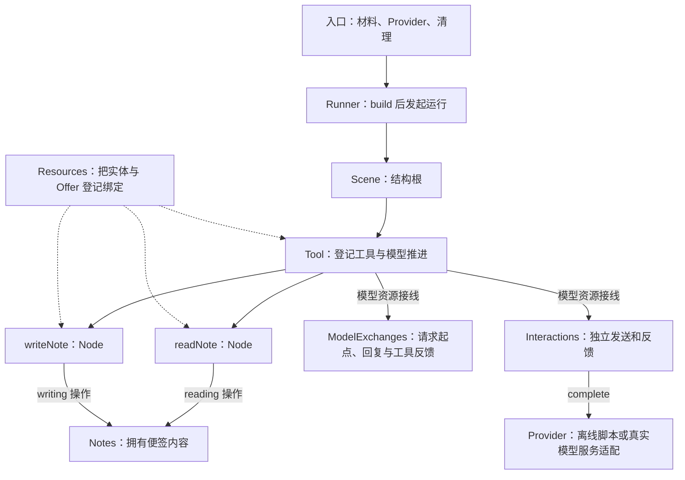

# 入门教程：一起拆开一个便签助手

我们要完成一件具体的事：读取「会议记录」和「项目计划」，整理三项待办，新增一张「待办」便签，再依据写入结果回答用户。完成以后，你应当能指出每一步由谁负责，也能为它增加一个查询功能。

这是一套连贯的课程。先运行已经接好的完整项目，得到一个可以核对的结果；再沿着同一份源码，依次理解内容、操作、节点、模型与运行。各章展示的片段直接来自可执行文件，最后一课也保留完整源码。无需先读完 API 契约，遇到需要深究的边界时再沿链接查阅。

## 先把完整项目跑起来

在仓库根目录，使用 Node.js **22.23.2** 与 pnpm **10.7.1**：

```sh
pnpm install --frozen-lockfile
pnpm build
node examples/notes-assistant.mjs
```

安装依赖可能需要联网。示例默认离线，不需要 Key、不调用外部模型服务。它用一个固定决策脚本扮演 Provider：每轮收到真实工具反馈，再决定下一步。这样我们可以先验证接线和数据流，随后再换成真实模型。

终端先打印两次 `readNote 成功`、一次 `writeNote 成功`，然后得到：

```text
最终回答：
已创建便签「待办」：
- 整理用户反馈
- 发送演示链接
- 检查安装步骤
```

末尾「本次新增便签」包含真实实体返回的 ID、标题和正文。ID 每次不同，正文应与回答对应。这个程序每次新建一份内存材料，不写文件或数据库；关闭进程后，再次运行会从两张初始便签开始。

先把这三件事对应起来：读取日志证明工具访问了原便签；写入日志给出新便签；最终文本依据写入反馈作答。只看到一句“已创建”，还不足以知道实际创建了什么。

## 从任务看全局



读这张图时，先抓住两个方向。向下是结构：Scene 包着 Tool，Tool 登记两个 Node。向旁边是能力：Node 经资源操作访问 Notes，Tool 经模型资源使用交换材料和发送通道。结构定义“由哪些部分协作”，资源接线定义“这些部分拿什么工作”。

Interactions 和 ModelExchanges 各有职责。前者处理一次发送及其反馈，后者保存模型循环中的请求起点、回复与工具结果。把它们分开，才能解释为什么工具调用已经结束后，宿主仍要照顾独立发送的退出。

默认过程是两次读、一次写、一次最终回复，共四轮模型请求。真实模型可能选择不同的调用顺序。提示描述了期望；必须强制的业务规则需要由结构或操作实现，不能仅靠一句提示。

## 课程地图

| 课程                                           | 要解决的问题                                      | 主要阅读位置                         |
| ---------------------------------------------- | ------------------------------------------------- | ------------------------------------ |
| [1．谁拥有便签](./notes-entities.md)           | 数据和身份放在哪里？读到的材料为何稳定？          | `Notes`、`createMaterials`           |
| [2．把操作交给资源](./notes-resources.md)      | 同一个实体怎样分别提供读与写？                    | `ResourceOffer`、`deps`、`Resources` |
| [3．让 Node 完成一次工作](./notes-nodes.md)    | 输入怎样到达操作，结果怎样交付？                  | 两个 Node、工具结果映射              |
| [4．接起模型与工具循环](./notes-model.md)      | 模型提出选择以后，谁真正执行？                    | `Tool`、离线 Provider                |
| [5．装配、运行与收尾](./notes-running.md)      | 什么时候 build，怎样换 Provider，谁等待发送结束？ | 工厂与 CLI                           |
| [6．用失败检查理解边界](./notes-failures.md)   | 参数错误、读取失败和回答失败各留下什么？          | 可执行验证                           |
| [7．加一个查询，再回看全局](./notes-extend.md) | 怎样复用已有便签，独立增加能力？                  | 查询节点与完整源码                   |

建议先按顺序走一遍，每章都运行一次小练习。所有业务操作都围绕这两张原便签，不会中途换成另一套玩具项目。完成后，你可以从[契约导航](../README.md)深入查阅资源、交互与恢复。

本教程在本机 Node.js 中运行；文档网站展示源码和说明，不在浏览器中执行模型。需要本地阅读站点时运行 `pnpm docs:dev`，构建与预览分别用 `pnpm docs:build`、`pnpm docs:preview`，以终端输出地址为准。

现在进入[第 1 课：谁拥有便签](./notes-entities.md)，从最普通的业务对象开始。
