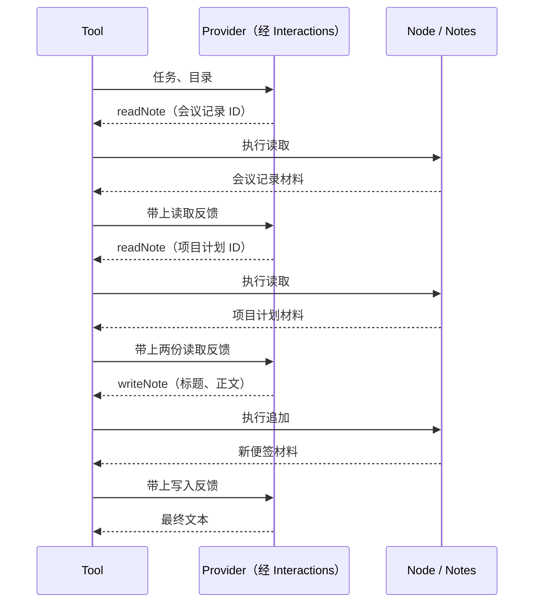

---
prev:
  text: 第 3 课：让 Node 完成一次工作
  link: /guide/notes-nodes
next:
  text: 第 5 课：装配、运行与收尾
  link: /guide/notes-running
---

# 第 4 课：接起模型与工具循环

两个 Node 一次各做一件事：读取或新增。用户的任务却需要连续几步，并依据前一步结果决定下一步。Tool 预设把这些普通节点组织为模型可以选择的工具，推进请求、执行、反馈与再次请求。

## 从登记中产生选择范围

<<< ../../examples/notes/assistant.mjs#tool-registration{js:line-numbers}

Tool 是普通 Group 的预设。它从登记成员得到工具目录，并把目录带到模型请求中。模型提出工具名称与参数后，框架按目录和输入契约处理，再调用相应 Node。写下一个工具名称，并不能让模型任意访问 Notes。

`policyVersion` 标识本例这份工具策略，`waitMs` 设定局部等待时间。它不是整个应用的业务截止时间，也不会让一切外部发送在超时瞬间消失；收尾会在下一课单独处理。

这里最关键的循环是“带着反馈再问”。模型可以选择读取已有便签，也可以选择追加新便签；执行权仍在已登记的节点及其资源操作中。最终文本只是回答，它不会绕过写节点自动保存内容。

## 用确定的四轮看清过程



离线 Provider 的完整实现直接来自运行代码：

<<< ../../examples/notes/offline-provider.mjs{js:line-numbers}

沿 `complete` 阅读：它先检查之前每次交换中的调用与反馈，再从读到的正文拆分事项，最后验证写反馈并形成文本。它不是预先打印一个固定答案；换材料时答案会跟着改变。但它仍是固定决策脚本，只认识两份来源、这个读取顺序和这两个工具，不能据此推断它能理解任意任务。

ModelExchanges 保存循环所用的请求起点、回复和工具结果；Interactions 负责发送及反馈。Provider 只需按模型协议完成一次请求，不负责直接调度业务 Node。这使真实模型适配和业务执行可以分别替换。

## 练习：对照第四轮的依据

先运行成功路径与已有验证：

```sh
node examples/notes-assistant.mjs
node examples/notes/verify.mjs
```

在 Provider 中找到 `written` 分支，再在验证文件中找到 `provider.requests.length` 为 4 的断言。预期验证通过；第四轮请求已经带有写入反馈，最终文本使用该反馈中的新便签内容。

这样可以区分两个问题：模型“打算写什么”，与“节点实际写成了什么”。本例在离线模式中严格核对这条链路；换成真实模型后，选择和措辞可能改变，业务仍应以真实操作结果为依据。

下一课把模型通道与 Runner 接起来：[第 5 课：装配、运行与收尾](./notes-running.md)。需要研究原生协议和工具推进规则时，再读[工具接入](../native-tool-integration.md)。
