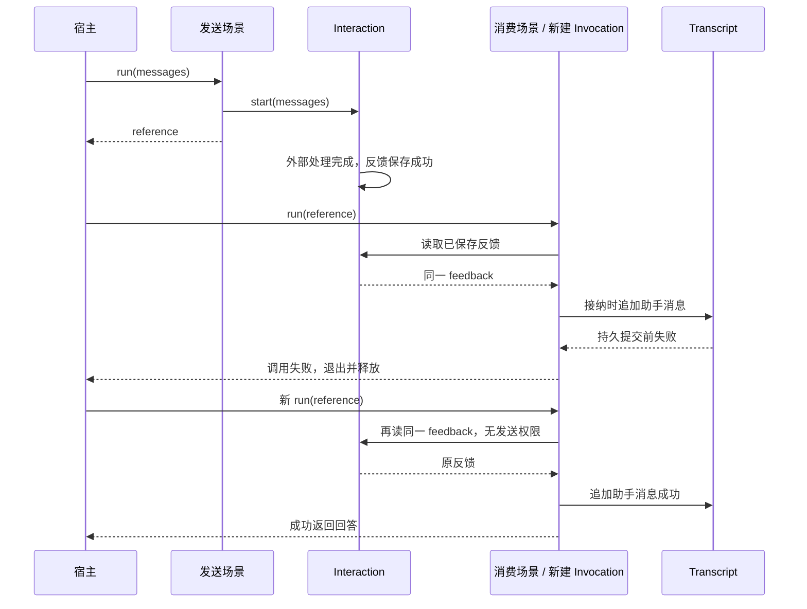

# 外部反馈成功、消息落实失败：消费边界验证

本轮验证一条跨模块失败链：外部处理成功且反馈已保存，当前调用读取反馈，但正式消息写入失败；当前调用结束后，新调用能否消费同一反馈并完成消息落实。只使用公开包出口、本地固定回答和故障注入存储，不调用真实模型，不修改生产实现。

## 对象关系与验证入口



可运行例子：[examples/interaction-message-retry.mjs](../examples/interaction-message-retry.mjs)。

```sh
pnpm build
node examples/interaction-message-retry.mjs
```

发送与消费分别用普通 Scene 表达。发送场景申请 start，将引用通过正常返回值交给宿主；消费场景只申请 feedback 和消息 append。资源接线本身就限制了消费者重新发送的能力。

宿主在示例里仅用变量保留引用，不通过被动观测收集恢复依据，也不宣称引用已经持久化。发送、引用保存、反馈保存、消息提交分别有自己的完成边界。这里没有旧调用复活、checkpoint 或执行重放。

## 验证的保证

1. **消息提交前失败不消耗外部反馈。** 反馈已经成立，失败发生在另一个实体的持久写入口。新 Invocation 可再次读取同一反馈；每次读取、接纳及其失败都属于真实的新调用。
2. **调用结束不结束独立发送。** 当前读取超时退出后，晚到反馈仍可保存；后续调用可以取得它，再处理消息落实。
3. **保存的最终反馈可以脱离旧交互宿主读取。** 测试将复制保存的交互状态交给新的 Interactions，新宿主读取反馈而不发送。它不恢复原调用、流式片段或尚未完成的外部执行。
4. **成功读取、子结果接纳和正式消息落实能够区分。** 子读取成功并不让父调用自动成功；本例接纳回调里的写入失败，不能发布成功的场景结果。

验证使用内存存储端口模拟独立持久边界，按 expectedRevision 检查写入并复制保存值。正例由适配器明确抛出 PersistenceError；普通存储错误的分类缺口另有对照测试。这里能验证公开契约的组合行为，不能替代 SQLite、真实进程崩溃或多实例一致性测试。

## 发现的四个接缝

### 一、现有回答 helper 没有交付失败后补写所需的引用

`createInteractionAnswer` 在内部发起请求并读取结果，成功只返回 string。`ModelReplyPending` 在等待超时时携带 reference；已经取得文本之后，父场景追加消息失败，不经过这个超时分支，因此不会自动把引用交给宿主。

原样再次调用 `createConversationScene(createInteractionAnswer())` 是一次新的用户输入处理：会再追加用户消息，并再次 start。这不是读取旧反馈的重试入口。

本轮例子通过发送场景的正式输出取得引用，证明底层机制可以组合出所需链路；这不等于现有便捷服务已经提供了完整补写功能。后续若要支持该功能，需要明确由谁保存“这份交互反馈用于哪个对话、哪个输入、哪种结果落实”的关联。不能依赖可能缺失或被隔离的 observation 回调维护它。

### 二、可重复读取不等于消息只落实一次

相同 reference 对应同一次交互，重复读取不重新发送。但每次 `append` 都是新的消息追加。测试明确保留这个反例：同一反馈成功消费两次，外部只发送一次，助手消息有两条。

现有 `TranscriptResource.append.applyFixed` 也不提供跨新调用的业务去重：它根据真实接纳关系注入 parentContextId、childContextId，再结合 position 确定固定操作。新 Invocation 的父子身份改变，使用相同 position 或同一交互引用不会变成原操作。它面向原接纳身份的固定效果确认；不能伪造旧身份把它用成新的业务收据。

如果产品需要跨新调用只落实一次，应先决定业务操作身份和适用范围，再明确消息实体与该依据如何一起提交。仅凭文本相同、交互 ID 相同或“前一次调用失败”无法替业务决定。

### 三、提交前失败与提交结果未知不能采用同一种重试

正例只承诺持久端口在写入前抛错：存储和实体都没有新增消息，因此可在条件恢复后重试。

反例模拟“存储已经写入，但端口随后抛错”。实体未安装该结果，存储 revision 已前进。下一次盲目 append 应被存储的 revision 核验拒绝，不能直接假设上次没有落实。需要先读取并核对存储事实；这是持久端口与实体的提交确认问题，Interaction 的反馈可读不能替代这项确认。

### 四、实体持久故障还没有一致地进入受保护的故障通道（修复前）

这一项不是产品尚未承诺的重试功能，而是当前接缝需要补齐的分类责任。

`TranscriptPersistence` 只规定同步提交，没有约定适配器必须抛出 `PersistenceError`；Transcript 也原样转抛持久端口的普通错误。Invocation 依赖真实 `PersistenceError` 身份，区分不可被业务兜底的持久故障与普通操作失败。Interaction 的存储边界会完成这个包装，Transcript 尚未做同样的处理。

对照测试在一个子 Node 内追加消息，由父 Scene 的 `result.failed` 提供回退：

| 持久端口的交付   | 父层业务回退 | 调用结果       | 正式消息数 |
| ---------------- | ------------ | -------------- | ---------- |
| 普通 Error       | 执行         | 成功返回回退值 | 0          |
| PersistenceError | 不执行       | 保持失败       | 0          |

测试断言的是现状，不能把第一行的通过解释为期望的安全保证。Observer SQLite 当前将故障封装为 `RuntimeError('PERSISTENCE_UNAVAILABLE')`，也不是 Invocation 用于保护持久故障的类；错误 code 相同或相近不能替代身份契约。

本轮主要链路把 append 放在父层成功接收回调中；该回调失败不会再次进入同一 `failed`，因此正例与现有 conversation helper 没有由此误报成功。但若把写入移动到普通子 Node，组合的分类缺口就会出现。不能依赖每个业务作者始终选对放置位置来补上这项机制保证。

后续应先明确由实体还是适配器负责标记必要持久端口失败，再统一相关实体边界的实现与回归。不需要扩大业务 Error 的保护范围，也不应让 Invocation 扫描错误文案或 code 猜测故障来源。

## 结论与后续判断

这轮没有修改生产实现。已有交互生命周期、资源授权、新调用和接纳回调足以表达“已知消息未落实后，读取同一反馈再接纳”；同时，故障注入找到了实体持久失败分类尚未一致接入的问题，不能再笼统地说组合边界已经全部封闭。

暴露的是组合后的业务承诺尚不完整：便捷服务还没有用于后续消费的正式关联交付；消息写入也没有跨新调用的业务去重依据；存储响应不明确时需要先确认事实。它们属于不同边界，不能用一个自动 retry 包装起来。

下一步建议先小范围补齐**持久故障分类责任**，再讨论**反馈到业务结果的落实契约**：关联由谁持有、一次落实如何识别、未知提交如何确认。是否需要独立实体应由这个契约的生命周期决定；本轮不提前建立消费中心、调度器或通用恢复机制。

验证文件：

- [test/interaction-message-retry.test.mjs](../test/interaction-message-retry.test.mjs)：失败后重读、晚到反馈、交互宿主重建和重复消费。
- [test/interaction-retry-boundaries.test.mjs](../test/interaction-retry-boundaries.test.mjs)：现有 helper、固定操作身份与提交结果未知的反例。
- [test/transcript-persistence-failure-boundary.test.mjs](../test/transcript-persistence-failure-boundary.test.mjs)：普通持久错误与 PersistenceError 的现状对照，明确分类缺口。

2026-11-02 验证结果：新增 9 项定向测试，可运行示例通过；`pnpm check` 的构建、类型检查、2205 项测试及格式检查全部通过。测试通过表示上述成功路径与现状反例均得到复核，不表示已修复分类缺口。本轮未调用真实模型，未修改生产代码。

## 后续：实体持久边界分类验证

同日后续小闭环已修复第四项：Transcript / Memories 仅在必要 commit 调用与同步返回检查处标记 `PersistenceError`，保留 cause 和已有同类错误身份。Invocation、资源操作接收和 SQLite 适配器无需改变；不会按错误 code 或文案猜测来源。

原 `test/transcript-persistence-failure-boundary.test.mjs` 从修复前的对照转为回归：普通存储 Error 与已标记错误都不能被父层业务回退清除。补充验证见 `test/entity-persistence-boundary.test.mjs`，检查消息与记忆、直接资源操作与子调用、业务校验和提交后变化发布的区别。原有存储已提交但确认丢失测试保留，分类不能替代效果确认，也不自动改变实体后续复用规则。

前三项在 [业务进度 example](../examples/business-progress/README.md) 中继续作为业务资源与预设候选验证，没有据此新增内核 Progress 实体或修改 Transcript 跨调用去重语义。

后续验证结果：`pnpm check` 的构建、类型检查、2227 项测试及格式检查通过；HTTP 回归另补充并验证首次保存失败交付 `PERSISTENCE_FAILED`、没有输入/回答成立事实，后续提交仍由存储健康门禁拒绝。已有交互重读与业务进度 example 均通过。本次没有修改 Invocation 的接收规则、增加自动重试或改变未知提交后的实体复用机制。
