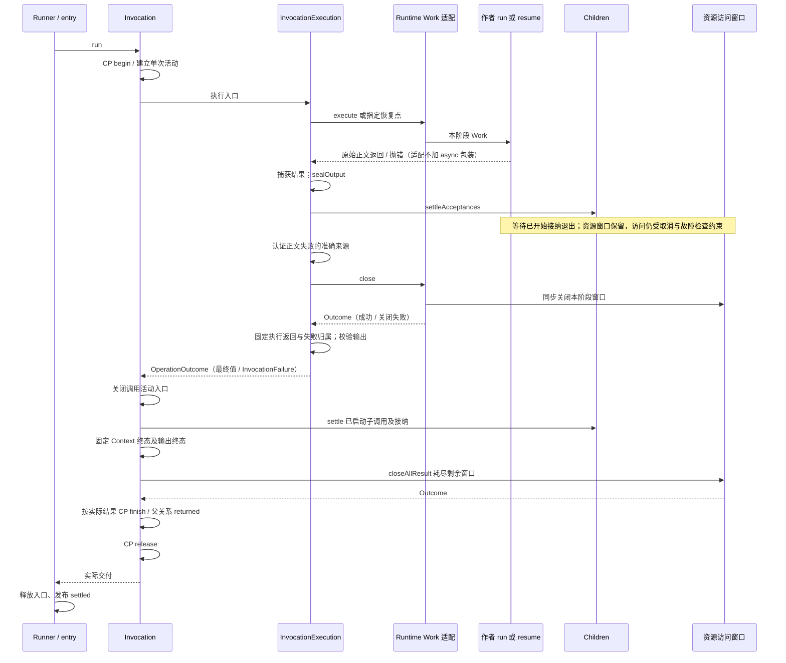

# 调用退出契约：时序审计与验证

2026-11-04。在 `e18fcea` 的退出审计之后，采用“模块闭合失败边界、调用统一安排顺序”的方案完成实施。

## 结论

InvocationExecution 统一处理正文结束、输出封口、接纳排空和本阶段 Work 关闭。Runtime 只提供具体执行与同步关闭端口，普通执行和 CP 恢复共用同一退出顺序。Invocation 负责后续子调用等待、剩余资源关闭、最终交付及 CP 占用释放。

审计发现并修复的两处缺口：

1. Work 关闭异常覆盖原业务异常：现在分别保存正文与关闭结果，在准确归属后聚合交付。
2. 低层资源关闭失败跳过 CP 释放，并可能留下过早的父关系成功：现在关闭先于成功 CP／父层交付，最外层 finally 只执行不调用宿主代码的本地释放。

沿用 OperationOutcome，不增加 ExitScope、阶段 DSL 或结构声明。业务作者的 deps/run/output/checkpoint 用法不变，恢复范围不变。

## 一次调用有几个结束时刻

| 时刻           | 表示什么                                 | 不表示什么                         |
| -------------- | ---------------------------------------- | ---------------------------------- |
| 正文 settled   | 执行函数已返回或抛错，被运行器观察到     | 接纳回调和已启动子调用都结束       |
| 输出 sealed    | 本段不再接受 delta                       | 最终值已通过校验、调用成功         |
| 接纳排空       | 已登记的子接纳活动都已退出               | 自动接纳未接纳结果、撤销已落实效果 |
| Work 关闭      | 本阶段的资源／子动作端点不可继续使用     | 所有外部操作已停止                 |
| Context 终态   | 本次工作结果已经固定                     | CP、父层交付或宿主释放必然成功     |
| 调用交付       | `Invocation.run()` 的 Promise 兑现或拒绝 | 宿主观察与入口释放已经结束         |
| Runner settled | 宿主入口完成交付及释放处理               | 独立 Interaction 已结束            |

这些是现有事实的解释，不需要新建七个状态对象。输出完成、工作成功和最终交付成功不能相互替代。

## 当前顺序与职责



图表示主要顺序，失败时保留各阶段已成立事实。低层 Invocation 可不提供 Work close，仍通过 closeAllResult 关闭其余资源；成功交付不越过这个边界。Context 已成功但后续关闭／CP／观察失败，保留工作成功并表达最终交付失败。

| 归属                              | 持有的责任                                                               |
| --------------------------------- | ------------------------------------------------------------------------ |
| ResourceAccess / ResourceActivity | 一个窗口内的端点与操作清理；关闭不可逆；耗尽本窗口清理后报告失败         |
| Runtime InvocationWorkBinding     | 持有本次 Work 窗口，提供普通／恢复正文及同步 close，不再自行安排退出顺序 |
| InvocationExecution               | 单次正文、封口、接纳等待、Work 关闭与输出校验，返回准确失败的 Outcome    |
| Invocation / Children             | 调用活动入口、真实子关系及等待、工作终态、父层交付与 CP 收尾             |
| Runner / entry                    | 宿主入口占用、取消归属及实际释放；不持有资源实体生命周期                 |
| Interactions                      | 独立发送与反馈生命周期；不作为 Invocation 的待清理子任务                 |

`settleAcceptances/settle` 等待的是登记到集合中的、始终兑现的完成通知，原操作失败仍沿原交付路径传播。它们不把所有子失败重新抛一遍。`sealOutput` 的被动消费者由 ProgressChannel 隔离。当前真正可抛错的关闭边界是资源 `close`，不是一个可以默认无异常的赋值动作。

## 等待范围要明确

```ts
// 子 invoke 登记了子执行与接纳活动；父层退出会等待这条已开始的链路。
void work.children.translate.invoke(input, {
  result: { succeeded: (value) => saveUsingThisWork(value) },
});
return candidate;

// 资源操作没有因此成为子调用；必要结果仍应显式 await。
await work.resources.files.write(path, content);
```

未 `await` 的普通资源 Promise 不被 Invocation 自动加入子调用等待。关闭窗口会撤销操作的本地消费、执行 `onClose`；底层函数若不响应清理，可能继续执行。它的晚到结果不能重新接纳到已结束的窗口，也不回滚已经发生的副作用。这不是建议忽略资源 Promise；如果业务结果依赖它，应显式等待。

普通正文抛错与取消也不同：前者被捕获后，已有接纳仍可使用资源，待排空后才安装正文失败；已成立效果不会因此回滚。取消会通过固定 signal 立即阻止后续端点访问，但仍等待本次正文、已登记子调用与接纳活动退出，不自动等待普通资源 Promise。不能用 Promise.race 提前释放这些仍在执行的调用活动。Interaction 的独立发送则继续存活，退出的只是本次读取／跟随。

保留窗口不保证接纳成功：取消或已归属的阻断故障仍可使回调的下一次端点访问失败，且此时 delta 已封口。接纳中多个效果的事务、提交与补偿是后续独立议题，本轮不增加接纳不可取消区间或跨资源原子性。

## 故障探针与修复结果

运行 [invocation-exit.mjs](../examples/invocation-exit.mjs)：

```sh
pnpm build
node examples/invocation-exit.mjs
```

这是故障注入诊断，不是推荐应用写法。只使用公开出口、内存资源和 MemoryCheckpointStore，不调用模型、不写业务库。修复后所有检查为 true、退出码为 0；保证未满足时退出码为 1。

### A. 原正文失败被清理失败覆盖

Scene 发起一个资源操作但未等待，然后抛出 `bodyFailure`；资源的 `onClose` 抛出 `cleanupFailure`。

修复前只保留 `ResourcePortError → cleanupFailure`。现在交付 AggregateError，保留正文原错误与清理错误；正文为 `throw undefined` 也凭 Outcome 判别字段保留，不把它当成“没有失败”。

原问题来自 [Work 适配](../packages/runtime/src/binding/work.ts) 的 finally。现在具体 close 返回 Outcome，正文与关闭分别由 [InvocationExecution](../packages/invocation/src/invocation/execution.ts) 处理；普通／恢复路径均有双失败专项。

### B. 资源关闭失败跳过 CP 占用释放

直接构造公开的低层 Invocation，挂载资源与 CP Store。正文返回，但最后关闭未完成资源操作时 `onClose` 抛错。

修复后的观察结果：

- 调用 Promise 拒绝清理错误。
- Context 已固定为 succeeded，`invocation.failure` 准确记录后续交付失败。
- 同一个 Store／Context ID 的诊断探针可以进入，证明本地占用已释放。

在 [Invocation.deliver](../packages/invocation/src/invocation/invocation.ts) 中，剩余关闭现在返回 Outcome 并进入交付处理；CP release 与宿主可抛错端口分离。Context 已成功不会被倒改为失败。

探针复用 Context ID 只是核验排他释放，不是业务重跑建议。本例没有保存恢复点，不证明存在一个可恢复的业务执行。另有多窗口专项验证 closeAllResult 耗尽全部窗口，以及部分资源构造／暴露失败时原错误不会被清理错误覆盖。

## 内部端口与规则

已落实三条规则：

1. **关闭不可被短路。** 一个关闭动作失败，不跳过其他已拥有窗口与 CP 占用释放；关闭动作幂等不等于首次关闭不会抛错。
2. **失败因果保留。** 正文失败与清理失败同时发生时保留两者；清理故障不能成为普通业务 fallback。成功正文遇到清理失败，交付仍须失败。
3. **交付依据真实。** 本地可能失败的必需关闭，应在对父层宣称成功交付之前完成；已固定工作结果与后续交付失败分开表达。CP 持久化或观察失败仍不承诺回滚实体效果。

内部接线使用原 InvocationWork，新增可选同步 close；不另建执行实体：

```ts
interface InvocationWork<I, O, Context> {
  execute(context: Context, invocation: Invocation): O | Promise<O>;
  close?(context: Context, invocation: Invocation): OperationOutcome<void>;
}
```

上例省略了泛型约束和 output/checkpoint 字段，准确类型见 [InvocationWork](../packages/invocation/src/invocation/work.ts)。close 缺省表示无额外 Work 关闭动作；提供了端口却抛错、返回非法值或 Promise，则转换为机制失败。迟到 Promise 拒绝被消费，不等待非法异步关闭，也不宣称撤销其已经开始的工作。

正文捕获保留单层 await/try，封口紧贴同一续体；Runtime 普通／恢复入口和 CP.resume 不增加纯 async 包装，微任务专项核验迟到 delta 已关闭。已有同步资源 closeAll 保持抛错形式，InvocationResources.closeAllResult 为内部退出协作返回 Outcome。

正文失败在接纳排空后、具体 close 前认证，避免清理先安装权威故障而丢失子来源。关闭失败明确归属 control 边界，必须降低权威故障的 receptionAllowed；不能仅修改一个返回副本，也不能靠错误恰好属于某个 class。原 ChildCallFailure 先认证再组合，不扫描 AggregateError 猜来源。

抛出值自身也可能在类型检查时执行代码并再次抛错。分类边界捕获这种失败，直接安装不可由业务接收的机制故障，保留原值与检查错误，不递归检查原值；随后仍执行 Work 关闭。

已保存 CP 或接纳事实不回滚。CP finish、父关系不变量和必要观察仍各自保持失败语义；Outcome 并不承诺任意内部代码绝不抛错。最外层本地 release 为最后保障，不混入资源／观察／存储回调。

## 验证入口

- [调用退出专项](../packages/runtime/test/invocation-exit-contract.test.mjs)：普通／恢复接纳期间的资源可用性、输出封口、正文失败后的真实效果、取消等待及低层子调用等待。
- [调用退出故障](../packages/invocation/test/invocation-exit-failures.test.mjs)与[装配退出故障](../packages/runtime/test/invocation-exit-failures.test.mjs)：普通／恢复双失败、子来源、非法 close、关闭故障不可降级、CP／观察失败与本地占用释放。
- [调用资源退出](../packages/invocation/test/invocation-resource-exit.test.mjs)与[资源活动退出](../packages/resources/test/invocation-resource-exit.test.mjs)：多窗口耗尽、单错误身份、构造／暴露和关闭双失败、同步及不可重开。
- [资源访问](../packages/resources/test/resource-access.test.mjs)：关闭后晚到结果不可接纳、异步接收过程中端点失效。
- [交互消费](../../capix-lab/test/conversation-interaction.test.mjs)、[过程反馈](../../capix-lab/test/conversation-interaction-progress.test.mjs)：局部取消／窗口关闭不终止独立发送，后续调用仍可读取同一反馈。
- [入口回归](../packages/runtime/test/runtime-entry.test.mjs)、[Work 适配](../packages/runtime/test/runtime-work-adapter.test.mjs)：宿主释放、严格观察故障、原始返回与接纳事实。

这些验证不证明任意宿主清理函数都会及时返回，也不承诺强制终止任意 Promise、跨实体回滚或完整进程恢复。
