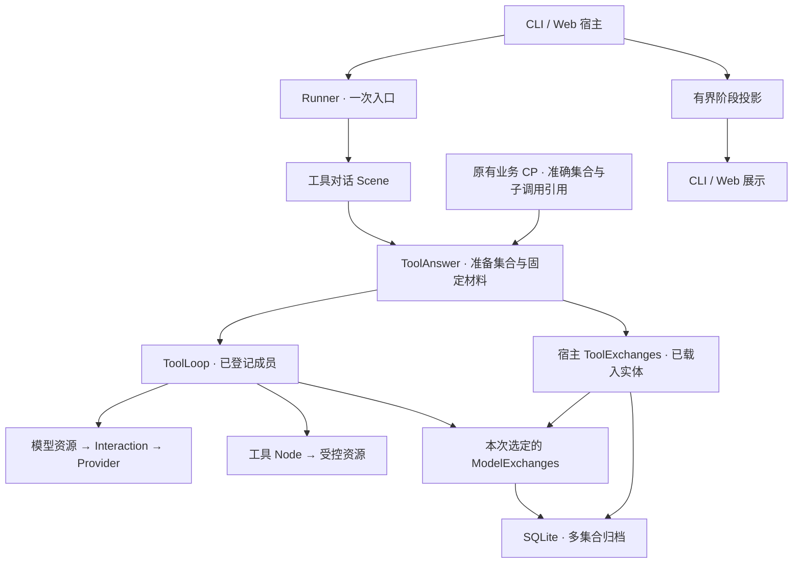

# 原生工具调用的宿主接入

> 历史设计／验证记录：下文版本、测量和“下一步”保留当轮语境，不是当前兼容承诺。现行接口见 [Checkpoint](checkpoints.md)、[增量引用选择](checkpoint-selection.md)；旧格式与数据库策略见[开发期兼容](development-compatibility.md)。文档脉络见[导航](README.md)。

状态：公共接缝、CLI/Web 工具模式、工具会话根恢复及一组真实接口验证已完成，见 §13–14 与 [验证报告](native-tool-host-validation.md)。承接 [原生工具接入](native-tool-integration.md) 的生产 Provider、ModelExchanges 与 ToolLoop。

当前使用以[宿主与持久化](conversation-host.md)、[显式恢复](conversation-recovery.md)和[工具预设](../services/conversation/src/tools/README.md)为准。下文 v4→v5 迁移方案只保留设计记录，当前 schema 8 不迁移旧库；旧文本交互和旧 Frame 也不提供兼容读取。

本次交叉审查后收敛：先保存空集合的创建意图，再落实集合；只有 prepared 可以补建，waiting 只能准确读取。ToolAnswer 与 ToolLoop 分别接入同一次宿主使用句柄。单次预算覆盖完整编码；原工具输出上限归工具登记与实现；交换／Interaction／CP 联合存量只作为入口门槛，不建立预留账本、不自动退休数据。下文保留设计推导；实际公开出口及保留范围见 §13–14。

## 1. 当前事实与建议

CLI/Web 默认仍使用材料回答，可在启动时显式选择 `--answer-mode tools` 装载 ToolLoop。两种模式共用正式消息、维护、入口门槛及宿主收尾。原 SQLite v4 每个对话只有一个交换集合；本轮 v5 已改为多集合与准确 ID 读取，仍没有删除接口。实体和 SQLite 的支持上限已经统一，但这不等于长期保留策略已经成立。

推荐第一轮采用以下组合：

1. 每次工具循环建立独立的 ModelExchanges 集合；集合身份写入固定输入和业务 CP。
2. 磁盘保留事实，运行时只载入当前或明确恢复的集合。调用真正退出后卸载内存；交换、Interaction 和 CP 一起纳入宿主归档预算，暂不自动删除。
3. 宿主统一配置模型期限、局部等待、调用次数和编码字节预算；模型反馈进入持久化／子 CP 前检查，工具派发前检查本次交换及下一次请求的可容纳范围。
4. CLI/Web 首先显示真实阶段进度和最终回答。分段候选预览另作明确扩展，不能把多次模型文字拼成一个答案。
5. 工具会话建立自己的根恢复契约；普通调用失败终结后，晚到模型反馈不自动复活原调用。

修改主要落在宿主持久接入、服务预设和 Provider 接缝；Interactions 只新增直接读取既有活动集合的 pendingCount。Invocation 模式、CP Frame 与资源生命周期不变；阶段投影通过真实调用事实接入，协议与客户端已独立验证。

## 2. 对象关系



`ToolExchanges` 是服务宿主的载入与卸载对象，不是新增业务实体。它不保存“运行到第几步”，不选择工具，不依据观测记录决定恢复。实际事实仍归 ModelExchanges、Interaction、正式内容实体和 CP。

集合 ID、业务 scope、调用 ID 分开：集合 ID 定位实体；scope 表达交换的业务分组；调用 ID 标识一次执行。第一版按一次循环分配集合只是这个宿主的策略，不改变实体可以保存多个 scope 的能力。

## 3. 为什么不在原集合中直接清理

| 方向                          | 得到什么                                 | 需要付出的代价                                             | 本轮判断 |
| ----------------------------- | ---------------------------------------- | ---------------------------------------------------------- | -------- |
| 单集合按 scope 删除           | 沿用装配                                 | 要重新定义 sequence、固定操作索引、快照及 CP/View 引用失效 | 不选     |
| 每次循环独立集合              | 独立容量、准确载入、旧事实不受新循环影响 | 多集合持久端口、准备和载入接缝                             | 推荐     |
| 一个支持分页/存储查询的大实体 | 全局查询更直接                           | 重做同步访问、效果确认、索引和 ViewSource 一致性           | 暂缓     |

现有恢复会核验 `sequence = Σ(1 + entry.revision)` 和全部操作凭据。删除几行并递减计数，不是一个合法的保留策略。也不能以“退出 View”或“当前恢复检查失败”作为删除依据：后者可能只是外部反馈尚未到达。

首版保留规则明确为：

- 集合数据在磁盘保留，包括已完成、已失败和未完成循环。
- 内存只保留本次入口实际载入的集合；Runner 完成子调用及接纳收尾后才释放。
- 启动不逐个构造归档实体；目录查询只分页读取 ID、计数和字节元数据。明确恢复时才读取对应集合的完整内容。既有 SQLite quick_check 仍可能检查整库页，不把“不反序列化历史交换”表述成“启动只读几个磁盘页”。
- 首版 View 继续只接消息与记忆，不隐式把所有工具交换加入后续上下文。需要工具历史时仍须设计明确的材料策略。
- 宿主设置**交换 + 模型 Interaction + CP 的联合逻辑存量门槛**。达到预算，在启动新的工具入口之前明确拒绝，不假装是模型失败，也不自动淘汰旧依据。旧材料模式留下的 Interaction/CP 同样占用这个库的预算，不能因缺少工具集合归属而漏算。

### 3.1 联合存量只作为入口门槛，不做硬配额

按 8 次请求、256 KiB 基础材料、每步新增约 68 KiB 粗算，累计完整请求为 `8 × 256 + 68 × 8 × 7 / 2 = 3952 KiB`，还未包含回复及状态包装。交换通常小于这部分。引用化降低 CP 的材料重复，不消除 Interaction 的累计请求存储。

必须区分三种量：

| 量                          | 用途                 | 计量依据                                                                                                       |
| --------------------------- | -------------------- | -------------------------------------------------------------------------------------------------------------- |
| 当前逻辑存量                | 接纳新入口的预算门控 | 交换当前行、Interaction 当前行、当前 CP head image 及终态 delivery 的完整编码；v6 旧镜像正文释放，仅保留身份行 |
| 累计写入量与同步耗时        | 性能验证             | 每次 create/commit/save/finish 的编码量、次数和耗时；同一请求在 prepared、started、feedback 保存中会多次写入   |
| SQLite 文件、WAL 与磁盘余量 | 宿主运维             | 实际文件和磁盘测量；压缩、索引、空闲页等使它不同于逻辑 JSON 字节                                               |

普通成功交互的最终存量近似 `Q + R`，三次状态保存的累计写入量近似 `3Q + R`，均另计元数据。失败、附加提交及压缩分别统计，不能用网络请求量替代持久化成本。消息和记忆另行计量；本预算不冒充全库的物理磁盘上限。

存量计数在对应 SQLite 事务中随行变更维护；首次迁移一次计算旧存量，后续门控不反序列化全部历史。材料模式和工具模式都增加这些计数，入口门槛对两种模式及实际恢复入口一致生效；诊断称“对话归档达到入口门槛”，不能把材料路径的积累误报为工具集合故障。

入口判断采用：

```text
当前联合存量 + 已安装且未 settled 的交互数 × 最大回复缓冲 + 固定增长缓冲
    >= 配置的入口参考上限 → 拒绝新的写入入口
```

固定增长缓冲来自 §11 的测量，属于宿主经验策略，不是单次执行的证明上界。独立交互数量直接读取 Interactions 的进程内活动集合，不维护另一份预留账本；公开只读 pendingCount 不含尚未安装的准备过程，active 仍保护准备时的关闭重入。持久数据只读载入不算新的在途发送，重启不自动重新发送旧请求。

已接纳入口不因联合存量越线而在 commit 中被拒绝；它仍受单个 CP、请求、回复、反馈和集合各自的硬限制，以及真实持久错误约束。一次入口可能远超经验缓冲，不能声称“最多只超过一点”或不会在其他边界失败。越线后拒绝后续新入口，查询和读取不受影响。没有跨入口预留、预留转存量或重启后配额重建，也不承诺物理磁盘硬上限。

工具输出上限由具体工具声明并在自身返回／CP 前落实；循环只能做事后核对。CP 保存次数和全部直接关系编码成本仍须测量，不能通过扩大缓冲隐藏。本轮实测后选择 2 GiB 入口参考上限、512 MiB 固定增长缓冲和每个在途交互 2 MiB 回复估计；三者均为宿主可配置策略。此前保留全部 CP 正文时，最密样本产生约 385 MiB 联合逻辑存量，旧候选 64 MiB 缓冲不足。v6 只保留当前 CP 正文后同一样本约 18.19 MiB；本轮不据单个样本调低默认缓冲。512 MiB 仍不是任意输入的证明上界，不能据此取消单项上限或退休设计。

这仍是**有限留存、到门槛停止接纳**的首版，不是清理策略。归档用量不会自行回落；CLI/Web 必须给出全库来源分解。需要无人维护地持续运行时，后续退休闭环仍是必要条件。

### 3.2 退休的准入条件，暂不实施删除

“根 CP 已终结”单独不足以删除集合和交互。根可能在局部超时／取消后终结，但外部反馈仍在写入；Runner Promise 失败也不证明根终态已持久成功。

未来的宿主退休至少要同时证明：

1. 集合、相关 Interaction、根 CP 及其子树有准确、持久的归属关系；当前 completion 请求只保存 ModelRequest，不能从正文、时间或可选记录反推归属。
2. 根终态交付确实保存，且没有在途调用或本地使用句柄。
3. 相关独立发送已经收尾，不存在会继续提交的写入者；活跃进程的 settled 与重启后的只读载入分别核验。
4. 宿主已明确结束这些引用的读取／续接保留承诺，且没有仍被保留的 CP、View 或业务引用依赖它们。不能任意删掉 CP 子树来让这个条件成立。
5. 退休提交与读取资格有明确的一致性边界；崩溃后不能出现“仍可续接，但依据被删掉”的状态。

本轮不为这些未证明条件建立通用 GC，也不把“晚到反馈可能没价值”当作丢弃事实的授权。联合预算可以不依赖逐集合的交互归属索引；真正推进退休时再设计这个持久接缝。

删除还必须与进程内的 Interaction 缓存和读取资格一起处理，不能只删 SQLite 行。现有公开通道没有按单个引用退休的端点，因此这里保留的是需求与准入条件，不宣称已有一套可直接启用的清理 API。

## 4. 集合如何进入调用

不能在 `capture` 中创建集合、读取数据库或选择“最近一个集合”。这些操作都有真实失败边界，应通过宿主提供的资源执行。

候选纯值：

```ts
// 服务契约候选，不是现有 API。
type ToolExchangeSelection = {
  collection: string;
  scope: string;
};

type ToolExchangePlan = {
  selection: ToolExchangeSelection;
  empty: ModelExchangesState; // 实体自己生成 UUID 的精确空快照。
  source: { transcriptId: string; index: number };
  policy: ToolArchivePolicy; // 版本、目录兼容依据和固定预算。
};

type ToolLoopInput = {
  selection: ToolExchangeSelection;
  request: ToolBaseRequest;
  catalog: string;
  budgets: ToolExecutionBudgets;
};
```

ToolAnswer 负责准备及交付这个选择；集合归属、容量配置仍由宿主核验。UUID 不是访问凭据。

```ts
// 设计流程伪代码：省略 point/codec 定义；实际出口见 §13–14。
async function runAnswer(work) {
  const plan = await work.resources.exchanges.plan({
    source: {
      transcriptId: work.input.query.transcriptId,
      index: work.input.query.index,
    },
    policy: fixedPolicy,
  }); // 只构造内存中的空实体及意图，不写集合归档、不发送模型。

  work.checkpoint({ point: prepared, state: { plan }, refs: {} });
  await work.resources.exchanges.initializePrepared(plan);
  return startLoop(work, plan.selection);
}

async function startLoop(work, selection) {
  const child = work.children.create(loop, {
    selection,
    request: requestFromFixedMaterials(work.input),
    catalog: fixedCatalog,
    budgets: fixedBudgets,
  });
  work.checkpoint({ point: waiting, state: { selection }, refs: { loop: child.ref } });
  return child.invoke();
}

async function resumePrepared(work, state) {
  // 点的核验先证明这是无子关系的准备意图，不是缺失的历史事实。
  await work.resources.exchanges.initializePrepared(state.plan);
  return startLoop(work, state.plan.selection);
}

async function resumeWaiting(work, state, refs) {
  await work.resources.exchanges.acquireExisting(state.selection);
  return work.children.resume(refs.loop).invoke();
}
```

约束：

- `plan` 通过 `new ModelExchanges()` 得到实体生成的 ID 和空快照，不新增业务任意指定 ID 的构造入口。planned 快照表示“允许按这个身份创建”，不是已落实的集合事实。
- prepared 的 codec/verify 核对快照格式、`sequence === 0`、空 entries、selection 与快照 ID 一致、原正式输入和固定策略，并通过作者可见的 facts 检查首轮及直接 children 为空。宿主资格检查另核对公共 Frame 的 `nextChildOrder === 0`、owner 和当前 head；作者 facts 没有这些内部字段，不能伪造访问出口。不能接受旧 prepared 副本绕过已推进的 waiting，也不能只凭作者 state 中没有 refs 就证明没有子调用。
- `initializePrepared` 只处理这个经过核验的意图：不存在时按精确空快照持久创建；已存在时必须核对归属、配置和**仍为空**，不是只看元数据相同。非空、异源或未知状态直接拒绝，不能覆盖或重建。
- 初始化持久成功后才安装到本次使用句柄。创建子调用后，waiting CP 保存成功才 invoke；模型发送始终晚于这些边界。
- 这样消除了原来“先持久 create、再保存 prepared”特有的空孤儿窗口；不承诺所有崩溃都不留下归档，不据此自动清理未知数据。
- prepared 恢复建立尚不存在的子调用；waiting 恢复准确旧子调用，二者不能互换。
- waiting 及更晚阶段只允许 `acquireExisting`。父 CP 可能落后于已经推进的子层，缺少集合意味着恢复依据缺失，不能用通用 `ensure` 补空。
- `capture` 只根据固定 selection 从已载入表取得准确实体。查不到即错误；不访问 SQLite，不回退到当前集合，也不读取实体最新内容来替换原输入材料。
- 使用现有 ModelExchangeResource 操作被选定实体；不把供给登记改成允许业务遍历所有集合的权限。

上述 prepared 协议用于本次可恢复的工具宿主。普通无 CP 的 ToolLoop 仍可由宿主直接准备并选择集合，不为了这个宿主协议强迫所有工具使用者配置 CP；它不获得 prepared 崩溃续接承诺。创建／安装／CP 仍非同一事务。

### 4.1 捕获与阶段授权要分别接全

资源方法只能看到 capture 返回的材料，不能直接读取 Runner options。因此 ToolAnswer 必须显式捕获本次句柄，不能只给 ToolLoop 登记 capture：

```ts
// 装配伪代码：新宿主保留准确的 Options 类型，不用类型断言补洞。
type ToolHostOptions = { exchangeUse: ToolExchangeUse };
const resources = new Resources<ToolHostOptions>();
registerConversationResources(resources, content, model, store.view, configuration);

resources
  .capture(answer, (input, options) => ({
    use: options.exchangeUse,
    source: fixedSourceOf(input),
    policy: fixedPolicy,
  }))
  .register(ToolExchangeArchiveResource, (material) => material);

resources
  .capture(loop, (input, options) => ({
    exchanges: options.exchangeUse.requireLoaded(input.selection),
    input: validateFixedLoopInput(input),
  }))
  .register(ModelExchangeResource, ({ exchanges, input }) => ({
    exchanges,
    scope: input.selection.scope,
  }));
// 模型资源登记也消费这份固定 input 和实体，并连接固定的模型通道。
```

`ToolExchangeArchiveResource` 是宿主集合载入端口，`ModelExchangeResource` 是对选定实体的业务操作，两者职责不同。前者的方法通过捕获到的 use 完成 plan/initializePrepared/acquireExisting；后者不接触整个归档目录。

| 位置                | 资源申请                     | 子调用权限                                      |
| ------------------- | ---------------------------- | ----------------------------------------------- |
| ToolAnswer 普通 run | 集合准备／载入端口           | 已登记的 loop                                   |
| prepared.resume     | 同一端口，核验后初始化空集合 | 声明 loop 的创建权限                            |
| waiting.resume      | 同一端口，只载入原集合       | 声明原 loop 引用的恢复权限                      |
| ToolLoop 及其恢复点 | 本点所需的交换／模型资源     | 沿用具体点的 uses 和 refs，不因载入集合扩大权限 |

现有 `createConversationResources` 建立 `Resources<{}>`，实施时需要让共享登记函数接收宿主创建的泛型 Resources，或保留等价的准确泛型出口；不能把 `exchangeUse` 强转进去。模型、目录、材料与预算仍来自固定输入及绑定配置，options 只带本次使用归属。恢复会重做 capture，但只能换成本次有效句柄，不能换掉持久业务依据。

### 4.2 使用句柄覆盖完整入口

宿主承担卸载，但不能使用无参数的 `clear/unloadAll`。每次入口尝试取得一份本地使用句柄，只持有自己 create/acquire 的准确集合对象；正常运行和 resume 都在同一 `finally` 关闭这一份句柄，包含资格核验失败。它是内存使用归属，不保存执行进度，也不是分布式租约。

原因是 busy 拒绝同样会执行 finally，而旧入口 released 回调可能在旧 Promise 返回前就启动新入口。即使只有一个 Runner，也不能让旧 finally 清掉新入口的数据。同一集合有其他使用句柄时，不能释放其共享实例；被拒入口关闭空句柄不影响实际运行者。

CLI 普通提交、HTTP 普通提交、CLI/Web resume 和选中目标的完整资格核验都必须建立并关闭自己的 use。资格核验与随后 resume 可共用一个 try/finally；单独核验则关闭该句柄，真正 resume 再建立新句柄并重新核验。目录列表不载入集合，也不以后台 use 持有全部候选。

不能用资源方法的 `operation.onClose` 代替整个入口的关闭：它在该方法返回时就结束，远早于整个工具循环退出。也不能依赖可选 Recorder 的完整性进行必要清理。首版运行期间不逐条淘汰，仍不需要超时续租、分布式缓存或调度平台。

```text
A released → B 已开始并持有集合 B → A finally 关闭 useA
结果：只解除 A 的持有；B 不受影响。

A 仍运行 → C 因 busy 被拒绝 → C finally 关闭空 useC
结果：A 的供给保持可用。
```

独立 Interaction 已持有完整请求，调用退出后释放交换内存不影响外部发送和晚到反馈保存。

## 5. SQLite 与兼容

服务 SQLite v5 已实现以下存储形状：

- 集合按 ID 保存，去掉“全库只有一个集合”的 singleton 约束。
- 条目、操作索引具有明确 collection 归属；集合 sequence 比较提交保持独立，提交仍原子更新该条目、凭据及集合计数。
- 新持久端口支持 `create/load(collectionId)/list(cursor, limit)/commit`。目录不包含回复或反馈正文；load 只核验目标集合。
- 初始化集合及元数据在同一 SQLite 事务中完成。已有条目／操作索引而缺少集合头是完整性错误，不能按“集合不存在”创建新空集合来掩盖。
- 旧 v4 集合整体迁入同一多集合存储，所有 ID、sequence、正文和凭据原样保留，归属元数据明确为“未锚定”，只读。不建立另一套 legacy 实体或执行分支；统一目录和归档读取按这个资格字段处理。它不能补默认值冒充经过 prepared 的新集合，不能被新工具场景 acquire/resume。即使宿主尚未接入，也不能假定示例数据库没有保留价值。
- 旧内容、Interaction 和 CP image 不改写。原始 ToolLoop/ToolAnswer CP 因输入与点改变而升级业务版本；不把旧 CP 临时补上新 selection。
- 新集合的宿主配置随归档元数据保存；恢复同时对照原配置与当前可接纳的策略。ModelExchanges 快照本身仍保持原格式，不偷偷改变已有 restore 的预算规则。

如果旧集合超过普通默认预算，只读载入仍按支持上限核验，不因此获得写入资格。新格式的已锚定集合恢复为可写实体时，必须使用其原有明确配置。归档未知、容量不匹配与真实 SQLite 失败分别报告，不把前两者包装成数据库损坏。

## 6. 容量不是一个集合上限

必须分别约束：单个 ModelReply、单个工具反馈、单个交换、本次集合、下一次完整 ModelRequest、CP image，以及磁盘归档总量。

目前 Provider 可以接纳 32 个工具调用，单个反馈可达 2 MiB，而交换上限为 8 MiB。因此“新建了一个空集合”不足以证明这批工具结果能保存。完整请求也有自己的值容量；不能保存完所有工具结果后才第一次发现下一轮请求装不下。

推荐由 ToolLoop 预设与宿主提供有界反馈策略，不改通用资源执行语义。首版使用固定的**全局反馈上限**，不要求每个 `tool()` 额外声明一个不同的数；有真实差异时再允许工具声明更小上限。两者都可以计算最坏情况，不能没有约束却依赖“首批工具应该很小”。

候选配置如下；它与目录、映射及预检策略版本一起形成兼容依据，进入 ToolLoop 输入、CP 核对和集合元数据。预算字段不作为厂商 tools Schema 的额外字段发送。

```ts
type ToolExecutionBudgets = {
  maxModelCalls: number;
  maxReplyBytes: number; // 完整规范化 ModelReply，含 usage/native/tool arguments。
  maxFeedbackBytes: number; // 完整 ToolFeedback，含 toolCallId/status/content。
  maxRequestBytes: number; // 下一次完整规范化 ModelRequest。
  maxWireRequestBytes: number; // 实际协议请求体，不能超过当前 Provider 支持上限。
  maxCollectionBytes: number; // 包括交换正文、反馈及实际接纳凭据。
};
```

共同纯值的上限按 `Buffer.byteLength(JSON.stringify(checkedValue), 'utf8')` 计量；`maxWireRequestBytes` 单独按同一 Provider 编码后的实际请求体字节检查。不能把共同材料和 wire 的结构开销当作相同。目录、标识长度、凭据数及编码包装均有自己的有界条件，不能只算正文字符或 maxTokens。

Provider 现已提供 `inspectRequest(request)`，复用 complete 的同一校验与编码，返回规范化请求和 wire 字节，由宿主按同一模型配置接入工具模型资源。工具宿主要求此能力；普通通道仍允许不带预检，但此时只检查共同材料，wire 由 Provider 实际发送前核验，不能声称在 Interaction 建立前拒绝。预检不请求网络、不暴露 Key，也不代替发送时的最后核验。

### 6.1 检查必须在它承诺保护的边界之前

| 检查位置                  | 检查内容                                               | 超限语义                                                         |
| ------------------------- | ------------------------------------------------------ | ---------------------------------------------------------------- |
| 发模型前                  | 当前规范化请求及 wire 容量、最大回复余量、联合归档余量 | 不启动这次 Interaction；不是 Provider 故障                       |
| 独立发送者返回前          | 完整 ModelReply 的业务字节上限                         | 抛出有界的超限错误，Interaction 保存失败事实，不保存超大成功反馈 |
| model.wait/confirm 交付前 | 同一回复约束，含已持久反馈的恢复读取                   | 不进入模型子节点的 completed CP，不把历史宽松上限当作当前兼容    |
| 一批工具派发前            | 所有剩余反馈槽位的最坏编码量、交换／集合／下一请求余量 | 默认终结本次，尚未派发的工具不执行                               |
| 工具节点返回／完成 CP 前  | 工具原始输出上限                                       | 真实工具违约失败；已经发生的效果不回滚                           |
| result 映射后、交换写入前 | 完整反馈的实际字节上限                                 | 拒绝违约反馈，不静默截断或重做工具                               |

模型回复只在 Loop intake 时检查太晚：当前模型子节点会先保存完整 reply 的 completed CP，Interaction 也已保存反馈。发送侧检查归宿主工具模型通道的固定策略，使用独立发送生命周期，不借用调用 Work；该配置也必须在恢复时核对。Provider 的既有传输字节上限仍保留，两者保护不同边界。

恢复若直接消费已有 completed CP、跳过 model.wait，回复 codec／资格核验也必须执行同一固定预算。工具已完成 CP 的原始输出同理；不能因换了一条读取路径绕过上限。

原工具输出与反馈不是同一个值。将大结果映射成短摘要不会缩小此前的子 CP。首批 history Node 的片段读取、数量和编码限制必须在自身完成 CP／返回之前成立；对任意自定义工具，只检查父层映射不足以承诺 CP 上限。工具通过 `tool(node, { maxOutputBytes, ... })` 登记自己的输出上限并进入目录摘要；宿主首批工具必须声明且自行落实，循环在接收时再次核对。这个字段不是给任意子 CP 自动安装保护，不能把登记当成已经实现。

### 6.2 派发前估算与实际校验共同成立

有界反馈策略可以返回摘要、分段内容及 `truncated/nextOffset` 或准确引用；不能截断 JSON 后宣称得到完整结果。成功映射和可接收失败映射都必须纯且无副作用。未知工具／参数拒绝没有真实工具子调用，由 ToolLoop 预设生成有界 error 反馈，文本模板及超限策略纳入 policyVersion，不伪造作者接收事件。

候选预算供验证：8 次模型请求，每回复 64 KiB，每个完整反馈 4 KiB，首批工具原始输出 4 KiB，基础材料 256 KiB，规范化请求与 wire 请求体分别不超过 2 MiB，本次集合 8 MiB。32 个槽位的完整反馈编码上界于是是 128 KiB，再计凭据和请求编码开销，而不是 64 MiB。它证明“可以估算”，不证明每份基础材料都能跑满 8 次；下一请求不足时仍在派发前结束。如果实际 callId 连最小反馈包装都无法放入 4 KiB，也必须在派发前拒绝。这些数字不是新的内核默认值，必须经最坏样本测量后确定。

```ts
// 预算判断的对象必须是最终编码形态，而非 text.length 或 token 数。
const estimate = estimateRemainingExchange({
  acceptedReply,
  pendingCalls,
  maxFeedbackBytes: budgets.maxFeedbackBytes,
  requestEncodingPolicy,
  receptionEncoding,
});
assertFitsEntryAndCollection(estimate);
assertFitsNextModelRequest(fixedRequest, acceptedExchanges, estimate);
// 通过后才允许派发对应工具；外部效果不能靠事后“再截一点”补救。
```

估算同时计入已有反馈、实际回复、剩余槽位、固定接纳凭据、下一请求的协议转义／包装，不使用“反馈字节加起来大约够”的经验公式。派发前的保证以注册工具遵守输出契约、串行写入和固定编码规则为前提；实际写入仍做最终检查。磁盘故障、工具违约或未知副作用继续明确失败，不能转为“工具没有执行”。

这里的预留不是跨调用的并发事务。入口容量拒绝、模型回复过大和工具派发前预算不足使用不同诊断；本轮预算不足直接结束，不再生成一次请求试图修补。

目录摘要继续使用固定的规范化序列化：对象键排序，数组顺序保留，拒绝非 JSON 值，不擅自按语义重写 Schema。有效预算、policyVersion 和预检反馈版本加入兼容摘要；Zod 升级引起 Schema 输出变化可以拒绝旧 CP，不能跳过校验续接。CP 自身仍有 8 MiB 上限，子关系累计编码的 CPU、save/finish 次数另行验收，引用化不是这些成本已解决的证明。

## 7. 等待、取消与晚到反馈

宿主形成一份固定配置，分别交给 Provider 和 ToolLoop：

| 配置           | 负责什么                               | 不保证什么                   |
| -------------- | -------------------------------------- | ---------------------------- |
| modelTimeoutMs | 一次独立模型请求的总期限               | 不等于整个工具循环期限       |
| modelWaitMs    | 当前调用等待同一交互的时间             | 不停止外部发送               |
| maxModelCalls  | 循环最多发出多少模型请求，包含最终回答 | 不限制所有工具耗时及总 token |
| 可选提交期限   | 宿主何时取消本次调用                   | 不回滚或取消独立外部效果     |

初始配置可以是请求 45 秒、等待 50 秒；额外 5 秒只是宿主缓冲，不是保证，保存延迟和事件循环阻塞仍可能使等待先结束。不要把多种期限合成含糊的 timeout。

首版不设置默认的提交总期限，保留用户取消；8 次模型请求的等待可能接近 6 分钟，再加工具、保存和维护耗时。请求次数上限不是总耗时保证。若宿主显式设置总期限，它只请求取消本次调用，不终止已经独立发送的请求，也不能把独立交互当作已经收尾。

```text
创建独立 Interaction → 固定原引用 → 等待
  完整反馈       → 校验、接纳、继续
  模型请求失败   → 本次失败
  局部等待到期   → ModelReplyPending(ref)，本次终结
  用户取消       → 请求停止当前消费和后续派发，等待实际退出
  浏览器断开     → 仅停止该连接消费，服务继续执行
```

CLI/Web 增加明确的 pending 诊断：本次未完成，已发出的请求仍可能完成。引用只在当前有界提交保留期间关联原提交；本轮不新增持久提交或待办实体。独立交互自身的请求与反馈依旧按原契约持久化，不因此承诺重启后还能通过旧 submissionId 找回它。不开放任意 Interaction ID 的正文查询，也不在浏览器自动重 POST。

已终结调用不能 resume。新调用读取晚到反馈可以成立，但**读取模型回复并不等于继续原工具计划**：回复中可能还有待执行工具。首版不提供自动继续或隐藏重试按钮。这与进程崩溃留下未终结 CP、后来有完整反馈时显式恢复，是两条不同路径。

取消不保证已启动工具立即停止，也不回滚其副作用。取消请求与最终退出分别交付；不能收到取消命令便把调用当成已经结束并卸载供给。

## 8. 展示：先阶段，再候选正文

第一轮显示“请求模型／执行已登记工具／整理回答／维护内容”等真实阶段，以及最终正式回答。阶段来自固定结构身份与调用事实，不按 label 猜测，不要求开启记录采集。

宿主只保留当前阶段、请求/工具计数及必要状态，形成有界提交投影；不传参数、工具正文、reasoning 或整棵调用树。跨端字段进入 protocol，HTTP/client-http 接纳后展示。丢失可选阶段信息不改变业务成败，也不能伪造阶段历史。

投影只识别 Loop 直属模型/工具及根维护位置。工具 returned 后仍可能在父层接纳、保存反馈，不能提前计为完成；一个已登记 Group 内部的并行子调用仍属于该工具阶段，不能让“最近一个子事件”任意覆盖当前阶段。

恢复后的阶段信息只来自本进程新发生的真实事件；旧 CP/归档可用于说明恢复依据，不能回放成刚发生的阶段历史，保持与现有 RecoveryActivity 一致。

这一轮不把中间模型正文作为答案 delta。现有服务的 Scene、ConversationRunner 和 Submission 都按 string delta、单一 generation 处理；Provider 支持 SSE 并不自动解决这个归属问题。

若随后接入正文流式，采用“一次模型交互对应一个候选”的方向：

```text
交互 A：候选开始 → 正文片段 → 最终反馈含工具 → 候选丢弃
执行工具并接纳
交互 B：新候选开始 → 正文片段 → 合格最终正文 → received
正式助手消息落实 → committed（complete / prefix / mismatch）
```

协议和 ClientPreview 已有 generation 机制；需要改变的是服务输出类型及 Submission 投影。旧候选迟到片段不能写入新候选，reasoning/arguments 不进入答案预览，完整反馈不能伪装成历史 delta。`received` 不等于正式内容已保存，候选缓存失效也不阻止最终反馈。

不推荐为获得流式而默认追加一轮禁工具的“总结请求”：它改变处理策略、延迟与成本。第一阶段到第二阶段的 stream 改动必须进入固定请求与恢复兼容依据。

## 9. 完整根恢复

工具会话使用独立业务 CP 契约 `conversation.tools.scene@1`。现有 `assertConversationRecovery` 只认识默认材料 Scene 及其模型路径，不能直接套用。

复用正式消息落实、记忆/View 核验的窄辅助；工具根资格检查明确覆盖：

- 原用户消息、固定材料、模型配置、输出预算及内容基础；
- 目录、策略版本、等待与循环预算；
- Scene → Answer → Loop → 模型/工具的准确关系；
- 原集合、scope、交换引用及固定接纳凭据；
- 已建立交互的准确原请求和完整持久反馈；
- 原助手固定写入凭据及后续维护边界。

prepared 严格满足 §4 的空创建意图时可以没有集合；waiting 及之后集合缺失必须拒绝。未建立第一份必要子 CP、目录变化、原反馈未知、未确认外部效果或终态调用继续拒绝。不能靠扫描记录猜出原关系。材料模式保留原恢复路径；切换模式不等于旧 CP 自动兼容。

恢复列表不能触发所有集合的载入。现有 `listConversationRecoveries` 逐根执行完整资格检查，新工具模式不能照搬。列表先按根身份、契约及内容依据筛选候选，选中目标时做完整检查，真正 resume 前再核验。候选不等于保证可恢复；若当前 UI 只有 available 布尔值，需明确增加“待核验”的投影或显式验证动作，不能仅靠目录存在便写成 available。

## 10. 第一批工具及装配

建议用两个有实际用途的只读工具验证：

- `search_history`：在本次正式用户消息之前的固定消息前缀中按文本搜索，返回少量原文位置和有界摘要。
- `read_message`：读取上述前缀里的准确消息片段，返回真实位置、偏移与剩余内容标志。

原文仍归 Transcript；工具只通过资源读取，不把历史重建成隐藏消息实体。当前输入单独处理，不能读到随后新增的助手消息。节点输出与反馈编码分别有界。消息追加式不变量支持固定前缀读取；若未来允许修改旧消息，需另行调整依据。

这验证模型选择、连续取材、工具失败和自然回答的链路；不同时引入文件路径授权、Shell、MCP 或写操作。带副作用工具在离线接缝测试中验证，不作为首批宿主默认能力。

```ts
// 宿主组合示意；候选 create* 方法并非当前公开 API。
const content = loadConversationContent(store);
const exchanges = new ToolExchanges(store.exchanges);
// 工具模式发送者在返回前执行固定回复预算；维护节点仍用自己的直接模型资源。
const interactions = createToolConversationInteractions(model, store.interactions, policy);
const tools = createHistoryTools(content.transcript, policy);
const scene = createToolConversationScene(tools, policy);
const resources = new Resources<ToolHostOptions>();
registerConversationResources(resources, content, model, store.view, configuration);
registerToolConversationResources(resources, scene, exchanges, interactions, policy);
const runner = new Runner(scene, resources, interactions, mechanisms).build();

// 本次入口的宿主内存归属，资源捕获通过泛型 options 取得它。
// 持久恢复依据仍来自原 selection/CP，不来自这个临时句柄。
const use = exchanges.openUse();
try {
  await runner.run(input, { exchangeUse: use });
} finally {
  use.close(); // 只解除本次持有，不删除磁盘，不停止 Interaction，不误清新入口。
}
```

CLI/Web 使用相同装配策略，启动时显式选择材料/工具模式，不逐提交热换已绑定结构。demo/live 与材料/工具是两个不同配置维度。HTTP 的窄 Runner 消费端口可由宿主补齐同样的 run/resume 收尾，但不得维护第二份 busy 或执行状态。

目录职责建议：

```text
services/conversation/src/
  tools/                     ToolLoop、目录、预算与有界反馈接缝
  assembly/tools.ts          工具场景和资源组合
  history/tools/             固定历史读取工具 Node、访问与反馈策略
  hosting/tool-exchanges.ts  集合准备、准确载入、运行结束卸载
  hosting/tool-policy.ts     宿主期限、容量、目录与版本配置
  recovery/tools.ts          工具根资格核验与原集合恢复
  persistence/exchanges.ts   多集合 SQLite 端口
  persistence/budget.ts      交换／Interaction／CP 存量统计与容量检查
  http/                      阶段投影、错误交付与原有提交跟随
```

这些目录按真实对象和职责形成；不建立通用 Session、任务调度、权限或归档平台。

## 11. 场景推演与验收

以下是完整宿主接入的验收目标；机制、宿主及跨进程恢复覆盖见 §13–14，实际容量和真实模型结果见验证报告。每项测试只证明对应样本，不构成任意业务的恢复保证。

| 场景                          | 预期行为                                                       | 必须拒绝的错误做法                       |
| ----------------------------- | -------------------------------------------------------------- | ---------------------------------------- |
| 连续数百次工具对话            | 联合预算允许时分别建立集合，内存只保留本次实际使用数据         | 宣称每次新建集合就能无限续用             |
| 联合归档预算不足              | 新入口明确拒绝，现有事实可读；报告三类存量                     | 漏算累计请求／CP、静默淘汰               |
| plan 后、prepared 前崩溃      | 没有持久集合和模型请求；不提供本层恢复依据                     | 把内存计划当成已保存事实                 |
| prepared 保存后、初始化前崩溃 | 由当前 head 的精确空计划初始化原 ID                            | 生成新 ID 或把任意缺失当空集合           |
| 初始化后、waiting 前崩溃      | 核对同一空集合，建立尚未派发的子调用                           | 接受非空／异值集合继续执行               |
| waiting 后集合缺失            | 明确拒绝恢复                                                   | ensure 补空                              |
| 旧 prepared 镜像被重新提交    | 最新 head／归属／CAS 检查拒绝                                  | 回退进度重新建子调用                     |
| waiting 子层没有首 CP         | 保持现有恢复拒绝                                               | 根据集合为空推断可重跑                   |
| 模型发送后进程退出            | 准确父链和必要 CP 已保存，且原请求一致、持久反馈完整才允许恢复 | 缺依据时再发一次                         |
| 单条回复携带大量工具          | 工具派发前完成反馈及下一请求容量检查                           | 工具执行后才发现确定性预算不足           |
| 模型回复超过业务字节上限      | 发送者交付前拒绝；读取／completed CP 也核对原预算              | 先写进 Interaction/子 CP 再拒绝          |
| 大原始工具结果映射成短反馈    | 原输出在工具自身返回／CP 前受限                                | 把小反馈当成 CP 不会超限的证明           |
| Unicode、转义及长 callId      | 以实际编码和最坏包装核对，必要时派发前拒绝                     | 按 text.length 或 token 推算字节         |
| 工具产生效果后保存失败        | 保留真实失败/未知效果，不自动重做                              | 用 error 文本冒充已保存的正常反馈        |
| 一个集合历史容量耗尽          | 不影响后来独立集合；当前运行按预算失败                         | 把交换失败永久扩散成所有对话失效         |
| 局部等待先结束                | 本次终态，原模型可继续并保存反馈                               | 自动恢复原终态调用                       |
| 用户取消或浏览器断开          | 分别停止本地调用或连接，外部交互独立                           | 两者都变成取消外部模型                   |
| 助手已落实后进程退出          | 固定凭据确认原消息，继续允许的维护                             | 重复追加助手                             |
| 助手已落实、随后维护失败      | 保留正式回答并如实交付维护结果                                 | 把已落实回答当候选丢弃                   |
| released 重入启动新入口       | 旧 finally 只解除旧入口自己的集合持有                          | 清空新入口已载入对象                     |
| busy 拒绝进入 finally         | 关闭被拒入口的空句柄                                           | 释放正在执行入口的供给                   |
| 完整资格核验后拒绝 resume     | 核验入口自己的 use 仍关闭                                      | 只给 runner.resume 包 finally            |
| 根超时终结、模型仍在发送      | 保留原请求；未 settled 数量进入新入口估算，晚反馈照常保存      | 根终态即删集合／交互、按新门槛拒绝晚反馈 |
| 原进程退出后查询阶段          | 只显示新事件及明确的恢复依据                                   | 从旧 CP 合成实时阶段历史                 |
| 旧 v4 集合与旧业务 CP         | 数据保留，旧归档可读；不兼容续接明确拒绝                       | 根据新目录解释旧调用                     |
| Recorder 关闭                 | 工具执行与必要阶段交付正常                                     | 依赖可选记录来推进业务或卸载资源         |

测量分别报告：启动正文读取量、峰值已载入集合数/字节，交换／Interaction／CP 各自的当前存量和累计写入量，CP 最大镜像、每点直接子项数、save/finish 次数及同步耗时；同时给出实际 SQLite/WAL 大小，单列 ToolAnswer 的 prepared、waiting 两次保存及同步耗时。覆盖逐步增加调用数、32 槽位、最大材料和反馈、晚反馈与下一入口重叠。逻辑 JSON 预算不等于 V8 堆占用或文件大小。

默认预算只有在组合预算允许的边界样本能够完成、组合超限样本在承诺边界之前被拒绝、且拒绝不伪造效果时才能定案。发送前让出 I/O 已由宿主传输实现，工具模式应复用并验证，不能把它当作消除了同步 CP 成本。

## 12. 实施顺序

1. **先证明三处接缝，再迁移存储。** prepared 空计划／waiting 只读原集合、Answer/Loop 双层捕获与全部入口收尾、回复／原始输出／反馈的准确预算位置。补通过和拒绝类型用例、崩溃提交前缀及容量样本；若现有公开契约不能表达，先停止并讨论，不用断言或全局当前句柄绕过。
2. **集合、预算与工具根接入 CLI。** 多集合迁移及未锚定旧归档只读、联合存量计数与入口门槛、两个有界历史工具、独立根恢复和 pending 诊断；跨入口隔离、新进程崩溃及到限拒绝验证。准备/等待契约改变需升级业务 CP，不改 Frame。
3. **Web 和阶段交付。** 显式工具模式，保留断线接回与主动采集，验证关闭和晚反馈；不把无正文增量显示成卡死。
4. **真实接口验证。** 明确启用后分别验证非思考、思考模式的工具续接，包含先工具后回答、多工具、参数拒绝、取消与超时；记录 token、缓存、耗时和请求次数，不以离线样本代替兼容结论。
5. **再决定分段候选预览与归档退休。** 退休进入实施前先闭合 §3.2 的持久归属、保留承诺和独立写入收尾。首版联合预算只支持有限留存；若需要无人维护地持续使用工具模式，退休必须作为前置交付，不能继续只提高额度。预览另行验证候选归属，不能以简单转发代替设计。

每步不扩大内核职责。若准备/载入/退出或反馈预算无法通过现有资源和调用表达，应先指出具体失败接缝，再调整设计；不能靠全局当前集合、隐式重新发送或新的运行状态绕开。

## 13. 第一闭环的实际交付（前一阶段）

- `ChatCompletionsProvider.inspectRequest` 返回冻结的 `{ requestBytes, wireBytes }`；ModelProvider 的该能力可选，工具宿主装配必需。发送侧和回复读取／completed CP 解码分别核对同一回复预算。
- `/persistence` 的 v5 提供 `exchanges.initialize(empty, metadata)`、`load(collectionId)`、分页 `list()`，以及 `store.archiveUsage()`。旧 v4 集合保留原值，metadata 为 null，未锚定只读；计数与实际行变更同事务，未加提交配额拒绝。
- `@capix/conversation-service/tools/hosting` 提供 ToolExchanges、按入口关闭的 ToolExchangeUse、createArchivedToolAnswer、registerArchivedToolResources、createToolConversationInteractions、readToolCheckpoint 和 assertArchiveAdmission。普通无 CP 工具仍使用原 createToolAnswer；归档宿主预设增加精确集合分配职责，不改变普通工具使用资格。
- 归档回答的 prepared 状态保存完整空计划，waiting 状态保存 selection。公共 Loop 输入以 `scope` 加可选 `collection` 表达已选集合；固定实体装配可不传 collection，归档宿主必须有且核对准确身份。`readToolCheckpoint` 在宿主 read 边界核对 prepared 的真实 Frame 子顺序；结构点继续核对作者可见 facts，不把内部 Frame 暴露给 Work。
- `Resources<ToolHostOptions>` 保留 exchangeUse 的准确类型，`registerConversationResources` 可登记到宿主创建的泛型 Resources。缺失使用句柄或不完整的请求预检输出有编译拒绝用例。
- ToolLoop 固定字节预算，tool 的 `maxOutputBytes` 进入目录摘要；工具使用 `assertToolOutputBytes` 自守，父层再次核对。准确 ToolBudgetError 不交给工具 failed 映射变成可继续反馈。字节之外的 Provider 结构容量也需要在批量派发前核验。

真实进程退出测试覆盖 prepared 保存后、空集合初始化后、waiting 缺少首子 CP；前两种复用原意图继续，第三种拒绝且不发模型请求。另覆盖多次入口独立集合、句柄重入关闭／共享释放、错误集合身份拒绝、回复超限先于成功反馈持久、联合存量计量、旧格式迁移与回滚。测试仅使用离线 Provider/本地夹具，没有真实模型调用。

前一阶段 `pnpm check` 通过：构建、类型检查、2,958 项测试和格式检查均通过。这是第一闭环的历史验收，不代表本轮全部新增测试数量。

## 14. 宿主闭环的实际交付

- `/assembly` 的 `createConversationHostAssembly` 共用材料与工具宿主装配，返回 Scene、Resources、Interactions、CP 端口及宿主访问。宿主仍明确创建并 build Runner；`assembly.entry(runner)` 只负责每次 run/resume 的 `ToolExchangeUse` 收尾，busy、取消、输出、观测均委托原 Runner，不创建第二份运行状态。
- CLI/Web 都支持 `--answer-mode material|tools`，默认 material，demo/live 独立。`search_history` 与 `read_message` 是普通已登记 Node，只读取原用户消息之前的固定历史前缀。初始材料为当前问题和活跃记忆，历史正文由工具读取。搜索与读取支持有界继续位置，原始输出及反馈均验证编码字节。
- 普通提交与实际 resume 在接纳正式输入/进入运行前核验联合存量门槛；材料模式同样适用。只读列表、消息及记录查询保持可用。拒绝诊断分别给出交换、Interaction、CP 的逻辑字节数。没有运行中联合配额拒绝或自动删除。
- `ToolStages` 消费实际调用事实中的结构身份，只识别当前 ToolLoop 的直属模型与工具调用，不依赖 Recorder。CLI 展示阶段，Web 通过可选 stage 字段同步；完成与故障清除当前阶段。恢复不重放旧阶段，已成功子调用的交付复用不冒充新执行。工具模式暂不输出候选正文预览；最终消息仍由原 Transcript 交付。
- `conversation.tools.scene@1` 单独固定工具目录、预算和策略。完整资格核验原消息、准备材料、集合、直接关系、原交互请求和完整持久反馈，再检查助手/记忆/View 落实凭据；列出工具候选只标记 `eligibility: unchecked`，不预载集合或模型交互。缺少必要子 CP 或持久反馈拒绝，不重发。
- 工具完成子节点的业务 CP 升为 `conversation.tools.completion@3`，completed 状态同时保存原交互 reference 与 reply，恢复不再只有孤立回复。旧 v2 工具完成 CP 不自动迁移；Frame v5 与材料回答的既有契约不变。
- 恢复测试暴露了一个真实问题：工具反馈落实后、父接纳 CP 保存前退出，解码后的对象字段顺序可能改变。历史工具的成功反馈映射现在先通过固定输出 Schema 规范化字段，再编码文本；重复确认与原反馈一致。映射仍必须纯且无副作用。

离线宿主覆盖多入口卸载、门槛前拒绝、真实进程退出、无反馈拒绝、篡改拒绝、恢复阶段、断线 follow、取消及晚到反馈。跨进程工具恢复 24 项、原材料链恢复回归 42 项通过。真实模型验证覆盖思考/非思考续接、多工具、无匹配、工具参数范围失败、取消及局部等待超时，详见 [验证报告](native-tool-host-validation.md)。

本轮仍不实施归档退休、候选正文流式、MCP、写入型默认工具或持久提交。有限存量门槛达到后需要宿主处理保留策略；不能把当前版本描述为无人维护、无限期运行的工具服务。
