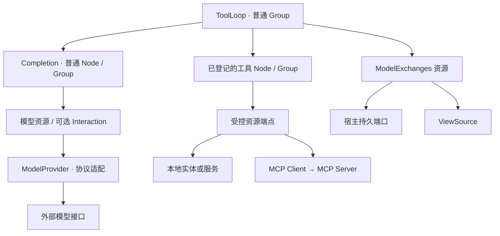

# 原生工具调用与 MCP 接入方案

> 历史设计／验证记录：下文版本、测量和“下一步”保留当轮语境，不是当前兼容承诺。现行接口见 [Checkpoint](checkpoints.md)、[增量引用选择](checkpoint-selection.md)；旧格式与数据库策略见[开发期兼容](development-compatibility.md)。文档脉络见[导航](README.md)。

状态：生产契约与首版工具循环已实现，2026-11-05。下文保留设计和离线验证的来由，当前落地范围见末节；协议样本不代表真实模型质量或多厂商兼容认证。

Provider 的现行接口见 [ModelProvider](../packages/model-provider/README.md)，工具作者接口见[工具预设](../../capix-lab/services/conversation/src/tools/README.md)，宿主使用见[服务 README](../../capix-lab/services/conversation/README.md)。本文旧文本交互只读和旧库迁移安排已撤销，详见文首兼容约定。

## 1. 目标与范围

让模型通过原生工具调用协议提出操作请求，由现有结构、资源和调用机制完成执行、接纳与反馈。模型决定下一步不改变 Invocation 的职责：它继续维护真实调用、访问窗口、父子交付与退出边界。

第一轮验证客户端执行的函数工具：结构化参数、文本反馈、有限循环。模型工具可以映射到本地 Node/Group，后续再用一个 MCP 工具替换实现，验证两条适配边界是否独立。

本轮不同时推进动态能力注册、通用插件平台、人工审批、Inbox、会话 fork、任意副作用恢复或厂商托管工具。内建搜索、服务端代码执行等工具由厂商执行，不能把它们的输出当成待派发给本地 Node 的请求。未经适配的输出类型应明确拒绝，不能静默丢弃。

原生工具调用不是 DeepSeek 专有能力；共同的是工具声明、调用请求和结果关联，传输协议不同。首个实际适配沿用 DeepSeek Chat Completions；Responses 和 Claude 用离线样本检验契约，不据此宣称已经支持这些接口。

## 2. 实施前基线与接缝

| 位置                                                                                                                                       | 当前事实                                        | 本轮需要处理                                      |
| ------------------------------------------------------------------------------------------------------------------------------------------ | ----------------------------------------------- | ------------------------------------------------- |
| [model-provider/types.ts](../packages/model-provider/src/types.ts)                                                                         | 三种文本消息角色；ModelReply 只有 text 等字段   | 工具声明、规范化有序输出、完整续接材料            |
| [provider.ts](../packages/model-provider/src/provider.ts)                                                                                  | 请求消息重新投影为 role/content                 | 完整编码工具请求和对应历史，明确支持的参数        |
| [response.ts](../packages/model-provider/src/response.ts)、[stream.ts](../packages/model-provider/src/stream.ts)                           | 文本接纳；流式拒绝 tool_calls，reasoning 不保留 | JSON/SSE 等价接纳、交错工具片段聚合、原生材料保真 |
| [completion-contract.ts](../../capix-lab/services/conversation/src/model/completion-contract.ts)                                           | 严格文本请求/回复 Schema，交互契约 v1           | 新形状的严格接纳及持久兼容                        |
| [model-codecs.ts](../../capix-lab/services/conversation/src/recovery/model-codecs.ts)                                                      | CP 复用服务模型 Schema                          | 声明版本与原始模型材料的恢复校验                  |
| [Dynamic](../packages/structure/src/composition/dynamic.ts)                                                                                | 单项选择、逐步调用，无自身 CP 声明              | 不直接扩为工具循环；另建普通 Group 预设           |
| [子引用契约](../packages/structure/src/definition/checkpoint.ts)                                                                           | childReferences 支持同一成员的多个引用          | 为固定工具目录建立准确的多引用槽                  |
| [对话 Scene](../../capix-lab/services/conversation/src/scene.ts)、[提交预览](../../capix-lab/services/conversation/src/http/submission.ts) | string delta，当前 Web 按单一 generation 追加   | 多次模型回复的候选身份、结束与最终回答映射        |

目前没有发现必须增加 Invocation 模式或修改 CP Frame 的依据。实际缺口集中在模型协议、材料实体和服务投影；这仍需后续验证，不能用“可以写成 Group”代替证明。

## 3. 职责与包边界



| 对象           | 持有和负责                                           | 不负责                                                  |
| -------------- | ---------------------------------------------------- | ------------------------------------------------------- |
| ModelProvider  | 固定连接配置；单次模型请求；协议编解码、完整回复接纳 | 隐式会话历史、选择 Node、执行工具、自动重试             |
| 工具配置       | 模型名、说明、参数契约、准确结构、反馈接收规则       | 独立身份或生命周期、新的 Callable kind                  |
| ToolLoop       | 固定目录、有限推进、派发与接纳、组成下一次模型输入   | 直接操作厂商消息字段、替代 Invocation、自动修复未知效果 |
| ModelExchanges | 完整模型交换事实、反馈槽位、固定写入、快照与来源版本 | 运行工具、调度缺失结果、保存另一套调用状态              |
| 资源           | 固定供给、受控端点、实际操作及失败交付               | 从模型给出的名字推导额外权限                            |
| Interaction    | 可选的独立发送、反馈保存、局部等待与再次读取         | 模型循环、远端幂等、任意调用恢复                        |
| 宿主           | 实体、Provider/MCP Client、持久端口、结构装配与关闭  | 根据记录猜测业务效果                                    |

共同模型类型先归 `@weiliang0121/capix-model-provider`，不因被多个包使用就晋级到通用 packages/contracts 或跨端 protocol。模型交换实体独立放在 `@weiliang0121/capix-model-exchanges`；它消费模型纯值及 resources/view/changes 等公开端口，不依赖 Invocation 或 Runtime。其持久存储仍由宿主实现。

ToolLoop 先在服务的独立 tools 目录实现，通过 example 验证；稳定后再决定公共预设包。不要放入 `@weiliang0121/capix-structure`，以免通用结构包反向依赖模型协议。MCP 客户端适配也独立于模型 Provider。

## 4. 模型协议：共同字段与原生补充形成一份回复

| 接口                      | 调用表达                          | 反馈表达                        |
| ------------------------- | --------------------------------- | ------------------------------- |
| OpenAI Chat Completions   | assistant.tool_calls              | role: tool + tool_call_id       |
| DeepSeek Chat Completions | 同类 tool_calls，另有思考模式材料 | tool 消息及该接口要求的历史材料 |
| OpenAI Responses          | function_call 输出项              | function_call_output + call_id  |
| Claude Messages           | 有序内容中的 tool_use 块          | user 消息中的 tool_result 块    |

共同层保留有序正文、工具请求、结束状态和用量，普通消费者直接读取；只有生成原生续接表达时需要对应适配器。原生补充保存共同部分无法表达的内容及准确关联，不另存一份完整 assistant/tool_calls，也不把全部回复装进不透明 payload 再要求每个消费者寻找适配器。

以下保留跨协议职责伪代码；首版精确类型见 model-provider/types.ts，只支持 json-text 和 Chat Completions 的严格 native 形状：

```ts
type ToolArguments = { encoding: 'json-text'; text: string } | { encoding: 'json-value'; value: JsonValue };

type ModelOutput = { kind: 'text'; text: string } | { kind: 'tool-call'; id: string; name: string; arguments: ToolArguments };

type ModelReply = {
  format: string; // 格式身份不因 native 为空而消失
  version: number;
  source: ProviderCompatibility; // 协议/模型等兼容依据，不含凭证
  id: string;
  model: string;
  output: readonly ModelOutput[];
  termination: {
    kind: 'completed' | 'incomplete' | 'refused';
    reason: string; // 保留原生原因
  };
  usage: ModelUsage | null;
  native?: JsonValue; // 具体格式严格接纳的补充材料，不能覆盖共同字段
};
```

`completed` 只说明这份回复满足适配器支持的正常结束语义，可以包含工具请求，不证明业务已经完成。工具参数的 JSON/Schema 校验仍在派发前进行。保留 json-text 是为了如实表达格式错误，不能在 Provider 内把错误参数修复成合法对象。

共同输入用正式消息材料与“模型回复＋已落实反馈”表达，由 Provider 展开成具体 wire 消息；ToolLoop 不手写 `role: tool`。正文 helper 是同一回复的只读投影，不是第二份权威数据。文本完成 helper 应检查正常结束、没有待执行工具请求及合格正文，不能仅拼接 text 后忽略工具请求。

续接材料遵守以下规则：

- 同一次适配完整接纳共同字段与原生补充，形成不可变纯值。共同部分已经保存的正文、工具 ID、名称和参数不得在 native 中另存可独立变化的副本；编码只能使用共同值，原生补充不得覆盖。
- 保留实际需要的有序原生块，包括思考模式/签名等该适配器要求的数据。若采用原生布局引用，必须核验公共项不遗漏、不重复、不重排，补充块关联准确；布局归具体适配器，不先建立通用 IR。`native: JsonValue` 只是示意，不能代替具体格式的严格 Schema。
- json-text 保存原始参数文本，执行时解析；不同时保存另一份可独立变化的 parsed arguments。JSON 与 SSE 均完整接纳后形成同一回复形状，包括结束之后到达的 usage；不能把最后一片 SSE 当作完整原生回复。
- 只保存本次回复所需材料，不把累计上下文、HTTP headers、密钥、SDK 客户端或回调塞进 native。
- Provider 不隐式持有历史。宿主显式保存，下一次明确传入；codec 的格式/version/source 不匹配时拒绝无损续接。旧数据仍需旧格式的数据接纳能力，但普通展示无需持有旧网络适配实现；展示可读与可原生续接分别判断。
- 更换 Provider 后把旧数据转成普通辅助材料，是另一个显式材料策略，不冒充原生协议可互换。
- 远端 response ID 依赖外部保留期限；仅保存 ID 不代表拥有本地自足的恢复材料。首版以明确保留的本地回复材料验证，不自动降级成远端引用模式。

工具 Schema、strict、指定工具和并行配置的支持范围因接口而异。首版只暴露实际支持的选项；不支持时明确拒绝，不能静默删减约束。无需为此先建立庞大的厂商能力注册平台。

## 5. 工具配置与作者用法

```ts
// 候选 API。tool 是类型化配置关联，不创建额外执行实体。
const answer = createToolLoop({
  completion: createCompletionNode(),
  tools: {
    read_text: tool(readText, {
      description: '读取工作区内的文本文件',
      input: readTextInputSchema,
      result: {
        succeeded: (document) => ({ status: 'ok', content: [{ kind: 'text', text: document.text }] }),
        failed: (error) => ({ status: 'error', content: [{ kind: 'text', text: describeExpectedReadFailure(error) }] }),
      },
    }),
    save_text: tool(saveText, {
      description: '保存文本到工作区',
      input: saveTextInputSchema,
      result: { succeeded: (receipt) => ({ status: 'ok', content: [{ kind: 'text', text: JSON.stringify(receipt) }] }) },
    }),
  },
  maxModelCalls: 8,
  execution: 'sequential',
});
```

`createToolLoop` 同时登记 completion 和工具成员，固定名称映射及参数/反馈契约；作者不再重复 add 或声明 uses。普通 run 的成员来自结构注册；可恢复预设仍要显式生成 resume.uses 和 reception 契约，不能把普通调用配置假装成恢复依据。

类型链必须保持 `Schema → Node Input → Node Output → result`。Schema 到 JSON Schema 的转换只接受支持的形状，不允许转换后丢失校验含义。输入需要业务转换时通过明确适配 Node 完成；运行时发现的 MCP Schema 必须在运行时校验，不能冒充 TypeScript 已知类型。

模型协议名来自 tools 的键，不复用 Node.name/label。目录固定到准确成员；名字只在这份目录中选择，不进入全局注册查找。Node 的依赖和端点仍由资源装配决定，目录可见不等于获得额外权限。

同一成员可在本 Group 内多次调用，每次建立独立 Invocation。结构实例不能跨父共享。异构目录由泛型配置保留参数关联，再在内部通过受控闭包派发；不向作者暴露一个靠断言连接的 `(node, unknownInput)`。

首版反馈为带状态的文本块，包括显式编码的业务失败；没有失败处理配置时沿用失败传播。首个闭环只执行串行工具，单份回复仍可请求多个工具；并行执行留到后续验证，不提前承诺副作用之间独立。

反馈映射必须无副作用且只由原交付决定。允许 Promise 返回不代表允许映射执行外部 I/O：成功子交付已保存、父接纳尚未保存的窗口恢复可能重新执行映射；已保存 accepted/handled 才只读原结果。外部效果应归实际工具及资源的确认契约，不能以 policyVersion 代替幂等。

目录在构造时固定，恢复前核对目录摘要及业务契约版本。摘要覆盖模型可见名称、说明、Schema、名称到准确成员位置/契约的映射，以及可序列化执行策略；反馈编码、预检反馈措辞等函数行为变化由显式业务版本表达，不 hash 函数源码冒充语义认证。摘要只证明本地依据未变，不证明远端实现或当前授权未变。

摘要采用确定性 JSON 表达：对象键按固定顺序排列，数组顺序保留，只接收支持的合法 JSON 值。首版不做 Schema 语义等价化简，不排序数组或删除约束来追求相同摘要。表示不同而保守拒绝恢复，可以接受。恢复仍核验准确结构和资源资格，摘要不替代它们。

生成的 JSON Schema 是固定目录数据的一部分。当前生成器为锁定的 Zod 4.6.5；升级可能改变生成数据及摘要，进而拒绝旧 CP。升级验收需要比对旧目录 fixture，不以重新生成的结果静默替换旧目录或绕过兼容检查。

## 6. 模型交换实体与身份

保存单位是一份完整模型回复及其对应工具反馈，候选名称 `ModelExchanges`。没有工具调用的最终回复也保存；这既保留协议续接材料，又避免让 Transcript 承担模型专属字段。

```ts
type ToolFeedback = {
  toolCallId: string;
  status: 'ok' | 'error';
  content: readonly { kind: 'text'; text: string }[];
};

type ModelExchangeSnapshot = {
  id: string;
  revision: number;
  reply: ModelReply;
  feedback: readonly ToolFeedback[];
};
```

实体本身不引入 running/accepted 等平行执行状态。由请求槽位与已保存反馈判断协议是否闭合；这不是对业务执行成功的判断。模型的最终无工具回复也不自动等于已经写入正式对话。

反馈的 status 表达交给模型的业务结果，不是 Invocation 状态的别名。业务失败被 handled 后可以交付有效替代结果，成功返回也可能表达业务拒绝。作者的 result 接收器只返回 status/content，由 ToolLoop 关联原请求的准确 callId，实体再核对槽位。内容块为以后扩展提供位置，不免除新增内容类型时的 Schema、版本和旧读者兼容处理。

建立交换前先核验回复内部关联、callId 唯一性及容量，实体写入口也守住这些不变量。非法原始回复若需要保留，只作为有界诊断事实，不建立可消费的交换或可写反馈槽位。工具名称和参数的业务校验可以在此后形成拒绝反馈。

候选端点：

| 操作                                    | 不变量                                                                                                                              |
| --------------------------------------- | ----------------------------------------------------------------------------------------------------------------------------------- |
| 固定接纳完整回复                        | 由模型子交付的真实接纳范围及固定位置取得操作依据；实体生成 exchangeId；同依据确认原结果，不按文本、模型 reply.id 或当前长度猜测身份 |
| complete(exchangeRef, callId, feedback) | 只写已存在的准确请求槽位；第一次写入或同值重复确认；异值冲突；检查集合与交换身份                                                    |
| read / snapshot / restore               | 返回冻结纯值；恢复不执行工具、不发布历史变更                                                                                        |
| ViewSource                              | 提供集合身份、版本、完整目录与按准确 key 的固定读取                                                                                 |

实体及资源可以复用固定落实的原则，不直接复制 Transcript.applyFixed 的业务签名。尤其预检拒绝没有工具子调用：它基于真实模型请求槽位记录反馈，不制造 childContextId。

| 身份                 | 作用域与含义                               |
| -------------------- | ------------------------------------------ |
| 工具目录名           | 一份固定 ToolLoop 目录中的能力选择         |
| exchangeId           | 模型交换实体中的一份回复与反馈集合         |
| toolCallId           | 该回复内的协议关联；与 exchangeId 组合定位 |
| Invocation 身份      | 一次真实模型或工具子调用及父子关系         |
| Interaction 引用     | 一次独立外部请求与反馈                     |
| MCP JSON-RPC 请求 ID | 一次传输请求/响应关联，不是远端幂等凭据    |

消息锚点和原提交的归属由服务明确建立，例如准确 transcriptId/index 与交换引用；实体不强制所有使用者必须有 Transcript，也不把“轮次”设为跨业务的固定范围。

首版 ToolLoop 通过有序交换引用保存本次请求链。实体若以后提供跨调用分组检索，再验证不透明 group/ordinal 的价值及同组同位唯一性；当前不同时建立第二套可变排序，不按反馈完成时间或集合长度猜测原顺序。

离线例子的 `scope` 是宿主创建并写入固定输入的业务循环归属，不是权限凭据，也不是 Invocation 身份。真正的接纳来源由资源端点取得的父子身份确定，集合身份和交换引用仍需准确核验。生产若要求“一份业务归属只能对应一次调用”，需要明确实施这条业务约束；若允许跨调用继续同一流程，则不能套用这一限制。UUID 由谁生成不能替代这项决定，恢复时也不能重新生成归属。

交换写入成功只证明协议材料落实，不证明子接纳完成或外部效果可恢复。反馈可在子 result 接收中落实；其凭据与 CP 关系分别核对，不从交换完整性反推 Invocation 成功。

## 7. 正常推进、失败与预算

```text
固定输入材料与目录
  → 创建模型子调用并等待完整回复
  → 检查协议完整性、整批调用身份/唯一性及数量/长度
  → 接纳并固定模型交换
  → 检查结束原因
      ├─ incomplete / refused：按明确业务规则结束，不派发工具
      ├─ completed 且无工具：检查最终正文，返回父层接纳
      └─ completed 且有工具：
          匹配目录并校验各项参数
          → 对允许修正的预检拒绝写入反馈
          → 创建合法工具子调用
          → 执行并在 result 中形成、落实反馈
          → 核验批次闭合，按原请求顺序组成下一次模型输入
```

调用前先检查整批协议结构，避免执行部分工具后才发现重复 callId 等无法解释的问题。未知工具或非法参数可以按固定预设转换成拒绝反馈；它们不产生工具子调用。恶化为无界请求、无法配对或不完整回复时直接停止，不靠模型自我修复。

预检拒绝由 ToolLoop 预设生成，不调用工具子接收函数、不伪造 failed/handled 子关系。它的文本与编码策略纳入预设的业务契约版本。恢复确认已经落实的准确反馈；尚未落实的反馈只有在原策略依据成立时才能生成。

| 情况                                     | 处理                                                                 |
| ---------------------------------------- | -------------------------------------------------------------------- |
| 工具成功                                 | 父 result.succeeded 编码并落实反馈，保留真实 accepted 关系           |
| 明确允许的业务失败                       | result.failed 形成反馈，保留 returned failed / reception handled     |
| 未声明可接收的失败                       | 继续失败，不自动交给模型无限重试                                     |
| 取消、持久化、CP、访问窗口、必要观测故障 | 沿用现有保护，不编码成普通工具失败                                   |
| 接收/编码回调自身失败                    | 不再次进入同一个 failed                                              |
| 工具效果已发生、反馈保存失败             | 保留真实效果，停止推进；不据缺少反馈重做                             |
| 并行的一项失败                           | 按既有退出契约收尾已启动子调用，保留已成立事实；不隐式回滚或取消兄弟 |

下一次请求必须等本批次所需反馈齐备，按准确 callId 及模型原请求顺序形成材料。完成顺序可以不同，不改变反馈关联。

预算至少覆盖模型请求次数、工具调用总数/单批数量、参数/结果字节、累计输入材料和单请求输出。达到模型次数上限时显式结束，不能在上限外偷偷追加“总结一次”；如需留总结额度，应在预设策略中计入。数值先在 example 中测量后确定，不据示例的 8 次宣称生产默认最优。

## 8. 流式、正式消息与 View

Provider 首版继续通过 `emit(string)` 交付正文预览。SSE 工具参数按 index 分别聚合，name/id/arguments 按实际协议校验；不得串调用，最终 JSON 与 SSE 接纳必须等价。完整回复前不启动工具，reasoning/参数片段不进入回答正文。

ToolLoop 的上层 Delta 需要区分模型候选：

```ts
type ToolLoopDelta = { kind: 'reply-start'; reply: string } | { kind: 'text'; reply: string; text: string } | { kind: 'reply-end'; reply: string; disposition: 'tools' | 'final' };
```

这里 reply 是当前输出范围内的本地候选身份，不要求等待厂商回复 ID 才能开始展示。失败/取消如何封口也要覆盖；不得把缺少 reply-end 当成正常完成。内核已有泛型 Delta，可表达这种输出；当前服务 string Delta 和 Web 单 generation 需要单独适配。

工具请求前的 assistant 文本是过程说明，不能和后续最终答案直接串接。首个 example 展示分段预览；正式服务适配候选替换/分段后再接入。若只在最终回复完成后输出，必须明确这不等于原有实时流式体验。

Transcript 继续保存正式 user/assistant。ModelExchanges 保留模型协议材料；最终回复与正式助手消息由服务建立准确来源关联，不能在重组时把同一答案从两个来源重复加入。

ViewSource 以交换为 key，暴露真实完整性摘要；View 只决定成员，既不组 prompt，也不负责修复工具协议。原生回放时由材料构造检查 assistant 与对应反馈闭合及适配器续接条件。缺失反馈的交换不能冒充完整原生历史；作为普通辅助材料呈现未知状态属于显式业务策略。

跨提交沿用当前服务的固定材料策略即可，不默认变成完整原生会话回放。后续若选择原生历史，需要明确交换顺序、正式消息锚点、材料截取边界、最终答案去重和 Provider 兼容性。保留协议材料不强制业务永久保留全部历史；退出 View、生成摘要与原生续接是不同操作。

## 9. Interaction、CP 与恢复

Completion 仍可使用直接资源或既有独立 Interaction：工具循环不改变局部取消与外部发送的分离。直接模型请求退出时消费本次 signal；独立交互保存迟到反馈，引用与发送交接的既有未知窗口仍然存在。

局部等待超时可用携带原 Interaction 引用的 `ModelReplyPending` 表达，供宿主或新读取调用继续消费同一反馈；它不是模型处理失败的证明。但抛出该错误的调用若已成为 failed 终态，仍不能恢复原调用。只有尚未终结的 CP 和完整恢复依据才能续接。要在超时后跨调用继续整个 ToolLoop，还需正式交付材料、目录、预算、工具前缀及待取引用的业务续接依据；不能只换一个异常类就宣称完成。

候选恢复点：

```text
modelWaiting
→ exchangeAccepted
→ toolsWaiting
→ feedbackAccepted
→ nextModelWaiting
→ finalReply
```

固定目录为每个成员生成多引用槽；同一工具多次调用由 `childReferences(member)` 保存。state 表达业务位置、预算消耗、交换引用及 callId→准确子引用关联；Frame 继续保存完整直接关系。不能把 callId/key 当成子身份，也不把原生 continuation 当成 CP。

上述是需要解释的处理边界，不要求六个独立 point 定义。一个 point 可以被多次保存，但不能据此删除必要保存边界；尤其父层已处理子失败的 handled 事实必须进入父 Frame，不能从实体反馈槽位反推。候选两类 point 是否足够由中断测试决定。

恢复必须分别核验：

- 模型请求等待：核对原有子调用的准确引用及原固定请求；只有保存反馈/有效子 CP 时续接，不重发未知请求。
- 已 accepted/handled：读取认证交付，不重新运行接收回调；核对交换反馈的准确凭据。
- 已返回尚未接纳：读取原返回，按原接纳契约和固定效果继续。
- 在途工具：仅恢复原引用；没有首个可用 CP/反馈时拒绝，不创建替代调用。
- 工具外部效果未知：保留未知，交换反馈缺失不是可重执行证明。
- 无工具最终回复：保存完整回复及其材料；正式消息落实仍由父层按已有实体凭据确认。

实体提交、父接纳、CP 分别提交，不构成统一事务。恢复资格由宿主及对应工具决定，不能因为安装 ToolLoop 的 CP 就承诺任意 Node 可恢复。

### 固定输入与资源供给

首版验证以下链路，而不是只给已有完整请求 Group 外包一层引用：

```text
ToolLoop 原输入保存固定基础材料
  → Resources.capture 从该输入建立本次子树供给
模型子调用输入只携带有序交换引用及必要依据
  → 资源方法核验集合、版本、顺序和反馈闭合
  → 在发送边界组成完整 ModelRequest
  → Provider.complete 或 Interaction.start
```

恢复从原 CP input 重建材料供给，不读取当前 View/记忆来替代原材料。这里只约束本链路的材料构造：由原输入和已核验固定配置决定，不读取可变 options；不把所有 Resources.capture 都限制成纯值函数。连接和实体句柄可以重新建立，当前授权失效仍应拒绝。普通 ModelProvider 不理解本地实体引用。

所有可恢复模型子层都必须检查：如果某个内部 send 的输入仍为完整累计请求，重复只是移到了更深 CP。请求展开后应直接交给资源发送端口。基础材料可由 ToolLoop 自身输入持有，不因此新增通用材料库或查找父 Context。

### 数据量与 CPU 验收

首版保留 Interaction 完整固定请求，明确接受并测量现有存储成本。在每次请求携带此前全部材料的配置下，n 次请求、基础材料 H、每次新增反馈 T 的逻辑请求存量约为 `nH + n(n−1)T/2`。引用化只减少 CP 的额外重复；Interaction 成本原本就存在，不是此次才转移过去。完整逻辑请求也不要求未来物理存储永远不能去重。

一个 Interaction 只发送一次，不等于物理上只编码/写入一次。准备、发送和反馈等状态提交可能再次保存包含请求的状态，因此分别统计最终留存量和累计编码/写入量。

CP 捕获仍遍历全部直接关系。若同一父层每增加一子就保存固定次数，累计关系处理为 `1 + 2 + … + k`；批量创建 k 个子且仅保存固定次数则不同。不能只按工具数量断言全部计算必然平方。引用数组、返回值与接纳值也有成本，不宣称引用化后所有 CP 数据线性增长。

离线验证输出：每层/每点 save 与 finish 次数，单次及累计同步耗时，父 Frame 子关系数量，image/delivery 原始 JSON 字节，Interaction 逻辑存量与累计提交字节，以及请求字节。扩大到负载时再观察 CPU 和事件循环停顿。计时标明包含关系，不重复累加 writer、Store 和 SQL。保持现有 8 MiB 边界，不静默裁剪材料或省略关系。

## 10. MCP 接入

模型工具协议连接应用与模型；MCP 连接应用与外部能力。MCP 不替代 ToolLoop，也不是一种新的 Invocation。MCP 的 tools/resources/prompts 都可通过 CAPiX 资源接入；MCP resource 不等同于 CAPiX 的受控资源机制。

第一轮 MCP 链路：

```text
宿主建立 MCP Client，发现并选择工具
→ 固定服务身份、名称映射、Schema 与允许范围
→ 形成普通工具配置/Node 和受控资源端点
→ Runner.build
→ ToolLoop 选择成员
→ Node 经资源调用 MCP Client
→ 检查结果并由模型 Provider 编码为工具反馈
```

MCP Client 的连接、凭证、版本兼容和关闭归宿主。共享连接不意味着共享用户授权。资源只开放本次已登记工具，业务不能通过模型提供的 server/name 任意访问其他端点。

目录冻结是本地依据，不冻结远端实现。工具消失、Schema/响应契约变化或原授权失效时明确失败，不能静默换源。收到目录变化通知不热改在途结构；宿主后续新建结构与 Runner，按现有配置生命周期重新装配，不修改已 build 的对象。

MCP 只提供发现资料，模型接口可能只支持其 Schema 的子集。不能静默移除限制。不同服务的同名工具通过固定映射区分；运行期按远端 Schema 校验，保留远端身份。

结果中的工具业务失败、协议错误、传输结果未知分开表达。结果内容可能不是纯文本：首版对支持的内容作显式转换，对其他形态拒绝或交给明确的内容策略，不默认只取第一个 text。MCP 协议版本不同，发现、补充输入和生命周期等细节也不同；实际接入前固定 SDK/支持版本，首版限定已验证的发现与普通完成调用，不隐式支持所有协作能力。

普通 MCP 调用可直接作为资源操作。只有需要调用退出后继续收反馈、持久保存并由新调用读取时才组合 Interaction。JSON-RPC 请求 ID 不提供远端幂等；重连不证明前次副作用未发生，不自动重发未知调用。

工具结果及远端目录是外部数据，不成为新的系统指令或权限来源。宿主在冻结目录前可以选择工具、审核或改写说明；不能静默削弱 Schema 后宣称仍满足远端契约。将材料标注为数据只是提示层辅助，实际执行仍由准确成员映射、参数校验及资源授权约束。

## 11. 持久兼容与代码落点

候选目录：

```text
packages/model-provider/src/
  types.ts                  共同模型纯值和 Provider 契约
  <具体适配器相关文件>      wire 编解码、续接 codec、流式接纳
packages/model-exchanges/     候选独立实体包：集合、固定写入、资源、ViewSource
services/conversation/src/tools/
  <工具配置与循环预设>      使用公开结构/资源端口
services/conversation/src/model/
  <模型契约与资源适配>      新请求/反馈的严格接纳
services/conversation/src/persistence/
  <模型交换持久端口>        宿主存储与版本迁移
examples/native-tools/      离线闭环、真实模型显式入口、故障验证
```

具体文件按实际对象内聚确定，以上不要求提前建立空目录、通用注册表或独立生命周期。

不能只给 Provider 增加字段：服务的 strict Schema、Interaction 保存/读取、CP codec、材料构造、正文取值和输出投影都要适配。最终正文由统一 helper 从共同输出取得，不同时保留可能不一致的 text 和 message.content 两份权威数据。迁移清单包含 model-provider JSON/SSE 与测试替身，conversation 的 completion-contract/model-codecs/SQLite 交互重载、模型资源摘要、材料回答、记忆维护、意图/总结节点及依赖公开 Provider 的 example。旧 Observer 自有 Provider 不据此自动纳入同一次迁移。

旧文本交互保持旧格式接纳和历史可读；新契约使用新版本。不在当前唯一 decoder 上直接换形状使旧数据不可读，也不把缺失续接材料的旧文本结果自动标成支持原生工具历史。既有 CP 是否还能续接由原业务声明版本明确决定，不静默改写镜像。具体兼容分发与迁移规则在机制迁移前由旧数据 fixture 验证。

## 12. 实施顺序

1. **契约与离线探针。** 确定共同字段/不重叠原生补充、目录依据、反馈语义；通过 DeepSeek JSON/SSE 样本及一个非 DeepSeek 的混合块反例检查。先在 example 验证，不同时替换生产 ModelReply。
2. **真实机制的离线闭环。** 使用公开 Group/Node/资源/Interaction/CP，固定回复和反馈槽位，覆盖串行多工具、重复成员、业务失败及预算；模型子输入保持引用，在资源边界展开请求。通过准确保存时点的快照重新装配，验证不漂移、错目录/引用拒绝、未知不重发；统计保存次数、关系增长、字节与同步时间。不用正常取消冒充进程丢失。
3. **生产契约迁移。** 前两步证明后，迁移 Provider、服务共同 helper、严格 Schema、实体包及持久版本；对照旧数据 fixture 验证读取与 CP 资格。生产包不能反向依赖 examples。
4. **服务与 MCP 验证。** 服务适配分段预览和正式消息关联，再显式运行小组真实模型测试；将其中一个本地工具替换成 MCP 实现，验证 ToolLoop 无需分支感知执行来源。

宿主发送前让出 I/O 是独立的响应性修复，可与离线验证并行。经已有 fetch 注入口装配 Node 专用传输，不全局改写 fetch，不让协议 Provider 默认承担宿主调度，也不增加重试。等待纳入原总超时，恢复执行后重新检查取消。它只改善已观察到的连接复用时序，不是 FIN 处理屏障，不消除 CP 同步成本，也不是工具协议设计的硬前置。CP Store 旧 head 消费、物理存储去重与异步 Store 另行闭环。

如果普通组合需要绕过公开端口、复制一套调用状态或扩大资源窗口，应停在对应接缝讨论；不能以预设内部封装掩盖机制缺口。真实模型测试使用宿主显式配置，普通测试离线，不因本方案默认读取凭证或发起外部请求。

## 13. 验收矩阵与待证明条件

| 场景                                       | 必须观察到的事实                                                     |
| ------------------------------------------ | -------------------------------------------------------------------- |
| 参数/节点/结果类型不匹配                   | 编译失败；不依靠作者端断言连接                                       |
| 未登记成员或目录名冲突                     | 构造/装配拒绝，运行不扩大可调用范围                                  |
| 无工具最终回复、纯工具回复、正文与工具混合 | 三者均可准确接纳；中间正文不冒充最终回答                             |
| 两个工具的交错 SSE 参数、UTF-8 分片        | 聚合准确，顺序与 ID 不串；与非流式最终值一致                         |
| JSON 参数非法、Schema 不符、未知名称       | 不执行对应工具；反馈/失败符合明确策略                                |
| 截断、缺结束标记、重复 callId、超预算      | 不从不完整请求产生副作用；没有隐藏重试                               |
| 同一工具多次、同回复多个工具串行执行       | 不同 Invocation 与正确的 callId 关联，反馈顺序稳定                   |
| 一项业务失败，其余成功                     | 保存真实 failed/handled 与 accepted，不整批伪装成功                  |
| 取消/持久化/CP/窗口故障                    | 不被普通 failed 降级；退出和独立交互语义不变                         |
| 交换写入重复、异值重复                     | 同操作确认原结果；冲突拒绝，不重复发布                               |
| 效果已发生但反馈或父 CP 未保存             | 固定凭据确认或明确未知，不能重新发起猜测                             |
| 完整回复保存、重载、下一次工具请求         | 原生必要材料完整；零工具最终回复也保留                               |
| native 试图覆盖共同字段或布局重复/遗漏     | 严格接纳拒绝；执行投影与原生续接使用同一工具事实                     |
| Provider/格式/版本不兼容                   | 明确拒绝原生续接，不悄悄丢字段                                       |
| View 选中缺反馈交换或孤立反馈              | 原生材料构造拒绝；不由 View 自动补造                                 |
| 两次模型正文预览                           | 有候选边界，不串成一条最终答案                                       |
| 旧文本交互与旧 CP                          | 读取和恢复资格按版本真实表达，不因换 decoder 丢失可读性              |
| MCP 同名工具、目录变化、越权名称           | 固定映射和授权仍有效，不热改在途树                                   |
| MCP 断线结果未知                           | 不自动重发；不误判成未执行                                           |
| 原输入保留但当前 View/记忆变化             | 恢复材料仍来自原输入，不能用新材料替换                               |
| 两条链交错、外集合或错误版本交换引用       | 本次供给不串；引用不属于本链或反馈未闭合则拒绝                       |
| 目录/成员映射/业务策略版本变化             | 在继续调用前拒绝恢复，不仅检查目录名                                 |
| 模型次数/材料增长                          | 分列请求、Interaction、CP 字节及 CPU/次数/关系数，不宣称消除所有重复 |

尚待证明的三项核心条件：

1. **类型与公共接口：**异构工具配置、schema 派生、节点输入/输出、接收和 CP refs 的关联是否保持准确且易写。
2. **协议材料：**共同字段与原生补充是否形成一份有界、不可变回复，普通读取无需网络适配器，执行和续接不分叉；DeepSeek 做实，一个不同协议形状用于结构反例检查，不要求同时交付多厂商实现。
3. **交接窗口：**模型接纳、交换落实、工具子接纳和 CP 保存之间，是否始终消费准确依据；不能把实体幂等扩张成远端效果恰好一次。

## 14. 本轮离线落地与边界

[examples/native-tools](../../capix-lab/examples/native-tools/README.md) 已提供第一、二步的可执行验证，生产包不依赖该目录：

- DeepSeek 形状的 JSON/SSE 样本接纳到共同回复与受限原生补充，完整反馈按工具 ID 重新编码；另有混合块反例检查顺序、重复与遗漏。普通正文/工具请求读取不依赖原生编码器。
- 目录使用稳定 JSON 摘要，成员位置及 CP 契约对应实际登记节点；恢复还核对固定预算、原输入和引用依据。类型用例直接关联现有 Node I/O，包含错误 Schema、结果处理和反馈身份的编译拒绝。
- 普通 Scene/Group/Node、Resources.capture、Interaction、CP 组成真实串行工具循环。同一成员可调用多次；预检拒绝不伪造子调用，业务工具失败保留 failed/handled，受保护故障与取消继续传播。
- 通过公开 Store 的真实提交前缀重建，验证等待模型、接纳模型、处理失败工具、写入完成和最终返回等边界。交换实体回复/反馈与准确子交付、接纳凭据交叉核验；没有首份子 CP、反馈缺失或效果未知时明确拒绝，不替换请求或重做工具。
- CLI 分别输出每点关系数量、image 字节、save/finish 次数、writer/Store 同步耗时，以及 Interaction 的逻辑存量与累计写入量。可配置 1–8 次模型请求、固定材料大小和工具返回大小，检查长链增长。

这个验证没有新增生产 ModelExchanges 包、修改 ModelProvider、迁移服务持久格式或改变 CP Frame v5。Store 提交前缀是进程内离线复现，不等于完成真实进程崩溃、SQLite 与网络共同故障的认证；严格协议 fixture 也不等于多厂商兼容验证。下一步生产迁移仍需按 §11 同时处理 Provider、正文消费者、交互/CP 编解码和旧数据资格。

独立的宿主传输修复已经接入新服务 CLI/Web。200 会话 direct/yield 各两次对照中，模型失败由每组 198/800 降至 0/800；CPU 和最大事件循环停顿未明显下降。完整配置、数据与限制见 [容量调查 §8](../../capix-lab/docs/checkpoint-capacity-investigation.md#8-宿主发送前让出执行权)。这项结果不能作为工具循环容量认证。

## 15. 依据

以下官方资料用于识别协议差异，具体实现时仍需固定支持范围与版本：

- [OpenAI Function calling](https://developers.openai.com/api/docs/guides/function-calling)：工具请求、结果及 Responses 的 reasoning items 续接要求。
- [DeepSeek Tool Calls](https://api-docs.deepseek.com/guides/tool_calls/)：Chat Completions 工具声明与调用反馈。
- [DeepSeek Thinking Mode](https://api-docs.deepseek.com/guides/thinking_mode/)：带 tools 时的 reasoning_content 回传要求，包含零工具回复。
- [Claude Handle tool calls](https://platform.claude.com/docs/en/agents-and-tools/tool-use/handle-tool-calls)：tool_use/tool_result 内容块、关联与错误表达。
- [MCP Architecture](https://modelcontextprotocol.io/docs/learn/architecture)、[MCP Tools](https://modelcontextprotocol.io/specification/latest/server/tools)：外部发现与调用接缝；本轮查询的 latest 指向 2026-07-28。
- 仓库：[模型 Provider](../packages/model-provider/README.md)、[资源包](resources-package.md)、[结构包](structure-package.md)、[交互](interactions.md)、[Checkpoint](checkpoints.md)、[操作失败](exceptions.md)、[退出契约](invocation-exit-contract.md)。

## 16. 首版生产落地

生产出口落在三处：

- `@weiliang0121/capix-model-provider`：ModelReply v1 唯一材料、Chat Completions JSON/SSE 工具解析、完整交换续接，以及 `modelReplyText` 纯投影。`native.format` 表达协议，不将通用端点伪装成某厂商。
- `@weiliang0121/capix-model-exchanges`：完整交换实体、按 callId 固定反馈、准确接纳凭据、同步持久接口及 ViewSource。SQLite v4 新增对应独立表。
- `@capix/conversation-service/tools`：普通 ToolLoop Group、类型关联的 `tool()`、显式资源装配与 `createToolAnswer`。默认无需 CP；选装恢复要求工具 CP 和宿主原交互读取，核对准确请求与完整反馈后再消费。首版串行工具，不转交候选正文预览；Provider 自身仍支持 SSE 工具聚合。

回复迁移覆盖现有服务、测试替身及公开 Provider 的 examples，未修改旧 Observer 自有模型协议。新交互使用 v2，默认 Scene、材料回答及记忆提案 CP 使用 v3，模型完成节点及 Group 使用 v2。旧文本历史通过独立只读入口保留，不假造原生续接依据。Frame v5、Invocation、资源窗口、接纳与终态恢复规则不变。

模型节点从输入到资源操作都只携带交换引用。根和回答/循环输入仍可能各持一份固定基础材料；CP 仍保存完整直接关系和回复输出，没有物理去重承诺。完整累计请求在发送资源边界形成并由 Interaction 保存，接受随步数增长的存储成本。集成测量分别报告 save/finish 次数、同步耗时、最大镜像及累计字节、直接子项和请求字节，不能把引用化理解为消除了 CP CPU 或所有平方增长。

生产使用示例见 `examples/tool-conversation.mjs`。集成测试通过 localhost HTTP、SQLite 重开及新进程 CP 续接验证，不调用真实模型。目录生成器升级和纯映射仍受前文契约约束。MCP、多协议实现、并行工具、候选预览及默认 Web 工具模式不在首版范围。

后续宿主闭环已于 2026-11-06 接入 CLI/Web 的可选工具模式、多集合存储、入口门槛及完整工具根恢复；该阶段工具完成 CP 更新为 v3，SQLite 更新为 v5。随后的 SQLite v6 将 CP 保留收敛为每个调用的当前镜像正文，旧镜像身份继续保留拒重；这不改变 Frame v5 或工具恢复契约。默认 Web 仍为材料模式。当前范围见 [原生工具调用的宿主接入](../../capix-lab/docs/native-tool-host-integration.md)，容量与真实模型结果见 [宿主验证报告](../../capix-lab/docs/native-tool-host-validation.md)。
