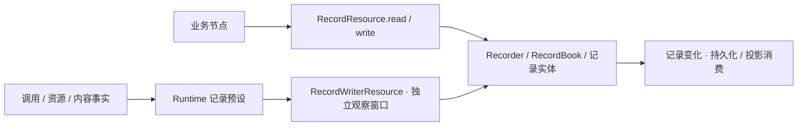

# 记录机制与特化处理

记录实体由 `@weiliang0121/capix-records`（`server/records`）提供：根出口包含 Recorder、RecordBook、RecordTree、各类记录与 Helper、snapshotValue、observeMemory 和普通 RecordResource；`@weiliang0121/capix-records/construction` 单独提供宿主 RecordWriterResource 与 RecordWriter。`server/records/src/restoration/` 只负责只读历史载体的恢复，不恢复执行。

Runtime 的 `@weiliang0121/capix-runtime/recording` 只提供自动观测预设，包括 bindRecording、RecordingInstallation、InvocationRecording、InvocationRecordAccess、invocationRecording 和描述契约；Runtime 根与 `/recording` 不再重导记录实体。预设仍位于 `server/runtime/src/records/observation/`：declaration 定义描述与写端点申请，installation 负责跨调用安装，invocation 持有单次记录状态，mapping 提供事实到记录的映射。实体包不依赖 Runtime、结构或内容实体包。

Recorder 是环境共享的登记入口。它组合 RecordBook、RecordTree、同步登记单元和 RecordClock。Recorder 本身不分派记录类型，树本体与关系辅助集中在 `server/records/src/tree/`，具体关系规则位于 `tree/relation.ts`，不处理 Context、业务正文或 ExecutionRecordSnapshot。

通用基类使用 BaseRecord，树形记录共用 CompositeRecord；RecordingRootRecord 表达一次记录安装的跨调用范围，InvocationRecord 统一调用正文与状态，CallableRecord 承载 Scene、Group、Node 的实际调用，ResourceRecord 表达正式资源访问事实。RecordingRootRecord 当前只保留创建时间与下级引用；不把记录登记、某次调用结束或驱动者释放占用等同于整个记录范围结束。

## 通用机制

- add(record) 是正式登记入口。RecordRegistration 先通过 RecordTree 检查归属并准备新的 childIds，然后同步写入 Book、替换父级 childIds，全部成功后才通知。登记期间拒绝同一 Recorder 的重入写入。
- 登记失败时恢复原 childIds，并清理本次 Book 写入，包括 Book 写入后抛错的情况。Book/关系的内部恢复不执行用户回调；不保留已无使用者的索引登记或回滚接口。
- update(record, apply, describe?) 要求是 Book 中登记的同一实例，再执行特化更新。如何判断终态、复制正文和检查子记录由具体 Record / Helper 决定。
- subscribe 接收 record、add/update 分类和 related 数组。子记录新增只发布一次 add，related 包含本次同步变更的直接父记录；不另外发布可能触发缺少边界事件快照的父记录 update。通知时记录与父子关系均已可见。原有两参数消费者可继续工作。通知不是历史快照，不承诺持久化或跨进程传输；有这些需求的消费者应另行捕获数据。
- 写入失败统一为 RecordingError。通知发生在登记之后，每个订阅者独立隔离；观察失败不回滚登记，也不阻止其他订阅者。
- RecordClock 只要求 `now(): string` 与 `tick(): number`。Recorder 默认使用 ISO 墙钟与单调时间；宿主可注入兼容的 Runtime Clock，实体包不导入其实现。调用起点、执行内偏移和事件顺序都属于调用记录特化。

## 资源访问与观察窗口

可运行示例见 [examples/records.mjs](../examples/records.mjs)：同一个 Recorder 同时接收业务内容记录与自动调用记录；构建后运行 `node examples/records.mjs` 即可验证，不依赖模型。

普通业务通过 `RecordResource.read` 的 `get(id)` / `snapshot()` 读取纯数据快照，通过 `RecordResource.write` 的 `create(value)` 创建 `kind: 'custom'` 记录并取得快照。写口只接收内容，由实体生成身份；调用方不能指定调用归属、生命周期事实或任意记录类型。读取与创建保持同步，返回值经过记录正文的复制、检查和冻结，不暴露 Book、Recorder 或活记录对象。

宿主自动记录使用 `@weiliang0121/capix-records/construction` 的 RecordWriterResource：`root()` 建立记录安装根，`add(record)` 登记准确记录对象，`update(record, apply, describe?)` 核验同一实例后更新，`boundary(location, type)` 登记调用边界。这个写口在观察窗口中使用活记录句柄，沿用实体、登记及关系检查；普通业务资源不提供这些操作。

RecordingInstallation 在内部用 `@weiliang0121/capix-resources` 的 Resources 登记固定 Recorder，并通过 `Resources.bind` 固定 RecordWriterResource 申请。安装根以及每个被消费的调用、资源、消息或记忆事实，分别 `open()` 一个无 ResourceOwner 的访问窗口，在同步写入后的 `finally` 中 `close()`。窗口由观察消费持有，独立于业务 Work 的取消与终态；因此业务工作退出时仍可登记真实终态和边界。窗口关闭后保存的端点立即失效。

这些内部访问窗口不接入被记录调用的资源观察链，不把记录写入再次作为同一预设的资源事实递归消费。Recorder 自身的 RecordChangeEvent 捕获与同步订阅出口继续发布；isolate / propagate、消费者失效和来源完整性规则保持原有含义。该窗口分离不改变业务调用控制、Checkpoint 保存格式或恢复范围。

## 直接归属与记录树

BaseRecord.parentId 表达直接产生位置，构造后不可改写；没有调用来源的内容记录保持根记录。CompositeRecord.childIds 是直接下级的冻结 ID 数组，每次成功登记替换数组，已取得的 toJSON/childIds 快照不随之变化。RecordingRootRecord 与调用记录均可持有下级，消息与记忆本体的 ID 仍是被描述对象，不作为父级。

- RecordingRootRecord 为一次记录安装的跨调用根；根调用挂在它下面，成员调用沿实际直接父关系挂接。Scene 与 Group 可以组合 Group/Node，Node 不拥有子调用；不补造旧 E/O 层次。
- 边界事件挂在被描述的调用下；消息变化、记忆变化依据内部 RecordChangeSource.callId 挂在实际产生它们的调用下。
- ResourceRecord 通过 parentId 归属记录安装根或 CallableRecord；调用资源事实只接受仍在运行的拥有者。资源种类只影响正文，不要求每新增实体就新增一条类型关系规则。
- 新调用记录以 parentId、childIds、contextId 和 structureKind 表达归属与结构。旧 executionId、operationId、parentOperationId 等只保留在历史载体及其读取契约中，不写入新的通用调用树。资源事实沿相同树查询，并进入详情、观测基线与增量。
- 新下级调用要求直接父的活动窗口仍开放。终态边界事件在调用结束之后登记；内容来源表示因果，不作为运行授权。内部实体 API 可以使用已经解析的来源；业务资源端点另行检查本次调用、阶段、轮次及固定控制信号，调用结束后不能用保存的端点继续读写。

Recorder.tree 提供 children(id)、descendants(id) 与 root(id)，直接沿 Book 中记录的 childIds 查询，不扫描整个 Book，也不维护第二份节点或边集合。root 沿直接 parentId 查到根并核对下级引用，不维护额外的结构成员表。后代查询按深度优先返回归属顺序，不能作为事件发生顺序。父级引用写入和关系提交使用包内能力，不对业务公开 attach/reparent 方法。Book.add 仍是底层存储操作，正式业务登记必须经过 Recorder.add。

RecordRegistration 只覆盖一次记录登记，既不包含整个 Callable 调用，也不回滚 Transcript 或 Memories 已经落实的业务变化。它不承担异步事务、执行恢复、重试或补偿。服务通过变化出口另行保存记录，见 [持久化](persistence.md)。

## 调用记录

`bindRecording(recorder, { failure?, invalidate? })` 创建宿主记录安装，默认为树中各结构选择记录声明；build 前用 `installation.describe(structure, { input?, output?, relationAccepted?, relationHandled?, role? })` 登记投影与角色。底层 `invocationRecording` 仍是安装使用的观测声明，申请 InvocationRecordAccess；普通结构不含 observation 配置。InvocationRecording 维护记录句柄、父预设和直接子预设，不建立全局 Context 反查。Invocation 不持有记录或 source，不直接调用记录 Helper。role 是宿主解释用途的元数据；Observer 用 `conversation-task` 标识任务范围，不把所有 Group 当成任务。

子调用 returned 使用宿主为该子结构登记的 output 描述；父层 accepted/handled 可以产生不同值，分别由父结构投影的 `relationAccepted(output, relation)` / `relationHandled(output, relation)` 独立描述。默认仍保留原值，不根据对象身份推断两种语义相等。文件分支据此将读取正文和模型请求投影为路径、字节数、摘要或请求元数据；运行中的输入输出与父子接纳仍保留真实对象。模型产生的回答仍按原有规则记录，生成正文可能引用源文，这不等于存储原始文件。

声明同步消费 InvocationFact。started 建立本层记录，process 捕获正文，finished 描述工作终态；关系变化写入父记录的 relationChanges。描述规则只影响记录，不替换业务 IO。观测关闭不执行描述。未安装记录时不生成记录或执行描述；安装后统一覆盖真实父链，不要求业务逐节点补声明。

RecordingRootRecord 描述跨调用范围，CallableRecord 描述其中一次调用。记录根由环境的记录安装持有，Runner 不持有 Recorder。一次根调用及其全部后代共用该根调用的单调计时起点；InvocationBoundaryRecord 的 scopeId 指向该根调用，scope='work'。任务子树详情可以省略兄弟调用的边界，因此 sequence 允许有间隙。墙钟只作展示，不用于判定父子先后，也不把工作成功边界冒充实际成功交付。

记录可以是主动分析的一次采集，不必伴随宿主常驻。新对话服务的 `ConversationRecording` 用现有安装端口实现 idle / recording / stopping / stopped：根入口选择一次采集目标、后代继承；停止仅拒绝新入口，原入口收尾后结果仍可查看、清空。每次开始创建新的记录载体，未开启不创建条目或执行描述。采集策略属于宿主预设，RecordBook 不需要因此新增自动淘汰、Invocation 不增加记录开关。静态 `bindRecording` 仍服务于显式全程采集的宿主；具体用法见 [主动记录](conversation-web.md#主动记录)。

InvocationRecordHelper 只复用载体更新。旧调用索引及全局 Context 反查均已退出；记录句柄只存在于记录预设局部绑定中，归属查询由 RecordTree 提供，Book 是记录的存储。

当前普通调用发布 execute（工作）与 control（结构停止），没有独立 receive/handling/continue 作者阶段。父子结果接收通过 relationChanges 表达 returned 与 accepted/handled/failed。过程保留 sequence、eventSequence、round、时间和正文；新普通运行 round 固定为 1，历史载体的旧阶段/轮次保持只读解释。

最终 resultOf 引用本记录直接产出的最终成功正文，当前来源为 execute.return；消费者使用 readOutput。历史 receive/handling 引用按其旧格式核对，不跨记录、不形成引用链，也不根据对象身份去重。

Invocation.failure 是运行中的最终交付事实，不依赖记录存在。Context 已经成功但终态登记失败时保持成功 Context，调用仍向外抛错；不能为了填充失败记录覆盖既成状态，也不能虚构完整记录。错误收敛自身损坏按 bug 暴露，不增加递归处理或补偿机制。

## 内容记录与来源

Memories 和 Transcript 负责审查与落实内容，自身不依赖 Recorder。内部 ChangeProvenance 提供 origin.contextId 和类型化观察端口；资源绑定将本调用观察端口传入，实体将正式事件交给必要捕获与可选观察。无调用的独立实体变更可使用环境默认端口。

记录安装从已发生事件构造 TranscriptRecord / MemoryRecord。RecordChangeSource 只存在于记录特化中，由本次记录句柄和父预设推导，实体不接收 callId/executionId，也不反查 Context。服务输入由 Scene 的普通 append 资源正式写入，归已经存在的 Scene 调用；此时尚未建立任务 Group，不伪造任务记录。

TranscriptRecord 正文保存追加或分段范围，不重复原文。消息 UID 和绝对 index 用于跨端定位；TranscriptRangeRef/MessageRef 只可在内部实体适配中使用，不能进入记录正文。snapshotValue 对普通记录数据执行复制、检查、冻结，不再识别并保留这些实体引用。

`observeMemory` 从 `@weiliang0121/capix-records` 导入，按结构兼容的只读输入组合当前记忆内容与已有 MemoryRecord。它只要求集合提供 `transcript.id` 和 `values()`，使用协议中的记忆值；记录包不依赖 `@weiliang0121/capix-memory`，也不持有或恢复 Memories。

## 资源运行事实

ResourceOffer 是资源模块公开的契约：来源捕获、正式访问端点、兑现时机及可记录描述。共享供给保存 capture 的结果或错误；每次调用由 InvocationResources 协调独立的 ResourceAccess 窗口，每个窗口共享 ResourceActivity；资源专属元信息由 ResourceEndpointActivity 固定。run/恢复端点分别受当前窗口约束，共享本次资源顺序与捕获供给；不共享带父调用身份的闭包。配置与 Provider 分别描述数据与能力；Provider 实例、连接和函数不序列化进入记录。

ResourceRecord 使用同一 BaseRecord、Recorder 与记录树。公共字段为 parentId、access、supplyId、sequence、occurredAt、phase 及可选 interactionId，value 由资源定义并经通用快照规则留存。phase 区分 bound、available、unavailable、started、returned、threw；它们是运行事实，不给每个资源增加一套可推进状态机。

这里的 interactionId 配对一次资源方法的 started/returned/threw，不是独立外部 Interaction 的身份。模型资源的返回摘要和 Node 的交付另含外部交互 ID；同一外部交互可以对应多次资源读取，各次访问仍有自己的边界。

静态 request/provide 不登记记录。调用记录 begin 后激活普通 run 请求，恢复工作使用自己的 resume.deps：bound 描述本次关联，available 描述兑现后的值或供应者。相同供给在同一调用内不因阶段切换重复登记 bound/available；惰性资源没有实际访问就不创建 Provider。正式 read/entries/invoke/apply 等方法通过 ResourceActivity 的同步或异步操作边界登记，不把同步读取改成 Promise，不拦截每次属性读取。

CallableContext 不拥有 settings/transcriptRange 业务字段。配置资源记录固定参数，原文资源记录 transcriptId/start/end/revision；原文可见范围不表示实际模型上下文，选择结果及模型实际请求分别查看 Group/Node 的已有 IO。记忆写入的访问事实可按本调用与实体变化序号关联 MemoryRecord，不再另存第二份记忆变化正文。

资源记录遵循安装策略，服务可显式采用 propagate：开始登记失败不调用实体；操作成功后的返回登记失败只报记录异常，不误记为操作失败或重做操作；操作与失败登记同时失败保留 AggregateError。记录关闭时不生成描述正文，不影响正常业务或运行来源。资源事实自身的 sequence 属于本调用资源会话，不替代 Invocation 内部过程序号或传输游标。

服务输入通过 Scene 的正式 append 资源写入；成员尚未建立时不伪造成员记录。工作资源在调用开始后按当前阶段可用，阶段切换后旧阶段端点不可使用，调用结束后全部失效。资源捕获、暴露和生命周期检查属于绑定／结构边界，即使抛出 DeclaredException 也按错误处理；正式资源方法体的业务失败可在该次操作的 result.failed 中处理，技术故障不能由此清除。

## 变化捕获与观察发布

Recorder 正式登记或更新之后，固定 RecordChangeEvent 并交给可选捕获器，然后通知原有同步订阅者。自身 id/revision 表达该登记范围；kind 由记录类声明，Recorder 不按 Scene/Group/Node 分派。added 同时描述新记录与父级引用；过程只发送新增条目，finish 只发送终态与结果。通用 update 的 describe 可提供特化变化，省略时使用显式 replaced。没有比较两份快照。

新记录预设通过 InvocationRecordHelper 和观察窗口中的 RecordWriter 更新统一过程、父子关系与终态，写口继续交给 Recorder 正式登记；CallableRecordHelper.snapshot 按明确选择的调用读取子树。旧 ExecutionRecordHelper、OperationRecordHelper、AttemptRecordHelper 保留历史载体的解释与测试用途，不参与新实时记录生产。实例方法仍维护自身状态约束，正式运行更新不能绕过登记入口。Transcript 和 Memories 自己捕获内容事件，不依赖 Recorder 通知推导业务变化。

Service ChangeConsumer 独占共享 ChangeBuffer 的 take；RecordSource 与 feed 订阅它，发送一致基线及后续增量；消息实体正文由独立消息订阅出口交付。旧 subscribeExecutions 保留为本地诊断与测试工具，基于同步登记通知组织执行快照；HTTP 观测不再使用它。

ExecutionRecordSnapshot 保留 Observer 的业务查询名称，内容为所选 execution、其通用 calls 子树、可选 rootCall、中间 ancestors、boundaries、resources、transcripts 和 memories。它不是整棵记录树，不包含根调用的其他任务子树。旧载体由服务只读规范化为这个形状，原载体身份不变；历史中断记录没有起始时间时保留未知。parentId/childIds 可以引用未装载的历史正文。对话由 Runner.run 独立交付，不从记录生成回答。消息正文通过集合 UID 独立加载和持续同步，客户端 binding 将资源定位与消息副本组合；原文未加载不等于空正文。

没有新增 Recorder 子类、插件注册、业务补偿或自动索引框架。Book 仍只存记录；记录特化没有转移进 Book。RecordBook.exportState / restore 提供历史载入，具体结构检查位于 `server/records/src/restoration/`；恢复的具体记录类型和 ID 保留，historical 记录不可修改，也不能附加新的子记录。该入口不重放登记、通知或调用。实体拆包保留既有类名、wire kind 和历史格式，不用重命名载体来表达新的包边界。

## 局部顺序与索引迁移进度

Invocation 自行给现有内部过程赋予连续 sequence，发布为 InvocationFact.process，由记录预设消费；记录不再通过 processes.length 生成序号，只检查是否连续。每次调用从 1 开始；业务重试是新的子调用，不覆盖已发生的序列，无 Recorder 也推进。另有 eventSequence 统一排列本调用过程与关系事实；relationChanges 与 processes 分开存储。

Memories 持有自身 id 和正式变化 sequence；MemoryRecord 保存 memoriesId/sequence/memoryId，分别表达变化范围、位置和对象。无变化与预检查失败不占号，已落实变化不会因记录失败回收序号。消息继续使用原有绝对 index。均不作为传输游标。

Group、Node 的范围查询、父级结束检查、快照中的事件收集均使用 Recorder.tree；事件按根调用计时范围内的 sequence 显式排序。InvocationBoundaryRecordHelper.last 从根调用子树中取 sequence 最大的事件，用于下一序号与单调时间检查，不能取遍历末项；登记失败不占用事件序号。它每次遍历根调用子树，暂不增加事件游标、缓存或时序管理者。调用索引及其登记接口已退出，见 [观测增量](observation-increments.md)。

## 调用记录与调用边界记录

InvocationRecord 表达一次调用的正文机制，新实时载体为 CallableRecord（wire kind: invocation）；structureKind 保存 scene/group/node。RuntimeCallRecord、ExecutionRecord、OperationRecord、AttemptRecord 只保留旧载体格式。InvocationBoundaryRecord 表达一次 call/return/throw 边界，创建后不可变；InvocationBoundaryRecordHelper 管理根调用范围内的顺序与单调时间检查。

两者都是运行记录，不是系统变化通知。边界记录的登记产生记录变化事件，但不能为该通知再次自动生成边界记录。ExecutionRecordSnapshot.boundaries 的元素是 InvocationBoundaryRecord；资源事实通过 resources 另行表达，不混入调用边界数组。旧 events/runtimeEvents 属于 LegacyExecutionRecordSnapshot，不再作为新响应的形状。

## 来源完整性与消费

记录源在首次观察前建立，并将 invalidate 接入安装。记录观察漏写后 source 永久标为不完整，旧连接以 SOURCE_INCOMPLETE 结束，新完整基线被拒绝；不能通过换游标或再次快照假装补齐丢失事实。isolate 不保证记录完整。多载体声明在部分写入后失败，保留已写数据，并使所依赖的完整性来源失效。单个网络消费失败不使源损坏，消息同步保持独立。

重启后的旧来源作为显式归档加载，不冒充新的健康活动来源。归档保留 open/sealed/incomplete 状态和最后保存的 revision；新的 Recorder/RecordingInstallation 只负责本进程变化。历史 running 表示“未取得结束记录”，不能作为活动调用继续计算耗时或恢复业务。内容实体从自己的持久状态恢复，不从调用记录或 MemoryRecord 反推。

## 新对话服务的可选安装

`@capix/conversation-service/recording` 在 build 前调用 `createConversationRecording(scene, recorder, options?)`，为实际结构树登记服务输入/输出/接收摘要，并复用 `bindRecording`。调用材料保留来源身份、版本、索引和数量，正文长度与数组条数替代反复复制；特殊非 JSON 返回值转成描述。正式消息范围、记忆变更和资源事实继续由已有预设按真实调用归属记录，业务节点没有额外 Recorder 依赖。

CLI `--records PATH` 为宿主选项，未启用不创建记录安装；启用后在内存记录，并在本地入口与独立发送结束后导出完整性标记和 RecordBook 快照。isolate 的 invalidate 使该份来源永久 incomplete，严格失败仍依既有 propagate 处理。单次摘要有界不代表记录总量有界，退出导出也不代表崩溃可恢复。具体文件生命周期与使用见 [对话服务宿主](conversation-host.md)。
