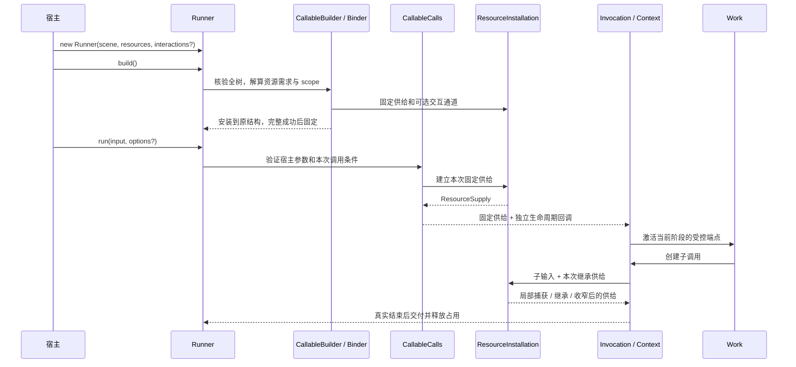

# Runner / Resources 迁移与验证

试点已延伸到 Observer 全部生产运行链：新入口贯穿绑定、资源供给、调用、阶段访问、HTTP 提交、流式交付与显式恢复。服务不再使用 Driver、ConversationCallSource 或 provider 数组；内核低层兼容构造仍保留，后续单独退役。

## 第一层：场景、资源、运行器

```ts
const scene = new Scene();
const resources = new Resources();
// 构造成员与业务处理，注册所需资源……
const runner = new Runner(scene, resources).build();
const result = await runner.run(input);
```

`scene` 是原结构，`resources` 登记供给，`runner` 固定两者并启动调用。`build()` 返回同一个 Runner，完整成功才固定整棵结构；失败可修正后重建。成功后不可修改结构或再次构建。不同 Runner 使用不同 Scene，可以共享资源实体与 Resources 注册表，每次运行的端点、输入、占用彼此独立。

`run/resume` 在入口浅复制并冻结宿主 options 的顶层字段，晚建子调用不会读取宿主后来替换的字段；signal 和嵌套实体仍保留真实引用。需要固定实体内容时，由对应捕获逻辑建立快照，不深冻结宿主世界。

交互是可选参数：`new Runner(scene, resources, interactions).build()`。不使用交互的场景无需建立空 Interactions。

最小可运行示例：[examples/runner.mjs](../examples/runner.mjs)。先 `pnpm build`，再 `node examples/runner.mjs`。示例不访问网络、不调用模型。

## 第二层：定义、注册、获取、使用

| 对象 / 操作                         | 职责                                     | 不持有什么                     |
| ----------------------------------- | ---------------------------------------- | ------------------------------ |
| `ResourceOffer`                     | 定义申请身份、公开端点、捕获与收窄规则   | 某次调用状态                   |
| `Resources.register(offer, entity)` | 登记实体与资源定义的供给关系             | 本次输入、当前端点             |
| `Resources.capture(target, fn)`     | 明确某个结构建立调用时的成组捕获         | 活调用与持续更新的全局上下文   |
| `ResourceSupply`（内部）            | 保存本次子树固定供给，可选择、覆盖、收窄 | 生命周期、阶段、端点           |
| `InvocationResources`（内部）       | 将供给兑现为本次调用、阶段、轮次的端点   | 资源实体的所有权               |
| `work.resources`                    | 只公开本阶段申请的访问形式               | 注册表、供给管道、祖先 Context |

普通供给直接注册：

```ts
resources.register(Messages.append, transcript);
resources.register(Files.read, workspace);
```

需要根据调用输入和宿主参数固定材料时，再使用成组捕获：

```ts
const resources = new Resources<{ revision: number }>();
resources
  .capture(group, (input, options) => captureMaterials(input, options.revision))
  .register(Messages.read, (snapshot) => snapshot.messages)
  .register(Memories.read, (snapshot) => snapshot.memories);
```

捕获发生在指定结构的本次调用建立时，一次结果供该组选择器使用；不在 build 执行，也不因端点重建而重复捕获。捕获与选择器必须同步。固定实体可以是任意业务类型；其捕获规则由资源定义负责，框架不会深拷贝任意实体或替业务保证快照不可变。恢复时同样走明确捕获，宿主仍须核对原配置与历史依据，Resources 不会从当前值猜出原快照。

本地注册只覆盖本子树的对应 offer，其他供给继承**本次祖先已经固定、已经收窄的值**，不是回到全局注册表重新获取。兄弟和父层不受影响。子树需要某资源，不意味着父层 Work 自动获得访问权。

`resources.refine(child, Files.read.refine(input => input.path))` 复用资源自己的收窄规则，不能由框架推断权限或自动扩大范围。一个资源存在多个访问形式时分别登记，例如 create/read；无需把整个外部对象暴露给 Work。

每次 build 固定注册快照。注册表后续增加其他场景的 scope，不改变已构建 Runner。共享注册表只解算当前树可达的 scope；没有命中的注册不参与本场景，也不作为错误。错误的 offer 身份、当前路径同名冲突、缺供给、重复注册仍明确拒绝。

## 可选交互怎样协作

```ts
const interactions = new Interactions();
interactions.register(modelContract, { send, persistence });
resources.registerInteraction(Model.request, modelContract);
const runner = new Runner(scene, resources, interactions).build();
```

`registerInteraction` 在 build 核验准确契约并固定通道，不发送请求。资源的实现使用 `InteractionChannel.start/read/wait`，仍由资源端点通过 `ResourceActivity` 检查调用窗口。Work 不直接取得全局 Interactions。

一次 `start` 建立一次新的交互，返回可保存的 `{ id, contract }`；“只发送一次”针对该交互，不是按请求内容去重。A1 等待到期或被取消后，A2 可以通过新端点继续读取同一引用；调用结束不取消独立发送。宿主使用 `settled()` 等待交互结束，`close()` 拒绝放弃在途发送。

已结束缓存默认每契约 128 条，在途交互不淘汰；持久端口可再次加载已淘汰反馈。无持久保存的已淘汰引用明确 unknown；恢复到没有反馈的旧发送意图明确 unavailable，不重发。没有新增队列、调度、租约或自动执行恢复。

## 接线和调用的实际路径



这条路径直接使用新资源安装，未调用旧 `bindCallableSources`。它与旧路径共享 CallableBuilder 的全树提交、InvocationBuilder、Invocation、阶段窗口、异常、输出、接纳和 CP，避免建立第二套运行循环。Observer 已使用 Runner；入口占用暂沿用现有 DriverFact 协议，不为入口命名修改持久记录格式。

`ResourceInstallation` 只处理供给；`CallableCalls` 组合调用校验、资源捕获和宿主回调。供给直接交给 InvocationBuilder，在该处建立最终访问窗口，由 InvocationResources 选择阶段，再通过资源包 ResourceAccess 建立端点窗口。

## 与资源分开的宿主回调

资源捕获不能顺带承担业务登记与输出交付。试点将必要宿主接线独立成 `callableHooks(structure, { validate, started, progress, output })`，放在 Runner 第四参数的 `hooks` 中。普通示例无需配置。

`started` 仍是 Context 已建立、开始事实发布前的严格同步登记，返回必须是 `undefined`；失败阻止业务执行，恢复旧调用不重复登记。`progress/output` 是对应交付端口。这保留了 Observer 的真实需要，没有把必要登记当成可丢弃观测。当前回调工厂仍有较高理解成本。Observer 已用该路径运行，但这不等于第二层概念已收敛；下一轮应依据真实宿主用法评估。

## 验收与后续决策

行为验证覆盖固定供给、惰性兑现、成组捕获、部分覆盖与祖先收窄的组合、多 Runner、构建快照、阶段与轮次窗口、错误和取消释放、严格回调、外部晚到反馈、持久反馈读取、CP 新访问窗口、已返回子关系接纳和实体固定写入。类型验证同时检查正确推导和错误调用的拒绝。相关测试在 `test/runner*.test.mjs`、`test/interaction/registry.test.mjs`、`test/interaction/runner.test.mjs`。

试点基线验证：清理 runtime 产物后全仓 build、typecheck 通过，完整测试 1705/1705 通过；30 个新增类型反例在公开调用点拒绝，示例实际输出 `你好`。

## Observer 完整链迁移

`initializeObserver` 显式创建 Resources，显式建立 ConversationCallCapture，以 `registerConversationResources` 只登记供给，再将独立 conversationCallHooks 和 validate 连接到 Runner。环境、HTTP、observeExecution 与恢复入口均使用 `runner.run/resume`，无需再次传 scene。具体时序见 [服务装配](service-assembly.md)。

原来源对象的职责已拆开：

- 固定实体直接登记；Scene 的正式输入追加与 ConversationGroup 的历史/配置/回答追加各有明确捕获范围。
- ConversationCallCapture 仅关联根校验、正式输入位置和 CP 登记，不承担一般资源供给。
- 活动进展、必要 started 与回答 output 分别用 hooks 接入；恢复旧调用不重复 started。
- 文件路径收窄由 Resources.refine 与原资源规则处理，兄弟与父层不受影响。
- ModelInteractions 作为普通资源供给，保留 SSE 前缀订阅、按 ID 观测、Provider 总超时、固定请求核验和取消后保存反馈的行为。

迁移暴露并修复了两个实际问题：调用方在输入进展回调中修改 settings，会让后建 Group 与 CP 重新读取另一份配置；固定注册与动态捕获混用可变 entities 参数袋，会跨越不同实体世界。现在本次 settings 在入口校验时固定，实体/恢复端口在注册时固定引用，端点仍按次创建。测试同时验证调用方保留修改下一次配置的能力。

宿主 `executionCallbacks.started` 仍取得真实 Context/Invocation，但资源类型为 object，不再声称它具有业务阶段的 ConversationTaskResources。必要登记仍严格同步，不用类型断言强接。

迁移回归覆盖正常对话、决策/文件、预览与正式提交、取消与独立晚到反馈、异常后下一次运行、按对话占用、内存/SQLite CP 和跨进程中断恢复。新增实体、配置与反馈归属回归位于 `test/observer-runner-migration.test.mjs`。验证不读取环境凭证、不调用真实模型。

服务迁移验证：清理 runtime 与 observer-service 产物后全仓 build、typecheck 通过，完整测试 **1708/1708** 通过；最小示例仍输出 `你好`，格式与 diff 检查通过。

## 第二层尚待收敛的接缝

1. `callableHooks` 仍是按调用输入/参数返回端口的工厂，必要登记与被动通知的形状还可简化；不能把严格登记降格为可丢通知。
2. 服务资源登记与 validate/hooks 已分开，见 service-assembly.md；当前已不再由资源函数返回运行接线。
3. 手动装配要让服务恢复核对的 checkpoints 与 Runner 的 store 是同一个实例；生产入口明确复用同一端口，注册 helper 本身无法验证另一对象的配置。
4. 通用 Interactions 与服务 ModelInteractions 的形状未归并。归并前必须覆盖模型流式、固定请求核验、超时和观测，不只替换名称。
5. Driver、旧 CallableSources 和显式 buildCallableFromSource 适配已隔离到 Runtime legacy/，仍供低层兼容测试；Runner 与 Observer 不经过它们。现代 Builder.build/Binder.bind 消费 Resources，旧适配复用同一整树安装和入口执行。完全退役仍需迁移直接以 Group/Node 为根的专项测试。记录预设已使用 ResourceSupply 与 ResourceBinding/ResourceAccess；旧 bindResources 仅保留在测试 fixture，不再是正式资源包接口。

这轮完成服务运行链迁移，未拆包、未改 CP Frame 或业务声明版本，也未把上述接缝表述为已完成收敛。
