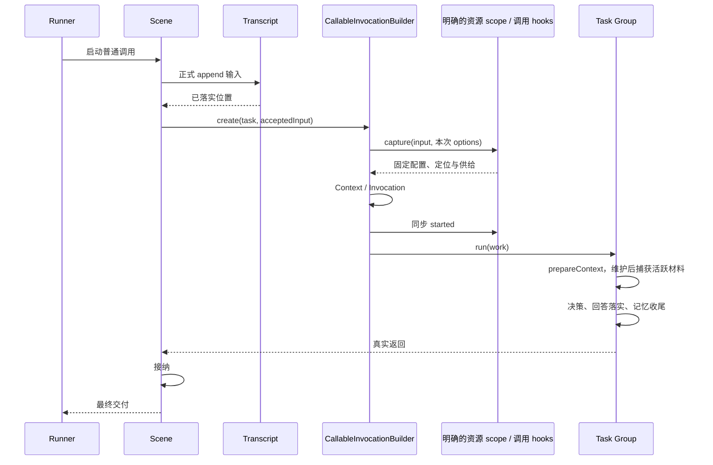
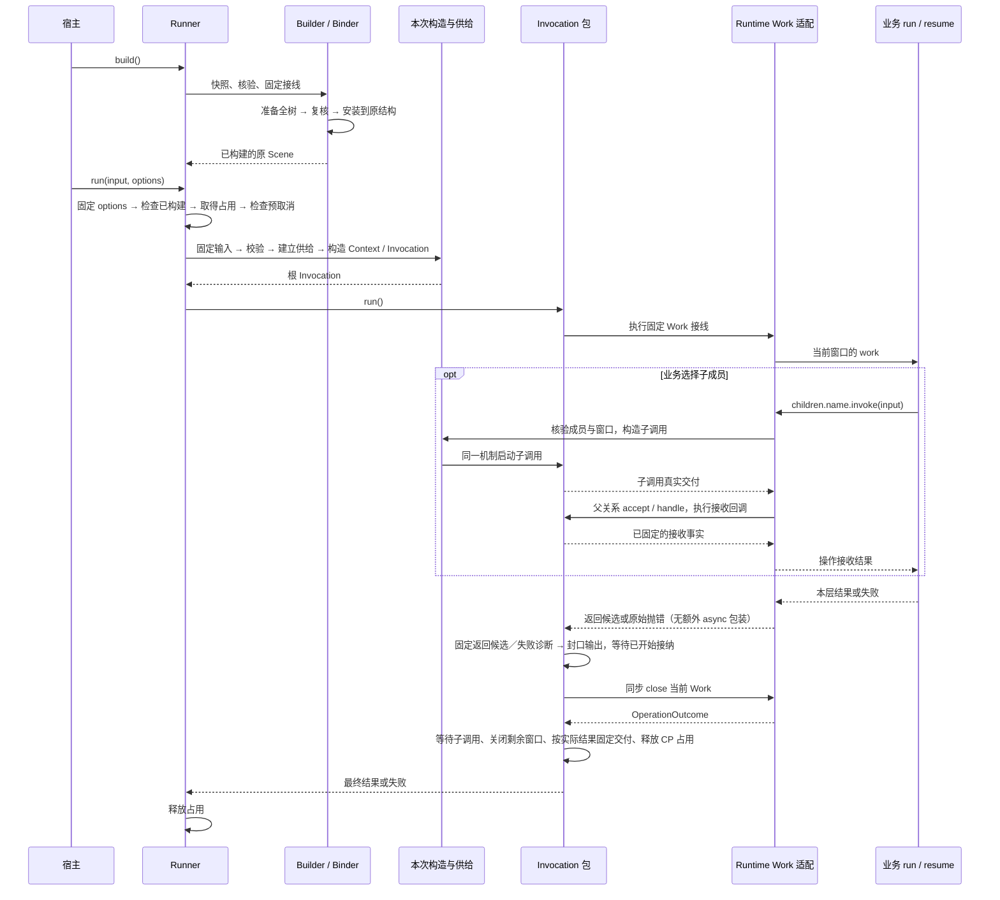

# 运行结构、调用与资源访问边界

当前结构为 Scene / Group / Node；共同机制为 Callable，成员组合为 Composite。完整角色表见 [项目组织](organization.md)，作者示例见 [可调用结构](callable-structures.md)。运行时表示这些结构和独立实体实际协作的活动状态，不是某个 Scene 或 Runner 的别名。

## 结构配置与整体构建

Scene 与 Group 都声明自己的普通输入、输出、run 和 members；Node 实现普通处理，没有 members。结构配置为 deps / run / output / checkpoint；观察消费者由宿主安装，操作接收规则在 run 中明确表达。成员注册不执行工作，Group 自己选择调用顺序、分支与接纳；Sequence 是可选组合辅助。

| 对象                      | 职责                                                          |
| ------------------------- | ------------------------------------------------------------- |
| CallableBinder            | 解算固定声明图，核验成员位置、资源、输出与 CP 的行动/接收契约 |
| CallableBinding           | 原结构需要安装的固定接线契约，不增加运行实体                  |
| CallableBuilder           | 完成原结构的绑定与运行能力装配，成功后一次性发布              |
| CallableInvocationBuilder | 持有安装归属，用同一机制建立任何 kind 的 Context 和调用       |
| Runner                    | 固定场景的宿主入口、占用、实际结束后释放                      |

Scene/Group/Node 本身是注册身份，普通 Definition 配置没有独立身份。Scene 是根，Group/Node 只有一个父结构；同父重复 add 不增加位置，跨父添加或循环拒绝。业务配置经构造器或 build 前的普通字段赋值形成；赋值不隐式清空其他配置。构建提前解算全树，固定配置容器、函数入口和资源接线，但保留业务方法 receiver。原结构承载这些装配结果，不产生第二棵 Bound 树。

```text
new Runner(scene, resources, interactions?, mechanisms)
  → 固定一个场景与机制接入

runner.build()
  → CallableBuilder.build
      → CallableBinder.bind：检查配置、成员、资源 scope 与 hooks
      → 建立固定 work 接线和 CallableInvocationBuilder
      → 将运行能力安装到原结构，完整成功后固定配置
  → 返回同一个 Runner

runner.run(input, options)
  → 固定 options 顶层字段，取得入口占用，检查预取消、validate
  → 建立本次 CallableCallScope
  → ResourceInstallation 打开固定供给，构造根 Invocation / Context
  → Invocation.run → 当前阶段 Work → 业务
  → 实际返回或失败，释放占用
```

build 成功后固定配置字段，拒绝 add 和再次构建。修改业务逻辑或供应规则需另建结构；输入和资源内容变化仍按次处理。build 不取得本次资源值、不执行业务；失败不留下部分可运行结构。固定结构与构建归属不等于固定一次运行的现场。

Runner 固定一个场景，不能在 run 时替换。使用 `runner.isRunning` 查询占用；不同 Runner 互不影响。占用不在 Context，也不扩展为每个 Node 的执行锁。构造、业务、观测失败都释放；Runner 不隐式排队。入口观测暂沿用 driverId 与 boundId，boundId 指构建安装身份，不代表第二个 Bound 对象。

CallableInvocationBuilder 直接构造 CallableContext，以自身作为固定安装归属。建立子调用时，资源选择前后均核对父活动及归属，因为资源收窄可能同步触发取消。子 Context 只继承父信号，不保留父对象。不同构建不共享构造归属。

## 来源、供应与访问窗口

Transcript、Memories、Provider、Interaction 等由宿主建立。结构只绑定其资源访问形式，不拥有实体生命。ResourceOffer 声明访问、capture、timing、describe 与可选 refine；资源检查范围是否扩大，绑定不能代为授权。

装配解算本层 deps 和子树 supply，父 Work 只取得本窗口 deps。普通成员继承本次固定供给；局部 `Resources.capture` 只覆盖该位置登记的 offer，不重建其他祖先供给。

```ts
const resources = new Resources<RunOptions>();
resources.register(Messages.append, transcript);
resources.capture(group, (input, options) => captureBasis(input, options)).register(Materials.read, (snapshot) => snapshot.material);
const runner = new Runner(scene, resources, undefined, {
  hooks: [callableHooks(group, { started: (_input, options) => options.started })],
}).build();
await runner.run(input, options);
```

捕获位置可以是 Scene、Group 或 Node，不由 kind 决定。started/progress/output 单独接线，不隐式创建资源范围。本次 options 与安装归属由内部固定对象传递，不进入业务 Work，不依赖祖先 Context 链。

`timing: 'binding'` 指本次供给建立时捕获，不是静态构建时取得实体；`timing: 'access'` 在真实访问时兑现。观测关闭不会触发 describe 或提前初始化 Provider。`resources.refine` 只收窄准确成员已申请的供应，不改变父、兄弟或无关资源。

资源端点验证本地调用、阶段/轮次及固定控制信号，不递归查询祖先状态。阶段变化不重新解算声明。正常 run 及其中的操作接收共用本次业务窗口；恢复有独立窗口，旧端点不可跨窗口复用。普通调用没有轮次切换或独立异常阶段。CP resume 离开后其独立窗口永久关闭。

## Observer 的输入与材料

服务的 ConversationScene 通过正式 append 资源落实输入，然后把 `{message,messageIndex,fileTask?}` 作为普通输入交给 ConversationGroup。Task 是普通 Group；内核没有 E 专属 entry、EntryInput 或按层固定的资源准备。



输入已落实而 Task 尚未建立时失败，保留内容及 Scene 的事实，不伪造 Task。模型配置在根校验时固定，原文定位在 Task 构造时捕获；真正模型材料由 prepareContext 在可选维护后一次捕获，其后各能力使用同一份固定材料。默认不隐式裁剪或分段，容量超限明确失败。

started 在 Context 建立后、调用 started 事实前同步运行，必须返回 undefined。异步或其他返回拒绝；意外 Promise 的迟到拒绝被消费，不承诺撤销已经开始的副作用。恢复旧调用不重复 started；恢复活动中新建调用正常登记。被动 progress 不能替代这个严格建立钩子。

## Invocation、Context 与 Work

Invocation 协调整次调用、真实交付和故障归属。CallableContext 唯一保存输入、当前输入、进度、终态、本次资源与固定构造归属，不持有祖先。InvocationControl 管理单次启动与活动窗口；InvocationAccess 签发阶段 Work。二者不各保存一套语义状态。

| 内部对象                      | 独立职责                                               |
| ----------------------------- | ------------------------------------------------------ |
| InvocationExecution           | 一次业务入口、输出段与最终结果校验                     |
| InvocationWork                | 调用机制消费的窄工作契约                               |
| InvocationWorkBinding         | 固定声明到共同工作契约的适配                           |
| InvocationChildren / Relation | 实际直接关系、returned/reception、异步接纳与已启动活动 |
| InvocationCheckpoint          | 本次保存、已保存子事实与恢复缓存                       |
| checkpoint/children           | CP 子事实编码和检查，不修改活关系                      |

业务只取得 Work，不接收内部 Invocation、Context 或 Frame。成员存在才提供 children 切面。refs/facts 保留准确父归属；普通动作来自已注册成员，恢复动作另外按 resume.uses 检查，打开旧引用不扩大行动范围。已保存成功交付不要求初始化子结构。

固定活动规则：

- 创建与真实启动时检查直接父活动及构造归属；在途子依靠自身窗口与固定信号，不随着父 phase/round 变化重新解算。
- 阶段离开前排空已开始的接纳回调，回调仍用原阶段 Work。execute 正文返回即封口输出。
- 最终交付前关闭新活动，等待已启动子调用真正退出。未启动关系不阻塞，不自动接纳，不隐式停止兄弟。
- Interaction 有自己的生命；调用退出不等待其结束、不取消外部发送、不重发未知请求。晚到反馈仍可保存。
- 技术故障已归属后不能由业务 catch 清除；声明异常按 ChildCallFailure 传播凭据判断，不能扫描原错误对象猜来源。

普通调用只执行一次 run，业务循环每次建立新子调用；没有旧 continue/maxRounds 状态机。调用输入、输出和父接纳在事实成立边界固定为稳定数据；真实异常对象仍保持引用，另行固定其诊断。CP 只接收 Frame v6，旧格式不读取或迁移，执行恢复拒绝旧 round 2/continuation 镜像。详见 [异常边界](exceptions.md)。

### 调用独立包与装配接缝

2026-10-27：`@weiliang0121/capix-invocation` 已作为独立 Workspace 包承载单次执行、直接关系、返回与接纳、故障归属及活动窗口。Runtime 负责把结构和宿主供给接成这种调用。调用包不依赖 Runtime、structure、记录或内容实体；它通过 packages/contracts、resources、changes、checkpoint、packages/protocol 与 diagnostics 的公开出口接入共同机制。

| 实际归属              | 内容                                                                                                 |
| --------------------- | ---------------------------------------------------------------------------------------------------- |
| invocation            | Invocation、Context、Control、Execution、Children/Relation、接收与故障来源、输出、调用事实与观察会话 |
| invocation 的资源适配 | 本次固定供给的阶段访问、关闭与故障归属；资源定义、登记和原子操作仍由 resources 包负责                |
| invocation 的 CP 适配 | 消费已成立事实、发布新增正文与关系、续接和固定交付；Frame/Store 仍由 checkpoint 包负责               |
| Runtime 装配          | Runner、结构 Binder/Builder、资源范围解算、调用构造、观测安装及记录预设                              |
| Runtime 作者适配      | InvocationWorkBinding、InvocationAccess、ChildBindingsBuilder：依据已固定声明和成员签发本次 Work     |

对象按次创建并不自动归属调用包。作者 Work 适配需要理解成员、deps、恢复 uses 与 point；它调用单次机制，但仍是结构向调用的适配。因此 `packages/runtime/src/construction/` 与 InvocationCapabilities 留在 Runtime。DriverFact/DriverObserver 描述宿主入口，也留在 Runtime；调用观察会话只按固定对象身份关联，不反向引用观察安装对象的类型。

低层消费者从 `@weiliang0121/capix-invocation` 取得单次机制。Runtime 原根入口和 `/construction` 中已有的调用名称精确重导新包的同一对象，不扩大为整个包的通配出口，也不复制错误类。Observer 对 Clock、取消、故障、进展和 CP 端口直接使用新包；结构配置、callableHooks、Runner 和交互装配保持原入口。业务作者仍使用相同的 `run(work)`，没有新增装配步骤。

验证入口：

- `test/invocation-boundary-core.test.mjs`：直接构造调用，验证结果稳定性与单次启动；业务子失败可以 handled，机制故障不能通过 fallback 清除；资源端点在成功或失败退出后关闭且不可重开。
- `test/invocation-boundary-checkpoint.test.mjs`：真实保存等待关系与接纳事实，经 JSON 往返在新 Store/Context 和重建的 CP 契约中续接；固定子交付不重跑，已接纳事实不重复回调，缺失或不一致的子依据明确拒绝。
- `test/invocation-boundary-package.test.mjs`：检查独立编译、声明产出和实际模块加载，不借 Runtime/Structure 反向完成工作；执行覆盖父子接纳、调用观测和真实 CP 保存后的续接。

Invocation 当前仍借助 Context.resources 协调资源窗口的开启与关闭。这是固定供给与本次活动的具体接线，没有为分包新增通用机制注册器。CP 保存格式、声明版本、实体固定效果与恢复资格均保持原样；此次分包不增加任意位置恢复、自动重放或跨进程接管。

## Runtime 职责与收敛（2026-10-27）

以调用包迁移 `628c732` 为基线，完成 Runtime 主路径与局部接缝整理；跨包退出契约已在后续闭环落实，见 [调用退出契约](invocation-exit-contract.md)。独立交互也已迁出，相关接线继续由 Runtime 负责。

Runtime 有自己的不变量：把一棵结构与宿主供给固定为同一份安装；只允许属于这份安装的调用使用它；按本次输入与窗口兑现已经确定的能力。它不决定业务执行顺序，也不重新实现 Invocation 状态机。“组织模块”仍需要明确这些职责，不能把剩余文件统称为胶水。

### 目前实际包含什么

| 部分           | 自身负责的事情                                                          | 当前主要位置                                                                                  |
| -------------- | ----------------------------------------------------------------------- | --------------------------------------------------------------------------------------------- |
| 宿主入口       | 固定场景、构建状态、根调用占用及释放                                    | `runner.ts`、`entry.ts`                                                                       |
| 结构安装       | 快照与解算、核验整树、准备接线、成功后发布到原结构                      | `structure/builder.ts`、`install.ts`、`binding/callable.ts`、`declarations.ts`、`snapshot.ts` |
| 结构资源接线   | 登记捕获位置和收窄；确定每个位置的供给；调用时兑现供给                  | `resource/`、`binding/resources.ts`                                                           |
| 单次调用构造   | 固定本次宿主参数，检查安装归属，组合资源、Context、观察及 Invocation    | `binding/calls.ts`、`hooks.ts`、`construction/`                                               |
| 作者 Work 适配 | 把固定成员、deps、point、reception 转成当前窗口允许的动作               | `binding/work.ts`、`access.ts`、`children/`、`checkpoint.ts`、`receptions.ts`                 |
| 观察与记录预设 | 选择观察消费者；将真实调用事实写入记录实体                              | `binding/observation.ts`、`definition/observation.ts`、`records/observation/`                 |
| 可选交互接线   | 将独立交互宿主的契约通道绑定为资源供给；发送与反馈由 interaction 包持有 | `resource/resources.ts`、`resource/installation.ts`、`runner.ts`                              |
| 旧入口与辅助   | Driver/source 兼容装配；同步惰性初始化                                  | `legacy/`、`initializer.ts`                                                                   |

目录按实际协作划分：`structure/` 负责把构建结果安装到原结构，`binding/` 负责声明与供给、作者端口的接线，`construction/` 负责单次调用构造及机制配置，`legacy/` 隔离旧宿主/source 适配。Runtime 内不再保留名称易混淆的 `invocation/` 目录；单次执行机制在独立 invocation 包。

### 四种范围必须分开

| 范围           | 持有内容                                                                                       | 不持有内容                               |
| -------------- | ---------------------------------------------------------------------------------------------- | ---------------------------------------- |
| 一次构建       | 原结构上的 `CallableConstruction`：本位置 binding、共享 calls 接线、共享 invocations 构造权限  | 某次输入、活动端点、正在执行的 Context   |
| 一次根运行     | `CallableCallScope`：准确安装归属与宿主 options；Runner 路径先浅固定 options，子调用沿用该依据 | 活动阶段、业务结果、外部交互生命         |
| 一次调用       | Invocation/Context、固定供给、局部观察、引用认证、真实交付与接收事实                           | 可修改结构配置或其他安装的构造权限       |
| 一个 Work 窗口 | 本阶段申请、允许的子动作、局部有效性与关闭状态                                                 | 跨窗口复用端点或随祖先状态重新解算的权限 |

`CallableCallScope` 是本次根运行的构造依据，不是资源端点窗口。`ResourceInstallation.open` 建立本次供给并执行显式 scope capture；各 offer 的材料按 timing 在供给建立或真实访问时取得。`InvocationResources` 在活动期间打开访问，Work 进一步限制本阶段可用的申请和成员。结构、构造依据、活动窗口不能因为都叫 binding/access 就视为同一个东西。

Runtime 的 `Resources` 扩展的是资源包不解释的结构范围：哪个节点捕获、哪个位置收窄、如何兑现交互通道。Offer、材料、端点和原子操作的有效性仍由资源包持有。这里需要的是分清结构接线与资源机制，不是再建立一个通用资源平台。

### 主路径与回调接缝



这是按接口双向协作，不是包之间的循环依赖：Invocation 消费自己的窄 Work 契约，Runtime 提供适配实现。恢复先核验保存依据、定位固定 point，再进入同一调用构造路径；其 Work 使用 point 的 deps/uses，而非重跑原 run。Interaction 不在这条退出链上，它的发送与反馈可以继续存在。

### 本轮已完成的整理

1. **默认构建使用 Resources。** `CallableBuilder.build(structure, resources, interactions?, options?)` 与 `CallableBinder.bind` 是唯一的现代装配入口。`buildResources/bindResources` 已移除。Driver/source 放入 `legacy/`，显式 `buildCallableFromSource(structure, options, capabilities?)` 供旧宿主和来源专项测试使用；它复用同一个 `installCallable`，不另建结构树或调用机制。
2. **计划、安装结果与本次依据分开。** `CallableBuildPlan` 是解算树与调用接线；原结构上的 `CallableConstruction` 保存最终 binding/calls/invocations；`CallableCallScope` 保存本次根运行的宿主条件和准确归属。`scope.prepare` 返回 `PreparedCall`，明确它提供供给和回调，不是一个资源访问窗口。
3. **整树发布保持集中。** `structure/install.ts` 负责检查、保留配置、准备全树、复核宿主回调未改写结构、统一安装、finally 解除构建标记。Builder 选择装配条件，Binder 解算固定契约；安装 helper 不引入独立实体或新生命周期。
4. **入口执行共用明确操作。** `entry.ts` 的 `runEntry` 统一忙碌检查、取得占用、正常或恢复构造、真实调用结束、释放及错误聚合。占用状态仍归 Runner 或 Driver 各根持有。Runner 浅固定 options 和严格 validate 保持；旧 Driver/source 的参数及校验行为保持，不借目录迁移改变兼容语义。

   Runner 的输出订阅与本次取消管理位于 `runner/output.ts`、`runner/cancellation.ts`。公开端点只允许订阅；发布端留在 Runner 内部，由根构造的 `RootInvocationOptions` 连接有效 signal 与输出接收器。资源接线仍消费原宿主 options。取得入口后、宿主校验后、供给准备和构造边界检查取消；已经开始的同步工作不承诺回滚。Runner 边界只映射由本次有效 signal 证明、且首次来自外部 signal 的取消交付，维持旧宿主的准确取消识别；不扫描 cause 或将普通错误归为取消。busy 不替换当前取消归属，旧调用清理核对身份以保留 released 回调里建立的新调用。

5. **静态解算显化步骤。** `resolveDeclaration` 主体保留本层快照/观察/deps、CP 成员检查、成员递归、供给归集与收窄核验；纯辅助函数表达各项检查，全树固定之后才调用宿主 check。没有把一次解算拆成多个管理对象。
6. **资源安装缩窄。** InstalledScope 只持有 supply、固定及局部 provider、capture；不再保存整个 ResolvedCallable。局部 scope 在构建时一次建索引。本次供给继承和 timing 保持不变。
7. **Work 与接收配置表达真实前提。** InvocationAccess 和 InvocationWorkBinding 使用准确的 CallableContext 约束，去掉 resources/signal 隐含断言；直接 invoke 与已创建句柄 invoke 共享接收配置校验与方法绑定。显式 create→CP→invoke 的精细时点保留，真实返回与接收事实仍分开。

低层构造 API 有明确调整：旧 `new CallableBuilder(...).build(structure, {source, providers, ...})` 改为 `buildCallableFromSource`；纯资源接线使用新的 Builder.build。内部 scope 的 open 改为 prepare，CallableBindings/CallableCallBindings/CallAccess 分别改为 CallableBuildPlan/CallableCallScope/PreparedCall。根与 `/construction` 按现有职责精确导出这些对象；普通 `new Runner(...).build(); runner.run(input)` 用法不变。

验证入口：`test/runtime-resolution.test.mjs` 覆盖解算顺序、CP 外部成员拒绝与嵌套供给；`test/runtime-work-adapter.test.mjs` 覆盖回调 receiver、固定配置、accepted/handled 与接收故障归属；`test/runtime-entry.test.mjs` 覆盖入口重入、观察失败聚合及旧新宿主差异。既有 Runner、Driver、结构、资源、恢复、服务与客户端回归继续运行。

### 后续闭环与保留议题

- **退出契约已闭合。** InvocationExecution 统一 `sealOutput → settleAcceptances → Work close`，Runtime 通过 InvocationWork 的可选同步 close 端口返回 OperationOutcome。正文先捕获、接纳排空后认证来源，关闭失败明确归属 control 且不可业务降级。InvocationResources.closeAllResult 耗尽剩余窗口；Invocation 在成功 CP／父交付之前处理关闭结果，最后仅做本地占用释放。原始错误与清理错误均保留，已成立工作／CP 事实不回滚；普通、恢复、低层及微任务边界均有回归。详见 [退出契约](invocation-exit-contract.md)。
- **交互接线与独立机制。** Interaction/Interactions 已归 `@weiliang0121/capix-interaction`，Runtime 保留 Runner 可选参数和资源通道接线；共享 PersistenceError/RuntimeErrorHelper 已归 diagnostics。更完整的外部执行、沙箱和工作区是后续议题，不由本次分包提前定义。
- **记录预设与公开出口。** 记录连接结构观察声明、调用事实与记录资源，有作为组合预设的依据。Initializer 仍只是一次性同步创建辅助；这些暂不新增包。普通入口、低层构造与历史重导继续明确标注，不为了减少导出数另建门面。

## 稳定调用数据与事实成立

稳定性是调用的数据契约，不取决于是否安装 CP。`@weiliang0121/capix-contracts` 的 `stableValue` 负责隔离普通数据，`Stable<T>` 表达递归只读的消费类型；调用、Relation 和 CP 共享同一份已经成立的值。

| 边界                                  | 成立的值                       | 后续行为                                                                       |
| ------------------------------------- | ------------------------------ | ------------------------------------------------------------------------------ |
| 输入进入调用构造、capture/refine 之前 | 本次固定 input                 | 父层再调用其他孩子、作者修改原参数，都不改写本次输入                           |
| 内核取得 run/resume 返回候选          | 固定候选                       | 清理及最终成功确认仍未完成，不能提前宣称交付成功                               |
| 子最终交付 / 父接纳回调完成           | returned / accepted 或 handled | 两份事实分开；父层加工生成新值，不改写子交付                                   |
| 失败归属确定                          | 纯数据诊断及失败来源           | 原 Error/DeclaredException/ChildCallFailure 仍按既有身份传播，不深冻结真实异常 |
| 首次 CP 发布该事实                    | 经过往返校验的准确编码及块引用 | 后续热保存不再编码旧正文；冷恢复重新认证后建立本地依据                         |

支持 undefined、null、布尔、字符串、有限数（含 -0）、密集数组、普通和 null 原型记录，保留缺失字段与显式 undefined 的区别。Date、Map、Set、Error 实例、函数、访问器、隐藏/symbol 属性、稀疏数组和循环不是稳定数据；业务先显式转成所需材料。资源端点、Work、实体、结构、宿主 options 内的能力引用和闭包都不进入这项隔离。资源方法自身不因此获得 CP、幂等或跨实体事务承诺。

当前内容限额是深度64、展开1000000值、展开文本与记录键共64×1024×1024个UTF-16代码单元。DAG 可在进程内共享固定副本，重复边仍累计展开内容；只有 `stableValue` 自己成功产生的不可变子图具有复用证据，`Object.freeze`、类型断言与外部承诺不能替代。恢复保证数据含义，不保证跨进程对象身份、原型或共享拓扑。限额不是 JS 堆上限，Proxy 的元操作仍可能执行；固定失败是受保护机制故障，不能通过业务 fallback 假造成功。

需要修改收到的数组或记录时生成新值。稳定候选、正式交付、实体落实、CP 提交是四个不同边界；本轮不增加草稿恢复、全局事务、自动重试或新的调用状态实体。实体自己的版本化快照、快照缓存及分块前缀另行推进。

## 返回、接纳与实体落实

`returned` 不等于 `accepted`。Composite 可在 checkpoint.receptions 登记恢复编码用的 reception，接纳开始即固定契约；回调结果先固定为 Stable<V> 再检查，安装后不可改写。check 只依赖固定值及已绑定参数，不承担当前外部业务条件；同步返回值不替换接纳值，thenable 拒绝。codec 在首次发布持久表示时检查往返，后续热保存复用准确表示；冷恢复重新解码/检查。facts.accepted 要求准确 ref 与同一契约，undefined 可以是合法成功值。raw accept 不可事后补标签。

接纳的异步作用域由调用包共享一个 AsyncLocalStorage 载体，每个父调用持有独立 owner，每次接纳建立带子调用身份的局部帧。嵌套接纳仍能查询有效祖先；并发链各自隔离，退出后帧失效。读取同一 owner 时只检查最近帧，不跳过失效帧借用外层权限。该载体不保存业务历史，也不为每个历史父调用保留独立异步钩子；200 会话验证曾暴露后者对所有后续 Promise 的传播成本。回归见 `test/invocation-reception-scope.test.mjs`。

实体写入、父接纳事实和 CP 提交是不同边界。固定写入口用真实调用/接纳范围派生凭据；恢复核对已有凭据，不凭内容相同或记录存在重做。Frame v6 保持完整逻辑直接关系、业务 state/refs、接纳契约位置及 handled 事实；物理提交只写新增固定正文、变化关系和 head，冷恢复完整重建。state 仍每次完整提交，point.check 仍每次执行；many refs 可用完整数组替换，也可显式传入有序选择并提交出现项增删。选择不隐式跨点沿用，缺失或不兼容明确拒绝。详见 [Checkpoint](checkpoints.md) 和[增量引用选择](checkpoint-selection.md)。

## 进展、观测与记录

运行控制、业务输出、进度、机制观测与必要保存的盘点和实施落点见 [运行出口](runtime-ports.md)。`runner.output` 消费场景输出，`runner.observation` 消费入口、调用、资源与 CP 的固定元数据。每次入口以 entryId 关联反馈，不把输出段完成当成 Runner 最终交付成功。

内部 CallableFeedback 只持被动接收器，不能替换固定 CP Store 或严格观察。CallableCallScope 在单次入口固定反馈方法与身份，后代沿用；不写入业务 options 或资源捕获。CP.feedback 与原 observation 使用独立消费边界，恢复转交不因严格观察故障连带停用。Runner 的 settled 来自实际交付路径，包含构造、取消和释放失败；订阅自身故障保持隔离。

progress 是被动元数据出口，消费者失败停用并隔离，不修改运行结果；绑定工厂本身失败仍是构造错误。服务依据真实调用身份、实体写入和 Runner 的最终交付解释提交状态，不依赖 Recorder 推断。

可选观测默认隔离，可显式传播；必要变化捕获保留严格失败。已成立事实不回滚，不由观察错误触发业务重做。记录只是一个预设载体，可替换或完全不安装。

新 CallableRecord 保存真实调用树和 structureKind；对话任务由明确 role 识别，不能把每个 Group 当 QA。父关系变化应刷新受影响任务；旧 REOA 记录只读投影，不重新参与运行。单次记录各自保留正文和关系变化，resultOf 不跨记录串联。
