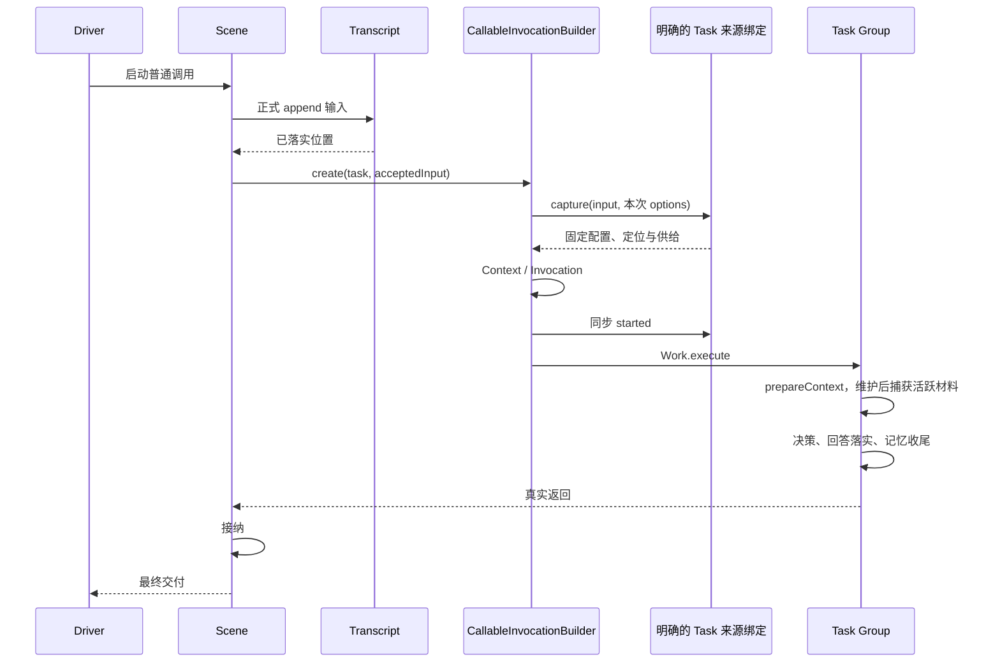

# 运行结构、调用与资源访问边界

当前结构为 Scene / Group / Node；共同机制为 Callable，成员组合为 Composite。完整角色表见 [项目组织](organization.md)，作者示例见 [可调用结构](callable-structures.md)。运行时表示这些结构和独立实体实际协作的活动状态，不是某个 Scene 或 Driver 的别名。

## 结构配置与整体构建

Scene 与 Group 都声明自己的普通输入、输出、run 和 members；Node 实现普通处理，没有 members。run / exceptions / observation / checkpoint 平级。成员注册不执行工作，Group 自己选择调用顺序、分支与接纳；Sequence 是可选组合辅助。

| 对象                      | 职责                                                          |
| ------------------------- | ------------------------------------------------------------- |
| CallableBinder            | 解算固定声明图，核验成员位置、资源、阶段 uses、接纳和 CP 契约 |
| CallableBinding           | 原结构需要安装的固定接线契约，不增加运行实体                  |
| CallableBuilder           | 完成原结构的绑定与运行能力装配，成功后一次性发布              |
| CallableInvocationBuilder | 持有安装归属，用同一机制建立任何 kind 的 Context 和调用       |
| Driver                    | 宿主入口、占用、实际结束后释放                                |

Scene/Group/Node 本身是注册身份，普通 Definition 配置没有独立身份。Scene 是根，Group/Node 只有一个父结构；同父重复 add 不增加位置，跨父添加或循环拒绝。业务配置经构造器或 setDefinition 安装，setRun 替换完整阶段。构建提前解算全树，固定配置容器、函数入口和资源接线，但保留业务方法 receiver。原结构承载这些装配结果，不产生第二棵 Bound 树。

```text
new Driver(capabilities)
  → 固定调用机制接入

Driver.build(structure, bindingOptions)
  → CallableBuilder.build
      → CallableBinder.bind：检查配置、成员、资源与来源契约
      → 建立固定 work 接线和 CallableInvocationBuilder
      → 将运行能力安装到原结构，完整成功后固定配置
  → 返回同一个结构的 BuiltCallable 类型

Driver.run(builtScene, input, options)
  → 核验构建归属，取得本场景入口占用，检查预取消，validate
  → 建立本次固定 CallableCallBindings
  → root capture，构造根 Invocation / CallableContext
  → Invocation.run → 当前阶段 Work → 业务
  → 实际返回或失败，释放占用
```

build 成功后拒绝结构 setter、add 和再次构建。修改业务逻辑或供应规则需另建结构；输入和资源内容变化仍按次处理。build 不取得本次资源值、不执行业务；失败不留下部分可运行结构。固定结构与构建归属不等于固定一次运行的现场。

构建后的场景归属于其 Driver；跨 Driver、伪造结构及独立 CallableBuilder 构建的结构均不能通过该 Driver 入口运行。场景入口独立占用，使用 `Driver.isRunning(scene)` 查询；同一个 Driver 的其他场景不受影响。占用不在 Context，也不扩展为每个 Node 的执行锁。构造、业务、观测任一失败都释放；Driver 不隐式建立等待队列。入口观测仍包含 driverId 与 boundId，boundId 指该构建安装的稳定身份，不代表第二个 Bound 对象。

CallableInvocationBuilder 直接构造 CallableContext，以自身作为固定安装归属。建立子调用时，资源选择前后均核对父活动及归属，因为资源收窄会执行宿主逻辑，可能同步触发取消。子 Context 只继承父信号，不保留父对象。不同构建即使来自同一 Driver，也不共享构造归属。

## 来源、供应与访问窗口

Transcript、Memories、Provider、Interaction 等由宿主建立。结构只绑定其资源访问形式，不拥有实体生命。ResourceOffer 声明访问、capture、timing、describe 与可选 refine；资源检查范围是否扩大，绑定不能代为授权。

装配解算本层 requires 和子树 supply，父 Work 只取得本阶段 requires。普通成员继承固定供给，但为本次调用建立独立端点；只有明确 `CallableSourceBinding.capture` 的位置建立独立来源边界，其子树不会泄漏到上游供给捕获。

```ts
const sourceBinding = bindCallSource(task, {
  capture: (input, options) => captureTaskBasis(input, options),
  started: (options) => options.started,
});
const driver = new Driver();
const builtScene = driver.build(scene, {
  providers,
  source: { capture: (input, options) => captureSceneBasis(input, options) },
  bindings: [sourceBinding],
});
await driver.run(builtScene, input, options);
```

这里的 task 可以是 Group 或 Node，独立捕获不由 kind 决定。仅绑定 progress/started/output 不会隐式创建新供给边界。来源方法在绑定时固定；本次 options 与接线归属由内部固定对象传递，不存入业务 Work，不需要祖先 Context 链。

`timing: 'binding'` 指本次供应建立时捕获，不是静态解算时取得实体；`timing: 'access'` 在真实访问时兑现。观测关闭不会触发 describe 或提前兑现惰性 Provider。`childResources` 只可收窄准确注册成员已申请的供应，不改变父、兄弟或无关资源。

资源端点验证本地调用、阶段/轮次及固定控制信号，不递归查询祖先状态。阶段变化不重新解算声明。正常 execute→accept 共享本轮正常资源端点；异常处理、局部继续与恢复有明确窗口，旧端点不可跨窗口复用。CP resume 离开后其独立窗口永久关闭。

## Observer 的输入与材料

服务的 ConversationScene 通过正式 append 资源落实输入，然后把 `{message,messageIndex,fileTask?}` 作为普通输入交给 ConversationGroup。Task 是普通 Group；内核没有 E 专属 entry、EntryInput 或按层固定的资源准备。



输入已落实而 Task 尚未建立时失败，保留内容及 Scene 的事实，不伪造 Task。配置与原文定位在 Task 构造时捕获；真正模型材料由 prepareContext 在可选维护后一次捕获，其后各能力使用同一份固定材料。默认不隐式裁剪或分段，容量超限明确失败。

started 在 Context 建立后、调用 started 事实前同步运行，必须返回 undefined。异步或其他返回拒绝；意外 Promise 的迟到拒绝被消费，不承诺撤销已经开始的副作用。恢复旧调用不重复 started；恢复活动中新建调用正常登记。被动 progress 不能替代这个严格建立钩子。

## Invocation、Context 与 Work

Invocation 协调整次调用、真实交付和故障归属。CallableContext 唯一保存输入、当前输入、进度、终态、本次资源与固定构造归属，不持有祖先。InvocationControl 管理单次启动与活动窗口；InvocationAccess 签发阶段 Work。二者不各保存一套语义状态。

| 内部对象                      | 独立职责                                               |
| ----------------------------- | ------------------------------------------------------ |
| InvocationCycle               | execute / receive / handling、有限继续与输出段         |
| InvocationWork                | 调用机制消费的窄工作契约                               |
| InvocationWorkBinding         | 固定声明到共同工作契约的适配                           |
| InvocationChildren / Relation | 实际直接关系、returned/reception、异步接纳与已启动活动 |
| InvocationCheckpoint          | 本次保存、已保存子事实与恢复缓存                       |
| checkpoint/children           | CP 子事实编码和检查，不修改活关系                      |

业务只取得 Work，不接收内部 Invocation、Context 或 Frame。成员存在才提供 children 切面。refs/facts 可跨阶段读取，创建/启动/恢复按阶段 uses 检查，打开旧引用不扩大行动范围。已保存成功交付不要求初始化子结构。

固定活动规则：

- 创建与真实启动时检查直接父活动及构造归属；在途子依靠自身窗口与固定信号，不随着父 phase/round 变化重新解算。
- 阶段离开前排空已开始的接纳回调，回调仍用原阶段 Work。execute 正文返回即封口输出。
- 最终交付前关闭新活动，等待已启动子调用真正退出。未启动关系不阻塞，不自动接纳，不隐式停止兄弟。
- Interaction 有自己的生命；调用退出不等待其结束、不取消外部发送、不重发未知请求。晚到反馈仍可保存。
- 技术故障已归属后不能由业务 catch 清除；声明异常按 ChildCallFailure 传播凭据判断，不能扫描原错误对象猜来源。

局部继续复用 Context 并原子安装 continuation/round/currentInput；maxRounds 仍仅支持 1/2。子调用每次有独立身份。真实输出/异常保持引用，记录及持久化才复制为纯数据。详见 [异常边界](exceptions.md)。

## 返回、接纳与实体落实

`returned` 不等于 `accepted`。Composite 可登记 reception，接纳开始即固定契约；检查保持真实 V 引用，codec 只用于 CP。facts.accepted 要求准确 ref 与同一契约，undefined 可以是合法成功值。raw accept 不可事后补标签。

实体写入、父接纳事实和 CP 提交是不同边界。固定写入口用真实调用/接纳范围派生凭据；恢复核对已有凭据，不凭内容相同或记录存在重做。Frame v4 保存完整直接关系、业务 state/refs、接纳契约位置和继续依据，缺失或不兼容明确拒绝。详见 [Checkpoint](checkpoints.md)。

## 进展、观测与记录

progress 是被动元数据出口，消费者失败停用并隔离，不修改运行结果；绑定工厂本身失败仍是构造错误。服务依据真实调用身份、实体写入和 Driver 的最终交付解释提交状态，不依赖 Recorder 推断。

可选观测默认隔离，可显式传播；必要变化捕获保留严格失败。已成立事实不回滚，不由观察错误触发业务重做。记录只是一个预设载体，可替换或完全不安装。

新 CallableRecord 保存真实调用树和 structureKind；对话任务由明确 role 识别，不能把每个 Group 当 QA。父关系变化应刷新受影响任务；旧 REOA 记录只读投影，不重新参与运行。单次记录各自保留正文和关系变化，resultOf 不跨记录串联。
