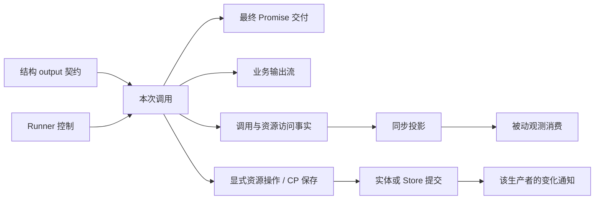
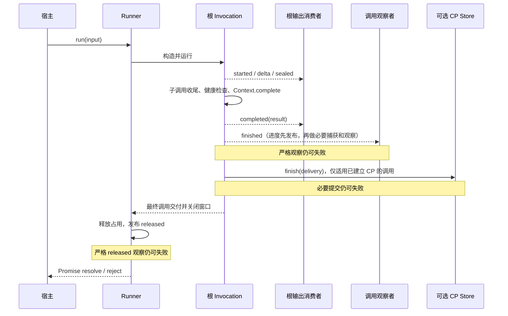

# 运行控制、输出与观测出口

状态：2026-10-28，本轮出口接线已实现。`runner.output` 保持名称，事件新增本次入口的 `entryId`；`runner.observation` 提供只读元数据订阅，覆盖入口、普通调用、资源访问、CP 活动与普通业务注释。CP 新增独立被动 `feedback`，严格观察与保存语义保持。本文保留实施前的反例与探针作为依据，第 7、9 节说明当前落点与限制；不新增公开 Run 实体或跨端协议。

本文回答：哪些端口参与运行，哪些端口消费结果或观察事实；它们在哪里建立、何时有效、失败影响什么。结构与调用机制见 [运行边界](runtime-boundaries.md)，普通用法见 [可调用结构](callable-structures.md)，服务跨端交付见 [协议](protocol.md)。

## 1. 第一层心智：决定、交付、观察分别表达

`output` 在结构侧描述允许产出什么，在 Runner 侧提供该场景运行输出的消费端。方法区分角色：结构配置契约，业务通过 `emit` 产生增量，宿主通过 `subscribe` 消费。流式是输出交付的一种形式，不需要为它再引入平行的公开名词。

Runner 固定一个 Scene 与资源供给。宿主对这份场景运行的启动、停止、最终交付和过程反馈，从 Runner 取得；实体仍保留自身的独立生命周期。Runner 的接口按“运行一个场景需要做什么、得到什么”组织，不机械映射 Scene 的每个字段。

| 使用者的意图                   | 对应职责   | 当前落点                                               |
| ------------------------------ | ---------- | ------------------------------------------------------ |
| 配置合法结果与增量             | 输出契约   | 结构的 `output.result / output.delta`                  |
| 发起、续接、停止一次运行       | 运行控制   | `runner.run / resume / cancel`，`isRunning`            |
| 在业务中接收资源或子调用结果   | 操作接收   | 操作的 `result.succeeded / failed`；可改变父层后续处理 |
| 展示正在产生的内容             | 流式交付   | `work.output.emit` → 当前 `runner.output.subscribe`    |
| 取得入口调用的最终结果         | 最终交付   | `await runner.run(...)` 或 `resume(...)`               |
| 了解执行到了哪里、发生过什么   | 进度与观测 | Progress、调用／资源／CP 等事实出口                    |
| 使内容、凭据或恢复依据可靠保存 | 必要提交   | 对应实体的持久端口、CheckpointStore                    |

前三项有决定运行的权限；后续的流消费者和普通观察者只消费事实。必要保存有自己的提交契约，不能以“订阅者收到事件”代替。



图中没有把输出、观测、保存排成一条处理流水线：它们在不同边界发生。实体通知的生命周期也不由 Runner 统一持有。

## 2. 运行侧：哪些失败必须影响当前运行

### 2.1 构建与调用建立

Runner 在构造／build 时固定 Scene、Resources、可选 Interactions 和机制安装；每次运行建立自己的信号、供给、Context 与 Invocation。订阅输出不构造或启动调用，取消订阅也不取消调用。

当前 `callableHooks` 聚合了四种入口，其名字相邻，职责并不相同：

| 入口                     | 时机和作用                                                                 | 失败语义                                   |
| ------------------------ | -------------------------------------------------------------------------- | ------------------------------------------ |
| `validate`               | 本次调用的条件核验，早于资源捕获                                           | 同步失败阻止建立                           |
| `started` 工厂及返回回调 | 工厂在供给准备后建立；回调在 Context 建立后、调用 started 事实前做必要登记 | 同步失败阻止业务执行；恢复旧调用不重复登记 |
| `progress` 工厂          | 为本次调用选择进度消费者                                                   | 工厂失败仍是构造失败；消费者失败隔离       |
| `output` 工厂            | 为本次调用选择输出消费者                                                   | 工厂失败仍是构造失败；消费者失败隔离       |

**“被动消费”只描述接收器的权限，不自动包含创建接收器的整个装配过程。** 当前这两层失败混在同一组 hooks 中，是下一轮值得收敛的地方。

依据：[hooks](../packages/runtime/src/binding/hooks.ts)、[调用构造](../packages/runtime/src/construction/invocation.ts)、[Runner](../packages/runtime/src/runner.ts)。

### 2.2 业务处理与最终结果

- 输出校验属于生产者：即使没有任何订阅者，非法增量和非法最终值也必须失败。最终校验保留真实结果引用。
- 操作的 `result` 回调属于业务接收：可以接纳、转换或处理允许的业务失败；它不是观测订阅。取消、CP、必要捕获等机制故障仍不可被普通失败回调掩盖。
- `work.output.emit` 使用当前调用窗口；资源或子调用的 delta 只有经过明确转发才成为父层输出。不能自动汇总整棵树的增量，否则内容来源与整体结果语义会混淆。
- `runner.cancel` 请求当前运行合作停止，不提前释放仍在运行的代码，不撤销已落实效果，不取消独立 Interaction。下一次运行有新的取消归属。

依据：[输出段](../packages/invocation/src/output/section.ts)、[操作失败](exceptions.md)、[Runner 取消](../packages/runtime/src/runner/cancellation.ts)。

## 3. 消费侧：相似的 subscribe / observe 不意味着相同契约

| 出口                  | 观察范围与数据                                                                                         | 当前消费性质                                                                                                     |
| --------------------- | ------------------------------------------------------------------------------------------------------ | ---------------------------------------------------------------------------------------------------------------- |
| `Runner.output`       | Scene 根输出；带本次入口 entryId，以及 contextId、round、局部 sequence。子输出须显式转发               | 被动同步订阅，跨 run/resume 保留；不缓存、不回放；单个消费者失败即停用，其他消费者和运行不受影响                 |
| `Runner.observation`  | `{ runnerId, entryId, source, fact }`，source 为 entry / invocation / resource / checkpoint / business | 固定元数据的被动同步订阅；不带业务 IO、Frame、资源 describe 或原始异常。恢复事实保留 CP 来源，不伪造普通调用事件 |
| `InvocationProgress`  | started、process、relation、finished 的元数据，无 IO 或原始错误                                        | 被动投影；父层可转发后代进度，保留真实生产者；恢复路径不发布普通进度                                             |
| `InvocationFact`      | 调用身份、过程与关系事实，含输入、输出、异常、描述等同步借用值                                         | 供机制安装同步观察；默认隔离，可配置严格传播；不能把原对象排队后再解释                                           |
| `ResourceObservation` | 当前访问中的资源操作事实；含惰性 `describe()`                                                          | 同步观察；需要正文时在有效边界求值并投影，不默认读取描述                                                         |
| `BusinessObservation` | `work.observation` 产生的业务注释，由内核补身份与时序                                                  | payload 为 unknown，不自动成为纯数据；不能冒充调用生命周期事实                                                   |
| `DriverFact`          | Runner 入口的 established/acquired/released/rejected/entry-failed                                      | 现有协议仍叫 Driver；有独立序号，released 只说明入口释放；严格消费者可影响入口交付                               |
| `CheckpointFact`      | 保存、检查、恢复安装、恢复活动与最终交付等 CP 事实                                                     | 独立 activityId；部分事件带 Frame、借用调用事实或原始错误，须按种类投影                                          |

当前 `Runner.output` 的事件封套冻结，Result/Delta 不因此深拷贝或深冻结。被动表示没有接纳决定权且回调故障隔离，不代表共享对象已经深度隔离；消费者应只读使用收到的值。它可用于本进程消费，但不是天然可以持久或跨端传输的 DTO；真正跨端的输出需要服务定义序列化与接纳。

`ObservationInstallation` 是 build 时安装的能力：它可以检查声明、提供观察所需资源、建立局部观察者并选择失败策略。`runner.observation.subscribe` 不获得这些权限。Runtime 的单次反馈接线只携带接收器，不能替换已安装 Store、严格观察或资源供给。**安装能力和消费出口并存，各自命名。**

依据：[输出契约](../packages/contracts/src/output.ts)、[根订阅](../packages/runtime/src/runner/output.ts)、[进度](../packages/invocation/src/invocation/progress.ts)、[调用事实](../packages/invocation/src/observation/facts.ts)、[观测安装](../packages/runtime/src/binding/observation.ts)、[CP 事实](../packages/invocation/src/checkpoint/contract.ts)。

## 4. 独立实体：Runner 不接管所有保存与通知

| 生产者                    | 正式操作／保存                                                         | 通知与 Runner 的关系                                                                              |
| ------------------------- | ---------------------------------------------------------------------- | ------------------------------------------------------------------------------------------------- |
| Transcript / Memories     | 自己落实内容、版本与固定操作凭据；有持久端口时先提交成功再安装内存状态 | 变化通知在落实后产生；通知失败不回滚内容。资源访问可关联本次调用，实体本身独立存在                |
| View / MessageUsage       | View 管成员与依据，可同步持久；Usage 目前管理实例内计数                | 不因“都有实体”而强制增加同形事件流；目前 Usage 没有持久或变化出口                                 |
| ResourceAccess / Activity | 打开不可重开的访问窗口，控制每次操作与结果接收                         | 关闭窗口不关闭资源实体；资源增量不自动成为 Runner 流                                              |
| Interaction               | 固定请求只发一次，独立保存反馈，非破坏读取                             | 调用结束后可继续收到反馈。通知失败隔离；按关联查询可由服务完成，不能靠 Runner 当前调用存活来保证  |
| CheckpointStore           | 保存不可变 image/head 与最终 delivery；是恢复依据                      | CP 通知不替代保存。恢复是新活动，不是旧调用事件回放                                               |
| Recorder                  | 可选记录实体；自动记录由安装的预设写入                                 | `RecordChangeEvent` 为固定快照；`Recorder.subscribe` 当前传活记录引用，两者不能混用为同一种纯值流 |

`ChangeCapture` 是必要同步捕获契约，可能只是写缓冲，不等同于持久化。捕获、可选观察与底层持久成功必须分别命名。已完成实体提交后通知失败，可以让当前调用失败，但不能据此猜测实体未写入并重做。

依据：[变化发布](../packages/changes/src/publish.ts)、[内容实体](content-entities-packages.md)、[View](view-package.md)、[交互](interactions.md)、[CP](checkpoints.md)、[Recorder](../packages/records/src/recorder.ts)。

## 5. 时序验证：相同的“完成”指向不同事实

### 5.1 根调用正常结束的典型顺序



子调用对应的后段还有父关系 `returned`，之后父业务才执行接纳。子返回、父接纳与父输出同样不能合成一个完成点。

由此得到四个必要区分：

1. `output.completed`：输出段产出了最终值。它既不是父层接纳，也不是入口最终成功。
2. `progress.finished` / `InvocationFact.finished`：本层工作终态已建立。终态观察或后续提交仍可能导致交付失败。
3. CP 最终 delivery：该调用在 Store 中的最终交付已固定；跨进程持久性取决于 Store 实现。根调用之后的宿主 released 观察仍有自己的失败边界。
4. `runner.run` 的 Promise：本次宿主入口最终返回／拒绝。失败仍不意味着之前所有实体效果未发生。

现有 Observer 的 submission.completed 等待运行返回，answer 和正式消息另行表达；本次梳理不能把这些已有区别抹平。

### 5.2 CP 的观察失败存在明确不对称

| 点          | 当前顺序                            | 严格观察失败的效果                           |
| ----------- | ----------------------------------- | -------------------------------------------- |
| `saved`     | `store.save` 成功 → 通知 saved      | 调用失败，已保存 image/head 不撤销           |
| `finishing` | 通知 finishing → `store.finish`     | 可阻止成功 delivery 的提交，进入失败交付路径 |
| `finished`  | `store.finish` 成功 → 通知 finished | 通知故障隔离，已经固定的 delivery 不变       |

这不是三种名称相似的被动订阅。这里混有可配置严格的机制观察，且最后一个点有明确的提交后保护。当前普通订阅与 CP feedback 均独立隔离；是否继续保留所有严格观察位置，需要单独讨论，不能借出口接线改变。

依据：[调用交付](../packages/invocation/src/invocation/invocation.ts)、[入口释放](../packages/runtime/src/entry.ts)、[CP 保存与最终提交](../packages/invocation/src/checkpoint/invocation.ts)。

## 6. 身份、顺序与数据寿命

| 信息                   | 顺序的真实范围                                                             | 聚合时需要保留的区别                                                                                 |
| ---------------------- | -------------------------------------------------------------------------- | ---------------------------------------------------------------------------------------------------- |
| 普通调用事实／Progress | 每个 Invocation 的 eventSequence                                           | 父层转发不分配新的事实身份；不是子树全局序号                                                         |
| 输出事件               | 每个输出段的 sequence                                                      | 底层恢复可复用 contextId/round，但新段从头计数；Runner 出口另带本次 entryId 区分活动，不改变调用身份 |
| Runner 入口事实        | observation 中每个 entryId 的 sequence；原 DriverFact 仍为 Runner 局部序号 | 与调用事实不在同一序列，也不能混用新旧入口出口的序号                                                 |
| 资源操作、业务注释     | 各自生产者的局部序号                                                       | 不能按相同字段名混成一个进度数字                                                                     |
| CP 事实                | 新 activityId 内的 sequence                                                | installed 是历史基线；后续是当前活动，不重播历史变化                                                 |
| 实体变化               | 对应实体的 revision/sequence                                               | 不借调用序号代替实体版本                                                                             |

`Clock.tick()` 提供单调时间，不提供跨来源事务或全局事件顺序。资源事实中的 `interactionId` 当前标识资源操作，不能直接当作独立外部 Interaction 的 ID；这是应明确区分的命名遗留。

Runner 只读观测出口在同步投影后交付，遵守以下边界：

- 保留 source、真实身份和各自的序号；不靠时间排序制造统一因果。
- 默认只取元数据，不携带 IO、Frame、活记录、未知业务 payload 或资源 `describe` 函数。
- 恢复观测沿用 CP 的活动身份与 installed 基线；不能伪造普通调用重新 started。
- 选择保存／跨端消费时，再形成明确的纯值协议与容量规则；不能直接序列化原始观察对象。

已有 [Observer CP 投影](../../capix-lab/services/observer/src/observation/checkpoints.ts) 可作为实例参考：它保存有界元数据和诊断，不把整个 Frame 暴露给客户端。这不是要求 Runtime 复刻 Observer 的业务投影。

## 7. 已确定的心智：Runner 兑现场景的运行契约

Scene 树已经表达整体处理与整体输出。本轮接受这个前提，不另建任意节点输出的订阅平台，也不自动拼接所有子节点 delta。Runner 负责让这份场景实际运行，并向宿主公开运行出口。

| Scene 侧          | Runner 侧               | 职责转换                    |
| ----------------- | ----------------------- | --------------------------- |
| `run` 处理函数    | `run(input)`            | 定义行为 → 启动行为         |
| `output` 契约     | `output.subscribe(...)` | 定义产出 → 消费产出         |
| `checkpoint` 配置 | `resume(...)`           | 定义恢复依据 → 发起恢复     |
| `members / deps`  | `build()`               | 定义组成与依赖 → 核验并装配 |
| 无需对应配置字段  | `cancel / isRunning`    | Runner 自身的当前运行管理   |

这些是职责关系，不是 Runner 转发 Scene 的同名属性。构造确定归属，build 固定接线，run/resume 产生本次活动；订阅可跨越多次活动。既有用法保持：

```ts
// 当前 API；display/updatePreview 是宿主自己的呈现函数。
const runner = new Runner(scene, resources, interactions).build();

const unsubscribe = runner.output.subscribe({
  receive(event) {
    updatePreview(event); // 同步消费；completed 也只更新输出呈现
    return undefined;
  },
});

try {
  const result = await runner.run(input);
  display(result); // 此处才取得本次入口的最终成功交付
} finally {
  unsubscribe(); // 只停止消费；停止运行另用 runner.cancel()
}
```

不再把输出消费者塞回每次 `run` 的 options，不新建公开 Run 实体。宿主确实需要的本次固定参数和外部 signal 可以继续存在；不能仅因有 options 就一概移除。

观测入口与 output 并列，交付固定元数据；它不是将 `ObservationInstallation` 改名后直接公开：

```ts
// 当前 API；inspectMetadata 是宿主自己的呈现函数。
runner.observation.subscribe({
  receive(event) {
    inspectMetadata(event); // 固定元数据；没有接纳、重试或改变输出的权限
    return undefined;
  },
});
```

当前范围是此 Runner 的入口与调用子树中的调用、资源访问、CP 活动及普通业务注释。实体独立变化、脱离调用后的 Interaction 通知仍由原生产者公开，服务按真实关联组合。一次订阅不自动安装 Recorder、不复制正文、不创建持久历史。恢复路径原本没有业务注释出口，本轮没有添加对应 CP 事实或伪造普通 business 事件。

Runner 复用现有 Progress 对普通调用事实的轻量投影，没有重建进度状态机。当前不额外公开同源的 `runner.progress`。

### 本轮实施落点

1. **Runner 入口与输出。** [Runner](../packages/runtime/src/runner.ts) 为每次 run/resume 固定反馈关联，[输出订阅](../packages/runtime/src/runner/output.ts) 在交付时添加 entryId；必要收尾之后发布真实 settled。
2. **只读观测与按次接线。** [事件契约](../packages/runtime/src/runner/observation-contract.ts)、[同步投影](../packages/runtime/src/runner/observation-projection.ts) 和[单次反馈](../packages/runtime/src/runner/feedback.ts) 分开；[构造反馈](../packages/runtime/src/construction/feedback.ts) 只连接接收器，不提供替换 Store 或必要机制的入口。
3. **CP 独立反馈。** [CP 发布](../packages/invocation/src/checkpoint/invocation.ts) 同一事实分别交付被动 feedback 与原 observation；[恢复转发](../packages/invocation/src/checkpoint/observation.ts) 不再因严格观察故障连带关闭被动事实。恢复建立前的失败也经独立反馈交付。

普通根输出订阅已不需要 output hook；必要登记与校验保持独立。对照服务可直接消费 Runner 出口，原 Observer 的特定 Group 接线只有在整体输出和登记职责真正迁移后才能删除。本轮没有据此删改旧服务的必要登记。

这三步不要求一个统一事件总线，不把所有模块包装成同一种订阅对象，也不把被动观察升级成恢复或业务推进机制。

## 8. 首轮盘点的验证记录

首轮盘点未改实现；针对当前工作区运行了 9 个既有测试，全部通过：

| 测试文件／选中用例                                                                                                                         | 验证边界                                         |
| ------------------------------------------------------------------------------------------------------------------------------------------ | ------------------------------------------------ |
| [output/contract](../packages/runtime/test/output/contract.test.mjs)：consumer failure、invalid delta、fallback violating final type，3 个 | 消费失败隔离；生产校验没有消费者也不能略过       |
| [progress](../packages/runtime/test/progress.test.mjs)：strict observation、commit progress、resource returned observation，3 个           | 进度或实体效果已经成立后，严格观察仍可使交付失败 |
| [transcript/fixed](../packages/transcript/test/fixed.test.mjs)：post-commit change failure，1 个                                           | 凭据可确认，不重复落实或发布                     |
| [transcript/changes](../packages/transcript/test/changes.test.mjs)：capture failure reports committed facts，1 个                          | 捕获失败与内容已提交同时成立                     |
| [memory/persistence](../packages/memory/test/persistence.test.mjs)：memory publication failure，1 个                                       | 已提交整批记忆的通知故障不隐藏其他成员事实       |

首轮另用不落文件的 Runner / MemoryCheckpointStore 探针验证 4 个场景：strict saved、strict finishing、strict finished、isolate saved，均符合第 5.2 节。当时尚未成为持久回归；本轮新增的 [CP feedback 测试](../packages/invocation/test/checkpoint/feedback.test.mjs) 已覆盖独立消费与严格提交边界。

已有 [Runner 端口测试](../packages/runtime/test/runner-ports.test.mjs) 覆盖订阅重入、取消归属与恢复等前轮改动。新增 [Runner 观测测试](../packages/runtime/test/runner-observation.test.mjs) 覆盖入口身份、输出完成后的严格 released 失败、恢复关联、迟到订阅与消费者隔离。2026-10-28 实施后执行 `pnpm check`，构建、类型检查、2060 项测试及格式检查全部通过；本地 conversation 与 runner-output 示例也执行通过，未调用真实模型。

普通订阅保持被动隔离，现有严格机制安装保留原语义。本轮补足出口关联与接线，未更换 output 名称。

## 9. 实施依据：入口关联、恢复反馈与订阅生命周期

本节保留实施前的反例与探针，相关入口关联、只读订阅及 CP 反馈接缝现已实现。它们没有改变 Scene / Resources / Runner 的职责，也没有新增公开 Run 实体。

### 9.1 持续订阅，需要区分每次进入 Runner

三个反例不能只用 `contextId` 解释：

- validate、绑定时材料捕获或必要登记失败，可能尚未建立输出段；Runner 已进入并最终拒绝，但没有 output 事件。
- resume 使用历史 contextId；同一历史依据在不同恢复活动中的输出段序号会重新开始。恢复活动不是新的业务调用身份。
- released 观察回调可以同步启动下一次运行；此时旧运行的 Promise 尚未交付，Runner 已进入新活动。给事件补身份时读取一个可变的 `runner.current` 会串源。

实现采用**每次 run/resume 入口请求的固定关联值 `entryId`**。它不是结构身份、Context 身份、submissionId 或幂等凭据，不要求宿主创建或管理一个 Run 对象。

```ts
// 当前公开输出值类型；mode 位于 observation 的 entry.requested 事实中。
// 输出仍遵循 Scene 的 I/O/Delta，只补本次入口的关联，不产生 Run 实体。
type RunnerOutputEvent<Result, Delta> = InvocationOutputEvent<Result, Delta> & Readonly<{ entryId: string }>;
```

规则：

1. 每次入口请求固定新的关联值；忙碌拒绝属于被拒绝的那次请求，不能贴上正在运行请求的身份。取消控制只归已取得占用的入口。
2. 真实根调用建立后，再明确关联 `entryId → rootContextId`；建立失败不伪造 Context。恢复仍沿用原 contextId。
3. 输出、普通调用观测和 CP 活动使用创建时捕获的同一入口依据。CP 自身 activityId 继续表达对应 CP 活动，不改写其含义。
4. 关联值通过内部单次接线传递，不写入业务 input、deps 或可变结构字段，也不由资源捕获函数负责补齐。
5. 序号仍属原生产者；不同活动事实可以交错到达，不以一个聚合计数冒充全局因果。

单一 `await runner.run()` 的调用者不需要主动管理这项关联；持续订阅、多消费者或恢复观察可以使用它。关联在入口内固定，不能依靠时间或“当前运行”推测。

### 9.2 输出与运行结局仍是两个出口

输出为空并不意味着没有运行，输出 completed 也不意味着入口最终成功。完整观察应覆盖入口进入、真实调用建立、最终交付及拒绝；它不能由输出事件反推。

```text
入口请求 entry-1
  → 取得占用
  → validate 失败
  → 释放并拒绝
  → 没有调用输出：这是正常可解释的失败路径

入口请求 entry-2
  → 建立根调用 context-A
  → output completed
  → 必要收尾失败
  → 最终拒绝：正文产出与运行结局分别保留
```

当前 `source: 'entry'` 的事实包括 requested、acquired、rejected、entry-failed、attached、released 和 settled。attached 在真实根调用建立后报告其身份；没有创建调用的失败不会生成 attached。settled 取自 Runner 实际返回／抛出的同一控制路径，包含严格 released 观察之后的结果；不会以 Context.state、输出 completed 或释放占用代替。该通知自身被动隔离，不能再次改变已经确定的交付。

`run/resume` 的 Promise 仍是直接调用方取得结果的方式；观测端只报告对应状态和有界诊断，不再重复携带业务结果正文。

### 9.3 普通调用与恢复，需要两条生产接缝、一个宿主消费入口

普通调用经 Runtime 的单次反馈绑定连接固定元数据投影；无需业务 deps、Recorder 或改写业务 Work。恢复明确跳过普通安装，进入 CP 事实出口。单次反馈只有 invocation/resource/business/checkpoint 接收器，不携带 Store、严格策略或资源供给；额外 CP 消费只能附着在已安装保存端口上，不能借订阅安装持久化。

```text
build 固定机制；每次入口固定接收器与 entryId
  普通 Invocation / Resource 事实 ──同步投影──┐
  CP 保存 / 恢复活动 / 恢复建立失败 ──投影───┼→ runner.observation
  Runner 入口及真实交付 ──固定元数据────────┘

subscribe / unsubscribe 只改变末端消费者
```

实施前 CP 只有一个可选观察会话。若把严格观察者和 Runner 被动消费写进同一个 `observe` 回调，严格观察故障会使整个会话停用，后续被动转交也被一起停掉。

当前 `CheckpointInstallation.feedback?: ProgressReceiver<CheckpointFact>` 在 CP 生产边界接收原始同步事实。每份事实只建立一次，feedback 与原 observation 共享 activityId、sequence 和事实对象；被动接收通过 ProgressChannel 隔离故障，再执行原观察策略。`prepareCheckpointRestoration` 在 Invocation 建立前的失败也沿此规则交付。Store、恢复身份与严格保存语义不随出口变化。

独立性覆盖完整转交链：恢复调用向 CP activity/resource 的桥接已改为只转交事实与保留错误包装的薄适配；停用状态由各消费会话持有。严格观察失败之后，真实失败收尾仍能送达被动端，不会重新启用失败观察者。恢复的 transcript/memory 变化也保持原有 CP 事实种类；业务注释原本没有这条恢复出口，本轮没有扩展。

原始 `feedback` 不承诺纯数据：其中可能有 Frame、借用 IO、错误或资源 describe。Runner 在同步边界将其投影成固定元数据，不保留这些原对象。这里实现的是已有 CP 事实的独立交付接缝，Runner 不代理 Store，不建立第二套恢复过程。普通安装的可选严格策略继续由机制安装承担；新订阅只消费。

依据：[普通／恢复安装分界](../packages/runtime/src/construction/invocation.ts)、[CP 观察会话](../packages/invocation/src/checkpoint/invocation.ts)、[恢复建立](../packages/invocation/src/checkpoint/restoration.ts)。

### 9.4 无人订阅、迟到订阅与取消

| 场景                     | 明确规则                                       | 实施注意                                                                               |
| ------------------------ | ---------------------------------------------- | -------------------------------------------------------------------------------------- |
| 没有订阅者               | 保持固定接线；不做内容投影、描述求值或历史保存 | 不能以订阅数决定观察会话 `available`；它一旦失效就停用，后订阅会丢失当前调用的后续事实 |
| 运行中订阅               | 从此后发生的事实开始；解除只停止消费           | 不补发 started 或历史帧；若产品需要当前快照，需另外定义读取契约                        |
| 构造后才订阅             | 不回放构造时 established                       | Runner 已有只读身份与场景，不为补齐通知自动建立历史仓库                                |
| 用户此刻点击停止         | `runner.cancel()` 针对当前运行                 | 仍等待实际退出；不能用它取消一个已结束的历史活动                                       |
| 针对某次运行设置迟到超时 | 使用该次 run 传入的独立 AbortSignal            | 当前已支持；不把旧活动排队的 `runner.cancel()` 当作有目标的取消                        |
| 外部反馈晚于运行结束     | 外部交互依然保存反馈，保持自己的出口           | Runner 不据此继续 busy，也不随共享 Interactions 汇总无关事件                           |

无人订阅仍会有固定会话和分派开销；目标是跳过不必要的投影与分配，不宣称零开销。业务注释的未知 payload、资源 describe 与 Frame 都不应因“统一出口”而默认复制。

### 9.5 本轮实施边界

- **保持原语义：** Scene 整体输出、Runner.output、run/resume/cancel、独立资源与 Interaction 生命周期、Promise 最终交付。
- **本轮已实现：** 单次 entryId 反馈关联、最终入口 settled 事实、Runner 的只读元数据订阅，以及 CP 的独立被动交付接缝。
- **暂不扩展：** 输出历史与重放、运行中途完整快照、公开 Run 对象、全局观察中心、通用队列与外部交互所有权。

接缝已有定向回归，对照服务可以直接消费 Runner 出口。旧 Observer 的必要登记不能因新订阅可用而直接删除；确认业务角色、内容落实及恢复登记均已明确归属后，才能逐项简化原接线。

### 9.6 实施前的临时探针

实施前仅用当时公开 API 执行 `node --input-type=module` 脚本，未修改生产代码、未新增永久测试，也未调用真实模型。三组探针全部符合以下结果，作为本轮 entryId 与接线的设计依据：

| 探针                 | 条件                                                                                    | 实际结果                                                                                                               |
| -------------------- | --------------------------------------------------------------------------------------- | ---------------------------------------------------------------------------------------------------------------------- |
| 建立前／首次访问失败 | validate、范围 capture、binding 时材料选择、正式 started 回调分别失败                   | Promise 拒绝、Runner 释放、output 为空                                                                                 |
| 同组的惰性访问分支   | access 时材料选择或 expose 失败                                                         | Promise 拒绝，但已有 started → sealed → discarded；不能把所有资源失败概括成“没有输出”                                  |
| 恢复身份             | 同一 Runner 的第一次 resume 在最终 Store 提交前失败；修复 Store 后再次 resume 同一 root | 第一份 head 未有 delivery，允许再次恢复；两次 output 的 contextId、round=1、sequence=1..4 完全相同，CP activityId 不同 |
| 延迟取消             | 第一轮 completed 回调用 setImmediate 排队 cancel；第一轮结束后立即运行第二轮            | 迟到 cancel 命中第二轮；这是 current 语义，不是对第一轮有目标的取消                                                    |

恢复探针没有重新打开已固定的最终 delivery，也不证明可以任意重试副作用；它仅证明原输出坐标不能唯一标识恢复活动。延迟取消探针同样不是要求改变现有 cancel 的含义，而是要求反馈来源与操作目标不能隐式混同。
