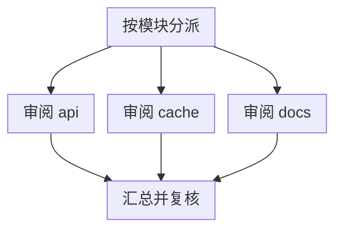

# 多 Agent 并行协作

一次变更同时改了 API、缓存和文档。API 实现从配置里读取 `timeoutMs`，文档却让用户传 `timeoutSeconds`。只审阅其中一个模块，很容易错过这个问题。怎样让三个模块同时接受审阅，又有人负责核对它们之间的约定？

在 CAPiX 里，可以把**分工**交给普通代码，把**需要判断的部分**交给模型。这个例子只定义一次模块审阅角色。协调者为每个模块发起一次独立的审阅调用，等所有发现交回后，再把它们一起交给复核角色。



图中间的三个方框是这一次运行产生的三个调用。构建时只需登记一个审阅成员。分工数量由本次输入决定，每次审阅可以独立选择工具、读取材料并交回发现。

## 在本地观察一次审阅

在仓库根目录运行以下命令。模型的选择和答复由离线脚本提供，模块读取、工具反馈和结果交接都由框架实际执行。无需 API Key。

```sh
pnpm install --frozen-lockfile
pnpm build
node examples/parallel-review.mjs
```

默认输入依次是 `api`、`cache`、`docs`。离线脚本让缓存审阅先完成，以便每次都能观察到完成顺序与报告顺序的区别。

```text
完成顺序：cache → api → docs
api：实现读取 timeoutMs
cache：实现读取 ttlSeconds
docs：文档写的是 timeoutSeconds
复核：文档的 timeoutSeconds 与 API 的 timeoutMs 不一致，请对齐名称和单位。
```

再试一次 `node examples/parallel-review.mjs docs`。这次只会交回文档的发现，复核会指出缺少 API 审阅结果。改变命令行输入，就能观察同一组角色怎样处理不同规模的任务。

## 把并发放在协调层

协调者用普通 `Group` 遍历输入中的模块。各次 `invoke` 在等待整批结果之前就已发起，所以后一个模块可以先完成。`Promise.all` 成功时按输入顺序交付结果，复核者可以逐项核对模块与发现。

<<< ../../examples/parallel-review.mjs#coordinator{js:line-numbers}

模块审阅自己决定何时使用读取工具、何时交回答案。模型与工具的循环位于审阅角色内部。协调者只消费这个角色交付的结果。

::: details 查看审阅角色怎样接入工具循环
<<< ../../examples/parallel-review.mjs#review{js:line-numbers}
:::

## 让读取权限跟着任务走

同一个审阅角色会处理不同模块。宿主通过 `resources.refine` 把审阅调用的模块名交给下面的资源。资源从已有材料中选出该模块的改动，然后才把读取操作开放给工具。例如，缓存审阅调用 `readChanges` 时，只会拿到包含 `ttlSeconds` 的那份改动。

<<< ../../examples/parallel-review.mjs#scope{js:line-numbers}

工具没有指定其他模块的参数。复核角色也只收到各模块主动交回的发现，它通过一次模型调用对照 `timeoutMs` 和 `timeoutSeconds`，指出单看任一模块都难以确认的命名和单位差异。

## 什么时候这样拆分

适合并行的是可以独立读取、独立形成初步发现的工作。如果判断某个模块必须先取得另一个模块的结论，就应把这一步放到汇合之后。一次变更只有一个模块时，同样的协调逻辑只会发起一次审阅。

成员登记和每次调用的区别见[结构与成员](../concepts/structure.md)。按输入收窄访问范围的规则见[资源与供给](../resources-package.md)。单个角色内部怎样选择工具和处理反馈，见[便签助手的模型与工具循环](../guide/notes-model.md)。

如果做到一半才发现还要请另一个角色参与，该在什么时候装配它？[从capix出发，如何思考智能组织](../essays/intelligent-organization.md)沿着这个问题，讨论一笔采购如何临时组织履约核验，再回到原单签字。
