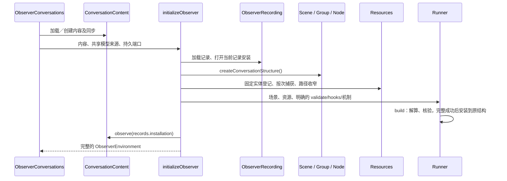
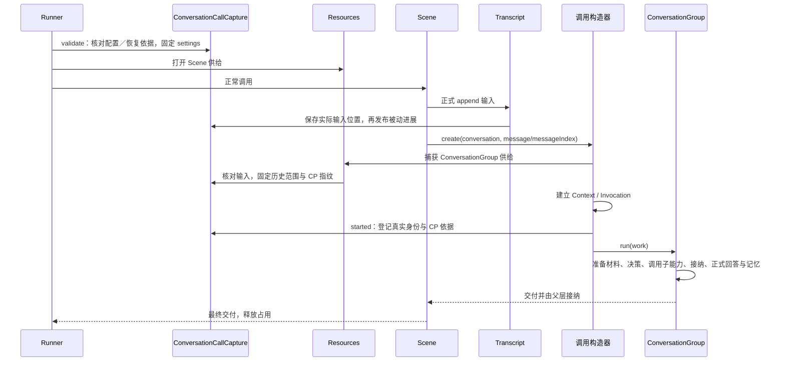

# Observer 服务装配与生命周期

Observer 使用 `Scene + Resources + Runner`。先独立定义和持有实体，再登记允许访问的方法与捕获范围，最后把结构、资源和调用机制交给 Runner。装配代码不处理一次对话的业务流程。

## 从哪里开始阅读

| 入口                                 | 职责                                                                                 |
| ------------------------------------ | ------------------------------------------------------------------------------------ |
| `conversation/structure.ts`          | 创建并组合业务结构，保留资源范围和调用 hooks 需要的准确结构引用                      |
| `conversation/scene.ts`              | Scene 本身的输入接纳、子调用和恢复点                                                 |
| `conversation/binding.ts`            | 只登记资源、按次捕获范围和路径收窄；返回 `void`                                      |
| `conversation/binding/capture.ts`    | 关联本次模型配置、正式输入位置和 CP 登记依据                                         |
| `conversation/binding/calls.ts`      | 为准确结构登记必要的 started 回调、活动进展和回答输出                                |
| `assembly/content.ts`                | `loadConversationContent` 按已提供的存储加载、初始化和校验内容，再创建或借用内容组合 |
| `@capix/observer-content`            | `ConversationContent` 持有实体、活跃索引、内容观察安装与消息同步                     |
| `observation/record/installation.ts` | 记录历史、当前记录安装、来源及持久记录会话的完整生命周期                             |
| `assembly/initialize.ts`             | 建立上述对象，显式配置 Runner，完整成功后交给环境；失败清理                          |
| `assembly/environment.ts`            | 持有已装配对象，提供恢复及关闭；不再重复保存记录安装内部状态                         |
| `assembly/conversations.ts`          | 对话目录、共享实体与按对话加载／缓存                                                 |

这里没有新增通用装配容器。`ConversationCallCapture` 是服务所需的按次关联，不是内核 Source；它不选择资源、不发送模型请求。`ObserverRecording` 则有真实的安装和关闭生命周期，持有 Recorder、RecordSource 与持久会话，正常关闭和安装失败分别处理。消费端通过 `environment.records.book/source/installation/archives` 访问，不再在环境上保留同义的展开入口。

内容实体与计数从 `@capix/transcript`、`@capix/memory` 和 `@capix/measurement` 导入。`@capix/observer-content` 提供 ActiveView 策略并组合内容及同步；ActiveView 内部使用通用 View，但保留 Observer 的保存和维护规则。内容组合只消费宿主提供的窄持久端口，不依赖 Runtime、Observer 服务或 SQLite。内容加载、初始化及借用身份校验仍留在 `assembly/content.ts`；分包不改变环境借用内容、宿主持有内容的关闭关系。具体边界见 [内容实体与独立包](content-entities-packages.md)。

## 装配主线

```ts
const structure = createConversationStructure(configuration);
const resources = new Resources<ConversationRunOptions>();
const entities = { transcript, memories, active, messageUsage, files };

// 服务的输入／恢复依据关联，明确建立一次。
const capture = new ConversationCallCapture(structure.scene, entities, {
  conversationId,
  checkpointRuns,
  checkpoints,
});
registerConversationResources(resources, structure, entities, interactions, capture);

const runner = new Runner(structure.scene, resources, undefined, {
  validate: (options) => capture.validate(options),
  hooks: conversationCallHooks(structure, capture),
  clock,
  observations: [records.installation],
  changes,
  checkpoints: { store: checkpoints, observation },
}).build();

await runner.run(input, options);
```

资源登记不会暗中生成 `validate/hooks`。资源供给与调用通知是两条明确的接线；Runner 在进入调用时协调它们。

ModelInteractions 仍是具有独立生命周期的模型交互实体，通过资源暴露 create/read；它负责模型 SSE、固定请求校验、Provider 总超时及按 ID 观测。它没有被换成通用 Interactions，因此 Runner 的第三个参数在此省略，不建立空交互注册表。



结构配置是 `deps / run / output / checkpoint`，构造器和普通赋值表达相同配置。普通 run 使用已登记成员，在操作处通过 `{delta,result}` 完成接收；没有全节点独立接纳/异常阶段。记录描述由宿主在 build 前按结构登记，业务结构不持有观察消费者。build 不执行业务或捕获本次输入；它固定入口和容器，保留业务 receiver。构建后禁止改配置；不产生平行 Bound 树。

`environment.scene`、`environment.structure.scene`、`environment.runner.scene` 是同一对象。每次提交建立自己的 Invocation、Context、Work 和资源窗口，不把这些状态放到共享结构上。

## 资源怎样登记和使用

固定实体通过 Resource 明示：

```ts
const active = new Resource(entities.active);
resources.register(active, ActiveViewResource.read);
resources.register(active, ActiveViewResource.manage);
```

Resource 不取得实体关闭所有权。不同 offer 表达不同访问契约；注册不会让所有节点自动获得全部方法，Work 仍由阶段 `deps` 决定。

| 供给                                                   | 登记位置                              | 按次行为                             |
| ------------------------------------------------------ | ------------------------------------- | ------------------------------------ |
| 活跃内容、记忆写入、分段、计数、模型 create/read       | `resources.register(resource, offer)` | 同一实体，各调用取得自己的受控端点   |
| 正式输入追加与其实际位置                               | `resources.capture(scene, …)`         | 为本次输入追加关联实际范围           |
| 历史范围、模型配置、记忆快照、回答追加、任务／文件进展 | `resources.capture(conversation, …)`  | 接纳输入后一起捕获一次，子树继承     |
| 文件路径收窄                                           | `resources.refine(document/save, …)`  | 依据准确子输入选择；资源自身拒绝扩大 |
| 建立登记、活动进展、回答增量                           | `conversationCallHooks`               | 属于调用接线，不是资源选择副作用     |

资源实现通常使用 `ResourceOffer({ methods })`，内核统一管理操作窗口、delta/result 和异常交付。需要固定值、同步返回、订阅清理或实体固定写入凭据时，使用具名的低层 `expose / capture / refine / timing / describe` 配置。它们不是普通异步方法，不能为了统一外观改变时序或丢掉凭据。

资源登记与调用 hooks 都核验 ConversationCallCapture 的场景归属，资源登记还逐项核对实体身份；混用另一对话的捕获对象在登记前拒绝。

注册固定实体引用和恢复端口；更换原配置容器字段不更换已登记实体。实体本身仍可正常变更。局部捕获只覆盖登记的 offer，子树供给不扩大父 Work。

## 单次输入、配置与建立事实



Runner 固定本次 options 顶层；根校验再固定模型配置。本次模型请求与 CP 登记共用该配置，下一次提交可以采用新配置。材料快照仍在准备 Group 的可选维护之后捕获，不能混同模型配置快照。

输入已追加、对话 Group 尚未建立时失败，保留内容与 Scene 事实，不伪造 Group。started 在 Context 建立后、开始事实前同步执行，必须返回 undefined。恢复旧调用不再次登记；恢复中新建调用照常登记。

普通节点可用具名子调用 `.invoke(input, { delta, result })`。当前 Observer 的多步处理普遍有真实的“创建子调用→保存等待 CP→call.invoke 接收”边界，因此保留显式句柄。这里的精细形式是恢复需要，不是遗漏迁移。

## 所有权与关闭

| 对象                                      | 建立与持有                                            | 关闭                                       |
| ----------------------------------------- | ----------------------------------------------------- | ------------------------------------------ |
| ModelSource / Provider                    | 宿主共享，发送请求时才兑现 Provider                   | 单环境不销毁                               |
| SQLite / WorkspaceFiles                   | 宿主建立，可由多对话共享                              | 宿主负责                                   |
| Transcript / Memories / ActiveView        | `@capix/observer-content` 的 ConversationContent 持有 | 内容所有者负责；活跃索引没有独立生命周期   |
| Scene / Resources / Runner / MessageUsage | 环境建立并复用                                        | 不持有本次运行状态，也不关闭借用实体       |
| ModelInteractions                         | 环境建立                                              | 等独立交互结束才能关闭                     |
| ObserverRecording                         | 环境建立；持有记录安装、来源、历史                    | 正常 seal/close；安装失败 abort/invalidate |
| CP 观测                                   | 环境建立                                              | 环境关闭                                   |
| ConversationCallCapture                   | 装配建立；WeakMap 按固定 options 关联每次依据         | 不存全局 current，不持有实体关闭权         |

初始化失败逐项清理本次记录、观察、交互和自有内容；借用内容及外部数据库保留。清理故障与原错误一起报告。记录历史逻辑损坏只让观测来源失效；真实数据库故障不能退化到内存运行。

环境在调用或外部交互仍在途时拒绝关闭。正常关闭解除内容观察、关闭交互及 CP 观测、seal 当前记录、释放来源，最后按所有权关闭内容及数据库；正常关闭不标为来源不完整。每项清理均尝试，即使其他项失败。

`environment.recover(rootContextId)` 核对恢复登记与内容／配置，Runner 的 validate 再检查准确依据，二者共享同一 CP 存储。Scene / ConversationGroup / GenerateAnswer 契约版本为 5 / 7 / 5，Frame 仍为 v5。回答的一次再生成使用显式业务状态、handled 拒绝事实与新子调用，不再使用调用 round 2。旧声明版本及旧 round 2/continuation 镜像拒绝恢复；交互不重发，历史对话内容和记录仍可读取。
