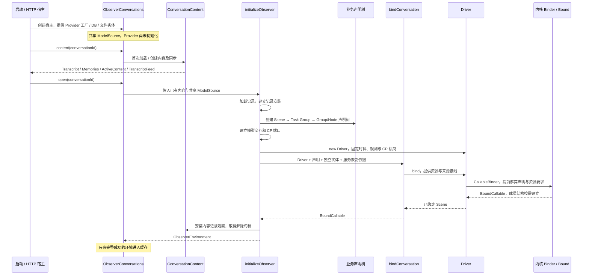
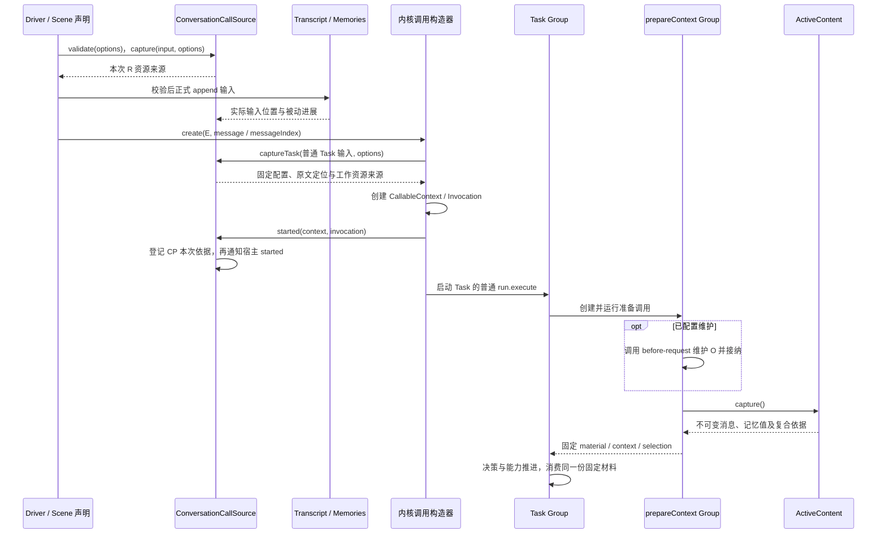

# Observer 服务装配与生命周期

这份说明对应当前代码。服务使用内核的声明、绑定和调用机制；服务自身的职责是建立独立实体、选择业务声明、供应资源、解释进展，并维护内容和环境的存活边界。

## 从哪里开始阅读

| 入口                                                     | 负责什么                                              | 不在这里处理什么                      |
| -------------------------------------------------------- | ----------------------------------------------------- | ------------------------------------- |
| `assembly/conversations.ts`：ObserverConversations       | 服务宿主的对话目录、共享对象与按对话缓存              | 单次业务编排                          |
| `assembly/content.ts`：ConversationContent               | 对话内容、活跃索引、变化消费与内容同步                | Scene/Group/Node 声明与运行           |
| `assembly/initialize.ts`：initializeObserver             | 一次具体环境的建立、接线与失败清理                    | 后续每次提交的状态                    |
| `assembly/environment.ts`：ObserverEnvironment           | 已安装环境的身份、恢复入口与关闭                      | 创建声明树或执行业务路径              |
| `conversation/scene.ts`：ConversationSceneDefinition     | 构造默认业务声明树，声明 Scene 如何调用并接纳 Task    | 实体创建、Provider 初始化             |
| `conversation/binding.ts`：bindConversation              | 通过已有 Driver 绑定声明、资源供给与服务接线          | 创建 Driver、运行时输入接纳和动态编排 |
| `conversation/binding/source.ts`：ConversationCallSource | 按次校验、Scene 资源供给、Task 配置定位捕获和建立回调 | 修改业务决策、消费模型结果            |
| `conversation/task.ts` 与具体 Group/Node 声明            | 材料准备、决策、子能力调用和父层接纳                  | 环境缓存与关闭                        |

`ConversationContent`、`ObserverEnvironment` 是已有生命周期的具名对象。它们不是新的 Scene/Group/Node 层次，也不是通用环境平台。服务只需要一个明确的来源实现，不重复建立一套按种类区分的 Binder 或 InvocationBuilder。

## 装配时序

创建声明和创建 Bound 是两个时机：当前默认业务声明树在环境初始化时一次建立；内核提前解算声明，随后惰性建立实际用到的 BoundCallable。环境分别持有 `driver`、`scene` 和原 `definition`；通过 `driver.run(scene,input,options)` 启动，通过 `driver.isRunning(scene)` 判断占用。每次 QA 不重建声明树，也不在业务声明上保存本次输入、信号或进度。

仅查询消息可以加载内容，而不建立运行环境、恢复记录或初始化 Provider。开启该对话的观测或执行时才调用 `open`。真正发起模型交互时才兑现 Provider。

## 对象的归属与存活

| 对象                                               | 建立时机                                 | 持有与关闭                                       |
| -------------------------------------------------- | ---------------------------------------- | ------------------------------------------------ |
| ModelSource / Provider                             | 宿主创建 Source；模型访问时创建 Provider | 多对话共享 Source，关闭单个环境不销毁它          |
| SQLite / WorkspaceFiles                            | 启动装配                                 | 宿主持有；文件工作区仍可跨对话共享               |
| Transcript / Memories                              | 创建或首次加载对话内容                   | 独立内容实体，不归属于 R                         |
| ActiveContent                                      | 对话内容创建或恢复                       | ConversationContent 持有的索引，无独立身份或关闭 |
| ConversationContent                                | 对话内容装配                             | 宿主拥有内容同步生命周期；单环境可以借用         |
| 声明树、Driver、SelectionUsage                     | 首次装配具体对话环境                     | 环境期复用；SelectionUsage 仍是独立实体          |
| ModelInteractions、记录安装、RecordSource、CP 观测 | 首次装配具体对话环境                     | 环境关闭时解除和关闭                             |
| ConversationCallSource                             | `bindConversation`                       | 绑定期复用，每次 options 有独立捕获槽            |
| Invocation / Context、业务推进 state               | 每次调用                                 | 单次调用和本层状态，不存入可复用声明             |
| Submission 与反馈连接                              | HTTP 受理 / 跟随                         | 服务交付层持有，连接不拥有上述实体               |

`initializeObserver` 独立使用时拥有自己创建的内容；传入 `content` 时只借用它。`shared` 只表达数据库连接由调用方持有。`ObserverConversations` 以借用内容、共享数据库的方式建立每个环境，最终统一关闭内容和数据库。

环境保留具名实体引用，方便宿主装配消费；业务仍只能通过正式资源申请获得本阶段访问。增加 `ConversationContent` 不改变 Transcript、Memories 各自的事实、不变量或持久化端口。

## 单次提交如何经过绑定源

Driver 固定调用机制接入；`ConversationBindingOptions` 保留服务侧 checkpoint 关联与对话身份，绑定从只读 `driver.checkpointStore` 取得实际安装的保存端口，不接受另一份独立配置；`ConversationRunOptions` 是一次运行的配置与进展通道。`ConversationCallSource` 实现根的 CallableCallSource 契约，并把 Task 的 capture/started/output 通过准确 taskDefinition 的显式 binding 接入；本轮只收敛驱动入口，保留这些接线的原有行为，后续单独梳理其作者契约。

Scene 的输入接纳是服务声明中的普通资源动作。Task 使用普通输入；内核不提供层次专属 `entry.accept/admit`。CP 登记使用正式 append 返回的位置、固定定位和真实父子调用身份，不读当前集合长度猜测输入归属。

配置和原文定位在创建 E 时固定，材料在维护之后由准备 O 固定。默认没有维护策略，也没有自动分段、模型历史选择或容量截断；完整材料超限在请求构造时明确失败。可选 `maintenance` 由装配传给普通 O，子声明自行申请资源，绑定解算保留子树供给，见 [活跃材料与维护](active-content.md)。

`binding/progress.ts` 只适配被动进展：消息落实、任务选择、Scene/Group/Node 状态与候选正文各走既有通道。调用进入/退出、子层接纳和消息落实仍由原生产者决定。`started` 是同步建立钩子；被动进展不替代这个时机。

## 恢复的两次核对

宿主 `environment.recover(rootContextId)` 先检查环境开放、无活动工作以及恢复登记。实际进入内核的 `source.validate` 再检查登记身份和当前依据。两者复用 `binding/checkpoint.ts` 的配置、head、内容与凭据核验，保留两个核对时机，避免直接使用 `driver.resume(scene,contextId,options)` 绕过检查。

恢复输入沿用已保存配置、原文定位和已准备的不可变材料，不用当前活跃索引替换旧快照。R 续接不重复 append，不重发旧 Submission 的输入/started/回答通知。当前 Scene/Task 契约分别为 observer.conversation.scene version 4 与 observer.conversation.task version 6，Frame 为 v4；旧 REOA CP 明确拒绝；自定义维护的宿主恢复尚未开放，索引落实也没有固定效果凭据。详细承诺见 [Checkpoint](checkpoints.md)。

## 失败与关闭

- 初始化失败不缓存半成品；释放本次建立的模型交互、CP 观测和记录消费。自己创建的内容关闭，借用内容及其既有观察保留。清理再失败时保留原错误，并附带清理诊断。
- 有活动调用或外部交互时拒绝关闭环境。关闭开始后环境不再由宿主 `open/peek/recover` 返回或使用；本轮不加入自动重建环境的机制。
- 环境关闭解除自己的内容记录观察与 RecordSource 消费，借用的 TranscriptFeed 和 ChangeConsumer 继续工作。正常关闭用独立关闭通知，不制造 `SOURCE_INCOMPLETE`。
- 宿主关闭依次处理所有环境、所有内容和数据库。某次封存或清理失败不会跳过后续清理；最终抛出原错误或聚合诊断。
- 关闭属于服务宿主生命周期，不为内核 Driver 新增关闭状态，也不提供撤销所有已交出的低层对象引用的机制。调用方在环境关闭后不得继续使用保存的运行入口。

本轮统一结构与显式来源绑定，保留材料准备、C/S 接纳、回答和终态语义。后续若要开放环境重新安装、动态声明替换或更细的 Provider 关闭约定，应由实际使用需求推动，不能从这次对象命名推导出这些能力已经成立。
