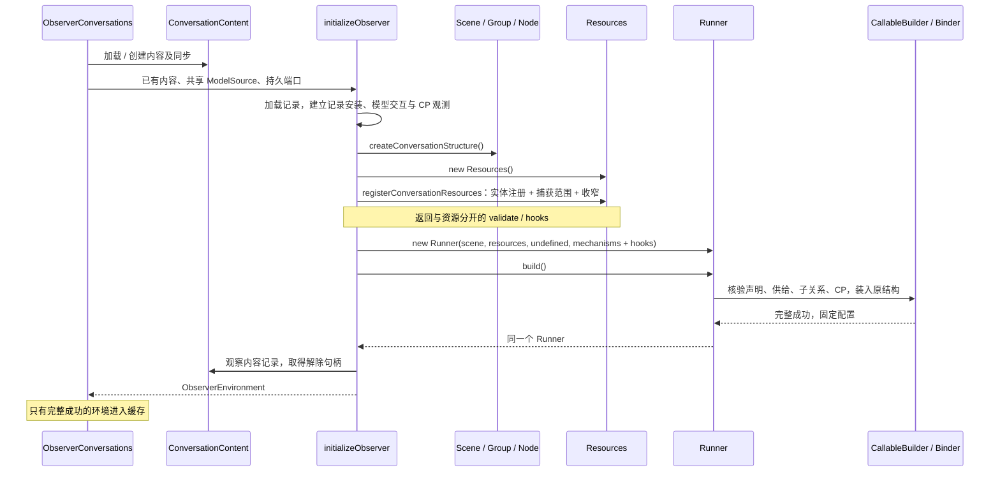
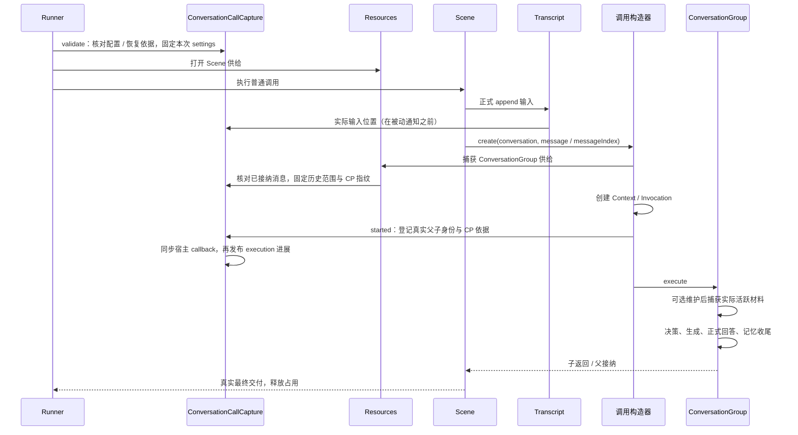

# Observer 服务装配与生命周期

Observer 使用 `Scene + Resources + Runner`。服务负责建立独立实体、组织业务结构、登记资源供给、解释进展，并维护内容和环境的存活边界；内核统一完成调用、访问窗口、接纳和恢复。

## 从哪里开始阅读

| 入口                                                       | 负责什么                                     | 不在这里处理什么          |
| ---------------------------------------------------------- | -------------------------------------------- | ------------------------- |
| `assembly/conversations.ts`：ObserverConversations         | 对话目录、共享对象与按对话缓存               | 单次业务编排              |
| `assembly/content.ts`：ConversationContent                 | 对话内容、活跃索引、变化消费与内容同步       | 结构与运行                |
| `assembly/initialize.ts`：initializeObserver               | 建立实体、Resources、Runner，失败清理        | 后续每次提交状态          |
| `assembly/environment.ts`：ObserverEnvironment             | 已安装环境、恢复入口与关闭                   | 创建结构或业务路径        |
| `conversation/scene.ts`：ConversationScene                 | 接纳输入，调用 ConversationGroup             | 实体创建、Provider 初始化 |
| `conversation/binding.ts`：registerConversationResources   | 固定实体注册、明确的捕获范围、独立调用 hooks | 创建 Runner、启动调用     |
| `conversation/binding/capture.ts`：ConversationCallCapture | 配置核对、正式输入定位与 CP 登记的关联       | 通用资源供给或模型发送    |
| `conversation/conversation.ts` 与具体 Group/Node           | 材料准备、决策、子能力调用与接纳             | 环境缓存与关闭            |

`ConversationContent`、`ObserverEnvironment` 持有已有生命周期。`ConversationCallCapture` 只是服务按次依据的关联对象，不是内核 Source 接口，不负责资源解析。

## 装配时序



实际装配代码的主线是：

```ts
const structure = createConversationStructure(configuration);
const resources = new Resources<ConversationRunOptions>();
const calls = registerConversationResources(resources, structure, entities, modelInteractions, {
  conversationId,
  checkpointRuns,
  checkpoints,
});
const runner = new Runner(structure.scene, resources, undefined, {
  ...calls,
  clock,
  observations: [recording],
  changes,
  checkpoints: { store: checkpoints, observation },
}).build();
await runner.run(input, options);
```

ModelInteractions 作为普通资源注册。它负责模型 SSE、固定请求校验、Provider 总超时及按 ID 观测，暂未替换为通用 Interactions；这里不需要建立空交互注册表。两种形式都遵守调用与交互独立存活的规则。

结构通过构造器、setDefinition、setRun 与 add 组成。build 完整成功后固定整树配置，失败不发布半成品；不产生平行 Bound 树。`environment.scene`、`environment.structure.scene`、`environment.runner.scene` 是同一个原结构。每次提交只需 `runner.run(input, options)`，不重复传场景。Resources 与 Runner 不取得外部实体的关闭所有权。

自定义 decision 使用工厂按对话创建；before-request 与 after-content 维护各有独立结构。共享处理函数与实体，不能跨父共享节点，也不能把本次端点存入共享字段。

仅查询消息可以加载内容，不建立运行环境或初始化 Provider。开启观测或执行时才装配环境；真正发送模型请求时才兑现 Provider。

## 资源怎样登记

| 供给                                                      | 登记位置                             | 按次行为                             |
| --------------------------------------------------------- | ------------------------------------ | ------------------------------------ |
| 活跃内容、记忆写入、分段、使用计数、模型 create/read      | `resources.register`                 | 同一实体，每个调用获得自己的受控端点 |
| 正式输入追加与其进展                                      | `resources.capture(scene, …)`        | 关联本次实际追加位置                 |
| 固定历史范围、模型配置、记忆快照、回答追加、任务/文件进展 | `resources.capture(conversation, …)` | 输入已落实后捕获一次；子树继承       |
| 文件路径收窄                                              | `resources.refine(document/save, …)` | 从准确子输入选择，资源自身拒绝扩大   |
| 必要建立登记、活动进展、回答增量                          | 独立 `callableHooks`                 | 不作为资源选择器的副作用             |

装配时固定实体引用与恢复端口；调用方替换原配置容器的字段不会改变已装配来源。实体本身仍可正常变更。固定供给与局部捕获只影响已登记的 offer，父 Work 不因子树需要而得到额外资源。

## 单次输入、配置与建立事实



Runner 浅复制并固定本次 options。服务在根校验时复制模型配置；本次模型请求与 CP 登记共用该配置，不在后续阶段重新读取调用方可变对象。后续提交可以接纳新配置。配置快照不等于模型材料快照：实际材料仍在准备 Group 的可选维护之后捕获。

输入已正式追加而对话 Group 尚未建立时失败，保留内容及 Scene 的事实，不伪造 Group。CP 登记依据正式 append 返回的位置与准确调用身份，不从当前集合长度猜归属。

started 在 Context 建立后、开始事实前同步执行，必须返回 undefined。意外异步或非空返回被拒绝，迟到 Promise 拒绝被消费；不承诺撤销已发生的副作用。服务宿主回调不再以 ConversationTaskResources 声称某阶段资源，但仍接收真实 Context/Invocation 供必要身份关联。业务 execute 仍只接收 Work。

## 对象的归属与存活

| 对象                                                  | 建立时机                                     | 持有与关闭                                   |
| ----------------------------------------------------- | -------------------------------------------- | -------------------------------------------- |
| ModelSource / Provider                                | 宿主建立 Source；真正模型访问时建立 Provider | 多对话共享，单环境不销毁                     |
| SQLite / WorkspaceFiles                               | 启动装配                                     | 宿主持有；文件工作区可共享                   |
| Transcript / Memories / ActiveContent                 | 内容加载或创建                               | ConversationContent 持有，活跃索引无独立身份 |
| Scene / Resources / Runner / SelectionUsage           | 具体对话环境建立                             | 环境期复用                                   |
| ModelInteractions / 记录安装 / RecordSource / CP 观测 | 具体环境建立                                 | 环境关闭时解除和关闭                         |
| ConversationCallCapture                               | 资源与 hooks 注册时                          | 每次固定 options 对应独立 WeakMap 槽         |
| Invocation / Context / Work                           | 每次调用与阶段                               | 单次状态，不存入结构                         |
| Submission / 反馈连接                                 | HTTP 受理与跟随                              | 服务交付层持有，连接不拥有运行               |

`initializeObserver` 关闭自己创建的内容，传入 content 则仅借用；shared 表达持久连接由宿主持有。ObserverConversations 最后统一关闭所有内容与数据库。

## 恢复核对与失败关闭

`environment.recover(rootContextId)` 先检查环境开放、没有当前调用和恢复登记；Runner 的 validate 再核对准确登记、内容、配置、CP 保存依据。两处复用 `binding/checkpoint.ts`。装配为服务校验与内核 CP 注入同一个 checkpoints 端口，直接调用 runner.resume 也经过校验。

恢复沿用原配置、原文定位与保存的材料，不重复 append，不重新登记旧调用，不复播旧 Submission 通知。恢复中新建调用照常登记。Scene / ConversationGroup 的 CP version 仍为 4 / 6，Frame v4；本次不改变成员位置或扩张恢复承诺。详见 [Checkpoint](checkpoints.md)。

- 初始化失败清理本次观察、模型交互、CP 观测及自有内容；借用内容保留。清理故障不掩盖原错误。
- 调用或外部交互仍在途时拒绝关闭。Runner 空闲与 ModelInteractions settled 分开判断。
- 关闭环境解除自身内容观察与 RecordSource；借用内容同步继续工作。正常关闭不制造 SOURCE_INCOMPLETE。
- 清理逐项耗尽后报告错误；不自动重建环境。宿主不能在环境关闭后继续使用先前取得的运行入口。

Observer 生产装配已不再使用 Driver、ConversationCallSource 或 provider 数组；低层历史构造兼容路径仍由独立内核测试覆盖，后续删除不需要再次改动服务运行链。
