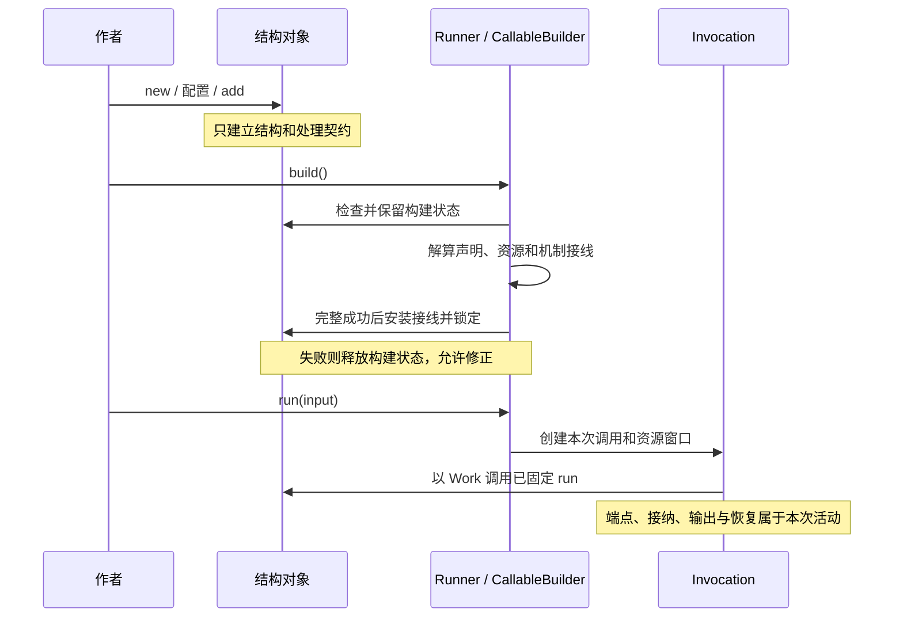

# 结构包：配置、组合与运行端口契约

状态：2026-10-25。`@capix/structure` 位于 `server/structure`，沿用已经确定的 Scene / Group / Node 模型。分包明确结构与执行的归属，保留原对象身份、作者写法和运行语义。

作者先构造结构、配置处理函数和申请资源，再通过 Runner 完成装配与运行。结构包可以独立用于构造和检查结构；它不会在构造、add 或声明恢复点时执行处理函数。

## 结构、契约与运行

| 归属                    | 主要内容                                                                                                    |
| ----------------------- | ----------------------------------------------------------------------------------------------------------- |
| `@capix/structure`      | Callable/Scene/Group/Node、成员与名字、配置状态、具体 CallableWork/ResumeWork 组合、point 配置和 Group 预设 |
| `@capix/contracts`      | I/O/Delta 签名、Work 基础切面、子调用／输出端口、统一操作接收、CP 编码和认证事实                            |
| `@capix/server-runtime` | 解算接线、构造 Invocation、签发和关闭窗口、落实父子接纳、保存与恢复 CP                                      |

Work 是业务取得的操作接口。结构根据 kind、资源申请和成员组合准确类型，Runtime 在本次活动中兑现端点；共同契约不依赖任一实现。

结构包只依赖 contracts/resources，不依赖 Runtime 或 protocol。资源申请沿用资源包的单一身份，资源方法与子调用的 result/delta 接收共享 contracts 中的形状；`@capix/resources/operation` 继续提供接收实现和同源类型出口。包依赖、类型晋级和协议维护规则见 [契约与协议](contracts-protocol.md)。

## 最小例子

```js
import { Resource, ResourceOffer } from '@capix/resources';
import { Scene, Node } from '@capix/structure';
import { Resources, Runner } from '@capix/server-runtime';

const dictionary = new ResourceOffer({
  methods: {
    translate(origin, word) {
      return origin.get(word) ?? word;
    },
  },
});
const translate = new Node({
  deps: { dictionary: dictionary.request() },
  run: (work) => work.resources.dictionary.translate(work.input),
});
const scene = new Scene(translate);
const resources = new Resources();
resources.register(new Resource(new Map([['hello', '你好']])), dictionary);
const runner = new Runner(scene, resources).build();
await runner.run('hello');
```

Runtime 根入口仍重导相同的 Scene、Group、Node 和作者契约。之前从 `@capix/server-runtime` 导入这些对象的例子仍然成立；新包不建立第二套类、声明树或 Bound 树。可执行例子见 [dictionary.mjs](../examples/dictionary.mjs)。

## 单子委托与输入转换

`new Scene(child)` 明确指定一个 Group/Node，自动登记该原对象并配置普通 `children.invoke(child, work.input)`。Scene 的 I/O 从子结构推导，交付孩子的稳定结果，不承诺作者原对象身份；后续 add 只登记成员，不改变委托目标。它不会根据成员数量猜执行顺序，也不继承子层 deps、Delta 或 checkpoint。需要编排时可在 build 前配置同签名 run，流式转发和恢复点仍由作者明确声明。

```ts
const processing = new Sequence([read, translate, save]);
const scene = new Scene(processing);
const runner = new Runner(scene, resources).build();
```

单个已知子结构（包括 Sequence / Dynamic）直接推导 I/O。若变量本身是同输入、异输出的结构联合，当前 TypeScript 构造推导可能只采用其中一支，可显式写 `new Scene<string, number | boolean>(child)`；不加入另一组结构泛型或类型断言来掩盖该边界。不同输入的未收窄联合不能直接委托，需先明确选中哪一支。

这只是结构构造便利，不增加运行分支。父调用、子调用、父接纳、失败和观测沿用正常机制。普通配置构造 `new Scene({run, deps, output, checkpoint})` 保持可用。

旧 `InvocationEntry`、`defineChildEntry`、`ChildEntry*` 和 `children.entry` 已删除。它们没有独立生命周期，唯一工作是先转换输入再创建子调用；转换现在是普通业务函数：

```ts
const input = toChildInput(work.input, work.children.facts);
return work.children.invoke(child, input);
```

普通转换函数没有内核端点的活动窗口承诺；它不应被当作受控资源操作。`create/invoke` 仍在创建调用前检查活动窗口、成员身份与权限。需要副作用的转换经资源方法或子节点执行。取消不会阻止 JavaScript 本地计算，但会拒绝之后的受控操作。`entry` 不再是保留端口名，可用作普通成员别名。

## 类型为什么保留

判断依据是类型承载的约束、关联和推导，不是它是否只有一行。

| 类型                                               | 保留理由                                                                        |
| -------------------------------------------------- | ------------------------------------------------------------------------------- |
| CallableContract / InvocationSignature             | 保存同一对象的 I/O/Delta 关联，输入不变关系防止用错误输入调用；不复制结构       |
| ChildCallable / ChildrenOf                         | 注册需要完整结构，按 kind 排除 Scene 子节点和 Node 成员                         |
| ChildContract / ChildContractsOf                   | 调用与认证事实只需要签名，不强迫运行包依赖结构实现                              |
| SceneDefinition / GroupDefinition / NodeDefinition | 固定 kind 的配置签名，避免作者在每处重复 kind 泛型；没有另一份声明实体          |
| CallableWork / ResumeWork 与具体 Work 别名         | 区分普通执行与恢复权限，关联资源、成员及 Delta；为独立业务函数提供可读类型      |
| NamedMemberRegistration / NamedWork                | add 后在同一结构上得到具名端口，同时保持准确成员类型                            |
| checkpoint point / refs / reception 类型           | 关联所属 I/O、state、直接子与接纳值，不允许用未认证事实恢复                     |
| DefinitionFactory                                  | 先确定 I/O，再从配置推导 deps、成员和 Delta；也承接 withDependencies 的公共申请 |

`CallableMembers` 只重复结构已有成员约束且没有生产消费者，已删除；实际约束由 Composite、Node.members、ChildCallable 和 add 保留。MemberNamesOf、NamedChildOperation(s) 以及 DefinitionFactory 作为推导内部类型保留，不再单独导出。

`defineNode/defineGroup/defineScene` 是可选的类型推导便利，结果仍是普通结构。现有构造器显式给出 I/O 泛型后，不能再自动补齐未指定的资源/Delta 泛型；因此本轮保留工厂及其必要类型，而不把类型断言或手写资源泛型的成本转给作者。工厂配置与构造器配置的差别来自该推导职责，不代表不同运行模型。

## 构建接缝



`@capix/structure/construction` 给装配者提供结构检查、配置的 begin/end/lock、父归属、childKinds 和依赖收集。它不负责打开资源、创建调用或提供新 Runner。

`CallableBuilder` 与 `CallableConstruction` 保留在 Runtime 的 `structure/`。前者组合 Binder、WorkBinding 和 InvocationBuilder；后者保存固定接线并安装到原结构。成功构建后拒绝配置改写、add 和再次构建；业务 receiver 与闭包不被深度冻结，单次状态也不存入结构字段。

## 保留的关联

- 注册使用真实结构对象，调用签名保留 Input、Output、Delta；名字只提供访问方式。
- ordinary run 可以调用已登记成员，Node 不带成员；Scene 不能成为成员。
- CP 的 state/refs/reception 保留所属点、直接子及值类型关联；refs/facts 不额外授予 resume 行动权限。
- 构建、调用、资源窗口、交付和 CP 保存仍有各自边界。分包不改变返回与父接纳的区别，也不扩大恢复承诺。

包接缝的验证入口是 `test/structure-package.test.mjs` 与 `test/types/structure-package.ts`；现有结构、调用、操作接收和 CP 回归继续覆盖运行行为。

## Sequence 与 Dynamic：一次构造的 Group 预设

两种预设都直接是普通 Group，使用现有成员注册和子调用端口，不增加 kind、专用 Invocation 或 Runner 分支。构造时固定推进配置：Sequence 接受完整步骤数组，Dynamic 接受候选、决策和步数限制。两者都没有逐项变更推进逻辑的方法，不需要额外 `.group()` 或另一份运行对象。资源接线和通常的结构配置仍在 Runner.build 时固定。

| 预设     | 构造输入                                                                   | 整体 I/O                                  |
| -------- | -------------------------------------------------------------------------- | ----------------------------------------- |
| Sequence | `new Sequence([node, {node, input?, result?, delta?, key?}, …], options?)` | 首步输入／适配器的外部输入 → 末步接收结果 |
| Dynamic  | `new Dynamic({options: {name: node}, decide: node, maxSteps?})`            | 决策节点输入 → 决策交付的 finish.value    |

### Sequence

没有适配器时，数组直接推导完整管道：

```ts
const counting = new Sequence([read, count]);
// read: Node<Path, string>，count: Node<string, number>
// counting: Group<Path, number>
```

需要适配时仍使用普通对象配置：

```ts
type Request = { source: string; destination: string };
const readStep = {
  node: read,
  input: ({ input }) => input.source,
} satisfies SequenceStep<typeof read, Request>;

const saveStep = {
  node: save,
  input: ({ input, previous }) => ({
    path: input.destination,
    text: previous,
  }),
} satisfies SequenceStep<typeof save, Request, string>;

const processing = new Sequence([readStep, translate, saveStep]);
```

`SequenceStep<Member, Input, Previous, Delta>` 是配置的类型辅助，不创建另一种运行实体。`satisfies` 为回调提供上下文类型，同时保留实际返回类型。也可直接标注内联适配器参数，例如 `input: ({input}: {input: Request}) => input.source`。

数组中的跨步回调存在推导依赖，当前不承诺任意内联回调都能免标注推导。实现先取得准确元组，再检查整条链；复杂步骤使用上述标注或已类型化函数，避免以 any 隐藏关联。宽数组丢失位置，构造时拒绝；从变量传入时使用保留元组的声明（如 `as const`）。该声明只保留静态顺序，真正的运行配置快照由构造器建立。

`input` 总是本次 Sequence 的固定输入；`previous` 是前一步接收后的稳定值，第一步则是本次输入。未写适配器时直接使用 previous；即使包装成 `{node}` 也必须满足相邻输入。`result.succeeded/failed` 的实际异步返回类型参与后续检查，可选接收必须保留未处理时的默认成功值。整体返回最后的接收结果。`new Sequence([])` 交付本次已固定输入，静态 I/O 为 unknown；不承诺作者原对象身份，需要明确的恒等签名时配置一个有类型的恒等节点。

完整数组在构造时复制并固定步骤顺序、成员和回调入口；后续改原数组、替换 input/result/delta 函数不会改变管道。保留回调 receiver 与闭包，不深度冻结业务数据。构造先核验全部配置，再一次登记成员；失败不留下前半批成员归属。重复成员只注册一次，每次执行仍创建新的调用。所有变量引用同一条固定管道，删除了可变 `.step()` 所造成的旧输出类型失效问题。

步骤失败默认停止；明确处理的业务失败可以继续。接收回调失败不会重入同一 failed，取消、捕获、CP 和强制观测故障不能被 fallback 掩盖。增量需要明确接收和转发：

```ts
const forward = {
  node: streaming,
  delta: (value, scope) => scope.output.emit(value),
} satisfies SequenceStep<typeof streaming, string, string, string>;
const processing = new Sequence([forward], {
  output: { result: String, delta: String },
});
```

非 never 的本层 Delta 必须在构造时提供 output.delta；预设固定本层 output 契约，不能随后删掉它而留下已声明的 writer 类型。没有本层 Delta 声明时，步骤不能假装取得输出 writer。预设不自动拼接或转发子输出。

### Dynamic

```ts
const options = { read, translate, save };
const decide = defineNode<Request, DynamicDecision<typeof options, Answer>>()({
  deps: decisionDeps,
  run: decideNext,
});
const processing = new Dynamic({ options, decide, maxSteps: 8 });
// Group<Request, Answer>，无需重复给 Dynamic 指定 I/O。
```

决策节点可先独立建立，返回普通判别对象，不再引用 `dynamic.decisions`：

```ts
type Decision = { kind: 'call'; option: 'read'; input: ReadInput } | { kind: 'call'; option: 'translate'; input: TranslateInput } | { kind: 'call'; option: 'save'; input: SaveInput } | { kind: 'finish'; value: Answer };
```

构造静态检查候选名和输入配对，整体输入来自决策节点，整体输出来自 finish 的值；多个 finish 值构成联合。没有 finish 的声明没有成功输出（never），运行仍受步数上限约束。候选成员与决策一次登记；候选名属于 Dynamic 选择契约，不自动形成 Group.names 或另一个 Work 端口。决策不会自动成为候选，需调用它时必须明确列入 options。

构造复制候选映射、决策引用和 maxSteps，外部修改原配置不改变行为；run 和 maxSteps 只读。maxSteps 默认 8，限制实际候选动作数；N 个动作后仍可再决策一次 finish，不能发出第 N+1 个动作。0 允许只决策结束。失败不会自动重试。

每次决策接收本次 Dynamic 的原始 input，历史、模型、记忆和流程材料都走普通 deps。候选结果按正常规则接纳，预设不自动维护 last/history 或写共享材料。来自模型的决定仍需业务输出契约校验输入内容；构造时的静态类型和运行时候选核验不能替代外部数据解析。

可执行的无外部模型示例见 [presets.mjs](../examples/presets.mjs)。旧链式 Sequence / Dynamic API 已移除。

## 公共 deps 与流程材料

```ts
const common = withDependencies({ flow: flowOffer.request() });
const translate = common.node<string, string>()({
  deps: { model: modelOffer.request() },
  async run(work) {
    const text = await work.resources.model.translate(work.input);
    await work.resources.flow.write(text);
    return text;
  },
});
```

`withDependencies` 复用 defineNode/Group/Scene 的配置推导，为随后创建的结构合并公共申请；`.node<I,O>()`、`.group<I,O>()`、`.scene<I,O>()` 返回相同的配置工厂。公共和局部别名冲突在类型与运行时均拒绝，不自动覆盖。它不修改既有节点，也不注册实体、捕获材料或给 CP resume 增加申请。

供给仍显式使用普通资源装配：

```ts
resources.capture(processing, () => ({ value: undefined })).register(flowOffer, (state) => state);
```

每次 processing 调用建立独立材料；本层与后代通过各自的受控端点访问它。嵌套 capture 只覆盖本地登记的 offer，其他资源继续继承。一个结构仅有一个 capture scope，需要其他按次数据时在同一个捕获结果中组合。公共 deps 是申请，capture/register 是兑现，两者不混成隐式注入。

中间资源写入不等于父层已接纳，失败不会自动回滚效果；材料不替代 Invocation 的关系或已接纳事实。当前预设提供普通运行，不自动声明恢复点。要支持恢复，仍需明确等待／接纳边界及材料保存、核验和重建；不能恢复到空材料后猜测进度或重发效果。

## 验证

`test/presets*.test.mjs` 覆盖步骤与决策推进、真实父子调用、失败处理、窗口和类型关联；`test/common-dependencies.test.mjs` 覆盖公共与局部 deps、并发调用材料隔离、嵌套供给及端点失效。类型测试既检查合法程序，也去掉 `@ts-expect-error` 确认非法程序被拒绝。既有调用和 CP 回归验证分包没有改变运行语义。
