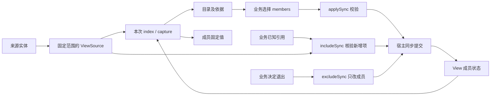

# View：来源目录、成员与固定读取

`@weiliang0121/capix-view` 提供通用 View。它保存来源身份与当前成员，按来源契约取得目录和固定值；不持有消息、记忆或模型，也不决定材料应怎样选择。

包依赖 packages/contracts、resources 与 diagnostics；diagnostics 仅提供必要持久端口的统一错误身份，不引入调用、Runtime 或业务实体依赖。

Observer 的 `ActiveView` 已移入 Lab 的 `@capix/observer-content`。它用 View 处理消息与记忆，同时保留“新内容默认纳入、退出后不因更新重新纳入”的业务策略。两者不是两个内容副本。

完整可运行例子见 [examples/view.mjs](../examples/view.mjs)，自定义静态来源见 [examples/view/skills.mjs](../examples/view/skills.mjs)。运行 `pnpm build && node examples/view.mjs`，可以看到消息、记忆、Skill 材料通过资源进入节点，以及后处理调整成员后两次捕获的差异。例子全部使用内存数据，Skill 作为材料读取，具体怎样组织模型输入仍由业务节点决定。

已知引用的策略示例见 [examples/view-membership.mjs](../examples/view-membership.mjs)。普通 Node 通过 `include/exclude` 纳入刚落实的消息、移除业务指定的旧消息，不先读取全部材料；同一决定重复执行不增加修订。两个操作分别提交，不把消息写入或两个成员操作声称为共同事务。

## 对象与关系

| 对象                              | 持有什么                                                  | 谁负责                              |
| --------------------------------- | --------------------------------------------------------- | ----------------------------------- |
| 来源实体                          | 正文、来源自己的身份与修订                                | Transcript、Memories 或其他宿主实体 |
| `ViewSource<Key, Summary, Value>` | 某个固定来源范围的读取方式                                | 来源适配器或受控资源端点            |
| `ViewState<Sources>`              | `revision`、来源 `{id, scope}`、有序 `{source, key}` 成员 | View                                |
| `ViewIndex<Sources>`              | 当前成员的摘要目录及读取依据                              | 一次视图目录读取的冻结结果          |
| `ViewSnapshot<Sources>`           | 当前成员的实际值及读取依据                                | 一次捕获的冻结结果                  |
| `ViewPersistence<Sources>`        | 同步校验并提交一次成员变更的方法                          | 宿主安装，不由 View 拥有            |



View 不保存 sources 参数、来源端点、ResourceActivity 或持久端口。需要读取或核验来源的操作显式传入 sources；查询本地成员和排除成员不需要来源。宿主可以长期持有 View；一次调用结束不删除成员状态，也不延长已关闭端点的访问权限。

View 的生命周期是“从成员状态构造 → 查询、读取或变更 → 导出成员状态”。构造时核验状态格式，不访问来源，也不承诺保存过的成员现在仍然存在。`exportState()` 返回冻结的成员状态，不执行持久化。View 没有 `start`、`close` 或后台同步；资源端点的打开与关闭属于本次访问窗口，已经取得的固定快照不依赖窗口继续存活。

View 没有独立 UUID；成员中的 `source` 是局部槽位名。槽位固定映射到来源的 `{id, scope}`，来源身份不能用展示名称替代。不同槽位的 key 类型独立，不能把记忆字符串 ID 当成消息数字索引。

`Sources` 类型用于关联每个槽位的 key、summary 与 value。实际访问参数采用 `SourceBindings<Sources>` / `SyncSourceBindings<Sources>`，只要求兑现对应读取契约；不要求端点持有具体适配器类的内部字段。来源对象可以封装成受控端点后再传入，类型关联仍然保留。

## 来源契约

```ts
interface SourceStamp {
  readonly id: string;
  readonly scope: string;
  readonly version: string;
}

interface ViewSource<Key extends string | number, Summary, Value> {
  // 发现候选：返回固定范围内的完整目录。
  index(): Awaitable<{
    readonly stamp: SourceStamp;
    readonly entries: readonly { readonly key: Key; readonly summary: Summary }[];
  }>;
  // 核验已知引用：恰好返回所请求 keys 的摘要，不能用完整目录代替。
  inspect(keys: readonly Key[]): Awaitable<SourceInspection<Key, Summary>>;
  read(
    keys: readonly Key[],
    expected: SourceStamp,
  ): Awaitable<{
    readonly stamp: SourceStamp;
    readonly entries: readonly { readonly key: Key; readonly value: Value }[];
  }>;
  check(expected: SourceStamp): Awaitable<boolean>;
}

interface SourceInspection<Key extends string | number, Summary> {
  readonly stamp: SourceStamp;
  readonly entries: readonly { readonly key: Key; readonly summary: Summary }[];
}
```

- `id` 是来源实体身份；`scope` 是当前端点允许读取的准确范围。端点不能拿另一范围的目录来满足已固定范围，即使实体 ID 相同。
- `version` 由来源解释，必须覆盖目录成员和实际值的变化，变化后不能复用旧版本。View 只比较版本，不推断时间、大小或序号的业务含义。
- `index` 返回该范围的完整目录，不接受“这一页就是全部”的分页结果。summary 是来源选择的说明值，不是按 key 延迟读取的句柄。
- `inspect` 在同一来源版本下核验所请求 key 的范围与存在性，并恰好返回这些 key 的摘要。缺项、多项、重复项或越界都不能算成功。`inspect([])` 返回空 entries 和当前 stamp，用于取得没有选中成员的来源依据；它不读取完整目录。`index` 与 `inspect` 分别承担发现和已知引用核验，不改变彼此的完整性含义。
- `read` 必须把 expected 的核验与实际取值放在同一个来源读取边界内；key 缺失、越界或版本变化都明确失败，不能省略某个结果后假装成功。
- `check` 检查依据仍有效，不刷新调用方的旧版本，也不自动重试。

`SyncViewSource` 是相同契约的同步形式，四个方法均直接返回。同步方法收到 Promise 或其他异步结果必须拒绝，不能把未完成的读取当成数据。

现有适配器由对应实体包提供：

```ts
const messages = new TranscriptViewSource(transcript);
const memories = new MemoryViewSource(memoryCollection);

// 可显式限定为固定、有序的 key 子集。
const selectedMessages = new TranscriptViewSource(transcript, [4, 1]);
```

无 keys 时 scope 为 `whole`；固定子集的 scope 包含准确 key 顺序。Transcript 的版本来自 revision，Memory 来源的版本来自集合 sequence。消息 summary 只含 role，记忆 summary 只含 topic；真正正文在 read 时取得。适配器固定范围，不因后续实体增长扩大原来的 keys 子集。

## 从成员到材料

```ts
import { View } from '@weiliang0121/capix-view';
import { TranscriptViewSource } from '@weiliang0121/capix-transcript';
import { MemoryViewSource } from '@weiliang0121/capix-memory';

const sources = {
  messages: new TranscriptViewSource(transcript),
  memories: new MemoryViewSource(memories),
};
const view = new View<typeof sources>({
  revision: 0,
  sources: {
    messages: { id: sources.messages.id, scope: sources.messages.scope },
    memories: { id: sources.memories.id, scope: sources.memories.scope },
  },
  members: [{ source: 'messages', key: 0 }],
});

const index = view.indexSync(sources);
const snapshot = view.captureSync(sources, index);
// snapshot.entries 是已固定值；以后源变化不会改变这份材料。
```

`view.index()` 按来源收集当前成员的 key，通过 `inspect(keys)` 核验并取得摘要，再按成员顺序形成 `ViewIndex.entries`。没有成员的来源使用 `inspect([])` 取得 stamp；所有固定来源仍进入完整 basis。View 不为此读取来源的完整目录，也不借读取视图放宽到全部来源候选。capture 也只读取当前成员，并保持其声明顺序。

业务若要增加成员，应通过另行取得的来源目录或已经知道的准确 key 形成选择；`includeSync` 可直接纳入这些引用，`applySync` 则用读取依据提交完整成员选择。两者都核验新增 key 的固定来源范围。View 的目录不包含正文，不自动发现新业务材料，也不让来源全部目录项成为活跃成员。

basis 组合 `viewRevision` 和每个来源的 stamp。成员未变但记忆更新时，viewRevision 可以不变，来源 version 仍会使旧依据失效。传入旧 index 不会让 capture 静默切换到最新值；目录、读取结果与收尾核验必须一致。

成员引用只接收 `{source, key}`，来源依据只接收 `{id, scope, version}`。这些固定格式拒绝额外字段，避免正文混入成员保存或版本依据。它们描述读取依据，不代替来源端点的范围检查。

读取结果只接受被动数据。活对象、访问器、代理、函数和循环不能进入固定快照；普通可变数据复制并冻结，已经通过校验且深冻结的值可以保留引用。它不是随时重新读取来源的惰性材料。

这些检查提供的是来源版本上的一致读取，不是跨数据库事务，也不证明多个外部系统在某个物理时刻共同一致。来源必须兑现自己的版本与读取契约；外部系统无法提供这个边界时，适配器不能伪造成功保证。

## 同步变更成员

成员操作表达业务决定，来源契约证明本次操作所需的事实。策略节点不用为了“纳入一个已知引用”先获取所有成员再构造替换数组。

| 操作                                          | 作用                                         | 来源访问                        |
| --------------------------------------------- | -------------------------------------------- | ------------------------------- |
| `has(ref)`                                    | 判断本地成员是否包含准确引用                 | 无                              |
| `members()`                                   | 取得当前有序、冻结的成员引用                 | 无                              |
| `includeSync(sources, refs, persistence?)`    | 保留已有位置，按 refs 首次出现顺序追加新成员 | 只核验实际新增项及其来源        |
| `excludeSync(refs, persistence?)`             | 删除命中的成员，保留其他成员的顺序           | 无                              |
| `applySync(sources, selection, persistence?)` | 依据旧 basis 完整替换成员，可重排            | 核验全部来源与 selection 的成员 |

```ts
const latest = { source: 'messages', key: 1 } as const;
view.has(latest); // 只问是否纳入，不证明消息仍存在或来源可用。
view.members(); // 只返回引用，不读取正文或摘要。

view.includeSync(sources, [latest], persistence);
view.excludeSync([{ source: 'messages', key: 0 }], persistence);

// 策略基于一份目录进行筛选、重排时，仍提交原来的依据。
const index = view.indexSync(sources);
view.applySync(sources, { basis: index.basis, members: [latest] }, persistence);
```

`includeSync` 对请求引用去重，已有成员保持原位置且不重新读取来源。例如当前为 `[a, b]`，纳入 `[b, c, c, a, d]` 得到 `[a, b, c, d]`。只核验 c、d；它不证明原有 a、b 仍可读取。后续 index/capture 会核验真正需要读取的成员。

`excludeSync` 同样对请求去重，不存在的成员是无变化。它不调用来源，因此来源不可用或条目已经删除时，仍可以移除相应成员。查询与这两类变更均拒绝未知 source 槽位、非法 key 或额外引用字段；无变化不是绕过输入校验的理由。

`applySync` 保持完整选择语义：成员不能重复，旧 viewRevision 和全部来源依据必须有效。即使选择恰好等于当前成员，也先核验 basis，不能以“无需更新”为由接受过期策略决定。include/exclude 是基于当前成员的直接操作；不能用它们或新取得的 basis 冒充旧快照决策仍然有效。

三种变更均整批处理，一次有变化的操作只产生一个修订和一次 commit。先校验、构造下一状态，再让宿主同步提交，成功后才安装；不逐项安装部分结果。无变化不增加 revision，也不调用 commit。变更期间拒绝重入变更；提交失败不修改当前成员，返回 Promise 或其他非 undefined 值不算同步成功。

View 在实际 commit 及其同步返回检查处使用 `@weiliang0121/capix-diagnostics` 的唯一 `PersistenceError` 标记失败，operation 为 `view.commit`，已有该类错误保持原身份。父层或资源 `result.failed` 不能将必要持久错误接收为业务备用成功；前置的成员／来源／依据拒绝保持普通操作异常，不被此包装扩大。持久端口内部的 CAS 拒绝同样按必要端口错误处理，不从错误文字推断可恢复性。此分类不证明存储未提交；确认丢失时保持本地未安装、外部需核验、不自动重试。

### 持久提交的核验依据

```ts
const persistence = {
  commit({ previous, state, checkedSources }) {
    store.commitView({ previous, state, checkedSources });
    // 比较已保存修订与 previous.revision，再同步保存 state。
    // checkedSources 只列出此次操作实际核验过的来源。
    // 必须同步完成并返回 undefined。
  },
};
```

`ViewCommit` 使用 `{previous, state, checkedSources}`。`previous.revision` 是宿主持久提交的比较依据；`checkedSources` 是来源 stamp 的部分映射，其范围取决于操作：include 为实际新增项涉及的来源，exclude 为空，apply 为全部固定来源。未列出的来源没有被本次操作核验，不能补齐一个看似完整的 basis。`previous` 和 `state` 仍保存完整成员状态与固定来源身份。

宿主负责把必要的来源核验和持久写入放进自己的事务。View 不替多个外部存储组织事务，也不在“持久成功之后又发现外部源变化”时伪装成已经回滚。持久端口已产生外部效果后再失败，外部结果可能需要宿主核对；View 不自动重试、不声称撤销，也不把源内容写入与成员提交合并成一个原子效果。

View 不保留持久端口；应用应在宿主或受控管理端点中固定它，不把“是否持久”变成普通业务每次写入时的随意选择。直接使用没有持久端口的成员变更是内存变更，不能称为已经保存。

## 资源窗口中的使用

ViewSource 可以来自资源端点。资源适配层在本次 ResourceActivity 下组合 View 与 sources，业务取得成员查询、目录、捕获或管理操作；关闭窗口后，已有端点不能继续读写，包括不访问来源的 has/members/exclude 和无变化操作。来源与 View 是不同责任：来源限制可读取的世界，View 在既定来源范围内选择成员。

| 辅助函数                                                     | 打开的端点                                                                                                         |
| ------------------------------------------------------------ | ------------------------------------------------------------------------------------------------------------------ |
| `openView(view, sources, activity)`                          | 同步 `has(ref)`、`members()`，异步 `index()` 和 `capture(index?)`                                                  |
| `openViewManager(view, syncSources, activity, persistence?)` | 同步 `has(ref)`、`members()`、`index()`、`capture(index?)`、`include(refs)`、`exclude(refs)` 和 `apply(selection)` |

辅助函数固定本次 sources 槽位与方法入口，受 `ResourceEndpointActivity` 约束。它不登记资源、不查找兄弟资源，也不把按次端点写回 View。

```ts
import { ResourceOffer } from '@weiliang0121/capix-resources';
import { openView } from '@weiliang0121/capix-view';

// sources 与 view 来自上面的宿主构造。
type Materials = { readonly view: View<typeof sources>; readonly sources: typeof sources };
const readView = new ResourceOffer({
  expose: (material: Materials, activity) => openView(material.view, material.sources, activity),
  timing: 'access',
});
```

资源访问辅助不创建第二份来源，不持有 Runtime/Invocation，也不让纯 View 自行找到资源中心。宿主显式把 Materials 登记给这个 Offer，节点通过 deps 取得受控端点；普通资源的窗口和取消规则继续生效。该低层 expose 直接返回上述同步／异步读取接口，不额外承诺普通 methods 的 delta/result 包装。

## 操作成本与契约迁移

View 内部按 source/key 建立成员索引，成员查询与新增项判断不需要每次遍历全部成员。`members()` 直接提供冻结引用数组。include 只让来源检查新增 key；exclude 不读来源；index 只索取当前成员摘要及各来源 stamp。Transcript、Memory 等适配器可以据此避免为少量已知 key 枚举整个来源目录；任意自定义来源的实际读取成本仍由其实现决定。

这不意味着变更全程都是 O(新增项数)。有变化时仍要构造完整成员数组、下一状态及成员索引，宿主持久端口也仍接收完整状态；这些成本随成员数增长。此次收敛减少不必要的来源目录读取和业务侧成员重组，没有引入增量持久协议、后台索引或新的进度实体。

来源适配器必须增加 `inspect`，不能把部分目录改名为 `index`，也不能用“先后读取碰巧相同”代替同一版本的核验。持久适配器从旧 `ViewCommit.basis` 改为读取 `previous.revision` 和 `checkedSources`，按实际操作维护保证。`ViewState` 的保存格式不变；读取策略仍使用完整 `ViewBasis`，apply 的过期检查没有移除。

## Observer 的保留策略

Lab 的 `@capix/observer-content` 的 `ActiveView` 使用两个 whole 来源，并转换通用 basis 与旧的 `transcriptId/memoriesId/indexRevision/transcriptRevision/memorySequence`。它负责：

1. 初始化时选择当前消息段及已有记忆。
2. 根据源增量游标把新消息、新记忆纳入，更新已有记忆不重新纳入已退出项。
3. 提供已有 read/manage Offer，并保持旧的 ActiveViewSnapshot、Selection 和持久状态形状。
4. 把显式成员变更转换为旧宿主持久端口，提交完成后才安装 View 状态。

自动纳入仍属于源写入的持久事务，内存 View 同步时不再重复提交一份独立写入。SQL `active_content`、保存字段 `active`、既有 CP 的业务 state、冲突码及恢复拒绝规则保持。通用 View 没有自动纳入、淘汰、容量策略、后台监听、固定效果凭据或调用恢复能力。

现行 Observer 维护链与恢复边界见 [活跃材料](active-content.md)，包归属和入口迁移见 [内容实体与独立包](content-entities-packages.md)。
