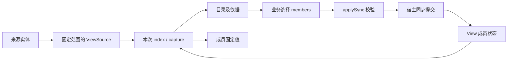

# View：来源目录、成员与固定读取

`@capix/view` 提供通用 View。它保存来源身份与当前成员，按来源契约取得目录和固定值；不持有消息、记忆或模型，也不决定材料应怎样选择。

Observer 的 `ActiveView` 已移入 `@capix/observer-content`。它用 View 处理消息与记忆，同时保留“新内容默认纳入、退出后不因更新重新纳入”的业务策略。两者不是两个内容副本。

完整可运行例子见 [examples/view.mjs](../examples/view.mjs)，自定义静态来源见 [examples/view/skills.mjs](../examples/view/skills.mjs)。运行 `pnpm build && node examples/view.mjs`，可以看到消息、记忆、Skill 材料通过资源进入节点，以及后处理调整成员后两次捕获的差异。例子全部使用内存数据，Skill 作为材料读取，具体怎样组织模型输入仍由业务节点决定。

## 对象与关系

| 对象                              | 持有什么                                                  | 谁负责                              |
| --------------------------------- | --------------------------------------------------------- | ----------------------------------- |
| 来源实体                          | 正文、来源自己的身份与修订                                | Transcript、Memories 或其他宿主实体 |
| `ViewSource<Key, Summary, Value>` | 某个固定来源范围的读取方式                                | 来源适配器或受控资源端点            |
| `ViewState<Sources>`              | `revision`、来源 `{id, scope}`、有序 `{source, key}` 成员 | View                                |
| `ViewIndex<Sources>`              | 当前成员的摘要目录及读取依据                              | 一次视图目录读取的冻结结果          |
| `ViewSnapshot<Sources>`           | 当前成员的实际值及读取依据                                | 一次捕获的冻结结果                  |
| `ViewPersistence<Sources>`        | 同步校验并提交一次成员变更的方法                          | 宿主安装，不由 View 拥有            |



View 不保存 sources 参数、来源端点、ResourceActivity 或持久端口。每次操作显式传入 sources，端点有效期继续由资源窗口控制。宿主可以长期持有 View；一次调用结束不删除成员状态，也不延长已关闭端点的访问权限。

View 没有独立 UUID；成员中的 `source` 是局部槽位名。槽位固定映射到来源的 `{id, scope}`，来源身份不能用展示名称替代。不同槽位的 key 类型独立，不能把记忆字符串 ID 当成消息数字索引。

`Sources` 类型用于关联每个槽位的 key、summary 与 value。实际访问参数采用 `SourceBindings<Sources>` / `SyncSourceBindings<Sources>`，只要求兑现对应读取契约；不要求端点持有具体适配器类的内部字段。来源对象可以封装成受控端点后再传入，类型关联仍然保留。

## 来源契约

```ts
interface SourceStamp {
  readonly id: string;
  readonly scope: string;
  readonly version: string;
}

interface ViewSource<Key extends string | number, Summary, Value> {
  index(): Awaitable<{
    readonly stamp: SourceStamp;
    readonly entries: readonly { readonly key: Key; readonly summary: Summary }[];
  }>;
  read(
    keys: readonly Key[],
    expected: SourceStamp,
  ): Awaitable<{
    readonly stamp: SourceStamp;
    readonly entries: readonly { readonly key: Key; readonly value: Value }[];
  }>;
  check(expected: SourceStamp): Awaitable<boolean>;
}
```

- `id` 是来源实体身份；`scope` 是当前端点允许读取的准确范围。端点不能拿另一范围的目录来满足已固定范围，即使实体 ID 相同。
- `version` 由来源解释，必须覆盖目录成员和实际值的变化，变化后不能复用旧版本。View 只比较版本，不推断时间、大小或序号的业务含义。
- `index` 返回该范围的完整目录，不接受“这一页就是全部”的分页结果。summary 是来源选择的说明值，不是按 key 延迟读取的句柄。
- `read` 必须把 expected 的核验与实际取值放在同一个来源读取边界内；key 缺失、越界或版本变化都明确失败，不能省略某个结果后假装成功。
- `check` 检查依据仍有效，不刷新调用方的旧版本，也不自动重试。

`SyncViewSource` 是相同契约的同步形式，三个方法均直接返回。同步方法收到 Promise 或其他异步结果必须拒绝，不能把未完成的读取当成数据。

现有适配器由对应实体包提供：

```ts
const messages = new TranscriptViewSource(transcript);
const memories = new MemoryViewSource(memoryCollection);

// 可显式限定为固定、有序的 key 子集。
const selectedMessages = new TranscriptViewSource(transcript, [4, 1]);
```

无 keys 时 scope 为 `whole`；固定子集的 scope 包含准确 key 顺序。Transcript 的版本来自 revision，Memory 来源的版本来自集合 sequence。消息 summary 只含 role，记忆 summary 只含 topic；真正正文在 read 时取得。适配器固定范围，不因后续实体增长扩大原来的 keys 子集。

## 从成员到材料

```ts
import { View } from '@capix/view';
import { TranscriptViewSource } from '@capix/transcript';
import { MemoryViewSource } from '@capix/memory';

const sources = {
  messages: new TranscriptViewSource(transcript),
  memories: new MemoryViewSource(memories),
};
const view = new View<typeof sources>({
  revision: 0,
  sources: {
    messages: { id: sources.messages.id, scope: sources.messages.scope },
    memories: { id: sources.memories.id, scope: sources.memories.scope },
  },
  members: [{ source: 'messages', key: 0 }],
});

const index = view.indexSync(sources);
const snapshot = view.captureSync(sources, index);
// snapshot.entries 是已固定值；以后源变化不会改变这份材料。
```

来源的 `index()` 必须返回其范围内完整目录；View 用它核验成员存在，再把当前 members 投影成 `ViewIndex.entries`。因此 `view.index()` 只公开当前成员的摘要，不借读取视图放宽到全部来源候选。capture 也只读取当前成员，并保持其声明顺序。

业务若要增加成员，应通过另行取得的来源目录或已经知道的准确 key 形成选择；applySync 会核验这些 key 在固定来源范围内。View 的目录不包含正文，不自动发现新业务材料，也不让来源全部目录项成为活跃成员。

basis 组合 `viewRevision` 和每个来源的 stamp。成员未变但记忆更新时，viewRevision 可以不变，来源 version 仍会使旧依据失效。传入旧 index 不会让 capture 静默切换到最新值；目录、读取结果与收尾核验必须一致。

成员引用只接收 `{source, key}`，来源依据只接收 `{id, scope, version}`。这些固定格式拒绝额外字段，避免正文混入成员保存或版本依据。它们描述读取依据，不代替来源端点的范围检查。

读取结果只接受被动数据。活对象、访问器、代理、函数和循环不能进入固定快照；普通可变数据复制并冻结，已经通过校验且深冻结的值可以保留引用。它不是随时重新读取来源的惰性材料。

这些检查提供的是来源版本上的一致读取，不是跨数据库事务，也不证明多个外部系统在某个物理时刻共同一致。来源必须兑现自己的版本与读取契约；外部系统无法提供这个边界时，适配器不能伪造成功保证。

## 同步变更成员

```ts
const index = view.indexSync(sources);
view.applySync(
  sources,
  { basis: index.basis, members: [{ source: 'messages', key: 1 }] },
  {
    commit({ basis, previous, state }) {
      store.commitView({ basis, previous, state });
      // 必须同步完成并返回 undefined。
    },
  },
);
```

applySync 先核验视图与来源依据，再核验新成员及范围。同样的成员与顺序不产生新修订、不调用 commit；有变化时先构造下一状态，宿主同步提交成功后才安装。提交失败不修改当前成员；返回 Promise 或其他非 undefined 值不算同步成功。

宿主负责把必要的来源核验和持久写入放进自己的事务。View 不替多个外部存储组织事务，也不在“持久成功之后又发现外部源变化”时伪装成已经回滚。接口因此保留 previous 和 basis，让宿主拥有明确的核验依据。

View 不保留持久端口；应用应在宿主或受控管理端点中固定它，不把“是否持久”变成普通业务每次写入时的随意选择。直接使用没有持久端口的 applySync 是内存变更，不能称为已经保存。

## 资源窗口中的使用

ViewSource 可以来自资源端点。资源适配层在本次 ResourceActivity 下组合 View 与 sources，业务只取得目录、捕获或管理操作；关闭窗口后，已有端点不能继续读写。来源与 View 是不同责任：来源限制可读取的世界，View 在既定来源范围内选择成员。

| 辅助函数                                                     | 打开的端点                                              |
| ------------------------------------------------------------ | ------------------------------------------------------- |
| `openView(view, sources, activity)`                          | 异步 `index()` 和 `capture(index?)`                     |
| `openViewManager(view, syncSources, activity, persistence?)` | 同步 `index()`、`capture(index?)` 和 `apply(selection)` |

辅助函数固定本次 sources 槽位与方法入口，受 `ResourceEndpointActivity` 约束。它不登记资源、不查找兄弟资源，也不把按次端点写回 View。

```ts
import { ResourceOffer } from '@capix/resources';
import { openView } from '@capix/view';

// sources 与 view 来自上面的宿主构造。
type Materials = { readonly view: View<typeof sources>; readonly sources: typeof sources };
const readView = new ResourceOffer({
  expose: (material: Materials, activity) => openView(material.view, material.sources, activity),
  timing: 'access',
});
```

资源访问辅助不创建第二份来源，不持有 Runtime/Invocation，也不让纯 View 自行找到资源中心。宿主显式把 Materials 登记给这个 Offer，节点通过 deps 取得受控端点；普通资源的窗口和取消规则继续生效。该低层 expose 直接返回上述同步／异步读取接口，不额外承诺普通 methods 的 delta/result 包装。

## Observer 的保留策略

`@capix/observer-content` 的 `ActiveView` 使用两个 whole 来源，并转换通用 basis 与旧的 `transcriptId/memoriesId/indexRevision/transcriptRevision/memorySequence`。它负责：

1. 初始化时选择当前消息段及已有记忆。
2. 根据源增量游标把新消息、新记忆纳入，更新已有记忆不重新纳入已退出项。
3. 提供已有 read/manage Offer，并保持旧的 ActiveViewSnapshot、Selection 和持久状态形状。
4. 把显式成员变更转换为旧宿主持久端口，提交完成后才安装 View 状态。

自动纳入仍属于源写入的持久事务，内存 View 同步时不再重复提交一份独立写入。SQL `active_content`、保存字段 `active`、既有 CP 的业务 state、冲突码及恢复拒绝规则保持。通用 View 没有自动纳入、淘汰、容量策略、后台监听、固定效果凭据或调用恢复能力。

现行 Observer 维护链与恢复边界见 [活跃材料](active-content.md)，包归属和入口迁移见 [内容实体与独立包](content-entities-packages.md)。
