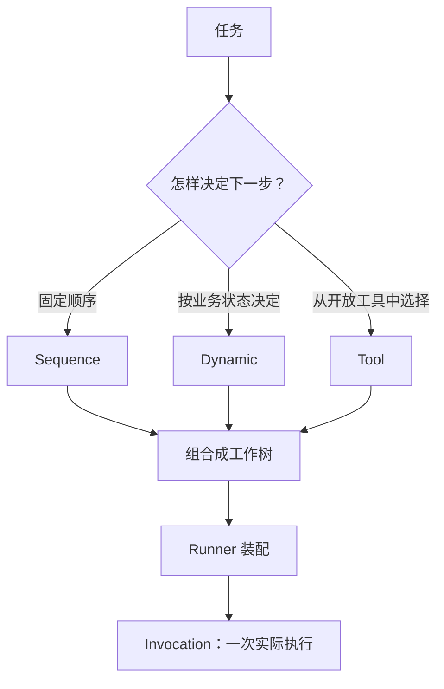
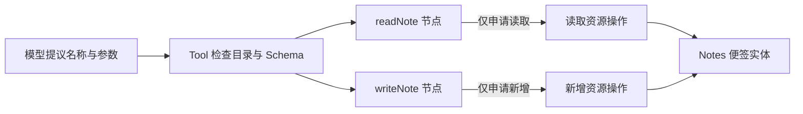
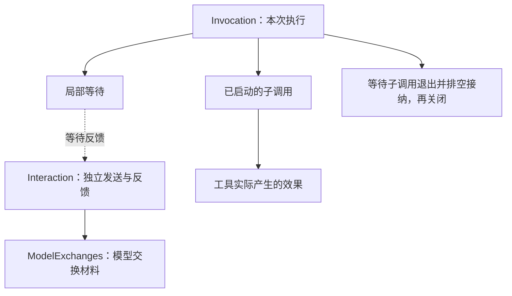
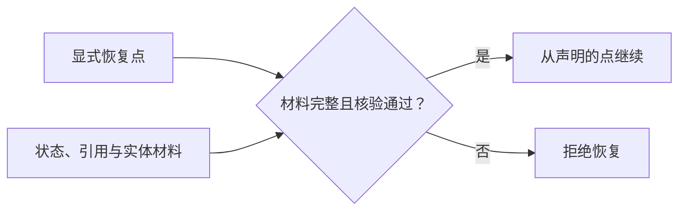

# 为什么用 CAPiX

让助手读两张便签、整理三项待办、创建一张新便签，再回答用户。简单时，一段模型循环和两个函数就能完成。随着步骤、工具和状态增多，需要回答的问题也变了：**谁安排工作，谁能操作内容，谁保存已经发生的事实？**

CAPiX 把这些边界放进可组合的结构。[便签助手教程](guide/getting-started.md)展示完整可运行代码。

> 复杂从组合中展开，可靠由每一层的边界维持。

## 程序安排工作，模型参与选择

结构定义可重复使用的工作；Invocation 持有本次执行的事实。模型适合选择工具时用 Tool，必须依次完成的步骤用 Sequence，程序按状态决定的路径用 Dynamic。

便签教程用提示要求“先读再写”。**提示不会自动变成业务门禁。** 必须强制的顺序，应由作者写进结构或资源操作。

## 工具开放操作，实体保存内容

Node 做事，ResourceOffer 声明开放的操作，实体维护内容与版本。模型看见工具目录，不等于获得便签库的全部操作。资源约束经由 CAPiX 端点的访问；宿主代码的权限与操作系统沙箱由宿主安排。

声明依赖、绑定资源需要接线，换来的是可检查的能力边界。实体可以独立于调用存活；是否落盘则取决于存储实现，教程只使用内存。

## 一次执行与一次发送，各有生命周期

停止局部等待不代表远端请求停止，也不自动重发。流结束、反馈保存和父层接纳，是不同的事实。Interactions 管发送，ModelExchanges 保存精确交换材料，Invocation 管执行与子调用退出。

**写入已完成，后续回答失败也不会撤销写入。** 取消请求停止；框架仍等待已启动子调用真正退出，才完成关闭。

## 需要恢复时，再补齐恢复依据

Checkpoint 恢复显式声明的点及完整依据。它不保存 JavaScript 栈，也不替远端写入提供事务或幂等保证。写入结果未知时，资源需要自己的确认契约，不能仅凭未收到成功回复就重做。详见 [Checkpoint](checkpoints.md)。便签首课不启用恢复。

## 从一个任务开始

只有一次文本生成时，直接调用模型更容易理解。多个步骤共用资源、模型与程序共同决定路径，或执行需要解释、取消与恢复时，这些声明才逐步有价值。

先运行[便签助手](guide/getting-started.md)，再按需要深入[结构](examples/structure.md)、[实体](examples/content.md)和[模型与工具](native-tool-integration.md)。每增加一层，都应对应一个实际问题。
