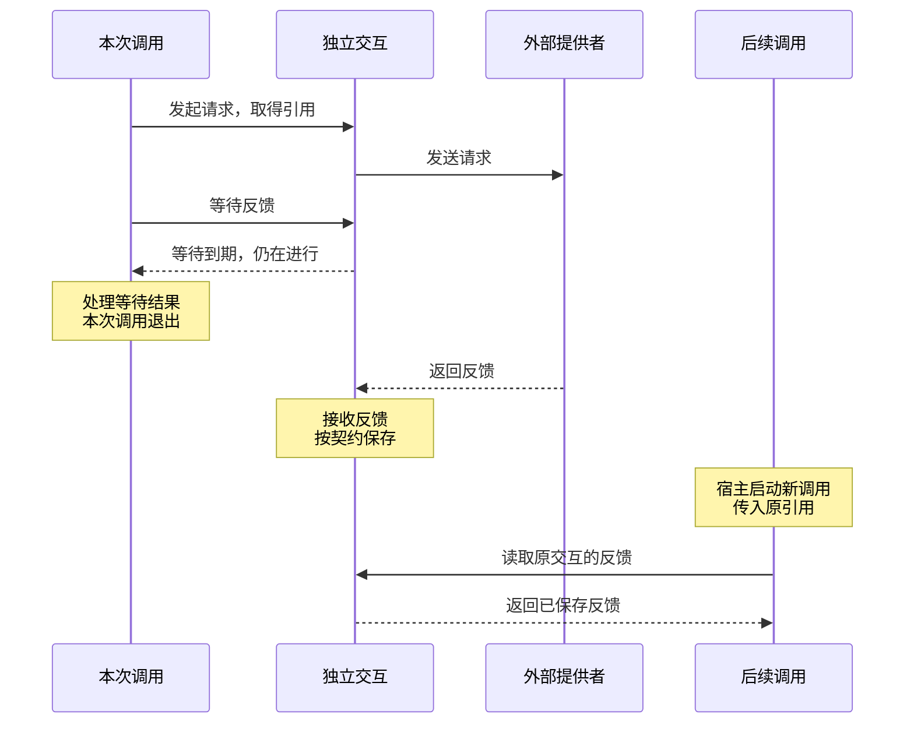

# 为什么用 CAPiX

企业有业务系统、数据、接口和流程；个人有文件、脚本和自己的工作方式。我们已经有很多能力。

我希望让大模型参与这些工作：理解需求、选择能力、处理材料，把原来需要人连接的步骤组织起来。

随着工作逐渐复杂，问题也变得具体：哪些步骤由程序确定，哪些可以交给模型选择？能力怎样继续组合？一次操作的结果，怎样成为下一步的依据？

CAPiX 是我对这些问题的回答：让已有能力在共同的契约下逐层组合，让程序与模型共同推进工作，并在每一层明确职责与交接边界。

<CompositionVisual />

## 我选择的分解方式

| 维度     | 要回答的问题                                           |
| -------- | ------------------------------------------------------ |
| **结构** | 工作由哪些部分组成，它们怎样组合？                     |
| **资源** | 每部分可以使用哪些能力，通过什么操作使用？             |
| **调用** | 一次执行怎样开始、交付、接纳和退出？                   |
| **交互** | 外部请求怎样发送、等待和取得反馈，它与调用是什么关系？ |
| **实体** | 内容由谁持有、如何更新，哪些版本已经确定？             |
| **观测** | 实际发生了什么，这些事实来自哪里、有什么关联？         |
| **恢复** | 中断后，凭哪些依据、从哪个明确位置继续？               |

这七个维度描述同一件工作中的不同关系，可以按需要组合使用。简单任务可以从结构与资源开始；需要解释执行过程或支持中断后继续时，再接入观测与恢复。具体对象与包的职责见[架构](organization.md)。

## 组合如何展开

一个节点完成一部分工作，一个组合组织多个成员。它们遵循共同的调用契约，所以一个复杂组合也可以成为另一层的成员，继续参与更大的工作。

模型通过资源接入这套结构。它可以在某一步处理材料，也可以在 Tool 预设中选择已登记的工具。Tool 本身是普通 Group，能够与固定步骤、业务判断继续组合。

模型放在哪里、参与哪些判断，由作者决定。没有模型参与的工作同样可以运行。数据也可以保留自己的业务形状，通过实体、资源和 View 接入，不必都装进消息或记忆。

组合依靠具体的边界来保持可靠：声明依赖时确定可用操作，调用时核验访问窗口，交付时固定正式值，恢复时检查完整依据。业务结果是否正确、外部效果是否可靠，仍需要各自的实现来保证。

## 为什么要区分这些对象

同一个结构可以多次调用，每次都有自己的输入、结果和退出过程。调用结束后，实体可以继续保留内容，已经发出的外部请求也可能还在进行。

例如，本次调用等待模型反馈到期后，可以处理等待结果并退出。外部请求由独立交互持有，仍可接收之后返回的反馈：

这个例子要求宿主保持运行，并保留交互引用。宿主启动后续调用时传入原引用，新调用便能读取同一次交互已经保存的反馈。旧调用已经退出，请求只发送一次；若要跨进程读取，还需要持久化实现提供依据。详见[交互](interactions.md)。

实体与调用的区别也很具体：便签已经写入，后续回答失败不会自动撤销这次写入；资源窗口关闭，本身也不意味着便签被删除。业务需要知道分别发生了什么，才能决定下一步。

观测帮助解释这些过程，恢复则需要足以继续执行的依据。Checkpoint 使用已经成立的固定事实，从声明的恢复点继续；它不恢复 JavaScript 栈，也不替资源确认未知的外部效果。留下一份执行记录，并不等于具备了恢复能力。

## 它适合什么工作

如果你面对的是下面这些问题，这套分解方式可能有帮助：

- 已有代码、服务和数据，需要与模型共同完成任务。
- 工作需要逐层组合，既有固定步骤，也有模型参与的判断。
- 内容、一次执行和外部请求有不同生命周期，需要分别管理。
- 需要解释执行结果、判断失败归属，并明确中断后能否继续。

不必同时具备这些需求。关键在于，你是否需要把这些关系分别表达清楚。

## 使用代价与承诺边界

采用 CAPiX，需要学习这些对象，并为能力编写声明、完成装配。业务仍要判断结果是否合格、选择哪些材料、哪些操作需要审批，以及失败后怎样处理。**提示不会自动变成业务门禁。**

资源约束的是通过 CAPiX 端点进行的访问，操作系统权限与沙箱由宿主安排。实体是否持久保存、外部写入能否安全重试、未知结果能否确认，取决于对应实现；内核不替它们承诺跨实体事务或安全重做。

对于下面这些需求，CAPiX 可能不合适，或只能解决其中一部分：

- **只需一次模型请求或一个简单脚本。** 声明和装配的成本可能大于收益。
- **需要开箱即用的 Agent 产品。** CAPiX 提供框架，具体应用、界面和宿主仍需构建。
- **希望任意代码中断后自动续跑。** 恢复依赖明确声明的点和完整材料。
- **希望框架自动回滚或重试所有外部操作。** 这需要资源与外部系统自身的确认和事务能力。

当前执行内核在 Node.js 上验证，浏览器与 Edge 运行不在现有承诺内。具体限制见[运行边界](runtime-boundaries.md)与[恢复契约](checkpoints.md)。

## 从一个例子开始

[便签助手](guide/getting-started.md)用一个完整的工具循环展示这套组合方式。默认使用离线决策脚本，真实执行读取与内存写入，不演示持久化和恢复。更小的例子见[结构与资源](examples/structure.md)，自己的内容模型如何接入，可以看[自定义实体](custom-entities.md)。

你可以从实际代码和契约判断：这套方式是否适合你的工作，以及把这些关系明确表达出来，是否值得相应的声明和装配成本。
