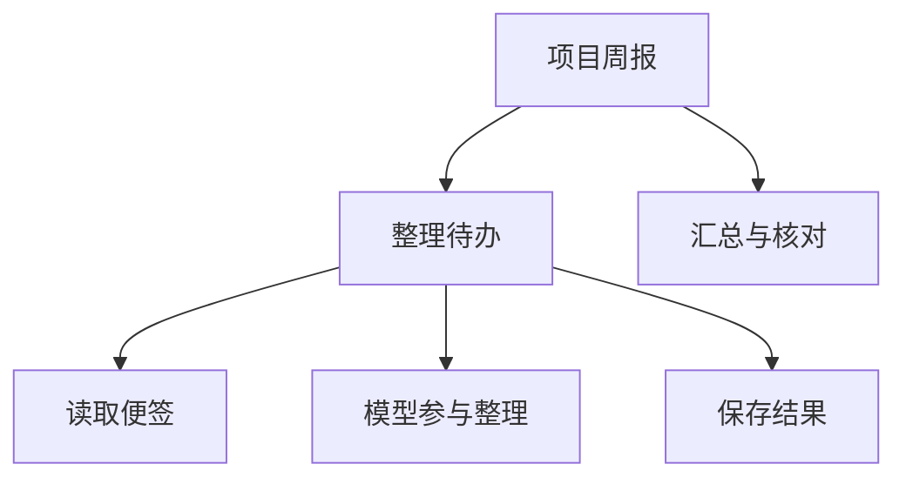

# 为什么用 CAPiX

CAPiX 的起点，是一个很简单的问题：

> 我已经有很多能力，怎样把它们组织起来，让大模型参与工作？

企业有业务系统、数据、接口和流程；个人有文件、脚本、工具和自己的工作方式。这些能力已经在解决具体问题。我希望把模型的理解、判断和生成能力引入其中，让它们能够一起完成新的工作。

CAPiX 是我对这个问题的回答：通过资源接入能力，通过实体承载内容，把工作逐层组合起来，同时说清每一部分可以做什么、结果怎样交给下一步。

## 接上模型之后，还要组织工作

一个自然的起步方式，是把已有操作描述成工具，让模型根据任务选择调用。比如“读取会议记录和项目计划，整理待办，再保存为一张新便签”：模型可以选择读哪些材料、怎样整理，程序负责实际读取和写入。

当这项工作要被反复使用，新的问题就出现了。读取范围由谁确定？写入前有哪些检查？整理好的待办，能不能再交给生成周报的流程？如果便签已经写入，最后生成回答却失败了，下一次怎样利用已经写入的结果，避免重复写入？

我希望这些问题能在各自的位置得到回答。已有的业务对象继续管理内容；可以开放的操作有明确入口；模型能够参与选择；整项工作的组织方式也能被程序表达和调整。

**提示不会自动变成业务门禁。** 如果某个检查必须发生在写入之前，就应把它放进实际执行路径。模型参与了多少决策，与业务必须守住哪些规则，可以分别设计。

## 让组合也成为能力

读取一张便签是一小步，整理一组待办是一项完整工作。接下来，它也可以参与更大的“项目周报”。我希望扩大工作范围时，已经组织好的部分仍然有自己的边界，能够继续被组合。

图中是一种可以继续构造的工作组成，具体执行顺序由作者安排。在 CAPiX 中，Node 表达一步工作，Group 组合成员，Scene 组织入口；组合也能作为另一层的成员，遵循同样的调用与交接规则。

模型可以只参与其中一步，也可以在 Tool 预设中连续选择工具。Tool 本身是普通 Group，因此，一个模型驱动的循环可以放进固定流程，固定的业务步骤也可以成为模型选择的成员。

**复杂从组合中展开，可靠由每一层的边界维持。** 对我来说，这句话首先描述一种构建方式：先把一部分工作做好，再把这些部分组织成更大的工作。

## 已经发生的事，需要分别说清楚

便签助手里有一个很小、却很具体的区别：**便签已经写入，和用户已经收到回答，是两件事。** 在教程的失败验证中，写入后的模型请求抛错，整个调用失败，但新便签仍然存在。

如果只留下一个“失败”，就无法据此决定是否重新写入。内容的落实由实体说明，一次工作的返回与接纳由调用说明。框架把这些边界分别保留下来，业务才能依据真实结果决定继续、补偿或停止。

外部请求也有自己的时间。一次调用停止等待，不意味着已经发出的模型请求消失。CAPiX 用独立交互持有请求和反馈；后续能否读取它，取决于宿主保留的引用和存储依据，而不是自动再发一次。

这也是观测与恢复各有职责的原因。观测帮助了解实际发生了什么；恢复需要足够的依据，在明确声明的位置继续。它们让作者能够检查执行过程和续接资格，业务效果本身仍需由资源与外部系统保证。

这些选择形成了结构、资源、调用、交互、实体、观测与恢复七个维度。它们的用法与设计分别放在[核心概念](concepts/index.md)中，便签例子的真实失败结果见[用失败检查理解边界](guide/notes-failures.md)。

## 什么情况下，这套选择值得

如果你已经有自己的代码、服务与内容，希望逐步引入模型；或者工作既有固定步骤，也有模型参与的判断，并且还要继续扩展和组合，CAPiX 所提供的划分可能有帮助。

代价也很具体：你需要定义资源操作、组织结构、完成装配，并决定哪些结果可以接纳、哪些材料需要保留。框架帮助维持这些约定，业务上的判断仍由你来设计。

如果任务只有一次模型请求或一个简单脚本，直接使用 SDK 或普通函数可能更合适。如果你需要一个现成的聊天或编程产品，CAPiX 仍需要你构建相应的宿主与界面。当前执行内核在 Node.js 上验证。

可恢复也有明确范围：Checkpoint 从声明的恢复点和完整依据继续，不保存 JavaScript 执行栈，不自动回滚外部写入，也不替资源承诺安全重试。资源访问约束针对框架端点，操作系统沙箱与外部权限由宿主安排。具体边界见[运行契约](runtime-boundaries.md)与[恢复契约](checkpoints.md)。

## 从便签助手检验这些选择

[入门教程](guide/getting-started.md)围绕同一个任务展开：先运行完整助手，再拆开实体、资源、节点与模型循环，观察失败留下什么，最后为同一份便签增加查询能力。

默认离线，读取与内存写入真实发生；模型选择由固定脚本提供，便于复现，不代表模型的理解能力。教程也不把内存保存当作持久化或恢复。

完成以后，你可以用自己的工作来判断：哪些能力可以保留，哪些规则需要明确，以及把它们这样组合起来，是否值得这些声明和装配。
