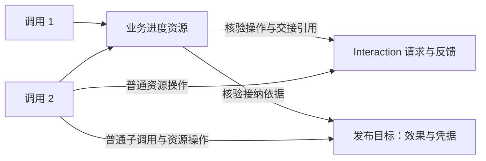

# 跨调用的业务交接、效果确认与接纳

这是一个离线验证 example，不新增内核概念或正式 `Progress` 包。业务是“依次生成并发布几份内容”：一次调用可以退出，另一调用从业务资源继续；外部请求、目标发布效果与业务接纳分别保存。

```sh
pnpm build
node examples/business-progress.mjs
node --test test/business-progress.test.mjs
```

不读取环境配置，不访问真实模型、数据库或网络。

## 从哪里读

1. [workflow.mjs](workflow.mjs)：实际 Node / Group / Scene、资源申请、子调用和业务接纳。每次调用只推进当前事项一次，没有隐藏循环、调度器或 CP。
2. [主例子](../business-progress.mjs)：第一次调用退出、晚到反馈、发布成功但业务接纳失败、全新装配继续，以及两个事项的顺序推进。
3. [progress.mjs](progress.mjs)：业务实体 `PublicationProgress`。顺序约束只属于这个业务。
4. [archive.mjs](archive.mjs)：目标实体 `PublicationArchive`，正文与固定操作凭据一起提交。
5. [interaction.mjs](interaction.mjs)：资源与 Interaction 接缝上的 `GenerationGateway`，使用公开持久端口实现可找回的交接。

后三个模块同时包含本地存储模拟和故障注入，便于检查提交前失败与提交确认丢失；这些代码不是业务节点必须重复书写的配置。

## 事实归属



| 对象                                  | 自己负责的事实                             | 不负责的事情                             |
| ------------------------------------- | ------------------------------------------ | ---------------------------------------- |
| `PublicationProgress`                 | 固定业务操作、交接引用、已接纳依据和修订   | 发送外部请求、宣称目标已经落实、运行节点 |
| `InteractionJournal` + `Interactions` | 操作到引用的关联、固定请求、发送意图与反馈 | 推进业务事项或自动恢复发送               |
| `PublicationArchive`                  | 固定发布操作的正文与真实凭据               | 判断整体业务是否完成                     |
| Node / Group / Runner                 | 本次执行、子调用与接收                     | 保存跨调用的业务生命周期                 |

事项 ID、生成操作 ID、发布操作 ID、接纳变更 ID 都有明确用途；它们不使用 Invocation ID，也不按文本匹配。初始化先登记固定操作及目标身份，后续调用只消费这些操作。一个事项包含多个操作，不把它压缩为一个 `interactionId`。

## 三个候选契约在代码中的位置

**正式交接。** `GenerationGateway.establish(operation)` 先按操作查询。不存在时才调用现有 `channel.start`；`persistence.create` 将固定请求、InteractionState 与操作索引一起保存。即使业务侧 `attach` 失败，下次仍能找回同一引用。查找失败不会转换成“可以新建”。同操作改输入明确拒绝。

这仍然有两个独立提交：交互侧创建、业务侧关联。前者能够再次确认，使后者失败后可以补交；没有跨仓储事务。

**目标效果确认。** `archive.confirm(operation)` 返回 `confirmed / not-applied / unknown`。提交时再次核验目标身份、唯一操作及固定输入，将正文和凭据一次保存。`unknown` 不允许写入；提交后丢失确认时，新调用从目标权威状态取得原凭据。

审查曾发现一个反例：如果只固定操作 ID，目标 A 已发布但业务尚未接纳时，重建绑定到 B 仍能再发布一次。本例已把 `targetId` 固定进业务操作，在重建业务实体时核验，并由目标自身在写入前再次核验；目标换绑不能成为一次新的写入许可。

**业务接纳提交。** `progress.accept(change)` 核验操作对应的真实交互反馈，并从目标实体核验凭据，再按修订提交。已提交的同一变更可以再次确认，不能换依据；未提交的新变化仍需通过版本检查。这里每次读取权威存储，没有用上一次失败后留下的内存状态推断成功。

`attach` 与 `accept` 重复确认先识别已经成立的相同事实，因此旧 `expectedRevision` 可以确认已经提交的原变更；它不能提交一份新的变化。`Receipt` 只是可序列化的依据，类型或字段形状不构成证明。

## 验证与明确边界

定向测试覆盖：

- 调用已退出而交互仍在途，晚到反馈由新调用接纳。
- 业务关联和接纳的提交前/提交后失败，经过 JSON 往返重建全部实体与 Runner 后继续。
- 发布提交前失败和发布已成功但确认丢失，分别由目标事实决定是否写入。
- 重复消费、两个独立 Runner 与业务实体实例并发消费，同一操作只发送、发布、接纳一次。
- 操作改输入、交接引用替换、伪造凭据、错误目标和修订冲突被拒绝。
- 目标确认未知时不推进；第一事项未接纳时不开始第二事项。
- 交互创建前失败可以重新建立；查找失败不能授权新建。
- 交互创建已提交但确认丢失，或 started 提交前/后失败：引用可以找回，但尚无反馈，现有只读恢复返回 `unavailable`，不会再次发送。

后一个结果是保留的能力边界，不是已经解决的发送恢复。这套 example 证明了引用关联与业务接纳可组合，也证明了它们不自动提供发送恢复。

所有存储都是单进程、同步权威内存模拟。JSON 往返排除了旧实体/闭包/调用身份帮助继续的可能性，但没有执行真实进程崩溃或数据库故障；并发正确性依赖模拟存储的唯一性和版本比较。没有数据过期、跨服务实例调度或分布式原子性承诺。

发布目标是本例的自定义业务实体，不是 Transcript。它验证“由目标实体提供跨调用固定效果契约”的方向，**没有改变 Transcript 普通 append 或基于父子调用身份的 applyFixed**。实体持久故障分类另行收敛，见[消费边界验证的后续修复](../../docs/interaction-consumption-validation.md#后续实体持久边界分类验证)。

当前不提取通用 `Progress`：`PublicationProgress` 的接纳规则、顺序与核验材料都属于这个业务。可以进一步对照其他业务资源实体，判断值得统一的是哪些端口，而不是先要求所有业务继承同一个生命周期。
