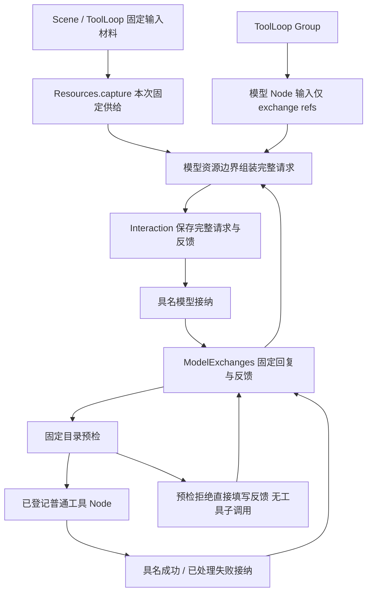

# 原生工具调用：离线机制闭环

这里验证工具协议、交换实体、普通成员调用与 CP 的接缝，**不修改生产 Provider、服务或内核**，也不调用真实模型。`fixtures.mjs` 提供 DeepSeek Chat Completions 原始响应，`protocol.mjs` 接纳为同一份正式回复材料。

```sh
pnpm build
node examples/native-tools/run.mjs
node examples/native-tools/run.mjs 131072
# 指定固定材料字节数、模型调用次数、单次工具结果字节数：
node examples/native-tools/run.mjs 2048 8 65536
node --test test/native-tools-protocol.test.mjs test/native-tools-loop.test.mjs test/native-tools-values.test.mjs test/native-tools-wait.test.mjs test/types/native-tools.test.mjs
```

默认流程包含读文件、预期的缺失文件、未知工具预检拒绝、写文件、最终回答，共 3 次模型调用。显式传入模型调用次数时，改用连续读文件与最终回答的规模实验；支持 1–8 次模型调用。

## 对象与文件

| 文件                         | 责任                                                                                              |
| ---------------------------- | ------------------------------------------------------------------------------------------------- |
| `protocol.mjs`、`blocks.mjs` | 严格接纳、工具参数流片段拼接、同一份回复回填原生请求；有序块反例只验证形状，不是另一厂商 Provider |
| `catalog.mjs`                | 冻结工具名、说明、Schema、成员位置与契约版本、预检策略版本，计算规范化摘要                        |
| `tools.mjs`                  | 默认工具作者注册；同一有序注册生成实际成员与目录，保留 Node/Group 的真实 I/O                      |
| `value.mjs`                  | 唯一的有界纯 JSON 捕获与规范化编码；回复、凭据、目录和快照共用检查规则                            |
| `exchanges.mjs`              | 示例实体，保存模型回复和逐个反馈槽位；固定接纳同值确认、异值拒绝                                  |
| `structure.mjs`              | 普通 Scene / Group / Node；模型、工具调用与具名接纳；三个父 CP 点及子节点 CP                      |
| `assembly.mjs`               | 宿主持有实体、Interactions、Resources 和 Runner，重新装配时从固定输入捕获材料                     |
| `measurement.mjs`            | 通过公开 MemoryCheckpointStore 提交记录真实保存与 finish；提供提交前缀重建和测量                  |
| `wait.mjs`                   | 局部交互等待；超时保留原引用，取消只解除本次消费                                                  |
| `run.mjs`                    | 可重复运行的离线规模实验，不保留测试专用实体快照                                                  |



## 这轮确定并验证的边界

- 回复只有一份持久表达：共同 `output/usage/termination` 与不重叠的原生补充。发送下一次请求时由适配逻辑回填；参数原始文本保留，执行参数来自对同一文本的解析。流片段只构成候选，正式回复完整接纳后才能派发。
- ToolLoop 向每个模型 Node 传递准确交换引用，模型 Node 不再向更深子调用传递完整请求；完整请求只在资源发送边界形成并交给 Interaction。原始材料保存在 Scene 与 ToolLoop 的固定输入中，恢复重新捕获原输入，不读取当前 View 或当前历史。
- 目录摘要覆盖模型可见材料、成员位置/契约版本和预检策略；实际成员接线必须与目录一致。恢复时摘要不符会拒绝，不能用新的工具语境续接旧交换。模型调用预算另存固定输入，恢复精确核对，不把当前剩余次数当作配置兼容证明。
- 工具预检拒绝由循环预设生成标准 error 反馈，不制造失败子调用。真实循环通过 `tool(node, {description, input, result})` 的 Schema 与处理函数解析参数、映射反馈，默认文件工具也使用相同入口。作者可以将成功结果反馈为 error，或将可处理失败的替代结果反馈为 ok；原调用仍保留 succeeded/accepted 或 failed/handled。没有 failed 配置就传播失败，接收回调的故障不重新进入 failed，受保护故障和取消不能被转换成普通反馈。
- 模型接纳凭据包含资源层获得的准确父子身份；工具接纳凭据包含反馈摘要与准确来源。恢复核对实体中的原回复、调用返回、已接纳引用及反馈凭据，不能只凭 exchange ID 相同就认定事实一致。实体槽位已经填写不代表父层已经接纳。
- 仅串行执行本次模型请求的工具。多次调用同一个工具或复用上次交换中的 tool-call ID，用模型交换和真实子关系顺序区分。

作者的业务配置例如：

```js
const registrations = {
  read_text: tool(readNode, {
    description: 'Read one named file',
    input: z.strictObject({ path: z.string() }),
    result: {
      succeeded: (text) => ({ status: 'ok', content: [{ kind: 'text', text }] }),
      failed: () => ({ status: 'ok', content: [{ kind: 'text', text: 'Use the supplied default.' }] }),
    },
  }),
};
const { scene, loop, catalog } = createToolScene(registrations, { policyVersion: 'fallback-v1' });
```

这里的 `readNode` 是已配置的普通 Node，也可以使用 Group；资源仍由宿主登记。这个恢复探针要求成员声明 CP 契约，尚未将“每个生产工具都必须有 CP”定为通用约束。工具参数由同一份 Zod Schema 生成模型目录并实际解析；本例拒绝解析后改变原值的变换。自定义 refine 与结果函数的语义无法由 JSON Schema 摘要证明，作者必须维护 `policyVersion`；已接纳结果恢复时读取原凭据，不重新运行映射。

参数 Schema 当前由锁定的 Zod 4.6.5 生成。升级 Zod 可能改变生成结果及目录摘要，使已有工具循环 CP 被明确拒绝恢复；升级时必须对照保存的目录数据检查兼容性，不能只依据业务代码没有变化就宣称兼容。

`result.succeeded/failed` 是无副作用的反馈映射，可以返回 Promise，但不能发送外部请求、写实体或依赖会变化的外部状态。子成功返回后、父接纳及 CP 尚未保存时发生中断，恢复可能重新运行成功映射；`policyVersion` 不能令外部效果幂等。业务 I/O 应放在实际工具 Node/Group 及其资源端点内，按其效果确认契约处理；已保存的 accepted/handled 结果恢复时不重跑映射。

`scope` 是宿主生成并保存在输入中的业务循环归属，不是权限凭据。除各自实体的并发用例外，测试也让两个循环共享同一个 ModelExchanges 集合，以不同 scope 核对交错执行时的准确引用和来源。是否允许多个调用继续同一业务 scope，仍由后续业务续接设计决定。

纯值捕获统一拒绝 getter、Proxy、循环、非普通对象和超限内容；单份请求/回复/反馈默认 2 MiB，集合快照明确采用 32 MiB 聚合上限，恢复仍逐条核验外部值。接纳键和反馈摘要使用同一规范化编码，普通对象键重排不改变依据，数组次序仍有含义。目录只缓存本模块认证过的深冻结对象；反序列化值重新认证，再使用认证后的实例做后续预检。

## 恢复验证怎样做

测试先让离线链路完整运行，记录公开 Store 的每次真实提交，以及当时各实体的快照。再选择真实保存边界，将**原始提交前缀**重建到新的 MemoryCheckpointStore，创建新的 Scene、Resources、Runner 和实体实例并执行 resume。不会修改 Frame，也不用 cancel 伪装崩溃。

覆盖已经建立交互、模型完成但父层尚未接纳、父层接纳、已处理工具失败、文件写入子节点已保存、最终交付等位置。额外记录交互反馈刚持久提交的真实截面，验证已建立交互可读取同一份晚到反馈。

拒绝样本包括无首个子 CP、已知交互没有持久反馈、工具副作用有可能发生但没有子 CP、目录改变、外国引用/作用域、反馈冲突，以及实体回复/接纳来源/工具反馈被修改但 CP 未改变。调用取消只关闭本次等待，独立发送仍可完成并保存晚到回复。

这不是通用跨实体事务或任意位置恢复：示例的 Map 文件效果与 CP 不原子；未知效果必须拒绝，不能重发来猜测。测试快照只为在明确位置构造进程重建的状态，不代表生产存储已经提供全局一致快照。

局部等待时限由宿主固定到输入，恢复时精确核对。超时沿用公开 `ModelReplyPending`，保留同一个 Interaction 引用；原调用已经失败时，原 CP 不能重新执行。专门的真实超时测试证明：迟到反馈仍独立保存，新建只读调用可以取得同一反馈，发送次数保持 1，但不会自动继续旧 ToolLoop 或接纳其业务结果。前面的 established 恢复测试针对未终结的提交前缀，不是超时后复活调用。

## 数据量和计算：不要把引用化误读成成本消失

一次本机运行的参考值如下，时间会受 JIT、GC 和其他进程影响，不是吞吐承诺。

| 场景                                          | save / finish | 最大 CP 镜像 | CP 累计提交字节 | Interaction 累计写入 / 最终逻辑存量 | CP writer 同步耗时 |
| --------------------------------------------- | ------------- | ------------ | --------------- | ----------------------------------- | ------------------ |
| 固定材料 2 KiB，默认 3 次模型调用             | 23 / 7        | 14,719 B     | 168,086 B       | 32,453 / 11,990 B                   | 14.82 ms           |
| 固定材料 128 KiB，默认 3 次模型调用           | 23 / 7        | 394,514 B    | 4,425,878 B     | 1,193,669 / 399,062 B               | 44.89 ms           |
| 固定材料 2 KiB，8 次模型调用，每次读出 64 KiB | 55 / 17       | 488,714 B    | 8,834,907 B     | 5,601,472 / 1,869,984 B             | 87.09 ms           |

最后一个场景经过 8 次模型请求、7 次工具调用，总用时约 202.45 ms、进程 CPU 236.84 ms。数据来自本轮收敛后的串行复测；大小会随诊断内容等变化，时间不用于证明前后优化收益。最大镜像仍远低于 8 MiB；累计写入可以大于单份上限，这是不同指标。

`run.mjs` 输出每个保存点的直属关系数量、JSON 字节数、Store 同步耗时与 CP writer 同步耗时。writer 包含本次捕获、编码、校验与提交，也包含 Journal 读回和留存采样的少量开销；Store 耗时是其中的子集，不能相加。finish 另计次数和提交字节。测量命令关闭测试专用实体快照，JSON 大小也在执行后统计，避免将测试快照复制计入 CP writer。

仍然存在的成本：

1. Scene 与 ToolLoop 都保存原始输入；父层每个 CP 仍编码完整直接关系，已返回的工具正文也属于关系事实。引用化没有取消这些事实，更没有让整个调用链只保存一次材料。
2. Interaction 固定每次完整请求，累计历史和工具结果会重复进入下一次请求。首版接受并测量这部分增长；逻辑存量与多次状态提交的累计写入分别报告。
3. 模型输入只保存短引用，未再把累计请求复制进模型子 CP。父关系逐渐增多造成的捕获/编码累计增长依然存在，本例没有新增增量 CP 协议或掩盖 CPU 成本。

验证结果：调用/恢复、协议、纯值与目录、等待边界及 TypeScript 正负例共 54 项定向测试通过。

## 暂未承诺

这是设计验收的离线 example，不是可发布的 ToolLoop / ModelExchanges 包。不接 MCP、不执行并行工具、不实现工具策略平台，也不迁移生产 `ModelReply`。目录验证只支持明确的简单 object/scalar JSON Schema；复杂 Schema 拒绝，不能宣称支持任意 JSON Schema。

跨协议样本用于发现事实分解和顺序约束，不意味着 Responses / Claude 已实现适配。示例没有网络、磁盘 SQLite 或故障注入杀进程测试；尚未评估真实模型选择质量、提示注入防护及授权审批。
