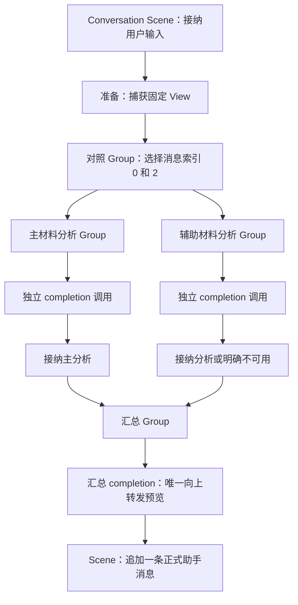

# 两份材料并行分析，再汇总回答

这是基于新装配服务的组合验证，不是新的内核并行预设。使用现有 `createConversationScene`、`createMaterialPreparation`、普通 Group/Node、CompletionResource 和 Runner；业务结构只负责材料选择、并行分析、接收与汇总。

```sh
pnpm build
node examples/parallel-analysis/run.mjs
node --test test/conversation-parallel-analysis.test.mjs test/types/parallel-analysis.test.mjs
```

默认且仅支持离线运行：不读取 `.env`，不请求真实模型，不打开数据库，不改变当前 Web 服务。模型替身实现完整 ModelProvider/ModelReply 契约；验证调用关系和交付，不评价分析质量。这个 Group 没有声明 CP，不能使用默认材料对话的恢复资格。

## 结构与职责



两个分析节点拥有独立调用和资源操作，共享宿主登记的 ModelProvider。这里只通过固定输入分发材料，没有增加文件、检索或权限系统；这不等于验证了 `Resources.refine`。当前用户消息是 query，材料来自其之前的两个明确消息索引，不能把稀疏 View 的数组位置当作消息索引。

| 文件            | 职责                                                 |
| --------------- | ---------------------------------------------------- |
| `structure.mjs` | 固定材料选择、主辅分析的接收、并行汇合和最终输出转交 |
| `model.mjs`     | 用现有 completion 子结构把分析/汇总输入变成模型请求  |
| `assembly.mjs`  | 建立内存实体、登记资源、安装 Scene 与可选记录        |
| `run.mjs`       | 受控离线模型，证明重叠启动和逆序完成，核对正式结果   |

## 作者需要写的组合

下面是 `structure.mjs` 的核心形态，省略材料校验；`accepted` 只校验并包装已知来源和分析正文，不写实体。

```js
answer.run = async (work) => {
  const [primary, secondary] = await Promise.all([
    work.children.primary.invoke(firstInput, {
      result: { succeeded: (value) => accepted(firstMaterial, value) },
    }),
    work.children.secondary.invoke(secondInput, {
      result: {
        succeeded: (value) => accepted(secondMaterial, value),
        failed(error) {
          if (!(error instanceof AnalysisUnavailable)) throw error;
          return { status: 'unavailable', material: secondMaterial, reason: error.message };
        },
      },
    }),
  ]);
  return work.children.merge.invoke({ query, primary, secondary }, { delta: (value) => work.output.emit(value) });
};
```

没有额外调度器、运行状态表或第二份子调用关系。Promise.all 保持传入位置；准确调用身份、接收事实和退出等待仍归内核。只有汇总 delta 被显式转交，分支产生的内部预览不会自动冒泡到用户正文。分析结果、主辅材料都不直接写 Transcript；正式助手消息仍由 Scene 的回答接收边界写一次。

## 验证重点

正常演示让两个模型调用都进入后，先释放 B，再释放 A。最终来源顺序仍为 `[0, 2]`，模型完成顺序为 `[2, 0]`；3 条种子消息加本次 user/assistant 共 5 条，记录中有 8 个真实子调用。预览只包含汇总正文。

故障测试使用明确的 Promise 门控，不用固定延时推测并发顺序；检查正式消息、调用/接收事实、资源输出以及 Runner 的真实释放。

- 辅助分支只有 `AnalysisUnavailable` 可以形成 `unavailable` 后继续汇总。其子调用保持 `returned.failed`，父接收为 `handled`，不能改写为一次成功分析。
- 失败处理器筛选不通过后重抛，会保留子 `returned.failed` 并产生 `reception.failed`，不等于从未进入接收。对于声明异常，归属相应成为 `child-reception`；没有绕过公开接口保留内部交付凭据。
- 首个失败阻止汇总，但不会隐式取消兄弟。Runner 等待已启动子调用与接收真正退出；并发 Promise.all 的提前拒绝不能提前释放整个调用。
- 取消阻止迟到结果接纳与端点继续使用，仍需等待已开始的工作退出。底层异步处理若忽略取消且永不返回，这个示例不承诺强制终止它。
- 若提供者在取消之后、资源尚在途时继续向已经关闭的输出端点 emit，会新增真实技术故障，最终可能交付 `failed`，不能一概显示为 `cancelled`。测试分别验证纯取消和取消叠加端点违规。
- 接收回调自身失败不会再次进入同一 `failed`；必要持久化故障不能伪装成可选材料不可用。
- 关闭记录不改变业务结果；开启记录用于核对真实分支、接收和正式消息关系，不承担调度或接纳决策。

## 结论的范围

2026-11-04 验证结果：演示脚本通过，11 项运行专项通过，独立 TypeScript 作者组合编译通过（含 14 个必须被拒绝的用法），全量 2723 项测试通过，格式检查通过。没有修改内核、生产服务逻辑或默认装配。

TypeScript 对照见 [parallel-analysis.ts](../../test/types/parallel-analysis.ts)：`Promise.all` 推导为 `[AvailableAnalysis, AvailableAnalysis | UnavailableAnalysis]`；成功接收包装与失败接收联合、子输入、merge 输入、父资源范围和 string delta 均不靠 `any` 或类型断言。它独立验证同形态的公开类型组合，不替代 `.mjs` 的静态检查。作者仍需定义业务 I/O、资源类型和输出增量类型，并保留 `add()` 返回的具名成员细化；本例没有发现额外类型卡点。

本轮验证普通调用组合；未增加并行 CP、独立 Interaction 的混合恢复、多 Runner 调度或跨实体事务。`model.mjs` 的直接 completion 使用当前调用 signal；不能把它的取消结论推广为取消独立 Interaction 的外部发送。

下一步若研究恢复，应另行声明“一个分支已接纳、另一个仍等待”的汇合点及宿主资格，不把当前顺序材料链的 CP 套在这个新结构上。资源权限收窄也应使用真正具有收窄契约的资源单独验证。运行通过不证明任意并发拓扑都已覆盖，更不说明框架必须新增 Parallel 类型。
