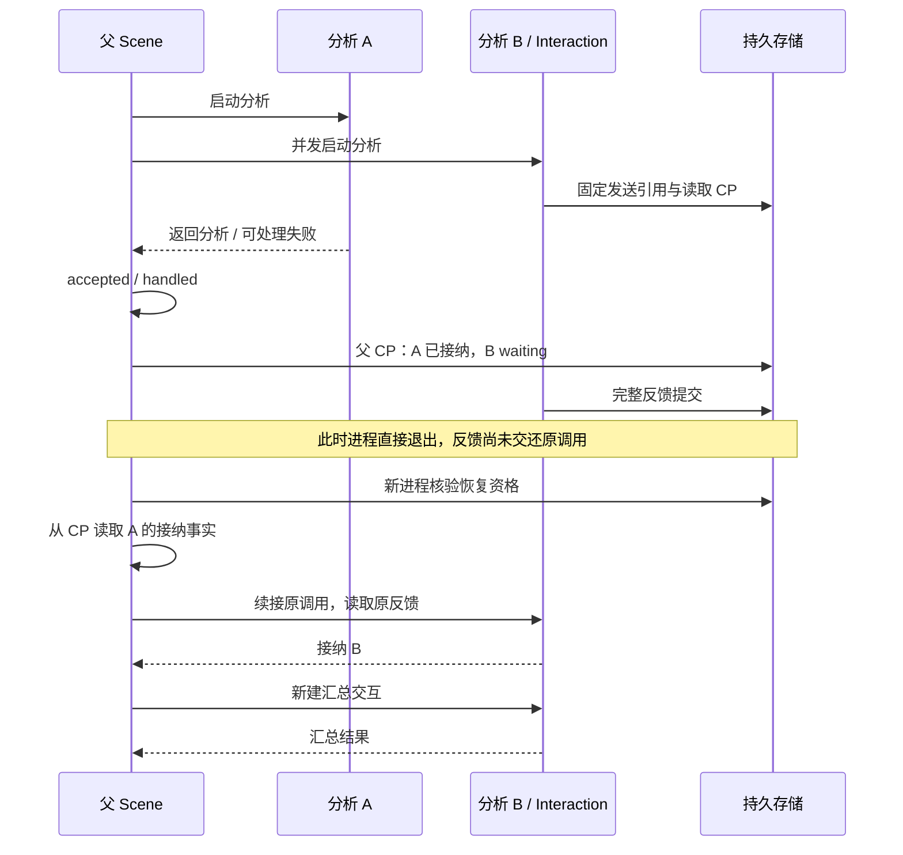

# 并行分支部分完成后的恢复汇合

这是上一级并行分析 example 的恢复对照。它验证一个具体组合：A 已经被父层接纳，B 仍在父 CP 中等待，但 B 的完整外部反馈已经保存；新进程恢复时使用 A 的事实、续接 B，然后执行汇总。

```sh
pnpm build
node examples/parallel-analysis/recovery/run.mjs
node --test test/conversation-parallel-recovery.test.mjs
```

全部离线，使用完整 ModelProvider/ModelReply 契约与现有 SQLite 持久端口，不读取 `.env`。演示在临时目录建立数据库，验证结束后清理；不访问运行中的服务或用户对话库。

## 保存了什么



父 CP 保存的是本层进度与直接关系，不是全系统同时刻的快照。父保存 `waiting` 后，B 的子 CP、交互反馈仍然可以推进。恢复时以原身份关联这些事实，不要求它们的修订号或时间相同。

| 材料                                | 归属                 | 恢复时怎么用                                          |
| ----------------------------------- | -------------------- | ----------------------------------------------------- |
| 固定 query 与两个来源材料           | 父调用输入           | 核对分支输入，不重新读取活动 View                     |
| A 的返回、typed accepted/handled 值 | 父 CP 的完整关系     | `facts.accepted` / `facts.handled`，不创建新的 A 活动 |
| B 的原子调用关系                    | 父 CP 的 child ref   | 以原身份 `resume`，不创建另一个分析                   |
| B 已建立的发送引用与读取位置        | B 自己的 CP 链       | 使用公开 `createInteractionCompletion` 的既有恢复声明 |
| B 的完整模型反馈                    | Interaction 持久端口 | 按原引用读取；缺少反馈不重新发送                      |
| 汇总调用                            | 恢复后新建的子调用   | order 为 2，先保存关系再启动                          |

## 作者写的恢复逻辑

核心逻辑仍是读取事实或续接子调用；`received` 只读取准确的 typed reception，不复制运行状态表。

```js
async run(work, _state, refs) {
  const a = received(work.children.facts, refs.primary, primaryReception);
  const b = received(work.children.facts, refs.secondary, secondaryReception);

  const [primary, secondary] = await Promise.all([
    a ?? receivePrimary(work, work.children.resume(refs.primary)),
    b ?? receiveSecondary(work, work.children.resume(refs.secondary)),
  ]);
  return beginMerge(work, refs, primary, secondary);
}
```

相对普通并行调用，新增工作主要是声明 codec、准确 child refs、接纳值契约，以及检查固定输入和已接纳事实之间的业务关系。输入与来源规则属于本例；运行身份认证、父子关系安装和活动窗口仍由内核处理。

## 文件归属

- `structure.mjs`：业务结构、typed reception、三个父 CP 点和校验；B 与汇总直接复用服务公开的交互 completion 组合。
- `host.mjs`：宿主持久装配、离线模型门控、真实进程中断和本例恢复资格检查。
- `run.mjs`：建立临时目录，在不同进程中执行与恢复，验证后清理。
- `../../../test/conversation-parallel-recovery.test.mjs`：成功与拒绝场景的回归断言。

`report` 与发送计数仅用于验证，不用于业务决策、恢复资格或调度。模型的释放顺序由明确的 Promise 门控和已提交事实控制，不靠固定延时猜测时序。中断使用进程退出，不用抛错或取消冒充崩溃。

## 边界

- 本例固定 A 为可选分析：正常时 `returned.succeeded / reception.accepted`；模型以 `length` 结束时，业务节点抛出可处理异常，父层形成 `returned.failed / reception.handled`。后者不是成功分析，恢复不重新运行失败处理器。
- A 使用直接资源请求；本次断点已在它被接纳之后。若 A 尚在途且没有首份 CP，本例不承诺恢复直接请求。
- 缺 B CP 或反馈由宿主在 `runner.resume` 前拒绝，保留原父 head。进入 resume 后才发生的错误属于恢复执行失败，不能混称为资格查询。
- 恢复不回放历史增量。只有新建汇总产生的新预览会向父输出转交。
- 汇总之前保存新的父点，避免第二次中断后无依据地重新发送；缺少子首份 CP 或反馈仍应拒绝。此示例宿主入口只验证指定的分析汇合边界，不宣称覆盖所有汇总中断位置。
- 本例接受固定来源材料作为 Scene 输入，未接入完整对话的消息追加、记忆维护或固定实体写入。不扩大默认 Web 恢复资格，也不宣称跨实体事务或任意位置恢复。

本轮的判断依据是公开接口能否准确组合这些事实，以及作者需要承担哪些业务检查；不是预先要求新增 Parallel 类型或通用恢复协调器。

## 验证结果与作者成本

2026-11-04：演示通过，8 项跨进程专项通过；与原并行示例一起运行共 19 项通过，全量 2731 项测试及格式检查通过。只增加 example、测试与说明，没有修改内核或生产服务。

| 场景                                | 实际结果                                                   |
| ----------------------------------- | ---------------------------------------------------------- |
| A accepted，B waiting，B 反馈已保存 | A 执行／接纳均 0 次，B 发送 0 次、接纳 1 次，汇总发送 1 次 |
| A handled，B waiting，B 反馈已保存  | A 失败处理器不重跑，原 failed/handled 事实保留             |
| B 读取 CP 缺失                      | 进入 resume 前拒绝，父与子 head 不变                       |
| B 完整反馈缺失                      | 不补发、不汇总、不终结原父 head                            |
| 同一交互 ID 下的请求不匹配          | 拒绝错误关联，不以“有反馈”冒充原请求的结果                 |
| 已成功终结后再次恢复                | 拒绝，不重开终态                                           |

故障通过公开读取端口注入；底层已保存数据保持原样。测试核对拒绝之后移除注入仍能恢复，区别于直接进入恢复后发生执行失败。恢复活动还核对 B 使用原 contextId、parent、order、input，A 只作为历史事实使用，新汇总排在两个分析之后。

这次没有发现需要补充内核原语的缺口。正常与恢复共用接收、汇总函数；恢复入口只是选择消费已接纳事实还是续接原来的子调用。

作者成本集中在两处：业务点需要核对“这些结果是否属于当前固定材料”，宿主需要核对“尚待处理的外部交互现在是否确有可读取的反馈”。本例宿主明确了解 `createInteractionCompletion` 的版本、send/read 关系和对应 CP 点；这是有版本约束的组合耦合，不能宣称为任意子树的通用检查。这份重复知识值得后续评估已有组合是否应提供窄的恢复资格检查出口，但本轮没有因此新增遍历器或恢复平台。
