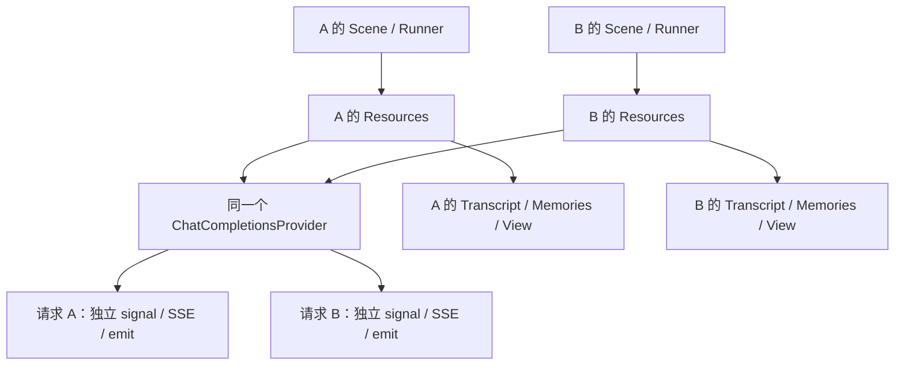

# 多会话共享模型服务

本例验证两个会话共用**同一个 `ChatCompletionsProvider` 实例**，各自发送不同请求。Provider 是实际会共享的模型服务适配器；消息、记忆、View、结构树、Runner 和交互引用由各会话分别持有。

使用真实请求编码、取消和 SSE 解析实现，仅将 `fetch` 替换为可控制的离线传输。不读取 `.env`，不连接模型、不评价模型回答质量，不修改现有 Web 服务。

```sh
pnpm build
node examples/shared-provider/run.mjs
node --test test/conversation-shared-provider.test.mjs test/conversation-shared-interactions.test.mjs
```

## 共享的对象与独立的对象



共享原始 Provider 不需要共享整个 Resources，也不需要共享结构实例。`CompletionResource` 的操作定义可以复用，两份登记指向同一个 Provider；端点与活动窗口在本次调用中建立。

从装配侧看，关键只有这个关系：

```js
const { model, transport } = createControlledProvider();
const a = createSession({ model, label: 'A', mode: 'direct' });
const b = createSession({ model, label: 'B', mode: 'direct' });

// 两个 run 同时在途；Provider 对象相同，运行和请求身份不同。
const first = a.runner.run('A:question');
const second = b.runner.run('B:question');
```

`createSession` 是本例装配函数。真正的结构、资源登记和私有实体建立集中在 [assembly.mjs](assembly.mjs)。材料包含私有历史与预置记忆，实际模型请求必须保留自己的来源身份与标记，不能包含另一个会话的材料。这是本例的归属选择，不把“所有记忆必须按会话划分”规定为框架规则。

## 两条路径的取消语义

| 路径                    | 取消 A 后                                  | B 的行为                        | A 后续可做什么                      |
| ----------------------- | ------------------------------------------ | ------------------------------- | ----------------------------------- |
| 直接 CompletionResource | A 的本地 HTTP 请求 signal 中止，释放流读取 | 保持运行并完成自己的回答        | 新的显式输入发起新请求              |
| 独立 Interaction        | 只结束 A 的局部反馈读取，外部发送继续      | 完成后可关闭自己的 Interactions | 用原引用读取 A 的晚反馈，不重新发送 |

两条路径都先保留已经接纳的 user 消息。被取消的回答不会追加为 assistant；预览与正式内容分开。晚反馈只读也不会自动追加助手消息。

交互路径复用公开的 `createCompletionStartNode` / `createCompletionReplyNode`，在两者之间增加一个明确的业务交接：

```js
const reference = await work.children.send.invoke(work.input, {
  result: { succeeded: (ref) => work.resources.references.remember(ref) },
});
return work.children.read.invoke(reference, {
  delta: (text) => work.output.emit(text),
});
```

引用来自发送节点的正式结果，并保存在本会话的普通资源中。没有从观测、记录或持久快照中推测引用。这里只保存进程内引用，发送与保存引用不构成原子交接；取消发生在交接前，不能承诺随后一定能找回它。本例没有安装 CP，也没有增加通用进度实体。

## 验证结果

本轮两条可运行示例及六项集成测试通过，无需修改生产内核或服务实现。

| 场景                  | 实际检查                                                               |
| --------------------- | ---------------------------------------------------------------------- |
| 两会话并发与交错输出  | 两个真实适配器请求同时在途；请求、来源身份、流与输出不串联             |
| 直接调用取消          | A 请求中止、B 仍占用并正常完成；A 的新输入仍可运行                     |
| 单个请求 SSE 格式错误 | 只拒绝该请求；另一会话继续；没有隐式重试                               |
| 输出消费者故障        | 两请求在途时 A 的 delta 订阅者抛错，其他订阅者和两边正式结果继续成立   |
| 独立发送与局部取消    | A 读取退出而发送仍活跃；B 完成并关闭后，A 仍能取得晚反馈               |
| 再次读取              | 原引用读取准确完整反馈；不重发、不回写旧回答、不向已关闭窗口输出       |
| 持久反馈重建          | 按宿主范围读到各自保存的反馈；不伪造进程内历史增量                     |
| 错误作用域与反例      | 带范围 read 拒绝另一会话的 ref；全局 read 能读取它，证明 UUID 不是授权 |

正常读完 `[DONE]` 也会执行 HTTP reader 的 `cancel()` 来释放读取。因此测试分别检查 `signal.aborted` 和 reader 锁释放，不把正常清理误判为请求取消。

## 多会话隔离与多用户授权的边界

`InteractionReference { id, contract }` 只负责定位。两个独立 Interactions 若接入同一个无范围的 `persistence.read(id)`，持有 B 引用的 A 仍能加载 B 的反馈。测试专门保留了这一反例。

宿主可以共享存储后端，但交给会话的读取端口必须体现其已确定的访问范围：

```js
const interactionsA = createConversationInteractions(model, store.scope(ownerA));
const interactionsB = createConversationInteractions(model, store.scope(ownerB));
```

测试中的 `scope(owner)` 是共享内存存储的夹具，固定检查归属并做 revision 提交校验。它不是新的框架 API，也不实现身份认证；生产宿主必须从可信接纳边界确定 owner，并让内容、引用查询及其他服务出口保持相同的归属约束。本轮没有把权限规则加入通用资源或交互内核。

此次验证证明的是所装配范围内的调用与反馈隔离。真实 HTTP 连接池、供应商全局故障、并发额度与公平性、跨进程持久增量、用户认证和跨实体事务不在结果范围内。单次取消只证明本地 HTTP 消费停止，也不证明供应商停止计算或计费。

## 文件分工

- [assembly.mjs](assembly.mjs)：作者侧装配，复用共享模型，建立各会话的内容、资源和结构。
- [transport.mjs](transport.mjs)：实际 Provider 下的离线 SSE 控制，不实现假 ModelProvider。
- [verify.mjs](verify.mjs)：按真实边界推进取消与晚反馈，保留可执行断言。
- [run.mjs](run.mjs)：依次运行两条验证路径并打印摘要。
- [直接调用测试](../../test/conversation-shared-provider.test.mjs) 与 [独立交互测试](../../test/conversation-shared-interactions.test.mjs)：错误、消费者与持久端口范围回归。
