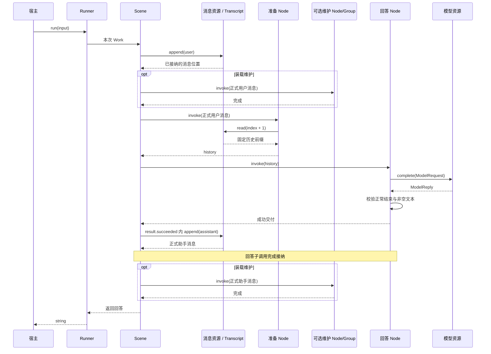

# 对话服务装配对照

`@capix/conversation-service` 是与 Observer 并排的参考装配服务。从公开内核对象建立对话，验证第一作者需要承担哪些工作。完整入口组合独立模型交互、流式回答、View 材料和记忆维护，保存消息、记忆与 View 成员，重启后建立新 Runner 继续对话。直接模型、历史总结及独立反馈读取仍作为可选能力保留。真实路径统一消费 `ModelProvider` 的完整请求和回复；离线演示也只用这个契约的替身，不再提供 TextModel 生产接口。现有 Observer 继续使用原实现；新服务已有独立浏览器入口，复用消息与提交接纳机制及界面基础组件。

## 浏览器入口

```sh
pnpm build
pnpm conversation:web --demo
```

打开 `http://127.0.0.1:4318`。真实模型配置在项目 `.env` 时，由启动命令显式加载：

```sh
node --env-file=.env services/conversation/dist/web/start.js --live
```

Web 与 CLI 使用同一默认数据库（真实 `.capix/conversation.sqlite`，演示 `.capix/conversation-demo.sqlite`）。**先退出使用该数据库的 CLI**，再启动 Web；不会并发打开或复制另一份内容。可指定 `--db PATH --port 4318`，当前只管理这一个对话。

页面提供正式消息、流式预览、取消与明确的失败/未确认状态，以及记忆、View 成员、实际 Scene 调用树和资源详情。首次载入读取内容基线，之后按消息事件同步；预览与提交分别使用增量，检查器按需读取，不随每个 token 重传历史和记录。默认展示本进程最近 100 次 Scene 调用，详情按真实父子关系读取。

刷新会根据本标签页保存的提交定位查询并接回；断线不会取消服务端调用，也不会重新 POST。未知或已淘汰提交保持“结果未确认”，可以核对正式消息后明确结束本地跟踪。服务重启只恢复内容，旧提交和本进程记录不恢复；多会话、文件操作、CP 续接不在这个入口中提供。详细边界见 [浏览器交付](../../docs/conversation-web.md)。

## 完整服务入口

在仓库根目录执行：

```sh
pnpm build
pnpm conversation --demo
```

默认也是离线演示模式，明确标记固定模型替身，不访问网络。`--db /path/to/conversation.sqlite` 可指定文件；演示默认使用 `.capix/conversation-demo.sqlite`，真实模式默认 `.capix/conversation.sqlite`，都与 Observer 数据库分开。输入文本连续对话，`/status` 查看内容数量，`/exit` 正常关闭。再次使用同一数据库启动即可读取原内容并继续。单次验证可用 `--input '请使用简短中文回答'`。

`--records /path/to/run.json` 可选导出本进程的调用记录，目标必须是新文件。记录在正常退出时保存，不承担崩溃恢复；详见下方记录安装。

真实模型须显式选择 `--live`，由宿主环境提供配置。CLI 不读取 `.env`，不输出或持久化密钥；具体配置及关闭语义见 [宿主与持久化](../../docs/conversation-host.md)。

## 目录与依赖方向

```text
cli/                       终端输入、预览展示、可选导出、关闭
web/                       浏览器宿主装配、启动、完整关闭
http/                      提交反馈、消息同步、读取接口与连接
hosting/                   两个可执行宿主共用的模型配置与离线替身
  ↓
assembly/                  组合已存在的公开能力
  content.ts               载入／建立实体，核验关联
  resources.ts             固定实体与 Offer 登记
  interactions.ts          宿主持有的模型发送
  structure.ts             默认业务策略的 Scene/Group 组合
  ↓
scene.ts                   正式输入、回答接纳与维护时机
materials/ memory/ model/  材料策略、记忆策略、模型调用能力

persistence/               SQLite 内容存储，兑现实体的同步持久端口
recording/                 可选记录安装与服务摘要，消费已发生的运行事实
```

业务节点不依赖 CLI 或 SQLite；装配不持有另一份运行状态。`@capix/conversation-service/assembly` 提供上述组合函数，`/persistence` 单独加载 SQLite，根出口仍是可单独使用的业务能力。examples 保留最小教学、策略验证和故障场景，不成为服务的运行依赖。

完整宿主的核心接线如下（`model` 是宿主持有的 `ModelProvider`）：

```ts
import { Runner } from '@capix/server-runtime';
import { loadConversationContent, createMaterialConversationScene, createConversationResources, createConversationInteractions } from '@capix/conversation-service/assembly';
import { ConversationStore } from '@capix/conversation-service/persistence';

const store = ConversationStore.open('.capix/conversation.sqlite');
try {
  const content = loadConversationContent(store);
  const scene = createMaterialConversationScene();
  const resources = createConversationResources(content, model, store.view);
  const interactions = createConversationInteractions(model);
  try {
    const runner = new Runner(scene, resources, interactions, {
      validate() {
        store.assertAvailable();
      },
    }).build();
    console.log(await runner.run('你好'));
  } finally {
    await interactions.settled();
    interactions.close();
  }
} finally {
  store.close();
}
```

`loadConversationContent` 只恢复正式实体，随后创建的是全新结构与调用。SQLite 不保存 Invocation、CP、预览、模型反馈或隐藏待办；未知旧请求不自动重发。装配和关闭失败的完整清理路径在 CLI 中，持久边界见下方文档。

## 阅读入口

| 文件                               | 职责                                                                            |
| ---------------------------------- | ------------------------------------------------------------------------------- |
| `src/scene.ts`                     | 组合准备、回答与可选维护 Node/Group，处理正式消息追加、维护调用、增量转交与接纳 |
| `src/answer.ts`                    | 用直接模型资源回答，校验最终文本并转交字符串增量                                |
| `src/history.ts`                   | 从头读取到本次已接纳输入的完整历史前缀                                          |
| `src/completion.ts`                | 独立 Provider 的完成请求资源与直接完成 Node，保留完整回复，由业务决定接纳       |
| `src/summary/input.ts`             | 区分当前请求与此前历史，形成总结与最近正式回答改写的固定输入                    |
| `src/summary/decision.ts`          | 识别总结、改写、澄清或不支持，并接纳严格的决定形状                              |
| `src/summary/answer.ts`            | 回答 Group：根据真实材料检查执行条件，调用总结或改写 Node                       |
| `src/materials/view.ts`            | 分别提供 View 读取与管理资源，核对来源接线与记忆所属原文                        |
| `src/materials/input.ts`           | 普通准备 Node：分开本次 query 与固定材料，保留真实来源、版本和成员键            |
| `src/materials/answer.ts`          | 普通回答 Group：组织固定请求，调用可替换的 completion 子结构，再接纳完整文本    |
| `src/materials/maintenance.ts`     | 可选普通维护 Node：按正式追加回执，将本条用户或助手消息纳入 View                |
| `src/memory/context.ts`            | 只读资源：核对正式助手位置，固定完整消息前缀与当前记忆全集                      |
| `src/memory/proposal.ts`           | 模型提案 Node：严格接纳变更结构、真实来源、更新目标及既有凭据                   |
| `src/memory/maintenance.ts`        | 可选维护 Group：核对集合版本、写入正式记忆，将实际新建 ID 纳入 View             |
| `src/model/feedback.ts`            | 在一次资源操作内跟随过程反馈、共享等待期限，并在窗口关闭时清理消费              |
| `src/model/request.ts`             | 历史回答 Group：把固定消息组成完整请求，调用独立 completion 并接纳文本          |
| `src/model/pending.ts`             | 本地等待到期的业务异常，携带本次固定交互引用                                    |
| `src/model/completion-contract.ts` | 完整 ModelRequest/ModelReply 交互契约；检查形状，保留真实完成状态               |
| `src/model/completion.ts`          | 完整模型交互的发送、读取资源与普通 Node/Group，复用已有等待和过程反馈机制       |
| `src/runner.ts`                    | 直接模型路径的便捷装配，返回原生 Runner                                         |
| `src/text.ts`                      | 本服务的字符串与非空回答检查                                                    |
| `src/recording/`                   | 安装现有记录预设，限制调用材料的重复正文                                        |
| `src/index.ts`                     | 上述业务能力出口；记录、装配和持久化使用独立子出口                              |

没有独立的 Environment、Source、Task、Manager 或业务继承树。Transcript、可选 Memories/View 与 Interactions 由宿主持有；Scene/Group/Node 描述业务，Resources 固定供给，Runner 管理入口运行。模型实现、持久端口与观测消费者由宿主提供。

## 最小使用与模型边界

真实模型通过独立 Provider 接入，`config` 由宿主提供 endpoint、apiKey、model 等配置：

```js
import { ChatCompletionsProvider } from '@capix/model-provider';
import { createConversationRunner } from '@capix/conversation-service';
import { Transcript } from '@capix/transcript';

const model = new ChatCompletionsProvider(config);
const runner = createConversationRunner(new Transcript(), model);
const unsubscribe = runner.output.subscribe({
  receive(event) {
    if (event.kind === 'delta') console.log('预览', event.delta);
  },
});
try {
  console.log(await runner.run('你好'));
} finally {
  unsubscribe();
}
```

`createConversationRunner` 只是公开装配的便捷函数，返回真实 Runner：

```ts
const scene = createConversationScene();
const messages = new Resource(transcript);
const resources = new Resources().register(messages, TranscriptResource.append).register(messages, HistoryResource).register(new Resource(model), CompletionResource);
const runner = new Runner(scene, resources).build();
```

所有真实模型路径使用 `ModelRequest → ModelReply`，保留 id、model、text、finishReason 和 usage。资源接纳完整反馈形状，业务只在正常结束且正文非空时接纳为回答。`length` 等状态不会因剥成字符串而丢失；提案、总结与改写也使用同一 Provider 契约。纯文本替身只用于测试适配，生产包不导出 TextModel、ModelResource 或 TextModelInteraction。

完整离线示例见 [conversation.mjs](../../examples/conversation.mjs) 和 [conversation-streaming.mjs](../../examples/conversation-streaming.mjs)。示例中的固定回复也实现 ModelProvider，不绕过生产接纳链路。TypeScript 可用 `satisfies ModelProvider` 检查宿主实现。

增量经过 `CompletionResource → 回答 Node/Group → Scene.output → Runner.output`。预览不进入正式消息，也不要求拼接后等于最终回复；最终消息及后处理使用已接纳的完整回复。维护仍失败时，已经正式写入并接纳的回答保留，Scene 失败。应从 `run()` 交付和 entry settled 判断入口终态，不能仅凭输出 completed 推断退出处理已成功。

直接 Provider 收到本次资源操作的 signal。独立交互则由宿主发送者使用自己的总超时，本次 signal 只控制局部反馈读取；两者共用完整模型契约，但生命周期不同。普通观察可用 `runner.observation.subscribe` 取得固定元数据；需要保存记录时使用下方宿主安装。

## 独立模型交互

完整服务默认选择独立交互，宿主登记一次发送与最终反馈的契约：

```js
import { Interactions } from '@capix/interaction';
import { CompletionInteraction, CompletionInteractionResource, createConversationScene, createInteractionAnswer } from '@capix/conversation-service';

const interactions = new Interactions().register(CompletionInteraction, {
  send(request, { publish }) {
    return model.complete(request, request.stream ? { emit: (delta) => void publish(delta) } : {});
  },
});
// 消息/历史资源保持前述登记，回答成员分别申请 start 与 feedback。
resources.registerInteraction(CompletionInteractionResource.start, CompletionInteraction);
resources.registerInteraction(CompletionInteractionResource.feedback, CompletionInteraction);
const scene = createConversationScene(createInteractionAnswer({ waitMs: 30_000 }));
const runner = new Runner(scene, resources, interactions).build();
try {
  await runner.run('你好');
} finally {
  await interactions.settled();
  interactions.close();
}
```

build 不发送请求。`createInteractionAnswer` 将历史组织为完整请求，交给 `createInteractionCompletion` 的发送与读取成员。只有 feedback 权限的节点不能发送替代请求；读取也不自动写入助手消息。

本地超时交付 `ModelReplyPending.reference`。需要可靠跨调用继续时，可以先用 `createCompletionStartNode()` 的正式返回值取得引用，由宿主保存，再把它交给 `createCompletionReplyNode()`；后者返回完整 ModelReply。取消或其他失败不保证交付引用，引用保存、发送、消息追加与 CP 没有共同事务，也没有自动补写。

`feedback.follow` 按 `{cursor,value}` 回放和跟随预览，与最终反馈等待共用截止时间。默认读取节点从头重建；高级消费者可传 `after`，但游标不证明展示或业务接纳成功。过程历史完整、有界、仅保留在进程内；超限或丢失只使预览不可用，最终反馈仍独立读取。不从最终文本伪造历史片段。

调用取消只停止局部读取，外部发送和晚到反馈继续存活；宿主等待 `settled()` 后再关闭 Interactions。持久反馈可重读不等于调用恢复，未完成发送不会在重启后自动重发。参见 [独立反馈读取示例](../../examples/conversation-interaction.mjs)、[消费边界验证](../../docs/interaction-consumption-validation.md) 和后文材料回答接线。

## 可选记录安装

记录属于宿主提供的观察能力，在 Runner build 前安装。业务 Scene/Node 不申请 Recorder，也不为记录重写处理逻辑：

```ts
import { RecordBook, Recorder } from '@capix/records';
import { createConversationRecording } from '@capix/conversation-service/recording';

const book = new RecordBook();
const recorder = new Recorder(book);
let incomplete = false;
const recording = createConversationRecording(scene, recorder, {
  invalidate() {
    incomplete = true;
  },
});
const runner = new Runner(scene, resources, interactions, {
  observations: [recording],
}).build();
await runner.run('你好');
// 保存或展示由宿主决定；incomplete 为 true 时不能把快照称为完整记录。
const snapshot = book.exportState();
```

安装复用内核的 `bindRecording`，保存真实调用树、资源操作、正式消息范围和记忆变更；`returned` 与父层的 `accepted/handled/failed` 分别记录。记忆提案失败被业务接收后，仍显示子失败和父 handled，不改成成功提案。

服务投影保留来源 ID、版本、索引和数量，大段调用材料只记长度，数组只记条数，避免各层反复保存正文。`void` 等非 JSON 返回值转为可记录描述；完整正文仍在内容实体，记忆变化记录仍按实体事实保存。预览片段不进入记录，不把输出结束解释为模型反馈或内容已保存。

默认不安装就没有自动记录。安装默认沿用 `isolate`，漏记通过 `invalidate` 告知宿主；需要严格策略时显式传 `failure: 'propagate'`。严格失败不回滚已经成立的消息/记忆事实，也不自动重发模型。外部交互晚到后若没有新的读取调用，不伪造一条读取或接纳记录。

CLI 的 `--records PATH` 使用同一安装，退出等待本地执行和独立发送结束后写出 `{format, version, recorderId, rootId, integrity, book}`。文件为 0600，拒绝覆盖已有文件以及数据库路径；写出失败使退出失败，正式内容仍保留。这是单进程结束快照，不是逐条持久化或崩溃恢复；Web 的调用检查器单独读取本进程记录。`RecordBook.restore(archive.book)` 可只读载入记录树。细节见 [宿主边界](../../docs/conversation-host.md)。

## 总结历史与后续改写

`createHistoryAnswer()` 是一个普通回答 Group，可以直接交给 `createConversationScene`。这个小闭环将“识别意图”继续推进到真实执行：总结已有对话，正式接纳总结，再在后续独立提交中改写它。

```js
import { CompletionResource, createConversationScene, createHistoryAnswer, HistoryResource } from '@capix/conversation-service';
import { Resource } from '@capix/resources';
import { Resources, Runner } from '@capix/server-runtime';
import { Transcript, TranscriptResource } from '@capix/transcript';

const transcript = new Transcript([{ role: 'user', content: '我们已决定周四复核，周五发布。' }]);
const messages = new Resource(transcript);
// model 是宿主提供的 ModelProvider，例如独立包的 ChatCompletionsProvider。
const resources = new Resources().register(messages, TranscriptResource.append).register(messages, HistoryResource).register(new Resource(model), CompletionResource);
const scene = createConversationScene(createHistoryAnswer());
const runner = new Runner(scene, resources).build();
await runner.run('总结刚才的安排。');
await runner.run('再短一些，只保留一句话。');
```

材料与处理的分工是明确的：

1. Scene 先追加本次用户消息，按其位置取得固定历史前缀。
2. 回答 Group 把最后一条用户消息作为 `query`，此前消息作为 `history`；当前请求不会因为已经写入实体就被当成此前历史。
3. 决策 Node 看这份固定材料，返回 `summarize_history / revise_answer / clarify / unsupported`。模型只选择动作，不签发历史引用或拼装执行材料。
4. Group 核对所选动作确有材料。总结 Node 收到 `{query, history}`；改写 Node 收到 `{query, answer: {index, content}}`，指向本次固定前缀中最近的正式助手消息。执行不重新读取可变 Transcript。
5. 执行结果必须正常完成且非空；Scene 使用原有的子结果接收，成功写入助手消息之后才能完成本次入口。下次提交再次读取实体，因而能引用刚才的正式结果。

没有历史却选中总结、没有助手回复却选中改写，都会返回具体澄清；澄清是正常的助手回复。模型决定形状错误、模型请求失败、非正常完成或取消仍按真实故障交付，不自动伪装成澄清，不重试。消息写入失败不能声称回答已接纳；已经成立的用户消息和其他实体事实不自动回滚。

本场景只处理总结和改写，不引入待办实体或跨提交控制状态。`revise_answer` 指最近正式助手消息，包括可能的澄清正文，并不保证它一定是某类总结；是否适合改写仍由本次业务选择。这组总结/改写节点仍读取完整前缀；下面的 View 材料路径是另一种准备与回答组合。这组总结/改写节点没有记忆写入、Skill 执行或服务 CP；浏览器默认装载后文的材料回答，也不会替换旧 Observer 的编排。它们仍使用非流式 Completion 请求；下文 View 材料回答已接入流式及可选记忆维护。系统提示是模型传输材料，不作为正式 Transcript 消息写入。

执行条件检查只确定“是否存在此前消息 / 正式助手回复”，不证明材料在语义上足以回答；相关性仍由业务选择与模型处理负责。当前输入始终是请求，不会因先前澄清而自动变成总结正文。补充内容先进入对话，后续再请求总结；本版没有完成“补料即自动续接”的流程，也没有以隐藏任务状态模拟它。

完整入口：[examples/conversation-history.mjs](../../examples/conversation-history.mjs)。默认固定模型响应验证真实资源、节点、消息与后续读取，不声称模型质量；显式 `--live` 才使用宿主提供的 DeepSeek 配置，完整示例最多 5 次请求：

```sh
pnpm build
node examples/conversation-history.mjs
# 需要实际模型时，由宿主加载凭据；示例本身不读取 .env。
node --env-file-if-exists=.env examples/conversation-history.mjs --live
```

验证见 `test/conversation-history.test.mjs` 与 `test/types/conversation-history.*`，覆盖固定材料交接、来源不足、后续正式回答引用、模型/取消/持久失败与下一次提交。

## 消息与记忆作为本次材料

回答结构可以有自己的输入类型。`createConversationScene(answer, prepare, maintain?)` 显式装载普通准备节点，由类型检查准备结果与回答输入是否一致。可选维护节点接收正式追加消息，返回 void。原有单参数用法仍读取完整历史前缀；不传 maintain 时没有额外维护调用，两种准备方式共用正式消息接纳。

```ts
const scene = createConversationScene(createMaterialAnswer(), createMaterialPreparation(), createMessageInclusion());
const materials = new Resource({ view, transcript, memories });
const resources = new Resources().register(new Resource(transcript), TranscriptResource.append).register(materials, ConversationViewResource.read).register(materials, ConversationViewResource.manage).register(new Resource(model), CompletionResource);
const runner = new Runner(scene, resources).build();
await runner.run('根据已有安排简短说明。');
```

宿主分别建立 Transcript、Memories 和 View。这个服务的 View 固定两个来源槽位：`messages` 与 `memories`，都使用实体包的 whole 范围适配器；成员可以稀疏、混合和显式排序。两个 Offer 分别登记：`read` 供准备节点读取，`manage` 供维护节点改变成员。资源适配核对 `memories.transcript`、View 来源身份与范围；来源版本继续由 View 核验。准备节点不因装载维护策略而取得写入权限，Scene 自身也不申请 View。

需要保存成员变更时，宿主可以给 manage 单独登记 `new Resource({ view, transcript, memories, persistence })`，其中 persistence 为 `ViewPersistence`。有变化的 View 提交先经过这个同步持久端口，成功后才安装成员状态；端口须比较 `commit.previous.revision`。这不把正式消息追加与 View 提交合成一次事务。

一次调用的过程如下：

```text
Scene 追加正式用户消息
  → { transcriptId, index, message }
maintain（若装载）处理这条用户消息
prepare 捕获 View 并核对本次输入的 Transcript
  → { query: { transcriptId, index, content }, materials: { basis, entries } }
answer 使用固定材料构造模型请求
  → 完整回答
Scene 接纳并追加正式助手消息
  → { transcriptId, index, message }
maintain（若装载）处理这条助手消息
Scene 返回回答
```

正式 append 端点返回真实 `transcriptId`，准备与维护节点不从 View 猜测输入来源。`AcceptedConversationMessage = { transcriptId, index, message }` 是 Scene 交给子节点的业务值，同时表示用户或助手的正式消息，不是认证凭据；单独运行准备或维护节点时，调用者仍负责提供正式追加所得的定位。助手维护发生在正式 append 与回答子调用接纳完成之后；回答增量仍由原来的 answer → Scene → Runner 链路转交。

`materials` 是 **View 捕获后的业务投影**：消息只保留真实 `key < query.index` 的条目，当前请求与更晚消息不作为此前材料。记忆保留独立类型、ID 与原文来源索引；两类条目共享捕获时的来源版本依据。投影保留原键和原顺序，不能把数组位置当作正式消息索引，也不能用它声称包含该修订下的全部 View 成员。当前请求独立传递，即使没有进入 View 也能正常回答，空 View 是合法输入。

捕获先核对来源版本，冲突直接失败，不自动重试成另一份材料，也不承诺跨实体事务。成功捕获的内容已固定；后来更新记忆或调整 View 不改变本次回答输入，只影响下一次捕获。材料准备失败时，已经追加的用户消息保留，回答节点不执行；回答保存失败时，生成文本不能算正式回答。

View 本身不决定何时纳入消息。`createMessageInclusion()` 是宿主选装的普通业务 Node，只申请 manage，核对消息属于该 Transcript 后调用 `include` 纳入本条消息；它不扫描此前历史或补纳缺口，不改变已有成员的顺序。每次 Scene 内的用户维护和助手维护是同一结构的两次普通调用，没有新增生命周期或内核 hook。自定义维护也可使用 `Node/Group<AcceptedConversationMessage, void, ...>`，由自己的 deps 声明所需能力。

不装载记忆维护时，这条材料路径只读取宿主已有的记忆；退出 View 不删除实体。完整示例 [conversation-materials.mjs](../../examples/conversation-materials.mjs) 只选装消息纳入策略：第一次读取稀疏消息与预置偏好，第二次自然读取前次已纳入的用户消息和正式回答，同时展示第一份捕获不随后续维护而变化：

```sh
pnpm build
node examples/conversation-materials.mjs
```

示例使用离线模型替身，展示装配、来源与固定材料，不评价模型理解质量。准备、回答与维护节点均可独立替换；当前材料回答使用 CompletionResource，显式请求流式正文并通过 Node/Scene 转交 Runner。历史总结/改写原有节点继续消费完整前缀，不能把稀疏材料强转为前缀后复用其位置推导。本轮没有自动选择、容量维护、Skill 或服务 CP。

正式消息与 View 的失败边界分别保留：

| 失败位置           | 已成立的事实                               | 后续行为                                             |
| ------------------ | ------------------------------------------ | ---------------------------------------------------- |
| 用户消息追加       | 以 Transcript 的实际保存结果为准           | 不调用维护、准备或模型；保存失败不能声称正式追加成功 |
| 用户消息后的维护   | 正式用户消息保留；已完成的 View 操作不回滚 | Scene 失败，不进入准备或模型                         |
| 材料准备或模型回答 | 正式用户消息及此前维护结果保留             | Scene 失败，不伪造正式助手消息                       |
| 助手消息追加       | 用户消息及此前维护结果保留                 | 回答子调用不完成成功接纳，不调用助手维护             |
| 助手维护交付失败   | 正式助手消息和回答子接纳均已成立           | Scene 失败，不能报告整个入口成功                     |

维护中的持久提交失败，不安装该次 View 成员变更。下一次提交仍只读取 View 的实际成员；此前没有纳入的消息不会自动补上。没有跨消息与 View 的事务，也没有自动回滚、修复或重试。

## 业务链路



上图展示直接模型与默认历史准备路径。Scene 只申请消息写入；准备节点申请历史读取，默认回答 Node 只申请模型，可选维护节点声明自己的资源。独立交互回答 Group 则由发送和读取节点分别申请所需资源。它们通过普通子调用传递不可变消息值，不共享活的 Context 或隐式环境。

历史范围来自输入追加的回执，不在异步等待后重新读取当前长度。消息读取与追加登记到同一个 Transcript。历史资源的“完整前缀”是本服务的策略，并未改变消息实体或内核。

## 行为边界

- 输入与模型最终回答必须是非空白字符串，保留原文，不自动 trim。
- 模型失败或输出不合法时，本次调用失败，已追加的用户消息保留；没有伪造的助手消息。下一次提交可以正常运行。
- 助手消息只在子结果接收时写入。实体持久端口失败不能被报告为成功回答；已经成立的实体事实不承诺回滚。
- 同一个 Runner 拒绝同时运行，拒绝发生在输入写入前。宿主为每个对话保留一个 Runner；多个 Runner 共享同一个 Transcript 不会自动获得跨入口串行保证。
- 直接模型的取消与独立交互的取消具有上述不同边界；两者都不承诺撤销已经发生的外部副作用。
- Transcript、模型、Interactions、持久端口及观察者由宿主持有。业务节点与装配函数借用它们，不自行关闭、重建或替换实体；CLI 作为宿主负责完整退出。

## 与 Observer 对照

| 关注点     | 现有 Observer                             | 本包当前实现                                                    |
| ---------- | ----------------------------------------- | --------------------------------------------------------------- |
| 输入       | HTTP / submission 接纳及内容同步          | `runner.run(string)`，Scene 写入用户消息                        |
| 材料       | 活跃视图、记忆、维护及准备                | 完整消息前缀，或 View 固定材料与可选的正式消息纳入策略          |
| 模型       | 固定配置、Provider 适配、独立 Interaction | 统一完整 Provider；直接完成或独立 CompletionInteraction         |
| 推进       | 决策、澄清、回答、文件与记忆能力          | 一个可替换的回答 Node/Group；两条路径共用消息接纳               |
| 观测       | 记录安装、来源投影与客户端交付            | Runner 输出/元数据、可选真实记录树与退出快照导出                |
| 持久与恢复 | SQLite 内容、记录、交互和显式 CP          | 独立 SQLite 保存消息／记忆／View；新 Runner 续用内容，无服务 CP |
| 对外服务   | 会话管理、HTTP、同步与 UI                 | 进程内包、连续对话 CLI 和独立单会话 Web 入口                    |

这不是旧服务的等效替代。完整历史可能达到模型容量边界；本版没有实现容量维护、选择或压缩策略，也不在装配函数里暗中截断。真实模型协议、超时和容量约束由宿主适配，后续作为明确能力逐项讨论。

## 当前完成与后续范围

直接流式、独立发送、本地取消/超时与反馈重读都通过公开资源、结构与 Runner 组合，不需要补写 Invocation/Context、callableHooks 或按次 capture。相关验证入口为 `test/conversation-service.test.mjs`、`test/conversation-streaming.test.mjs`、`test/conversation-interaction.test.mjs` 与 `test/types/conversation-service.ts`。命名成员和资源方法保持准确类型。TypeScript 作者仍需明确结构 I/O，并用 `ResourcesOf<typeof deps>` 表达资源端点；不能从业务函数体反推未知输入，也不以断言假装已经推导。

组合测试覆盖自定义 Node/Group 的输入、接纳和单父归属；交互类型测试验证引用、消息、结果与增量不可混用。取消回归区分准确 signal.reason 与同期独立故障。完整服务新增 `conversation-persistence`、`conversation-assembly`、`conversation-cli` 测试，分别验证存储契约、业务接线和进程重启，不访问真实模型。

独立交互的过程反馈、局部等待、取消和引用继续由公共 Interaction 端口处理。回归保留了跨调用续读、窗口清理、预览失效、游标及固定期限，见 `test/conversation-interaction-progress.test.mjs`。记录回归见 `test/conversation-recording.test.mjs`，验证真实关系、材料依据、隔离与严格失败以及关闭边界。

材料筛选、容量策略与服务 CP 仍需分别设计；Web 交付只投影已发生的内容与调用事实，不扩展执行恢复。

## 材料回答的流式输出

`createMaterialAnswer(completion = createCompletionNode())` 是普通 Group，使用固定 query/materials 构造一次 `stream: true` 请求，交给自己的 completion 成员。默认成员通过 `CompletionResource.complete` 直接调用 Provider，把同步 emit 接到本次资源操作，再逐层转交到 Scene；宿主继续使用 `runner.output.subscribe`。记忆提案没有开启 stream，也不取得 emit，提取内容不会混进回答预览。

```text
Provider 正文片段 → ResourceOperation.emit → completion 子结构 → 回答 Group → Scene → Runner.output
Provider 完整回复 → finishReason/非空校验 → 正式助手消息 → 可选维护 → 根完成
```

模型流在最终回复前断开、超限、取消或得到非正常结束时，已显示的片段仍只是预览，不追加助手消息，也不启动该回答的记忆提取。正式追加失败同样不进入维护。提取的可处理异常继续按下节跳过；必要持久错误保留原边界。Scene 仍等待维护结束，不把输出预览当成根调用完成。

ChatCompletionsProvider 的最终 text 由其接纳的 content 片段累积；服务也支持宿主自定义 ModelProvider，预览与最终 text 可以不同，正式保存及后处理只采用已校验的最终值。无 delta 的宿主实现仍可交付完整回复，服务不会从最终文本伪造历史片段。流式请求、字节上限和取消规则见 [Provider 包](../../server/model-provider/README.md)。

本次不改变旧 Observer、独立交互的过程缓存或 HTTP/客户端。示例 `conversation-memory.mjs` 通过现有 Runner 出口展示预览与记忆维护，默认离线。验证入口为 `test/model-provider-streaming.test.mjs` 和 `test/conversation-material-streaming.test.mjs`。

## 材料回答选装独立模型交互

材料准备和正式回答接纳保持同一套业务逻辑，宿主可替换 completion 成员：

```ts
const interactions = new Interactions().register(CompletionInteraction, {
  send(request, { publish }) {
    // model 是宿主持有的 ModelProvider，外部请求由它自己的总超时管理。
    // publish 属于交互，不引用当前调用的 signal 或 operation.emit。
    return model.complete(request, request.stream ? { emit: (delta) => void publish(delta) } : {});
  },
});
const answer = createMaterialAnswer(createInteractionCompletion({ waitMs: 30_000 }));
const scene = createConversationScene(answer, createMaterialPreparation(), maintain);
// materials/message/maintenance 的登记与直接模式相同；回答成员只申请下面两个交互资源。
resources.registerInteraction(CompletionInteractionResource.start, CompletionInteraction);
resources.registerInteraction(CompletionInteractionResource.feedback, CompletionInteraction);
const runner = new Runner(scene, resources, interactions).build();
```

`ConversationCompletion` 是 `Node<ModelRequest, ModelReply, …, string>` 或相同 I/O/Delta 的 Group，普通业务结构也可以实现它。默认直接成员使用本次调用的 signal；独立交互成员的 signal 仅停止本地读取。记忆维护仍按其自身 deps 使用直接 `CompletionResource`，上述选择不隐式改变其他模型调用的生命周期。

`CompletionInteraction` 使用独立版本键 `conversation.completion.v1`。它保存带 system/user/assistant 消息、stream、responseFormat、maxTokens、temperature 的固定请求，并保留完整 `id/model/text/finishReason/usage` 反馈。这些都是不含凭据的值；Provider 的 endpoint/key/model 配置由宿主发送者持有。原纯文本交互接口已退出服务；旧版本持久反馈不自动迁移为这个格式。

交互仍要求固定 JSON 数据：未配置的可选字段应省略，不传显式 `undefined`、signal、函数或活对象。默认材料请求符合这个要求；自定义 completion 结构需自行遵守持久边界，不能仅凭 TypeScript 的 ModelRequest 类型推断任意 JavaScript 值均可保存。

交互检查数据形状，不要求 `finishReason === 'stop'` 或正文非空。`length`、空正文等回复可以被保存、再次读取；材料回答仍在取得完整反馈之后检查正常完成与非空，再交给 Scene 正式追加。原始反馈与业务接纳事实因此分别保留。预览丢失或超限时仍读取最终反馈；流封闭不等于最终反馈已保存。完成 Node 的输出检查返回原对象，不用新的解码对象替换成功返回值。

`createInteractionCompletion()` 组合发送和读取，等待到期交付现有 `ModelReplyPending.reference`；取消或其他失败不保证向宿主交付引用。确需跨调用继续时，可以先用 `createCompletionStartNode()` 的正式返回值取得引用，由宿主保存，再把它交给 `createCompletionReplyNode()`。发送、引用保存和消息落实仍不构成事务。本轮不增加隐藏引用表、自动重发或自动补写。

`createCompletionReplyNode()` 返回完整 ModelReply，读取本身不判断是否能成为回答，也不自动追加消息。它从头重建预览；需要按位置续读时直接使用 `CompletionInteractionResource.feedback.follow({reference, after, waitMs})`，得到 `{cursor,value}`。所有模型回复共用同一套等待实现，没有第二套超时、取消或缓存生命周期。

读取节点在进入处理时固定本次引用，后续等待、最终读取和超时交付共用同一份身份；调用者在等待期间修改原输入对象，不能把 pending 改指另一交互。

离线示例 [conversation-completion-interaction.mjs](../../examples/conversation-completion-interaction.mjs) 先运行材料回答，再演示正式交付引用、本地取消、晚到反馈及新调用只读消费。测试 `test/conversation-completion-interaction.test.mjs` 和对应类型用例另验证严格契约、固定请求、反馈持久端口重读、异常完成的业务拒绝，以及真实 Provider + 模拟 SSE 经过交互后进入材料回答和记忆维护。持久端口验证使用内存快照，不宣称实际数据库恢复；本轮未调用真实模型。

## 从正式回答形成后续记忆

`createMemoryMaintenance()` 是可选的普通 Group。它只在正式助手消息之后请求一次模型提案；用户消息阶段直接返回。消息纳入和记忆维护由宿主通过普通成员调用决定组合顺序：

```ts
const maintain = new Group<AcceptedConversationMessage, void>().add({
  include: createMessageInclusion(),
  remember: createMemoryMaintenance(),
});
maintain.run = async (work) => {
  await work.children.include.invoke(work.input);
  await work.children.remember.invoke(work.input);
};
const scene = createConversationScene(createMaterialAnswer(), createMaterialPreparation(), maintain);

// 延续前面的消息、View 和模型登记，额外明确授予记忆读取与写入。
const memory = new Resource(memories);
resources.register(memory, ConversationMemoryResource).register(memory, MemoryResource.apply);
const runner = new Runner(scene, resources).build();
```

提取输入在调用时经 `ConversationMemoryResource.capture` 固定。这个服务预设选择截至本条助手消息的完整正式前缀及当前记忆全集，包含未进入 View 的记忆，避免更新只能看到活跃条目。它核对助手正文和位置，并返回 `{basis, acceptedIndex, messages, memories}`；basis 包含真实原文身份、记忆集合身份和 sequence。已有记忆若引用前缀之外的消息，拒绝使用。此策略不是 View 的默认行为，也没有隐式筛选、截断、相似度去重或容量管理。

模型只返回最多 32 项 `changes`，空数组合法。服务检查完整结束、严格字段、非空内容、非空且唯一的真实原文来源、准确更新目标、同批目标不重复及结果包含本次变更依据。来源必须在本次捕获的完整前缀内。更新可根据当前记忆内容保留或移除旧 `sourceIndexes`，不要求结果包含全部旧索引；哪些旧来源仍有意义由本服务的提取策略决定，内核与记忆实体原本就不强制旧来源累加。校验保证结构和定位合法，不能证明语义提取正确，或阻止模型将相同内容误判为新事项。

`sourceResults` 仍由本服务原样继承目标正式记忆的全部既有凭据；模型既不能生成凭据，也不能选择保留或删除哪些凭据。这是当前业务预设，不是所有记忆或内核的永久累加规则。本轮不增加凭据选择 API。

```text
正式助手消息已保存且子结果已接纳
  → 固定完整前缀与当前记忆全集
  → 提案 Node 请求模型、校验来源与目标
    → 成功：MemoryResource.apply(changes, 原 basis)
      → 只将实际新建的记忆 ID 纳入 View
    → 可处理异常：result.failed 接收为 skipped，结束维护
Scene 等待维护结束 → 返回已保存的回答
下一次准备 → 捕获更新后的活跃材料
```

写入资源同步核对原集合身份、原文身份和 sequence，模型等待期间若记忆已被其他写入修改，则拒绝本提案，空批次也不能绕过检查。返回的 `MemoryApplication` 仅包含实际变化项的冻结快照；等值更新不占新 sequence。它不是跨调用幂等凭据，不改变原 `applyFixed`。

新记忆 ID 来自实体实际落实的返回值。已有记忆更新保持原成员资格：活跃项下次读取新正文，已退出项仍退出；需要重新纳入时由另一条明确策略调用 View.include。消息退出 View、记忆退出 View 和修改记忆来源互不自动级联：退出消息不删除记忆来源，修改来源不改变消息或记忆的成员资格。维护不会遍历重建 View 的全部成员，但本预设的提取输入仍遍历完整消息前缀与记忆全集。

默认维护在 propose 子调用的 `result.failed` 中接收可处理的模型／候选异常，以内部 `skipped` 结果直接结束本次维护，跳过 Memory.apply 和 View.include。提案子调用仍保留原始 returned failed，维护父层记录 reception handled，不把提取失败改记成成功或空 changes；成功提案的空 changes 仍调用 apply 核对原 MemoryBasis。公开维护签名仍返回 void，不增加策略参数或公开结果类型。Scene 等待维护结束后交付已保存且接纳的回答，没有后台维护或自动重试。

接收只包住 propose 子调用，没有整个维护的 catch。材料捕获、实体身份核验、MemoryBasis 冲突、记忆写入及 View 操作的失败仍使维护和 Scene 失败，不发布成功根 completed。Memories 与 View 的实际持久端口失败、必要变化发布／严格观测错误、运行窗口错误及取消等受保护交付，即使发生在 propose 内，也不进入业务 failed 分支。普通操作异常是否可接收与本服务是否选择接收分别判断，详见 [错误与异常边界](../../docs/exceptions.md)。

记忆写入与 View 纳入分别提交。记忆提交失败不进入纳入；必要变化发布失败可能发生在记忆已安装之后；View 提交失败保留已写入记忆。各处失败都保留此前正式助手消息，不重跑模型、不补写或补纳入。后续新提交仍能读取真实记忆全集，由新的提案决定处理；不从缺少 View 成员推断记忆尚未写入。

离线完整示例：[conversation-memory.mjs](../../examples/conversation-memory.mjs)，运行 `node examples/conversation-memory.mjs`。它从空记忆集合开始，验证真实 ID、新建纳入、后续读取、同 ID 更新及退出后不回流。固定模型响应只验证链路与契约，不评价真实模型提取率；只有显式装载这个维护 Group 才启用提取。测试见 `test/conversation-memory.test.mjs`、`test/types/conversation-memory.*` 与 `test/memory/apply-resource.test.mjs`。
