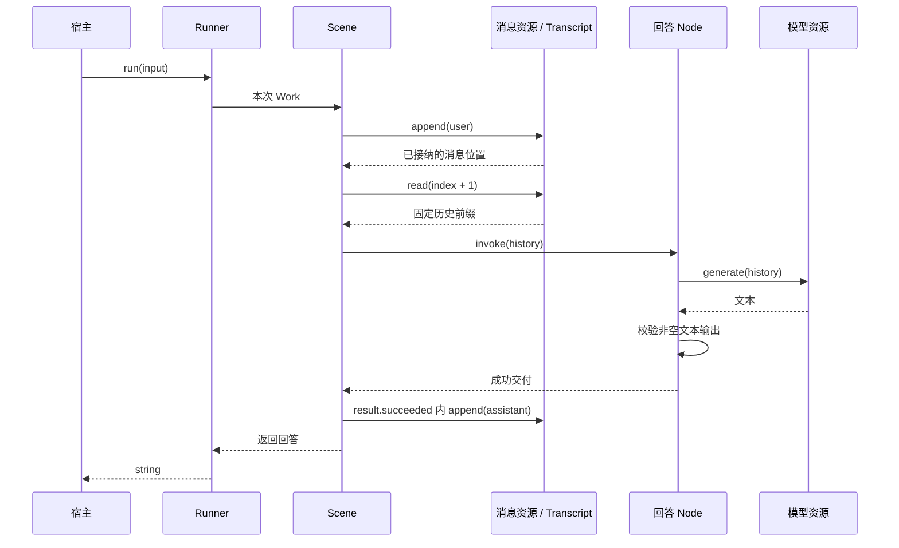

# 对话服务装配对照

`@capix/conversation-service` 是与 Observer 并排的服务装配实验。从公开内核对象建立对话，验证第一作者需要承担哪些工作。当前支持直接模型流式输出，以及可选的独立模型交互、有界过程反馈与最终反馈重读；两条路径共用输入落实、历史读取和回答接纳。现有 Observer、HTTP 和客户端继续使用原实现。

## 阅读入口

| 文件                       | 职责                                                                           |
| -------------------------- | ------------------------------------------------------------------------------ |
| `src/scene.ts`             | 接受回答 Node/Group，统一处理输入落实、历史读取、增量转交、回答接纳与写入      |
| `src/answer.ts`            | 用直接模型资源回答，校验最终文本并转交字符串增量                               |
| `src/history.ts`           | 从头读取到本次已接纳输入的完整历史前缀                                         |
| `src/model.ts`             | TextModel 与普通受控资源；把本次 signal/emit 交给宿主模型实现                  |
| `src/model/interaction.ts` | 固定请求/反馈契约，以及分别授权的 start/feedback 资源                          |
| `src/model/feedback.ts`    | 在一次资源操作内跟随过程反馈、共享等待期限，并在窗口关闭时清理消费             |
| `src/model/request.ts`     | 组合一次发送与本地读取；提供可独立使用的读取节点和携带引用的 ModelReplyPending |
| `src/runner.ts`            | 直接模型路径的便捷装配，返回原生 Runner                                        |
| `src/text.ts`              | 本服务的字符串与非空回答检查                                                   |
| `src/index.ts`             | 上述公开出口                                                                   |

没有独立的 Environment、Source、Task、Manager 或业务继承树。Transcript 与可选 Interactions 由宿主持有；Scene/Group/Node 描述业务，Resources 固定供给，Runner 管理入口运行。模型实现、持久端口与观测消费者由宿主提供。

## 最小使用

```js
import { createConversationRunner } from '@capix/conversation-service';
import { Transcript } from '@capix/transcript';

const transcript = new Transcript();
const model = {
  generate(messages) {
    return `收到：${messages.at(-1).content}`;
  },
};
const runner = createConversationRunner(transcript, model);
const answer = await runner.run('你好');
```

这是 JavaScript 也可直接使用的示例。TypeScript 中可用 `satisfies TextModel` 为模型对象取得参数类型。

`createConversationRunner` 只是下面这段公开装配的便捷函数，返回真实 Runner：

```ts
const scene = createConversationScene();
const messages = new Resource(transcript);
const resources = new Resources().register(messages, TranscriptResource.append).register(messages, HistoryResource).register(new Resource(model), ModelResource);

const runner = new Runner(scene, resources).build();
await runner.run('你好');
```

完整可运行示例见 [examples/conversation.mjs](../../examples/conversation.mjs)，构建后执行 `node examples/conversation.mjs`，不需要模型配置或凭证。普通运行观察直接使用 `runner.observation.subscribe`，消费固定元数据；场景输出使用 `runner.output.subscribe`，最终回答仍由 run 返回。两种反馈以 entryId 关联，不需要额外的服务包装对象。确需原生同步观察能力时，便捷函数仍可通过第三个参数的 `observations` 安装；进一步组合直接使用公开 Scene、Offer 和 Runner。

## 直接模型与流式输出

```js
const runner = createConversationRunner(new Transcript(), {
  async generate(messages, { signal, emit }) {
    emit?.('正在整理答案');
    // 真实模型适配器在这里使用 signal，并逐段调用 emit。
    // 最终文本是独立的返回值，可以修正已经展示的预览。
    return `最终回答：${messages.at(-1).content}`;
  },
});
const unsubscribe = runner.output.subscribe({
  receive(event) {
    if (event.kind === 'delta') console.log('预览', event.delta);
    if (event.kind === 'completed') console.log('最终文本', event.result);
  },
});
try {
  console.log(await runner.run('你好'));
} finally {
  unsubscribe();
}
```

增量经过 `ModelResource → createAnswerNode → Scene.output → Runner.output`。每层只转交自己的输出，不把资源操作或 Work 留给调用之外的对象使用。没有订阅者时，增量的字符串检查仍然执行；订阅者失败不改变业务结果。

预览不是正式消息，也不要求拼接后等于最终文本。最终非空回答通过子结果接收并写入 Transcript，Scene 才能返回；失败或取消不能用已经展示的预览冒充正式回答。`runner.run()` 的完成结果与 `runner.observation` 的 entry settled 事实表达入口的真实终态，不能仅凭输出 completed 推断所有退出处理已经成功。

直接模型收到本次操作的 signal。模型是否停止外部请求取决于实现；不响应 signal 的模型仍占用 Runner，直到原操作退出。取消或操作结束后，保留的 emit 不能继续发布。示例见 [conversation-streaming.mjs](../../examples/conversation-streaming.mjs)。

## 独立模型交互

当外部处理需要独立于本次调用存活时，可以用同一会话 Scene，替换其中实际装载的回答结构：

```js
import { Interactions } from '@capix/interaction';
import { Resource } from '@capix/resources';
import { Resources, Runner } from '@capix/server-runtime';
import { Transcript, TranscriptResource } from '@capix/transcript';
import { createConversationScene, createInteractionAnswer, HistoryResource, ModelInteractionResource, TextModelInteraction } from '@capix/conversation-service';

const transcript = new Transcript();
const interactions = new Interactions().register(TextModelInteraction, {
  send(history, { publish }) {
    publish('正在整理回答'); // 入口属于交互，可以跨越一次调用的寿命。
    return `回答：${history.at(-1).content}`;
  },
  // persistence 由宿主按需要提供，示例默认只在本进程保留反馈。
});
const messages = new Resource(transcript);
const resources = new Resources().register(messages, TranscriptResource.append).register(messages, HistoryResource).registerInteraction(ModelInteractionResource.start, TextModelInteraction).registerInteraction(ModelInteractionResource.feedback, TextModelInteraction);
const scene = createConversationScene(createInteractionAnswer({ waitMs: 30_000 }));
const runner = new Runner(scene, resources, interactions).build();
await runner.run('你好');
await interactions.settled();
interactions.close();
```

`createConversationScene(answer?)` 接受尚未被其他父结构占用的实际 Node/Group；每个回答结构保留自己的 deps。Scene 不增加模型模式判断，也不复制消息接纳逻辑。`createConversationRunner` 仍是直接模型的便捷函数；独立交互按上例显式装配。

build 只核对登记和固定接线，不发送请求。`createInteractionAnswer` 用一个发送节点取得引用，再用 `createModelReplyNode` 等待同一交互。start 与 feedback 分别授权，只有反馈读取权限的节点无法发送替代请求。

本地等待到期会抛出 `ModelReplyPending`，其 `reference` 可以交给一个新的读取场景：

```js
import { Scene } from '@capix/structure';
import { createModelReplyNode } from '@capix/conversation-service';

const reader = new Runner(new Scene(createModelReplyNode(30_000)), new Resources().registerInteraction(ModelInteractionResource.feedback, TextModelInteraction), interactions).build();
const text = await reader.run(pending.reference); // pending 来自捕获的 ModelReplyPending。
```

读取不重发，也不自动追加助手消息。反馈为 unavailable 时，读取节点保留原故障，不把它改造成 pending 或猜测应该重新发送。宿主必须明确决定取得文本之后是否以及如何接纳为会话结果。完整示例见 [conversation-interaction.mjs](../../examples/conversation-interaction.mjs)。

交互路径的 signal 只作用于本地过程读取与最终反馈等待。取消可以释放本次 Runner，已开始的外部处理继续，晚到反馈仍由 Interactions 接收；宿主等待 `settled()` 后才能 `close()`。没有持久端口时，只有本进程的有界缓存；跨进程读取需要宿主配置持久端口、确认反馈保存成功并保留引用。旧宿主尚未完成的发送不会在新宿主中自动恢复或重发。

引用交付、外部发送、会话消息写入与 CP 保存没有统一原子提交。本服务没有声明 CP；不能承诺任意失败后都能从本次调用取得引用，也不能把反馈可重读解释为会话执行已经恢复。

## 业务链路



上图展示直接模型路径。Scene 只申请消息写入与历史读取；默认回答 Node 只申请模型，独立交互回答 Group 则由发送和读取节点分别申请所需资源。它们通过普通子调用传递不可变消息值，不共享活的 Context 或隐式环境。

历史范围来自输入追加的回执，不在异步等待后重新读取当前长度。消息读取与追加登记到同一个 Transcript。历史资源的“完整前缀”是本服务的策略，并未改变消息实体或内核。

## 行为边界

- 输入与模型最终回答必须是非空白字符串，保留原文，不自动 trim。
- 模型失败或输出不合法时，本次调用失败，已追加的用户消息保留；没有伪造的助手消息。下一次提交可以正常运行。
- 助手消息只在子结果接收时写入。实体持久端口失败不能被报告为成功回答；已经成立的实体事实不承诺回滚。
- 同一个 Runner 拒绝同时运行，拒绝发生在输入写入前。宿主为每个对话保留一个 Runner；多个 Runner 共享同一个 Transcript 不会自动获得跨入口串行保证。
- 直接模型的取消与独立交互的取消具有上述不同边界；两者都不承诺撤销已经发生的外部副作用。
- Transcript、模型、Interactions、持久端口及观察者由宿主持有。本包借用它们，不自行关闭、重建或替换实体。

## 与 Observer 对照

| 关注点     | 现有 Observer                             | 本包当前实现                                                       |
| ---------- | ----------------------------------------- | ------------------------------------------------------------------ |
| 输入       | HTTP / submission 接纳及内容同步          | `runner.run(string)`，Scene 写入用户消息                           |
| 材料       | 活跃视图、记忆、维护及准备                | 截至当前输入的完整消息前缀                                         |
| 模型       | 固定配置、Provider 适配、独立 Interaction | 直接 TextModel 流式资源，或带有界过程反馈的独立 Request/Reply 交互 |
| 推进       | 决策、澄清、回答、文件与记忆能力          | 一个可替换的回答 Node/Group；两条路径共用消息接纳                  |
| 观测       | 记录安装、来源投影与客户端交付            | Runner 只读元数据订阅及根输出；也保留可选原生观察安装              |
| 持久与恢复 | SQLite 内容、记录、交互和显式 CP          | 宿主可提供 Transcript 与 Interaction 持久端口；反馈重读，无服务 CP |
| 对外服务   | 会话管理、HTTP、同步与 UI                 | 进程内包，无 HTTP 或客户端适配                                     |

这不是旧服务的等效替代。完整历史可能达到模型容量边界；本版没有实现容量维护、选择或压缩策略，也不在装配函数里暗中截断。真实模型协议、超时和容量约束由宿主适配，后续作为明确能力逐项讨论。

## 当前完成与后续范围

直接流式、独立发送、本地取消/超时与反馈重读都通过公开资源、结构与 Runner 组合，不需要补写 Invocation/Context、callableHooks 或按次 capture。相关验证入口为 `test/conversation-service.test.mjs`、`test/conversation-streaming.test.mjs`、`test/conversation-interaction.test.mjs` 与 `test/types/conversation-service.ts`。命名成员和资源方法保持准确类型。TypeScript 作者仍需明确结构 I/O，并用 `ResourcesOf<typeof deps>` 表达资源端点；不能从业务函数体反推未知输入，也不以断言假装已经推导。

2026-10-28 执行 `pnpm check`，构建、类型检查、2096 项测试及格式检查全部通过。组合测试另覆盖自定义 Node/Group 的输入、接纳和单父归属；交互类型测试验证引用、消息、结果与增量不可混用。取消回归区分准确 signal.reason 与同期独立故障。两个新增示例均在本地运行通过，不访问真实模型。

**独立交互的过程反馈通过公共端口接入。** `TextModelInteraction.progress` 校验字符串片段，宿主发送者通过本次交互的 `publish` 发布；`ModelInteractionResource.feedback.follow` 创建本次读取器，按序回放并跟随，再读取独立的最终反馈。默认读取节点把 `{cursor,value}` 解为字符串，通过 Group 与 Scene 显式转交给 `runner.output`。普通作者仍使用 `createInteractionAnswer()`，无需建立交互 ID 到流的另一张映射表。

过程反馈采用完整、有界、进程内保留；超限或丢失时预览不可用，最终反馈仍独立读取。已封闭的过程序列不代表最终结果校验、保存成功；取得的最终文本可以不同于预览。`follow` 的所有片段等待与最终反馈等待共用一个期限，收到片段不会延长期限。`operation.onClose` 只终止本地消费；窗口关闭和调用取消保持不同的错误归属，二者都不停止独立发送。

资源 `feedback.wait` 只等最终反馈；`feedback.follow` 的增量是 `{cursor,value}`，高级消费者可通过输入的 `after` 从明确位置之后继续读取。游标仅表示交付位置，不证明解码、展示或业务接纳成功。没有对应解码状态时应从头重建消费，不能把完整回放追加到旧展示。默认 `createModelReplyNode()` 每次从头读取；`new Scene(child)` 不自动转发子增量，若要展示重新读取的预览，需要在 Scene 显式声明输出并转交子增量，示例中已经展开。

过程反馈不进入持久 InteractionState 或 CP。重建宿主时可读取已保存的最终反馈，不能据此重建历史增量或再次发送。新增验证见 `test/conversation-interaction-progress.test.mjs`，覆盖跨调用续读、窗口关闭清理、预览失效、固定期限、游标与消费失败以及正式消息写入边界。

视图、记忆、维护策略、记录预设、服务 CP 和跨端交付仍不在本轮实现中。后续每次增加一项真实业务要求；若公开内核无法清晰表达，应停在该处讨论接缝。
