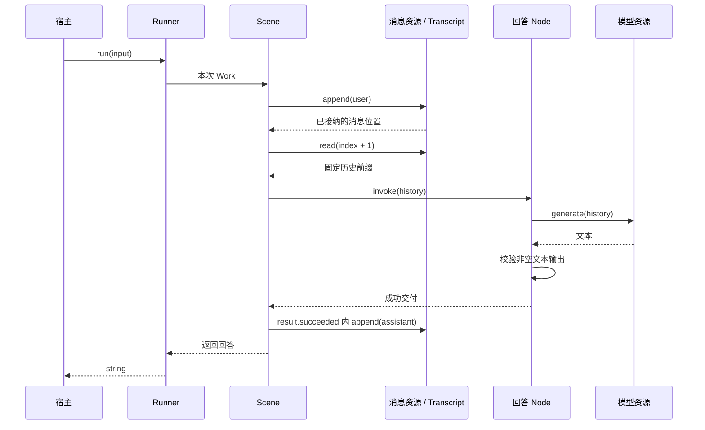

# 对话服务装配对照

`@capix/conversation-service` 是与 Observer 并排的服务装配实验。从公开内核对象建立最小完整对话，验证第一作者需要承担哪些工作。现有 Observer、HTTP 和客户端继续使用原实现。

## 阅读入口

| 文件             | 职责                                                           |
| ---------------- | -------------------------------------------------------------- |
| `src/scene.ts`   | 建立 Scene 和回答 Node，表达输入落实、历史读取、回答接纳与写入 |
| `src/history.ts` | 声明本服务的历史读取资源：从头到本次已接纳输入的完整前缀       |
| `src/model.ts`   | 定义宿主提供的 TextModel 接口，并通过 Offer 暴露受控调用       |
| `src/runner.ts`  | 登记实体和 Offer，构建原生 Runner；不建立新的服务运行对象      |
| `src/index.ts`   | 上述公开出口                                                   |

没有独立的 Environment、Source、Task、Manager 或业务继承树。需要状态的是 Transcript；Scene/Node 描述业务，Resources 固定供给，Runner 管理入口运行。模型实现与观测消费者由宿主提供。

## 最小使用

```js
import { createConversationRunner } from '@capix/conversation-service';
import { Transcript } from '@capix/transcript';

const transcript = new Transcript();
const model = {
  generate(messages) {
    return `收到：${messages.at(-1).content}`;
  },
};
const runner = createConversationRunner(transcript, model);
const answer = await runner.run('你好');
```

这是 JavaScript 也可直接使用的示例。TypeScript 中可用 `satisfies TextModel` 为模型对象取得参数类型。

`createConversationRunner` 只是下面这段公开装配的便捷函数，返回真实 Runner：

```ts
const scene = createConversationScene();
const messages = new Resource(transcript);
const resources = new Resources().register(messages, TranscriptResource.append).register(messages, HistoryResource).register(new Resource(model), ModelResource);

const runner = new Runner(scene, resources).build();
await runner.run('你好');
```

完整可运行示例见 [examples/conversation.mjs](../../examples/conversation.mjs)，构建后执行 `node examples/conversation.mjs`，不需要模型配置或凭证。普通运行观察直接使用 `runner.observation.subscribe`，消费固定元数据；场景输出可使用 `runner.output.subscribe`，最终回答仍由 run 返回。两种反馈以 entryId 关联，不需要额外的服务包装对象。确需原生同步观察能力时，便捷函数仍可通过第三个参数的 `observations` 安装；进一步组合直接使用公开 Scene、Offer 和 Runner。

## 业务链路



Scene 只申请消息写入与历史读取；回答 Node 只申请模型。两者通过普通子调用传递不可变消息值，不共享活的 Context 或隐式环境。

历史范围来自输入追加的回执，不在异步等待后重新读取当前长度。消息读取与追加登记到同一个 Transcript。历史资源的“完整前缀”是本服务的策略，并未改变消息实体或内核。

## 行为边界

- 输入与模型最终回答必须是非空白字符串，保留原文，不自动 trim。
- 模型失败或输出不合法时，本次调用失败，已追加的用户消息保留；没有伪造的助手消息。下一次提交可以正常运行。
- 助手消息只在子结果接收时写入。实体持久端口失败不能被报告为成功回答；已经成立的实体事实不承诺回滚。
- 同一个 Runner 拒绝同时运行，拒绝发生在输入写入前。宿主为每个对话保留一个 Runner；多个 Runner 共享同一个 Transcript 不会自动获得跨入口串行保证。
- 模型收到本次资源操作的 signal。取消会限制本次结果接收；模型能否停止外部请求取决于实现。不响应 signal 的模型仍会占用 Runner，直到它返回或拒绝；迟到回答不会写入。这里没有持久交互引用、反馈重读或外部副作用撤销承诺。
- Transcript、模型及观察者由宿主持有。本包借用它们，不自行关闭、重建或替换实体。

## 与 Observer 对照

| 关注点     | 现有 Observer                             | 本包第一版                                        |
| ---------- | ----------------------------------------- | ------------------------------------------------- |
| 输入       | HTTP / submission 接纳及内容同步          | `runner.run(string)`，Scene 写入用户消息          |
| 材料       | 活跃视图、记忆、维护及准备                | 截至当前输入的完整消息前缀                        |
| 模型       | 固定配置、Provider 适配、独立 Interaction | 宿主注入 TextModel，普通资源调用                  |
| 推进       | 决策、澄清、回答、文件与记忆能力          | 一个回答 Node                                     |
| 观测       | 记录安装、来源投影与客户端交付            | Runner 只读元数据订阅；也保留可选原生观察安装     |
| 持久与恢复 | SQLite 内容、记录、交互和显式 CP          | 可借用宿主配置的 Transcript 持久端口；没有声明 CP |
| 对外服务   | 会话管理、HTTP、同步与 UI                 | 进程内包，无 HTTP 或客户端适配                    |

这不是旧服务的等效替代。完整历史可能达到模型容量边界；本版没有实现容量维护、选择或压缩策略，也不在装配函数里暗中截断。真实模型协议、超时和容量约束由宿主适配，后续作为明确能力逐项讨论。

## 本轮的内核验证结论

当前链路可以只用公开资源、结构与 Runner 完成；不需要补写 Invocation/Context、callableHooks 或按次 capture。命名成员和资源方法保持准确类型。TypeScript 作者仍需明确结构 I/O，并用 `ResourcesOf<typeof deps>` 表达资源端点；不能从业务函数体反推未知输入，也不以断言假装已经推导。

后续接入视图、交互、记录或恢复时，每次先增加一项真实业务要求。若必须导入内核私有实现、维护第二份运行状态或绕过资源窗口，应停在该处讨论内核接缝，不在本包加一个隐蔽的协调层。
