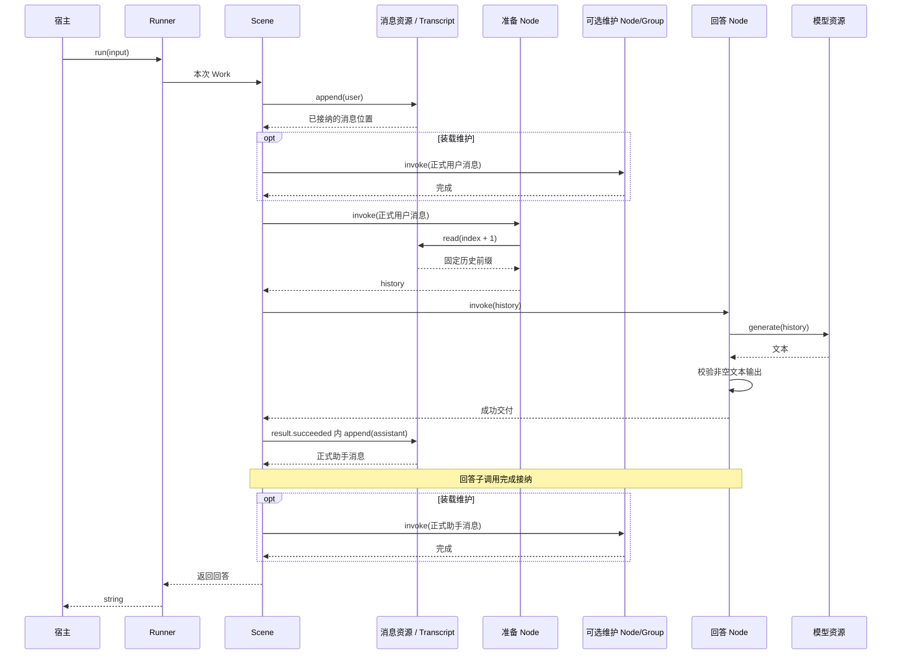

# 对话服务装配对照

`@capix/conversation-service` 是与 Observer 并排的服务装配实验。从公开内核对象建立对话，验证第一作者需要承担哪些工作。当前支持直接模型流式输出，以及可选的独立模型交互、有界过程反馈与最终反馈重读；两条路径共用输入落实、材料准备和回答接纳。准备节点可读取完整历史或 View 材料，宿主还可选装普通维护节点，在正式消息追加后维护视图。现有 Observer、HTTP 和客户端继续使用原实现。

## 阅读入口

| 文件                           | 职责                                                                            |
| ------------------------------ | ------------------------------------------------------------------------------- |
| `src/scene.ts`                 | 组合准备、回答与可选维护 Node/Group，处理正式消息追加、维护调用、增量转交与接纳 |
| `src/answer.ts`                | 用直接模型资源回答，校验最终文本并转交字符串增量                                |
| `src/history.ts`               | 从头读取到本次已接纳输入的完整历史前缀                                          |
| `src/model.ts`                 | TextModel 与普通受控资源；把本次 signal/emit 交给宿主模型实现                   |
| `src/completion.ts`            | 独立 Provider 的完成请求资源，保留完成原因，由具体业务决定接纳                  |
| `src/summary/input.ts`         | 区分当前请求与此前历史，形成总结与最近正式回答改写的固定输入                    |
| `src/summary/decision.ts`      | 识别总结、改写、澄清或不支持，并接纳严格的决定形状                              |
| `src/summary/answer.ts`        | 回答 Group：根据真实材料检查执行条件，调用总结或改写 Node                       |
| `src/materials/view.ts`        | 分别提供 View 读取与管理资源，核对来源接线与记忆所属原文                        |
| `src/materials/input.ts`       | 普通准备 Node：分开本次 query 与固定材料，保留真实来源、版本和成员键            |
| `src/materials/answer.ts`      | 普通回答 Node：将固定材料组织成模型请求并接纳完整文本                           |
| `src/materials/maintenance.ts` | 可选普通维护 Node：按正式追加回执，将本条用户或助手消息纳入 View                |
| `src/memory/context.ts`        | 只读资源：核对正式助手位置，固定完整消息前缀与当前记忆全集                      |
| `src/memory/proposal.ts`       | 模型提案 Node：严格接纳变更结构、真实来源、更新目标及既有凭据                   |
| `src/memory/maintenance.ts`    | 可选维护 Group：核对集合版本、写入正式记忆，将实际新建 ID 纳入 View             |
| `src/model/interaction.ts`     | 固定请求/反馈契约，以及分别授权的 start/feedback 资源                           |
| `src/model/feedback.ts`        | 在一次资源操作内跟随过程反馈、共享等待期限，并在窗口关闭时清理消费              |
| `src/model/request.ts`         | 组合一次发送与本地读取；提供可独立使用的读取节点和携带引用的 ModelReplyPending  |
| `src/runner.ts`                | 直接模型路径的便捷装配，返回原生 Runner                                         |
| `src/text.ts`                  | 本服务的字符串与非空回答检查                                                    |
| `src/index.ts`                 | 上述公开出口                                                                    |

没有独立的 Environment、Source、Task、Manager 或业务继承树。Transcript、可选 Memories/View 与 Interactions 由宿主持有；Scene/Group/Node 描述业务，Resources 固定供给，Runner 管理入口运行。模型实现、持久端口与观测消费者由宿主提供。

## 最小使用

```js
import { createConversationRunner } from '@capix/conversation-service';
import { Transcript } from '@capix/transcript';

const transcript = new Transcript();
const model = {
  generate(messages) {
    return `收到：${messages.at(-1).content}`;
  },
};
const runner = createConversationRunner(transcript, model);
const answer = await runner.run('你好');
```

这是 JavaScript 也可直接使用的示例。TypeScript 中可用 `satisfies TextModel` 为模型对象取得参数类型。

`createConversationRunner` 只是下面这段公开装配的便捷函数，返回真实 Runner：

```ts
const scene = createConversationScene();
const messages = new Resource(transcript);
const resources = new Resources().register(messages, TranscriptResource.append).register(messages, HistoryResource).register(new Resource(model), ModelResource);

const runner = new Runner(scene, resources).build();
await runner.run('你好');
```

完整可运行示例见 [examples/conversation.mjs](../../examples/conversation.mjs)，构建后执行 `node examples/conversation.mjs`，不需要模型配置或凭证。普通运行观察直接使用 `runner.observation.subscribe`，消费固定元数据；场景输出使用 `runner.output.subscribe`，最终回答仍由 run 返回。两种反馈以 entryId 关联，不需要额外的服务包装对象。确需原生同步观察能力时，便捷函数仍可通过第三个参数的 `observations` 安装；进一步组合直接使用公开 Scene、Offer 和 Runner。

## 直接模型与流式输出

```js
const runner = createConversationRunner(new Transcript(), {
  async generate(messages, { signal, emit }) {
    emit?.('正在整理答案');
    // 真实模型适配器在这里使用 signal，并逐段调用 emit。
    // 最终文本是独立的返回值，可以修正已经展示的预览。
    return `最终回答：${messages.at(-1).content}`;
  },
});
const unsubscribe = runner.output.subscribe({
  receive(event) {
    if (event.kind === 'delta') console.log('预览', event.delta);
    if (event.kind === 'completed') console.log('最终文本', event.result);
  },
});
try {
  console.log(await runner.run('你好'));
} finally {
  unsubscribe();
}
```

增量经过 `ModelResource → createAnswerNode → Scene.output → Runner.output`。每层只转交自己的输出，不把资源操作或 Work 留给调用之外的对象使用。没有订阅者时，增量的字符串检查仍然执行；订阅者失败不改变业务结果。

预览不是正式消息，也不要求拼接后等于最终文本。最终非空回答通过子结果接收并写入 Transcript；如果装载了维护节点，还要完成助手消息后的维护，Scene 才能返回。维护仍交付失败时，已经正式写入并接纳的回答保留，Scene 仍失败；默认记忆维护对可处理提取异常的跳过策略见下文。预览本身不能证明回答已正式写入。`runner.run()` 的完成结果与 `runner.observation` 的 entry settled 事实表达入口的真实终态，不能仅凭输出 completed 推断所有退出处理已经成功。

直接模型收到本次操作的 signal。模型是否停止外部请求取决于实现；不响应 signal 的模型仍占用 Runner，直到原操作退出。取消或操作结束后，保留的 emit 不能继续发布。示例见 [conversation-streaming.mjs](../../examples/conversation-streaming.mjs)。

## 独立模型交互

当外部处理需要独立于本次调用存活时，可以用同一会话 Scene，替换其中实际装载的回答结构：

```js
import { Interactions } from '@capix/interaction';
import { Resource } from '@capix/resources';
import { Resources, Runner } from '@capix/server-runtime';
import { Transcript, TranscriptResource } from '@capix/transcript';
import { createConversationScene, createInteractionAnswer, HistoryResource, ModelInteractionResource, TextModelInteraction } from '@capix/conversation-service';

const transcript = new Transcript();
const interactions = new Interactions().register(TextModelInteraction, {
  send(history, { publish }) {
    publish('正在整理回答'); // 入口属于交互，可以跨越一次调用的寿命。
    return `回答：${history.at(-1).content}`;
  },
  // persistence 由宿主按需要提供，示例默认只在本进程保留反馈。
});
const messages = new Resource(transcript);
const resources = new Resources().register(messages, TranscriptResource.append).register(messages, HistoryResource).registerInteraction(ModelInteractionResource.start, TextModelInteraction).registerInteraction(ModelInteractionResource.feedback, TextModelInteraction);
const scene = createConversationScene(createInteractionAnswer({ waitMs: 30_000 }));
const runner = new Runner(scene, resources, interactions).build();
await runner.run('你好');
await interactions.settled();
interactions.close();
```

`createConversationScene(answer?, prepare?, maintain?)` 接受尚未被其他父结构占用的实际 Node/Group；每个成员保留自己的 deps。默认 prepare Node 读取完整历史前缀，maintain 默认不装载；需要保留默认准备时可用 `createConversationScene(answer, undefined, maintain)`。Scene 不增加模型模式判断，也不复制消息接纳逻辑。`createConversationRunner` 仍是直接模型的便捷函数；独立交互按上例显式装配。

build 只核对登记和固定接线，不发送请求。`createInteractionAnswer` 用一个发送节点取得引用，再用 `createModelReplyNode` 等待同一交互。start 与 feedback 分别授权，只有反馈读取权限的节点无法发送替代请求。

本地等待到期会抛出 `ModelReplyPending`，其 `reference` 可以交给一个新的读取场景：

```js
import { Scene } from '@capix/structure';
import { createModelReplyNode } from '@capix/conversation-service';

const reader = new Runner(new Scene(createModelReplyNode(30_000)), new Resources().registerInteraction(ModelInteractionResource.feedback, TextModelInteraction), interactions).build();
const text = await reader.run(pending.reference); // pending 来自捕获的 ModelReplyPending。
```

读取不重发，也不自动追加助手消息。反馈为 unavailable 时，读取节点保留原故障，不把它改造成 pending 或猜测应该重新发送。宿主必须明确决定取得文本之后是否以及如何接纳为会话结果。完整示例见 [conversation-interaction.mjs](../../examples/conversation-interaction.mjs)。

交互路径的 signal 只作用于本地过程读取与最终反馈等待。取消可以释放本次 Runner，已开始的外部处理继续，晚到反馈仍由 Interactions 接收；宿主等待 `settled()` 后才能 `close()`。没有持久端口时，只有本进程的有界缓存；跨进程读取需要宿主配置持久端口、确认反馈保存成功并保留引用。旧宿主尚未完成的发送不会在新宿主中自动恢复或重发。

引用交付、外部发送、会话消息写入与 CP 保存没有统一原子提交。本服务没有声明 CP；不能承诺任意失败后都能从本次调用取得引用，也不能把反馈可重读解释为会话执行已经恢复。

故障注入示例 [interaction-message-retry.mjs](../../examples/interaction-message-retry.mjs) 展开了“反馈已保存，消息提交前失败，新调用重读并落实”的链路：宿主从发送场景的正式返回值保留引用，消费场景只申请反馈读取与消息追加。外部发送一次，后续消费不会重发。它也保留重复消费的反例：普通 append 不跨调用去重，applyFixed 的真实父子接纳身份也不能替代跨调用的业务依据。现有 createInteractionAnswer 不在消息写入失败时自动交付引用；完整结论与未知提交边界见 [消费边界验证](../../docs/interaction-consumption-validation.md)。

## 总结历史与后续改写

`createHistoryAnswer()` 是一个普通回答 Group，可以直接交给 `createConversationScene`。这个小闭环将“识别意图”继续推进到真实执行：总结已有对话，正式接纳总结，再在后续独立提交中改写它。

```js
import { CompletionResource, createConversationScene, createHistoryAnswer, HistoryResource } from '@capix/conversation-service';
import { Resource } from '@capix/resources';
import { Resources, Runner } from '@capix/server-runtime';
import { Transcript, TranscriptResource } from '@capix/transcript';

const transcript = new Transcript([{ role: 'user', content: '我们已决定周四复核，周五发布。' }]);
const messages = new Resource(transcript);
// model 是宿主提供的 ModelProvider，例如独立包的 ChatCompletionsProvider。
const resources = new Resources().register(messages, TranscriptResource.append).register(messages, HistoryResource).register(new Resource(model), CompletionResource);
const scene = createConversationScene(createHistoryAnswer());
const runner = new Runner(scene, resources).build();
await runner.run('总结刚才的安排。');
await runner.run('再短一些，只保留一句话。');
```

材料与处理的分工是明确的：

1. Scene 先追加本次用户消息，按其位置取得固定历史前缀。
2. 回答 Group 把最后一条用户消息作为 `query`，此前消息作为 `history`；当前请求不会因为已经写入实体就被当成此前历史。
3. 决策 Node 看这份固定材料，返回 `summarize_history / revise_answer / clarify / unsupported`。模型只选择动作，不签发历史引用或拼装执行材料。
4. Group 核对所选动作确有材料。总结 Node 收到 `{query, history}`；改写 Node 收到 `{query, answer: {index, content}}`，指向本次固定前缀中最近的正式助手消息。执行不重新读取可变 Transcript。
5. 执行结果必须正常完成且非空；Scene 使用原有的子结果接收，成功写入助手消息之后才能完成本次入口。下次提交再次读取实体，因而能引用刚才的正式结果。

没有历史却选中总结、没有助手回复却选中改写，都会返回具体澄清；澄清是正常的助手回复。模型决定形状错误、模型请求失败、非正常完成或取消仍按真实故障交付，不自动伪装成澄清，不重试。消息写入失败不能声称回答已接纳；已经成立的用户消息和其他实体事实不自动回滚。

本场景只处理总结和改写，不引入待办实体或跨提交控制状态。`revise_answer` 指最近正式助手消息，包括可能的澄清正文，并不保证它一定是某类总结；是否适合改写仍由本次业务选择。这组总结/改写节点仍读取完整前缀；下面的 View 材料路径是另一种准备与回答组合。这组总结/改写节点没有记忆写入、Skill 执行、服务 CP 或 HTTP 适配，也不会替换旧 Observer 的编排。它们仍使用非流式 Completion 请求；下文 View 材料回答已接入流式及可选记忆维护。系统提示是模型传输材料，不作为正式 Transcript 消息写入。

执行条件检查只确定“是否存在此前消息 / 正式助手回复”，不证明材料在语义上足以回答；相关性仍由业务选择与模型处理负责。当前输入始终是请求，不会因先前澄清而自动变成总结正文。补充内容先进入对话，后续再请求总结；本版没有完成“补料即自动续接”的流程，也没有以隐藏任务状态模拟它。

完整入口：[examples/conversation-history.mjs](../../examples/conversation-history.mjs)。默认固定模型响应验证真实资源、节点、消息与后续读取，不声称模型质量；显式 `--live` 才使用宿主提供的 DeepSeek 配置，完整示例最多 5 次请求：

```sh
pnpm build
node examples/conversation-history.mjs
# 需要实际模型时，由宿主加载凭据；示例本身不读取 .env。
node --env-file-if-exists=.env examples/conversation-history.mjs --live
```

新增验证见 `test/conversation-history.test.mjs` 与 `test/types/conversation-history.*`，共 20 项，覆盖固定材料交接、来源不足、后续正式回答引用、模型/取消/持久失败与下一次提交。2026-11-02 的 `pnpm check` 全部通过（2196 项测试）；示例已离线运行，本轮未调用真实模型。

## 消息与记忆作为本次材料

回答结构可以有自己的输入类型。`createConversationScene(answer, prepare, maintain?)` 显式装载普通准备节点，由类型检查准备结果与回答输入是否一致。可选维护节点接收正式追加消息，返回 void。原有单参数用法仍读取完整历史前缀；不传 maintain 时没有额外维护调用，两种准备方式共用正式消息接纳。

```ts
const scene = createConversationScene(createMaterialAnswer(), createMaterialPreparation(), createMessageInclusion());
const materials = new Resource({ view, transcript, memories });
const resources = new Resources().register(new Resource(transcript), TranscriptResource.append).register(materials, ConversationViewResource.read).register(materials, ConversationViewResource.manage).register(new Resource(model), CompletionResource);
const runner = new Runner(scene, resources).build();
await runner.run('根据已有安排简短说明。');
```

宿主分别建立 Transcript、Memories 和 View。这个服务的 View 固定两个来源槽位：`messages` 与 `memories`，都使用实体包的 whole 范围适配器；成员可以稀疏、混合和显式排序。两个 Offer 分别登记：`read` 供准备节点读取，`manage` 供维护节点改变成员。资源适配核对 `memories.transcript`、View 来源身份与范围；来源版本继续由 View 核验。准备节点不因装载维护策略而取得写入权限，Scene 自身也不申请 View。

需要保存成员变更时，宿主可以给 manage 单独登记 `new Resource({ view, transcript, memories, persistence })`，其中 persistence 为 `ViewPersistence`。有变化的 View 提交先经过这个同步持久端口，成功后才安装成员状态；端口须比较 `commit.previous.revision`。这不把正式消息追加与 View 提交合成一次事务。

一次调用的过程如下：

```text
Scene 追加正式用户消息
  → { transcriptId, index, message }
maintain（若装载）处理这条用户消息
prepare 捕获 View 并核对本次输入的 Transcript
  → { query: { transcriptId, index, content }, materials: { basis, entries } }
answer 使用固定材料构造模型请求
  → 完整回答
Scene 接纳并追加正式助手消息
  → { transcriptId, index, message }
maintain（若装载）处理这条助手消息
Scene 返回回答
```

正式 append 端点返回真实 `transcriptId`，准备与维护节点不从 View 猜测输入来源。`AcceptedConversationMessage = { transcriptId, index, message }` 是 Scene 交给子节点的业务值，同时表示用户或助手的正式消息，不是认证凭据；单独运行准备或维护节点时，调用者仍负责提供正式追加所得的定位。助手维护发生在正式 append 与回答子调用接纳完成之后；回答增量仍由原来的 answer → Scene → Runner 链路转交。

`materials` 是 **View 捕获后的业务投影**：消息只保留真实 `key < query.index` 的条目，当前请求与更晚消息不作为此前材料。记忆保留独立类型、ID 与原文来源索引；两类条目共享捕获时的来源版本依据。投影保留原键和原顺序，不能把数组位置当作正式消息索引，也不能用它声称包含该修订下的全部 View 成员。当前请求独立传递，即使没有进入 View 也能正常回答，空 View 是合法输入。

捕获先核对来源版本，冲突直接失败，不自动重试成另一份材料，也不承诺跨实体事务。成功捕获的内容已固定；后来更新记忆或调整 View 不改变本次回答输入，只影响下一次捕获。材料准备失败时，已经追加的用户消息保留，回答节点不执行；回答保存失败时，生成文本不能算正式回答。

View 本身不决定何时纳入消息。`createMessageInclusion()` 是宿主选装的普通业务 Node，只申请 manage，核对消息属于该 Transcript 后调用 `include` 纳入本条消息；它不扫描此前历史或补纳缺口，不改变已有成员的顺序。每次 Scene 内的用户维护和助手维护是同一结构的两次普通调用，没有新增生命周期或内核 hook。自定义维护也可使用 `Node/Group<AcceptedConversationMessage, void, ...>`，由自己的 deps 声明所需能力。

不装载记忆维护时，这条材料路径只读取宿主已有的记忆；退出 View 不删除实体。完整示例 [conversation-materials.mjs](../../examples/conversation-materials.mjs) 只选装消息纳入策略：第一次读取稀疏消息与预置偏好，第二次自然读取前次已纳入的用户消息和正式回答，同时展示第一份捕获不随后续维护而变化：

```sh
pnpm build
node examples/conversation-materials.mjs
```

示例使用离线模型替身，展示装配、来源与固定材料，不评价模型理解质量。准备、回答与维护节点均可独立替换；当前材料回答使用 CompletionResource，显式请求流式正文并通过 Node/Scene 转交 Runner。历史总结/改写原有节点继续消费完整前缀，不能把稀疏材料强转为前缀后复用其位置推导。本轮没有自动选择、容量维护、Skill、服务 CP 或 HTTP 适配。

正式消息与 View 的失败边界分别保留：

| 失败位置           | 已成立的事实                               | 后续行为                                             |
| ------------------ | ------------------------------------------ | ---------------------------------------------------- |
| 用户消息追加       | 以 Transcript 的实际保存结果为准           | 不调用维护、准备或模型；保存失败不能声称正式追加成功 |
| 用户消息后的维护   | 正式用户消息保留；已完成的 View 操作不回滚 | Scene 失败，不进入准备或模型                         |
| 材料准备或模型回答 | 正式用户消息及此前维护结果保留             | Scene 失败，不伪造正式助手消息                       |
| 助手消息追加       | 用户消息及此前维护结果保留                 | 回答子调用不完成成功接纳，不调用助手维护             |
| 助手维护交付失败   | 正式助手消息和回答子接纳均已成立           | Scene 失败，不能报告整个入口成功                     |

维护中的持久提交失败，不安装该次 View 成员变更。下一次提交仍只读取 View 的实际成员；此前没有纳入的消息不会自动补上。没有跨消息与 View 的事务，也没有自动回滚、修复或重试。

## 业务链路



上图展示直接模型与默认历史准备路径。Scene 只申请消息写入；准备节点申请历史读取，默认回答 Node 只申请模型，可选维护节点声明自己的资源。独立交互回答 Group 则由发送和读取节点分别申请所需资源。它们通过普通子调用传递不可变消息值，不共享活的 Context 或隐式环境。

历史范围来自输入追加的回执，不在异步等待后重新读取当前长度。消息读取与追加登记到同一个 Transcript。历史资源的“完整前缀”是本服务的策略，并未改变消息实体或内核。

## 行为边界

- 输入与模型最终回答必须是非空白字符串，保留原文，不自动 trim。
- 模型失败或输出不合法时，本次调用失败，已追加的用户消息保留；没有伪造的助手消息。下一次提交可以正常运行。
- 助手消息只在子结果接收时写入。实体持久端口失败不能被报告为成功回答；已经成立的实体事实不承诺回滚。
- 同一个 Runner 拒绝同时运行，拒绝发生在输入写入前。宿主为每个对话保留一个 Runner；多个 Runner 共享同一个 Transcript 不会自动获得跨入口串行保证。
- 直接模型的取消与独立交互的取消具有上述不同边界；两者都不承诺撤销已经发生的外部副作用。
- Transcript、模型、Interactions、持久端口及观察者由宿主持有。本包借用它们，不自行关闭、重建或替换实体。

## 与 Observer 对照

| 关注点     | 现有 Observer                             | 本包当前实现                                                       |
| ---------- | ----------------------------------------- | ------------------------------------------------------------------ |
| 输入       | HTTP / submission 接纳及内容同步          | `runner.run(string)`，Scene 写入用户消息                           |
| 材料       | 活跃视图、记忆、维护及准备                | 完整消息前缀，或 View 固定材料与可选的正式消息纳入策略             |
| 模型       | 固定配置、Provider 适配、独立 Interaction | 直接 TextModel 流式资源，或带有界过程反馈的独立 Request/Reply 交互 |
| 推进       | 决策、澄清、回答、文件与记忆能力          | 一个可替换的回答 Node/Group；两条路径共用消息接纳                  |
| 观测       | 记录安装、来源投影与客户端交付            | Runner 只读元数据订阅及根输出；也保留可选原生观察安装              |
| 持久与恢复 | SQLite 内容、记录、交互和显式 CP          | 宿主提供内容、View 与 Interaction 持久端口；反馈重读，无服务 CP    |
| 对外服务   | 会话管理、HTTP、同步与 UI                 | 进程内包，无 HTTP 或客户端适配                                     |

这不是旧服务的等效替代。完整历史可能达到模型容量边界；本版没有实现容量维护、选择或压缩策略，也不在装配函数里暗中截断。真实模型协议、超时和容量约束由宿主适配，后续作为明确能力逐项讨论。

## 当前完成与后续范围

直接流式、独立发送、本地取消/超时与反馈重读都通过公开资源、结构与 Runner 组合，不需要补写 Invocation/Context、callableHooks 或按次 capture。相关验证入口为 `test/conversation-service.test.mjs`、`test/conversation-streaming.test.mjs`、`test/conversation-interaction.test.mjs` 与 `test/types/conversation-service.ts`。命名成员和资源方法保持准确类型。TypeScript 作者仍需明确结构 I/O，并用 `ResourcesOf<typeof deps>` 表达资源端点；不能从业务函数体反推未知输入，也不以断言假装已经推导。

2026-10-28 执行 `pnpm check`，构建、类型检查、2096 项测试及格式检查全部通过。组合测试另覆盖自定义 Node/Group 的输入、接纳和单父归属；交互类型测试验证引用、消息、结果与增量不可混用。取消回归区分准确 signal.reason 与同期独立故障。两个新增示例均在本地运行通过，不访问真实模型。

**独立交互的过程反馈通过公共端口接入。** `TextModelInteraction.progress` 校验字符串片段，宿主发送者通过本次交互的 `publish` 发布；`ModelInteractionResource.feedback.follow` 创建本次读取器，按序回放并跟随，再读取独立的最终反馈。默认读取节点把 `{cursor,value}` 解为字符串，通过 Group 与 Scene 显式转交给 `runner.output`。普通作者仍使用 `createInteractionAnswer()`，无需建立交互 ID 到流的另一张映射表。

过程反馈采用完整、有界、进程内保留；超限或丢失时预览不可用，最终反馈仍独立读取。已封闭的过程序列不代表最终结果校验、保存成功；取得的最终文本可以不同于预览。`follow` 的所有片段等待与最终反馈等待共用一个期限，收到片段不会延长期限。`operation.onClose` 只终止本地消费；窗口关闭和调用取消保持不同的错误归属，二者都不停止独立发送。

资源 `feedback.wait` 只等最终反馈；`feedback.follow` 的增量是 `{cursor,value}`，高级消费者可通过输入的 `after` 从明确位置之后继续读取。游标仅表示交付位置，不证明解码、展示或业务接纳成功。没有对应解码状态时应从头重建消费，不能把完整回放追加到旧展示。默认 `createModelReplyNode()` 每次从头读取；`new Scene(child)` 不自动转发子增量，若要展示重新读取的预览，需要在 Scene 显式声明输出并转交子增量，示例中已经展开。

过程反馈不进入持久 InteractionState 或 CP。重建宿主时可读取已保存的最终反馈，不能据此重建历史增量或再次发送。新增验证见 `test/conversation-interaction-progress.test.mjs`，覆盖跨调用续读、窗口关闭清理、预览失效、固定期限、游标与消费失败以及正式消息写入边界。

View 材料读取、正式消息纳入和可选记忆维护均由普通业务结构组合。材料筛选与容量策略、记录预设、服务 CP 和跨端交付仍不在本轮实现中。后续每次增加一项真实业务要求；若公开内核无法清晰表达，应停在该处讨论接缝。

## 材料回答的流式输出

`createMaterialAnswer()` 使用固定 query/materials 构造一次 `stream: true` 请求。`CompletionResource.complete` 把 Provider 的同步 emit 接到本次资源操作，节点通过 delta 接收并转交 Scene，宿主继续使用 `runner.output.subscribe`。记忆提案没有开启 stream，也不取得 emit，提取内容不会混进回答预览。

```text
Provider 正文片段 → ResourceOperation.emit → 回答 Node → Scene → Runner.output
Provider 完整回复 → finishReason/非空校验 → 正式助手消息 → 可选维护 → 根完成
```

模型流在最终回复前断开、超限、取消或得到非正常结束时，已显示的片段仍只是预览，不追加助手消息，也不启动该回答的记忆提取。正式追加失败同样不进入维护。提取的可处理异常继续按下节跳过；必要持久错误保留原边界。Scene 仍等待维护结束，不把输出预览当成根调用完成。

ChatCompletionsProvider 的最终 text 由其接纳的 content 片段累积；服务也支持宿主自定义 ModelProvider，预览与最终 text 可以不同，正式保存及后处理只采用已校验的最终值。无 delta 的宿主实现仍可交付完整回复，服务不会从最终文本伪造历史片段。流式请求、字节上限和取消规则见 [Provider 包](../../server/model-provider/README.md)。

本次不改变旧 Observer、独立交互的过程缓存或 HTTP/客户端。示例 `conversation-memory.mjs` 通过现有 Runner 出口展示预览与记忆维护，默认离线。验证入口为 `test/model-provider-streaming.test.mjs` 和 `test/conversation-material-streaming.test.mjs`。

## 从正式回答形成后续记忆

`createMemoryMaintenance()` 是可选的普通 Group。它只在正式助手消息之后请求一次模型提案；用户消息阶段直接返回。消息纳入和记忆维护由宿主通过普通成员调用决定组合顺序：

```ts
const maintain = new Group<AcceptedConversationMessage, void>().add({
  include: createMessageInclusion(),
  remember: createMemoryMaintenance(),
});
maintain.run = async (work) => {
  await work.children.include.invoke(work.input);
  await work.children.remember.invoke(work.input);
};
const scene = createConversationScene(createMaterialAnswer(), createMaterialPreparation(), maintain);

// 延续前面的消息、View 和模型登记，额外明确授予记忆读取与写入。
const memory = new Resource(memories);
resources.register(memory, ConversationMemoryResource).register(memory, MemoryResource.apply);
const runner = new Runner(scene, resources).build();
```

提取输入在调用时经 `ConversationMemoryResource.capture` 固定。这个服务预设选择截至本条助手消息的完整正式前缀及当前记忆全集，包含未进入 View 的记忆，避免更新只能看到活跃条目。它核对助手正文和位置，并返回 `{basis, acceptedIndex, messages, memories}`；basis 包含真实原文身份、记忆集合身份和 sequence。已有记忆若引用前缀之外的消息，拒绝使用。此策略不是 View 的默认行为，也没有隐式筛选、截断、相似度去重或容量管理。

模型只返回最多 32 项 `changes`，空数组合法。服务检查完整结束、严格字段、非空内容、非空且唯一的真实原文来源、准确更新目标、同批目标不重复及结果包含本次变更依据。来源必须在本次捕获的完整前缀内。更新可根据当前记忆内容保留或移除旧 `sourceIndexes`，不要求结果包含全部旧索引；哪些旧来源仍有意义由本服务的提取策略决定，内核与记忆实体原本就不强制旧来源累加。校验保证结构和定位合法，不能证明语义提取正确，或阻止模型将相同内容误判为新事项。

`sourceResults` 仍由本服务原样继承目标正式记忆的全部既有凭据；模型既不能生成凭据，也不能选择保留或删除哪些凭据。这是当前业务预设，不是所有记忆或内核的永久累加规则。本轮不增加凭据选择 API。

```text
正式助手消息已保存且子结果已接纳
  → 固定完整前缀与当前记忆全集
  → 提案 Node 请求模型、校验来源与目标
    → 成功：MemoryResource.apply(changes, 原 basis)
      → 只将实际新建的记忆 ID 纳入 View
    → 可处理异常：result.failed 接收为 skipped，结束维护
Scene 等待维护结束 → 返回已保存的回答
下一次准备 → 捕获更新后的活跃材料
```

写入资源同步核对原集合身份、原文身份和 sequence，模型等待期间若记忆已被其他写入修改，则拒绝本提案，空批次也不能绕过检查。返回的 `MemoryApplication` 仅包含实际变化项的冻结快照；等值更新不占新 sequence。它不是跨调用幂等凭据，不改变原 `applyFixed`。

新记忆 ID 来自实体实际落实的返回值。已有记忆更新保持原成员资格：活跃项下次读取新正文，已退出项仍退出；需要重新纳入时由另一条明确策略调用 View.include。消息退出 View、记忆退出 View 和修改记忆来源互不自动级联：退出消息不删除记忆来源，修改来源不改变消息或记忆的成员资格。维护不会遍历重建 View 的全部成员，但本预设的提取输入仍遍历完整消息前缀与记忆全集。

默认维护在 propose 子调用的 `result.failed` 中接收可处理的模型／候选异常，以内部 `skipped` 结果直接结束本次维护，跳过 Memory.apply 和 View.include。提案子调用仍保留原始 returned failed，维护父层记录 reception handled，不把提取失败改记成成功或空 changes；成功提案的空 changes 仍调用 apply 核对原 MemoryBasis。公开维护签名仍返回 void，不增加策略参数或公开结果类型。Scene 等待维护结束后交付已保存且接纳的回答，没有后台维护或自动重试。

接收只包住 propose 子调用，没有整个维护的 catch。材料捕获、实体身份核验、MemoryBasis 冲突、记忆写入及 View 操作的失败仍使维护和 Scene 失败，不发布成功根 completed。Memories 与 View 的实际持久端口失败、必要变化发布／严格观测错误、运行窗口错误及取消等受保护交付，即使发生在 propose 内，也不进入业务 failed 分支。普通操作异常是否可接收与本服务是否选择接收分别判断，详见 [错误与异常边界](../../docs/exceptions.md)。

记忆写入与 View 纳入分别提交。记忆提交失败不进入纳入；必要变化发布失败可能发生在记忆已安装之后；View 提交失败保留已写入记忆。各处失败都保留此前正式助手消息，不重跑模型、不补写或补纳入。后续新提交仍能读取真实记忆全集，由新的提案决定处理；不从缺少 View 成员推断记忆尚未写入。

离线完整示例：[conversation-memory.mjs](../../examples/conversation-memory.mjs)，运行 `node examples/conversation-memory.mjs`。它从空记忆集合开始，验证真实 ID、新建纳入、后续读取、同 ID 更新及退出后不回流。固定模型响应只验证链路与契约，不评价真实模型提取率；只有显式装载这个维护 Group 才启用提取。测试见 `test/conversation-memory.test.mjs`、`test/types/conversation-memory.*` 与 `test/memory/apply-resource.test.mjs`。
